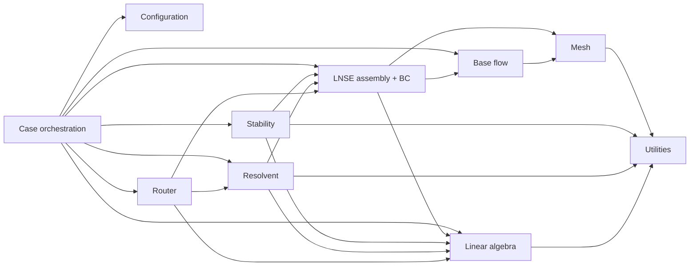
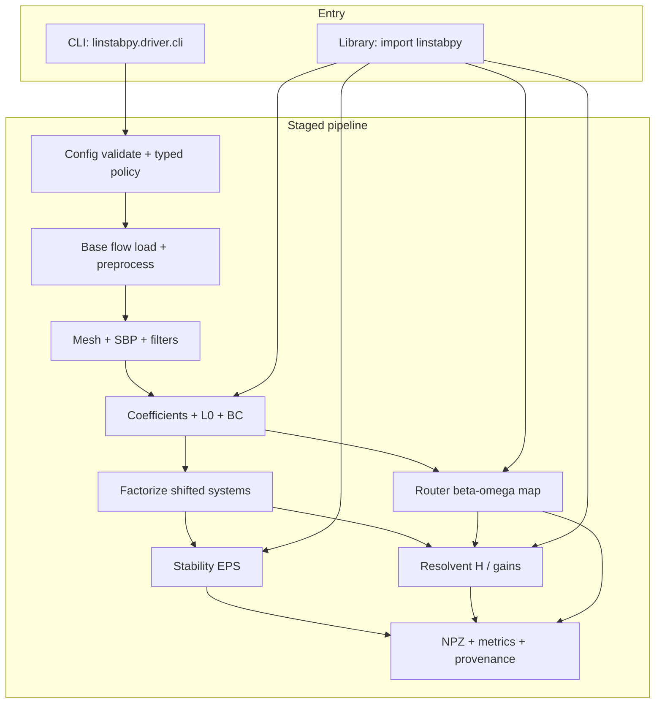
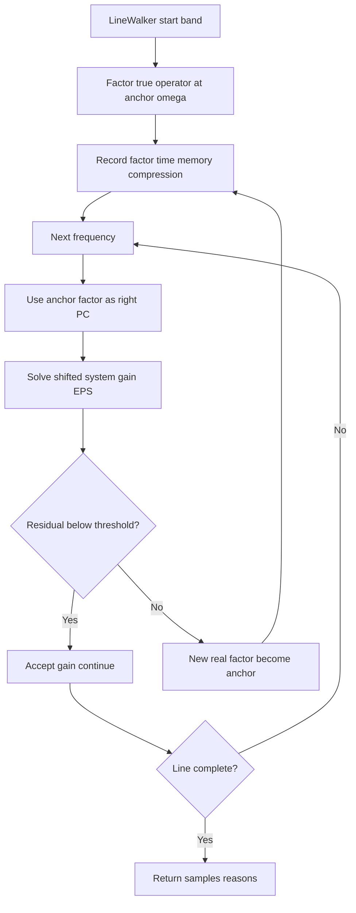

# Architecture

**LinStabPy** is a Python CLI and library for linear stability and resolvent analysis of compressible viscous flows. It ports LinStab2D linearized Navier-Stokes (LNSE) workflows from MATLAB to an MPI HPC stack on [PETSc](https://en.wikipedia.org/wiki/PETSc) and [SLEPc](https://en.wikipedia.org/wiki/SLEPc), with sparse direct factorization ([MUMPS](https://en.wikipedia.org/wiki/MUMPS_(software)) by default, optional [cuDSS](https://docs.nvidia.com/cuda/cudss/)).

This page lists the packages and who owns which policy, the order in which a case runs, the stored data, and the quality gates. Package details are on the [module pages](modules/index.md).

!!! info "Conventions"
    Temporal [eigenvalues](https://grokipedia.com/page/Eigenvalues_and_eigenvectors) are $\omega = \mathrm{eig}(i L_0)$ with $\exp(-i\omega t)$ time dependence. Unstable means $\mathrm{Im}(\omega) > 0$. The shift-invert target lives in $\omega$ space. The [resolvent](https://grokipedia.com/page/Resolvent_formalism) is $H = C F ((\gamma - i\omega) I - L_0)^{-1} F B$ with $\sigma = \sqrt{\mathrm{Re}(\lambda)}$ from the weighted normal problem. [SBP](https://grokipedia.com/page/Summation_by_parts) orders are $2$, $4$, $6$, $8$ only. The default shifted solve is `KSPPREONLY` with `PCLU` through MUMPS, driven by SLEPc Krylov-Schur with `ST=SINVERT`. Assembly order is fixed: raw blocks, `inv(B/1j)` scaling, sponge, dissipation, then BC rows last. The state vector is $q = [\rho, u, v, w, T]$.


## Design rules

1. **Staged pipeline.** `driver/run.py` runs the stages in a fixed order: config, base flow, mesh, coefficients, $L_0$ with BCs, factorize, solve, payload. It records wall time and RSS per stage.
2. **One operator family.** Temporal, adjoint, spatial, single-frequency resolvent, and $\beta$-$\omega$ maps all consume BC-enforced LNSE operators. The spatial path reuses the temporal preparation helpers.
3. **Factorize once, solve many.** `linalg.factorize` is shared by shift-invert eigenproblems and by every $H$ and $H^H$ apply at one shift.
4. **Config is the single policy source.** YAML, then environment, then defaults, then schema validation into typed `Config` subsections. Invalid structure or FD orders fail before any factorization.
5. **Lazy imports.** `import linstabpy` and the package, mesh, BC, linalg, stability, resolvent, and router packages resolve names through PEP 562 `__getattr__`. PETSc and MPI start only on solve paths. Importing `driver.run` is the intentional boundary.
6. **SciPy and PETSc paths.** Local assembly uses SciPy CSC/CSR. The production path converts to distributed PETSc `Mat` through `utils/petsc_core.py`, which keeps mesh and solver packages independent.
7. **Declarative BCs and cost-aware routing.** Case behavior comes from YAML and BC rules. The router decides between reuse and refactor from measured factor cost, memory, and residuals.
8. **Reproducibility.** Config hash, git SHA, a metrics schema, and fixed NPZ contract keys.

The layers, from the entry point down: orchestration, analysis domains, discretization and operators, linear algebra, utilities.

| Layer | Choice |
|-------|--------|
| Language | Python 3.11 to 3.14 |
| Local arrays and sparse | NumPy, SciPy (CSC/CSR) |
| Parallel runtime | MPI via `mpi4py` |
| Distributed linear algebra | PETSc (`petsc4py`), complex scalars required |
| Eigenproblems | SLEPc (`slepc4py`), EPS and weighted normal problems |
| Sparse direct solvers | MUMPS through `PCLU` (default); optional cuDSS as a GPU shell PC |
| Configuration | PyYAML, typed dataclasses, schema validation |
| Outputs | NPZ result payloads, `metrics.json`, provenance |

`environment.yml` targets conda-forge complex-scalar PETSc/SLEPc. GPU PETSc is not a supported conda path; cuDSS is an optional, non-conda path.


## Packages

```text
src/linstabpy/
├── __init__.py              # Lazy public API (no PETSc on import)
├── metrics_schema.py        # Run metrics JSON contract
├── mumps_options.py         # MUMPS option helpers
├── driver/                  # CLI + case pipeline
├── config/                  # Schema, typed Config, defaults
├── baseflow/                # BaseFlow + I/O + preprocess
├── mesh/                    # Mesh, SBP, filters, FD weights
├── operators/               # LNSE assembly, coefficients, spatial, norms
├── boundary_conditions/     # Dirichlet/Neumann recipes
├── stability/               # Eigenvalue services, acceptance, sensitivity
├── resolvent/               # Operator, gain, analysis
├── solvers/                 # EPS backends + router/
├── linalg/                  # factorize, backends, shifted, cuDSS
└── utils/                   # PETSc init/core, YAML, metrics, provenance
```

| Package | Code paths | Role | Page |
|---------|------------|------|------|
| Case orchestration | `driver/`, `__init__.py` | PETSc/MPI init, staged runs, CLI, payload, public lazy API | [Runtime driver](modules/driver.md) |
| Configuration | `config/` | Merge and validate YAML, env, defaults; typed solver policy | [Configuration](modules/config.md) |
| Base flow | `baseflow/` | Mean-flow ingest, sponge, shock cleanup, viscosity | [Base flow](modules/baseflow.md) |
| Mesh | `mesh/` | Geometry, SBP operators, filters, deformation, masking | [Structured mesh](modules/mesh.md) |
| LNSE assembly | `operators/`, `boundary_conditions/` | Coefficients, $L_0$ and spatial assembly, BC recipes, Chu norm | [LNSE assembly](modules/operators.md), [BC recipes](modules/boundary-conditions.md) |
| Stability | `stability/`, `solvers/eigenvalue.py`, `solvers/spatial_eig.py` | Temporal, adjoint, and spatial EPS, sensitivity | [Stability analysis](modules/stability.md) |
| Resolvent | `resolvent/` | $H$ operator, weighted gains, forcing models | [Resolvent analysis](modules/resolvent.md) |
| Solver routing | `solvers/router/` | $\beta$-$\omega$ maps, anchors, residual gates, RAM autoselect | [Solvers and routing](modules/solvers.md) |
| Linear algebra | `linalg/`, `mumps_options.py` | Factor backends, shifted operators, cuDSS | [Linear algebra](modules/linalg.md) |
| Shared utilities | `utils/`, `metrics_schema.py` | PETSc bridge, YAML, cost, provenance, Floquet | [Shared utilities](modules/shared-utilities.md) |

`boundary_conditions/` is a separate package for import hygiene and MATLAB module parity. Functionally it belongs to LNSE assembly: BC application is the last step of operator finalization.

Public library surface (lazy exports from `linstabpy.__init__`): `build_lnse_system`, `build_lnse_operator`, `compute_chu_norm`, `temporal_eigenvalues`, `adjoint_eigenvalues`, `wavemaker`, `resolvent_analysis`, `resolvent_map`, `BaseFlow`. The CLI entry is `linstabpy.driver.cli.main`, which imports `driver.run` only after handling `--version` and `--help`.

Calls between packages are in-process Python calls:



Library consumers may call assembly and analysis APIs directly and skip the driver. They still depend on the same operator and factorization contracts. Stability and resolvent never own mesh generation; they consume finished operators and energy weights. Utilities never own case flow.


## Ownership

Keep policy in the owning module rather than recreating pass-through files.

| Area | Owning module | What belongs there |
|---|---|---|
| Boundary-condition recipes | `linstabpy.boundary_conditions.recipe` | YAML recipe parsing, rule validation, effective rows, column-zeroed Dirichlet rows, overlap reporting, and SciPy/PETSc/spatial dispatch. |
| LNSE assembly | `linstabpy.operators.assembly` | Coefficient preparation, backend choice, operator construction order, boundary-condition application, and the `LNSESystem` result object. |
| Solver policy | `linstabpy.utils._solver_cfg`, `linstabpy.config.typed` | Dict/env resolution, PETSc/SLEPc defaults, MUMPS/KSP/EPS setup, and resolvent linear-solver selection. |
| Runtime pipeline | `linstabpy.driver.run` | Case loading, mesh construction, Chu norm, assembly, stability/resolvent stages, postchecks, acceptance, and `.npz` persistence. |
| Packed-field ingest | `linstabpy.baseflow.grid_fields` | One loader for npz or an npy directory. Filter, boundary sponge, and shock live in `baseflow.preprocess`. |
| Result archive | `linstabpy.driver.payload`, `linstabpy.driver.io` | Payload grouping and NPZ/sidecar write. `io.py` does not import the driver. |
| Mesh state | `linstabpy.mesh.mesh` | Structured geometry, derivative operators, filters, dissipation state, and sponge state. |

Rules that go with the table:

- **Boundary conditions.** `BCRecipe` is the seam. Public YAML files pass lists of dictionaries; the recipe layer normalizes them. When changing BC behavior, update the recipe analysis and every backend wrapper together. Do not duplicate row-selection logic in assembly, runtime code, or example scripts.
- **LNSE assembly.** `LNSESystem` is the assembly handoff. The construction order is part of the numerical contract: prepare coefficients, build the raw operator, apply the inverse mass/metric block, apply sponge and operator dissipation, then apply boundary conditions. Keep this order explicit in `operators.assembly`. Runtime callers ask for an assembled system and do not rebuild pieces of the sequence.
- **Solver policy.** `Config` in `config.typed` reads YAML and environment variables. PETSc/SLEPc objects are created inside the solver modules, but defaults and fallbacks come from the shared policy layer. The launcher, `mpi4py`, PETSc, and SLEPc must agree on one MPI stack; installer checks report the chosen stack.
- **Dissipation.** Every path, the map router included, reads dissipation from `numerics.operator_dissipation` through `config.defaults.stage_dissipation_epsilon`. The old top-level `dissipation_epsilon` and `eps_resolv` keys are refused.
- **Mesh state.** `Mesh` is the main structured-grid object. Deformation and masking must preserve numerical behavior. A geometry-only optimization is allowed only when tests show that derivative operators, filters, weights, and saved outputs stay equivalent for the relevant cases.
- **Packed fields.** Every packed case uses the same eight keys: `x`, `y`, `rho`, `u`, `v`, `w`, `T`, `sponge`. YAML names the file; the loader does not guess a Song filename. Martini `.mat` constructors live in `examples/linstab2d/matlab_baseflow.py`.
- **Runtime and NPZ output.** Example scripts set `LINSTABPY_CASE_CONFIG` and call `linstabpy.driver.run`. Martini generated-mesh examples build their own fields; packed-field cases go through `load_case_fields`. The compatibility surface for saved results is `RUNTIME_NPZ_CONTRACT_KEYS` in `linstabpy.driver.payload`; the grouped explanation is the [runtime NPZ contract](development/runtime-npz-contract.md) page. Additive fields are acceptable. Renames or removals need a migration note, test updates, and reader updates.


## Run order

Every analysis product shares the preparation stages. Step 7 is where the paths split.

| Step | Operation | Inputs | Outputs | Code |
|---|---|---|---|---|
| 1 | Runtime init: `init_petsc_from_argv()`, then MPI/PETSc imports; config path from `LINSTABPY_CASE_CONFIG` (required) | argv, env | PETSc/MPI ready, rank-0 logging | `driver/run.py` |
| 2 | Config merge and schema validation | YAML, env, defaults | Typed `Config`, or `ConfigValidationError` | `config/schema.py`, `config/typed.py` |
| 3 | Field I/O | npy directory or npz | Dict of 2-D float fields | `baseflow/grid_fields.py` |
| 4 | Preprocess and transport | Raw primitives | `BaseFlow` with mu and sponge | `baseflow/preprocess.py`, `sponge.py`, `viscosity.py` |
| 5 | Mesh and SBP | x, y, FD order, deformation | `Mesh` with operators and runtime state | `mesh/mesh.py`, `mesh/sbp.py` |
| 6 | Coefficients | `BaseFlow`, metrics | Cartesian or cylindrical LNSE coefficient blocks | `operators/coefficients.py` |
| 7 | $L_0$ finalization and BC recipes | Coefficients, FD matrices, sponge, backend request | SciPy CSC or PETSc `Mat` $L_0$, free-DOF sets | `operators/assembly.py`, `boundary_conditions/` |
| 8 | Factorization | Shifted $L_0$ | `Factorization` handle | `linalg/factorize.py` |
| 9 | Solve: SLEPc EPS or weighted normal shell | Factor, weights | Eigenvalues, modes, gains | `stability/`, `resolvent/`, `solvers/` |
| 10 | Postcheck and acceptance | Modes, residuals | Accepted modes, advisories | `stability/acceptance.py`, `driver/preflight.py` |
| 11 | Payload | Results, cost, provenance | NPZ and `metrics.json` | `driver/payload.py`, `driver/io.py` |

State progression: raw files, validated config, `BaseFlow` on `(ny, nx)`, mesh runtime state, coefficient tensors, constrained sparse $L_0$ with free-DOF mask, factor, solution, accepted result, emitted payload.



Two entry paths converge on the same operator core and factorization layer. The CLI and driver path (`driver/run.py`) initializes PETSc/MPI, resolves config, logs stages and heartbeats, and writes the payload. The library path (`import linstabpy`) starts nothing on import and loads public symbols on first use.

### Temporal eigenvalues (primary product)

Steps 1 to 8 above, then:

- **Shift-invert factorization.** `linalg/factorize.py` factorizes with the backend chosen by `resolve_factor_backend` and the MUMPS options. The default is `KSPPREONLY` + `PCLU` + MUMPS. Iterative solves are an explicit opt-in for memory-bound cases, not a silent fallback. The API is solve, transpose solve, block solve, refactorize, destroy.
- **Eigenanalysis.** SLEPc EPS through `stability/_eigenvalues.py` and `solvers/eigenvalue.py`. EPS iterations call repeated solves against the factor. Post-processing: residual norms and reordering, target-distance check, conjugate-pair completeness, `stability/acceptance.py`.
- **Output.** `build_runtime_payload` packs eigenvalues, eigenvectors, metrics, and provenance. The NPZ path comes from the environment or defaults to `{prefix}_{config_md5}_{git_sha8}.npz`.

### Adjoint and structural sensitivity

`adjoint_eigenvalues` (lazy export from `stability._eigenvalues`) runs the adjoint solve after the direct modes exist. `wavemaker` in `stability/sensitivity.py` combines direct and adjoint modes. The factorization layer provides the transpose solves the adjoint needs.

### Resolvent gain (single frequency)

The preparation matches the temporal path. Then:

1. Factor $((\gamma - i\omega) I - L_0)$ once. Under `solver.resolvent_sign_convention: matlab_parity` the code inverts the older LinStab2D matrix instead; see the [resolvent sign convention](resolvent-sign-convention.md).
2. Apply $H$ and $H^H$ through the factor: input map $B$, solve, output map $C$ (`resolvent/operator.py`). `compute_chu_norm` supplies the energy weights.
3. Build the weighted normal operator `invW * H^H * W * H(v)` as a PETSc `MatShell` (`resolvent/gain.py`).
4. Run SLEPc on the shell, validate residuals, and return gains with forcing and response modes (`resolvent/analysis.py`).

### Gain map over $\beta$ and $\omega$

Entry: `solvers/router/resolvent_map.py` (public `resolvent_map`).

1. **Per-$\beta$ assembly.** One BC-enforced operator per spanwise wavenumber.
2. **Band marking.** `band_marking.py` labels frequency bands NEAR_POLE, SMOOTH, or STABLE to choose the walk strategy.
3. **Line walk.** `map_walk.LineWalker` pays a real factor for the first frequencies on a line and records factor time, memory, and compression. Later points apply $K(\omega)^{-1}$ with that factor as a right preconditioner. A residual gate forces a new factor when accuracy degrades; a walk may be deferred (`WalkDeferred`) or aborted.
4. **Stable-regime sweeps.** `stable_sweep.py` runs anchor-preconditioned sweeps across nearby frequencies.
5. **Backend policy.** `linalg/backends.py` normalizes and probes MUMPS, LU, and cuDSS. RAM autoselect and break-even logic influence the choice.
6. **Leading gain.** Computed by the resolvent analysis at each scheduled point.
7. **Recording.** Map arrays, cost keys (wall assemble/factor/solve, peak RSS and GPU memory, ranks, git SHA), and certification metadata. `map_record` saves atomically.



Dissipation depends on the mesh. On rectilinear tensor meshes the metric cross-terms vanish, so dissipation can be a costly no-op for gain accuracy. On meshes curvilinear in both directions, an undamped operator can show spurious near-singular resonances. Enable it in pairs: `enabled` builds $Q_{\mathrm{diss}}$ on the mesh and `epsilon` is the strength.

The outer loop is $\beta$ and the inner loop is the frequency line. Each point ends in one of: continue, refactor, defer, abort. Walks on one line stay sequential to preserve factor reuse; parallelism across $\beta$ lines is not implemented.

### Spatial eigenproblem

- **Config.** `solver.spatial`, with fallback to `solver.eigen` when no spatial YAML section exists.
- **Assembly.** `operators/spatial.py` reuses the temporal preparation and index helpers, with SciPy and PETSc block-matrix paths.
- **Solve.** `solvers/spatial_eig.py` runs a generalized SLEPc EPS with a direct shift-invert backend chosen as for the temporal case. Output: spatial eigenvalues, modes, and solver metadata.


## Stored data

LinStabPy is file-oriented. There is no database; reproducibility comes from config hashing, schema versions, and fixed result contracts.

| Store | Form | Contract |
|-------|------|----------|
| Case policy | YAML on disk, env overrides | Merged into typed `Config`; schema-validated |
| Mean flow | npy directory or npz | Primitives `RHO,U,V,W,T` on `(ny,nx)`; optional sponge |
| Runtime operators | In-memory SciPy CSC or PETSc `Mat` | Sparse $5 N_{gp} \times 5 N_{gp}$, or reduced free DOFs |
| Results | NPZ | Fixed key contract in `driver.payload` |
| Metrics | JSON | `metrics_schema.SCHEMA`: provenance, problem, cost, quality |
| Provenance | Embedded in metrics and payload | Config hash/MD5, git SHA, hostname, factor backend and precision |

```text
YAML + npy/npz
    → Config (typed) + BaseFlow (ny,nx fields)
    → Mesh (X,Y, Dx,Dy, W, filters)
    → Coefficients + Energy weights (Chu W_diag / invW_diag)
    → L0 PETSc Mat + free-DOF IS + BC-enforced rows
    → Factorization handle(s)
    → Spectra / gains / modes (distributed Vec → gathered arrays)
    → NPZ payload + metrics.json (provenance, cost, quality)
```

| Object | Contract |
|--------|----------|
| `BaseFlow` | Parameters (`Re,Ma,Pr,kappa,T_0`) and `(ny,nx)` primitives; optional MU and dmu/dT |
| `Mesh` and operators | `X,Y`, SBP `Dx,Dy,...`, weights `W`, optional dissipation |
| `LNSESystem` ($L_0$) | Sparse, size scale `5 * ngp`, or reduced free DOFs |
| BC recipe | Rules, enforced rows, free-DOF index sets |
| Energy weights | Chu norm diagonals `W_diag` and `invW_diag` |
| Factors | Opaque `Factorization` handle that owns the KSP/PC lifecycle |
| Modes and gains | Distributed `Vec`, gathered to NumPy for the payload |
| Map records | Structured arrays, cost samples, certification |

`driver/run.py` is about 1.8k lines and owns stage sequencing, timing, and payload emission. One place defines "a case", which helps reproducibility but raises change risk. Library users can bypass it.


## Runtime behavior

- **Logging.** Rank 0 writes the human-readable log. Stage lines are machine-parseable: `stage complete: stage=<name> elapsed=<s> rss_peak_delta_bytes=<n>`. Heartbeats default to every 30 s (`LINSTABPY_STAGE_HEARTBEAT_SECONDS`).
- **Environment.** `LINSTABPY_CASE_CONFIG`, `LINSTABPY_CASE_OUTPUT_NPZ`, `LINSTABPY_FORCE_RECOMPUTE`, and the log prefix. Use a dedicated output NPZ per concurrent run.
- **Cache.** The CLI reuses an NPZ when config hash and git SHA match, unless `LINSTABPY_FORCE_RECOMPUTE` is set.
- **MPI.** PETSc `COMM_WORLD` ranks share distributed matrices and vectors. One MPI job runs one case or one map campaign. There is no server process.
- **Init order.** Initialize `mpi4py` before PETSc, with thread level MULTIPLE when a backend requires it. `import linstabpy` alone does not set up the parallel runtime.
- **Requirements.** Python 3.11 to 3.14, working MPI with `mpi4py`, complex-scalar PETSc/SLEPc, MUMPS through PETSc, NumPy, SciPy, PyYAML. cuDSS is optional. Large cases are memory-bound by the sparse factors.
- **Factor lifecycle.** Create, solve N times, refactorize (same nonzero pattern), destroy.


## Quality gates and errors

| Gate | Behavior |
|------|----------|
| Schema validation | Unknown top-level keys and invalid FD orders raise `ConfigValidationError` before any mesh or factor work |
| Base flow I/O | Missing field names or non-2-D arrays raise at load |
| BC recipe | Invalid symbols or inconsistent borders and variables fail in recipe analysis and application |
| Backend availability | A requested MUMPS, LU, or cuDSS backend that is not present fails in the probe in `backends.py`, before factorization |
| Factorization | PETSc, MUMPS, and STRUMPACK failures raise dedicated errors and destroy partial state |
| Refactorize | A changed nonzero pattern raises `NotImplementedError` or a PETSc error |
| Preflight advisories | Non-blocking warnings (dissipation versus mesh coupling, freestream scale); the run continues |
| Eigen quality | Residual norms, target distance, conjugate-pair completeness (`stability/acceptance.py`) before the payload is written |
| Resolvent and map quality | Residual gate forces a refactor when preconditioner reuse loses accuracy; reason codes OK, PENDING, FAILED per point |
| Certification | Router consistency and RSVD-style certification metadata |

Principles:

- Fail fast on reproducibility gates (config, missing backends) rather than run expensive wrong physics.
- Refactor rather than return inaccurate gains from a failed residual gate.
- Iterative linear solvers are never an automatic downgrade from direct factors. They need an explicit solver policy.
- A gain map records completed $(\beta, \omega)$ cells with FAILED or PENDING markers when one line breaks, instead of discarding the campaign.
- On a STRUMPACK or MUMPS failure, check the backend build, the matrix conditioning and BC setup, and memory. Retrying without a config change does not help.


## Troubleshooting map

| Symptom | Likely stage | First checks |
|---|---|---|
| Immediate abort | Config or schema | YAML keys, FD orders |
| Bad spectra or gains | Base flow, BC, assembly | Field alignment, BC recipe, sponge |
| Factor crash or out of memory | Linear algebra | Backend probe, ranks, BLR, iterative opt-in |
| Noisy map ridges | Router and mesh dissipation | Metric cross-coupling, dissipation `enabled` and `epsilon` set together |
| Slow dense $\omega$ grid | Map walk | Anchor spacing, residual threshold, stable sweep |

On map jobs, compare `cost_wall_factor_s` with `cost_wall_solve_s` and watch the residual-driven refactor rate. See [Troubleshooting](troubleshooting.md) for install and runtime problems.
