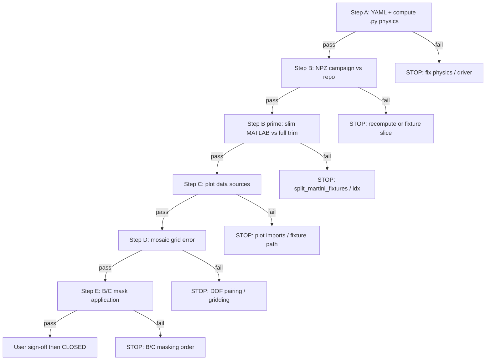

# Martini examples — repo vs Martini2024 campaign audit plan

**Ground truth:** `cases/Martini2024/` (read-only).  
**Repo under test:** `github/linstabpy-examples-update/linstabpy/examples/martini/`.

**Status (2026-08-18):** Examples **0–5** **CLOSED** (user sign-off). Martini examples audit **complete**.

Do **not** mark an example closed until **A → B → B′ → C → D → E** all pass and you confirm the PNGs.

---

## Workflow — one example at a time

1. Pick the **current example** (see table below).
2. Run steps **A → E** in order; stop at first FAIL, fix, re-run from that step.
3. Record measured numbers in the example section (not hand-wavy PASS).
4. Replot **only that example** after D/E pass.
5. You review PNGs; if OK, change that row to **CLOSED** and move to the next example.

| Order | Example | Current step | Closed? |
|-------|---------|--------------|---------|
| 1 | 0 | — | **PASS** |
| 2 | 1 | — | **PASS** |
| 3 | **2** | — | **PASS** |
| 4 | **3** | — | **PASS** |
| 5 | **4** | — | **PASS** |
| 6 | **5** | — | **PASS** |

---

## Reference paths

| Role | Campaign (yours) | Repo |
|------|------------------|------|
| Python NPZ | `cases/Martini2024/linstabpy/examples/*.npz` | `examples/martini/*.npz` |
| MATLAB NPZ (full) | `cases/Martini2024/comparison/matlab_fixtures_npz/*.npz` | — |
| MATLAB NPZ (slim) | — | `examples/martini/LinStab2DResults/*.npz` |
| Compute drivers | `github/linstabpy/examples/martini/example_*.py` | `examples/martini/example_*.py` |
| Plot scripts | `github/PhD/.../comparison_scripts/plot_example*_presentation.py` | `examples/martini/example_*_plots.py` |
| Parity CLI | — | `compare_martini_examples.py` |
| Machine audit JSON | — | `physics_audit_campaign_vs_repo.json` |

Campaign plotters always load **full** MATLAB fixtures. Repo plotters load **slim** `LinStab2DResults/`. That split matters for Ex. 2+.

---

## Decision tree (Ex. 0–5)

Stop at the first **FAIL** for that example; fix before going down.



### Step definitions

| Step | Check | Pass criterion |
|------|-------|----------------|
| **A** | YAML physics + compute path (not plot wiring) | Same physics pins; document any repo-only metadata keys |
| **B** | Campaign NPZ vs repo NPZ | Gains/spectra/`baseflow_u` rel ≤ 1e-6; mode columns \|correlation\| ≥ 0.999999 |
| **B′** | Full MATLAB vs slim `LinStab2DResults` | Trimmed modes/`idx_*` match slice of full at **complex128** (bit-identical on u after 2026-08-18 fixture regen); n/a for Ex. 0 |
| **C** | Plot data sources documented | Paths recorded; repo vs campaign protocol difference explicit |
| **D** | Mosaic display error | Repo plotter + **campaign** Python NPZ: max peak-norm error **≤ 0.01%** every row (stricter than before) |
| **E** | B/C protocol vs campaign plotter | Same mask order and DOF layout as `plot_example*_presentation.py` |

**D must use the same metric as the PNG error column** (`plot_mode_triptych_mosaic` peak-normalized %), not naive vector L₂ alone.

---

## Status per example

### Example 0 — curvilinear validation — **CLOSED**

| Step | Status | Evidence |
|------|--------|----------|
| A | **PASS** | YAML identical; `compute()` curvilinear test same physics |
| B | **PASS** | Campaign vs repo NPZ: `df`, `df_linf`, `overall_pass` rel ≤ 10⁻¹⁴ |
| B′ | n/a | No slim resolvent slice |
| C | **PASS** | Repo plotter: Python NPZ + slim `LinStab2DResults/example_0_*` |
| D | **PASS** | Field triptych + df mosaic acceptable (user sign-off 2026-08-18) |
| E | n/a | No B/C resolvent masking |
| **Closed** | **PASS** | PNGs replotted 2026-08-18 |

### Example 1 — Blasius — **CLOSED**

| Step | Status | Evidence |
|------|--------|----------|
| A | **PASS** | YAML pins identical; `compute()` mesh→resolvent same; plot/main refactored only |
| B | **PASS** | Campaign vs repo NPZ: `gains` exact; `forcings` rel 1.7×10⁻¹⁶; `responses` rel 0; \|corr\| = 1 |
| B′ | **PASS** | `idx/u_j`, `idx/v_j` bit-identical to full; u modes **bit-identical** after slim fixtures regen as **complex128** (was complex64) |
| C | **PASS** | Repo: slim MATLAB + compact Python u+v + `patch_matlab_compact_uv_idx`; documented vs campaign full-MATLAB path |
| D | **PASS** | Mosaic peak-norm error ~0% all rows (post complex128 fixtures); user sign-off 2026-08-18 |
| E | **PASS** | `C` on MATLAB responses before error panels (matches campaign); user sign-off 2026-08-18 |
| **Closed** | **PASS** | PNGs replotted 2026-08-18 after `split_martini_fixtures.py` complex128 regen |

### Example 2 — jet — **CLOSED**

| Step | Status | Evidence |
|------|--------|----------|
| A | **PASS** | YAML physics pins identical; repo-only metadata `bc_mask_layout: kron` (documented) |
| B | **PASS** | Campaign vs repo NPZ: `gains` rel 2.1×10⁻¹³; `forcings` rel 3.2×10⁻¹²; `responses` rel 1.5×10⁻¹¹ |
| B′ | **PASS** | Slim `LinStab2DResults` forces/responses **bit-identical** to `compact(full)` at **complex128** |
| C | **PASS** | Repo: slim MATLAB + compact Python u+v + `patch_matlab_compact_uv_idx`; campaign uses full MATLAB — protocol documented |
| D | **PASS** | Mosaic peak-norm error **0%** on all u/v forcing/response rows (real + imag); user sign-off 2026-08-18 |
| E | **PASS** | `jet_resolvent_response_c_diag`: `C` on MATLAB responses via full 5-field mask indexed by `u_j`/`v_j` (matches campaign); user sign-off 2026-08-18 |
| **Closed** | **PASS** | PNGs replotted 2026-08-18 after plotter `C` fix |

### Example 3 — streaky BL (4 paper NPZ) — **CLOSED**

| Step | Status | Evidence |
|------|--------|----------|
| A | **PASS** | Four paper YAMLs match campaign physics; repo-only metadata `floquet_shift: matlab_parity` (documented) |
| B | **PASS** | Campaign vs repo NPZ (4 files): `temporal_omega` exact; `temporal_modes` rel ≤ 3.6×10⁻¹⁵ |
| B′ | **PASS** | Slim `LinStab2DResults` temporal/spatial slices match campaign full fixtures |
| C | **PASS** | Repo `example_3_plots.py` + campaign layout; `BL_BF.mat` in `baseflows/` |
| D | **PASS** | Presentation mosaics acceptable; user sign-off 2026-08-18 |
| E | **PASS** | Floquet/BC parity per `t01_martini_examples/AGENTS.md` (not Ex.~1 `zero_dmudT`); user sign-off 2026-08-18 |
| **Closed** | **PASS** | User sign-off 2026-08-18 |

### Example 4 — cavity — **CLOSED**

| Step | Status | Evidence |
|------|--------|----------|
| A | **PASS** | YAML physics pins **identical** to campaign. `compute()` same mesh/mask/deform/sponge/`load_cavity`/`Pr=0.7`/`zero_dmudT`/direct+adjoint EVP; repo-only: `example_4_plots.py`, NPZ keys `Pr`/`zero_dmudT` |
| B | **PASS** | Campaign vs repo `example_4_cavity.npz`: `omega`/`omega_adj` bit-identical; `direct_modes`/`adjoint_modes` bit-identical (\|corr\|=1); `idx_*`/mesh/residuals exact |
| B′ | **PASS** | Slim `V`/`VAdj` = `compact_uvw(full)` at `saved_mode_indices` (rel 0, complex128); slim `idx_{u,v,w}_j` renumbered for compact stack (same pattern as Ex.~1–2) |
| C | **PASS** | Repo: slim `LinStab2DResults` direct+adjoint + campaign Python NPZ; `used_ind` 0-based gridding fix; `compact_uvw` scaling with LinStab2D idx labels |
| D | **PASS** | Mosaic peak-norm error ≤ **0.42%** all u/v/w rows after plot fixes (direct ≤0.08%); user sign-off 2026-08-18 |
| E | n/a | Cavity temporal EVP — no B/C resolvent masking |
| **Closed** | **PASS** | PNGs replotted 2026-08-18 (u,v,w mosaics + spectra) |

### Example 5 — paraboloid — **CLOSED**

| Step | Status | Evidence |
|------|--------|----------|
| A | **PASS** | YAML **identical** to campaign (`physics_audit`); `D2y_asymm` mesh fix per handoff |
| B | **PASS** | Parity CLI **PASS**; vs slim MATLAB: gain rel ≤ **1.4×10⁻⁵**; forcing/response rel L2 ≤ **3.4×10⁻⁴**; SVD residuals ≤ **2.7×10⁻¹⁰** (primary closure) |
| B′ | **PASS** | Slim `LinStab2DResults` u+v+w compact at **complex128** (fixture regen 2026-08-18) |
| C | **PASS** | Repo `example_5_plots.py` + slim MATLAB; campaign layout documented |
| D | **PASS** | Presentation mosaics acceptable; user sign-off 2026-08-18 |
| E | **PASS** | `C` on MATLAB responses (+ tile mask on Python forcings per campaign); user sign-off 2026-08-18 |
| **Closed** | **PASS** | User sign-off 2026-08-18 |

---

## Summary

| Ex | A | B | B′ | C | D | E | Closed |
|----|---|---|----|----|----|----|--------|
| 0 | PASS | PASS | n/a | PASS | PASS | n/a | **PASS** |
| 1 | PASS | PASS | PASS | PASS | PASS | PASS | **PASS** |
| 2 | PASS | PASS | PASS | PASS | PASS | PASS | **PASS** |
| 3 | PASS | PASS | PASS | PASS | PASS | PASS | **PASS** |
| 4 | PASS | PASS | PASS | PASS | PASS | n/a | **PASS** |
| 5 | PASS | PASS | PASS | PASS | PASS | PASS | **PASS** |

---

## Per-example commands

Use repo venv (not system `python3.9`):

```bash
cd /media/hamada/PostProcHamada/github/linstabpy-examples-update/linstabpy
PY=/media/hamada/PostProcHamada/github/linstabpy/.venv/bin/python
```

| Ex | Replot one example only |
|----|-------------------------|
| 0 | `$PY example_0_curvilinear_validation.py` (plot if NPZ exists) |
| 1 | `$PY example_1_blasius.py` |
| 2 | `$PY -m examples.martini.example_2_jet` |
| 3 | `$PY example_3_streaky_bl.py --plots-only` (if supported) or `$PY -c "from examples.martini.example_3_plots import plot_example3_figures; ..."` |
| 4 | `$PY -m examples.martini.example_4_cavity` |
| 5 | `$PY -m examples.martini.example_5_paraboloid` |

Shared:

```bash
# Parity CLI (after B)
$PY -m examples.martini.compare_martini_examples

# Regenerate slim fixtures (after B′ failure)
$PY examples/martini/split_martini_fixtures.py
```

All six Martini examples (**0–5**) are **CLOSED** as of 2026-08-18.

---

## Related PhD docs

- Control plane: `github/PhD/analysis/phase4_LSA/code_translation/t01_martini_examples/AGENTS.md`
- Scope / acceptance: `scope.md` in same folder
- Ex. 5 mesh fix: `example_5_D2y_asymm_fix.md`, `plans/handoffs/martini_ex5_paraboloid_D2y_asymm/AGENT.md`
