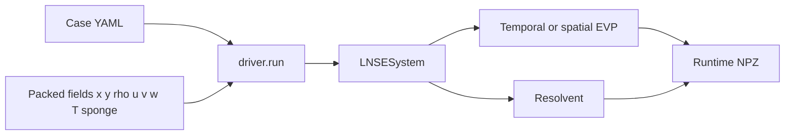

# Overview

LinStabPy is a Python package for **sparse linear stability and resolvent
analysis** of compressible viscous flow. It began as a port of MATLAB
LinStab2D (Martini and Schmidt, 2024) and is now a standalone stack: SBP
operators fd2–fd8, PETSc/SLEPc, MUMPS, and checks that do not rely on MATLAB
output alone.

The public project name is LinStabPy. The repository, distribution, and
import name is `linstabpy`. Version is the `pyproject.toml` string
(`1.0.0rc9` on this tree). License is GPL-3.0-only.

## What it computes

- **Resolvent analysis:** leading gain, forcing modes, response modes
- **Temporal stability:** direct and adjoint eigenvalue problems
- **Spatial stability:** streamwise-wavenumber eigenvalue problems
- **Coordinates:** Cartesian, cylindrical/axisymmetric, curvilinear structured meshes
- **Boundaries:** Dirichlet rows, Neumann rows, sponge damping, masking of excluded points
- **Energy inner product:** Chu compressible energy norm with quadrature weights

## What it is not

- Not a CFD solver. The base flow is an input (packed NPZ/NPY, or a Martini
  `.mat` constructor under `examples/`).
- Not a 3-D unstructured-mesh code. The mesh is a 2-D structured grid.
- Not a GPU install path in the merge gate. The reference stack is CPU,
  complex-scalar PETSc/SLEPc, MUMPS.

## Public import surface

`import linstabpy` loads names on first use. It does not initialize PETSc.

| Name | Module |
|---|---|
| `build_lnse_system`, `build_lnse_operator` | `operators.assembly` |
| `compute_chu_norm` | `operators.energy_norm` |
| `temporal_eigenvalues`, `adjoint_eigenvalues` | `stability._eigenvalues` |
| `wavemaker` | `stability.sensitivity` |
| `resolvent_analysis` | `resolvent.analysis` |
| `resolvent_map` | `solvers.router.resolvent_map` |
| `BaseFlow` | `baseflow` |

Case scripts do not call those names one by one. They set
`LINSTABPY_CASE_CONFIG` and call `linstabpy.driver.run`.

## Context

PETSc, SLEPc, and MUMPS sit under the solver and factorization layers. The
driver never rebuilds the assembly sequence. Callers ask for an assembled
system.
