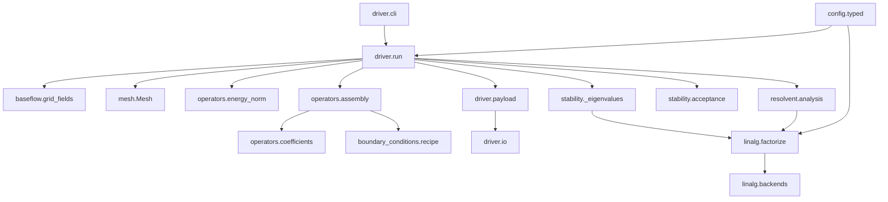

# Architecture

Policy lives in the owning module. Do not add pass-through files that copy
row selection, solver defaults, or assembly order.

## Ownership

| Area | Owning module | What belongs there |
|---|---|---|
| Boundary-condition recipes | `linstabpy.boundary_conditions.recipe` | YAML recipe parsing, rule validation, effective rows, column-zeroed Dirichlet rows, overlap reporting, SciPy/PETSc/spatial dispatch |
| LNSE assembly | `linstabpy.operators.assembly` | Coefficient preparation, backend choice, operator construction order, BC application, `LNSESystem` |
| Solver policy | `linstabpy.utils._solver_cfg`, `linstabpy.config.typed` | Dict/env resolution, PETSc/SLEPc defaults, MUMPS/KSP/EPS setup, resolvent linear-solver selection |
| Runtime pipeline | `linstabpy.driver.run` | Case load, mesh, Chu norm, assembly, stability/resolvent, postchecks, acceptance, NPZ |
| Packed-field ingest | `linstabpy.baseflow.grid_fields` | One loader for npz or an npy directory. Filter, sponge, shock live in `baseflow.preprocess` |
| Result archive | `linstabpy.driver.payload`, `linstabpy.driver.io` | Payload grouping and NPZ/sidecar write. `io.py` does not import the driver |
| Mesh state | `linstabpy.mesh.mesh` | Structured geometry, derivative operators, filters, dissipation, sponge |

## Package graph

There is no service mesh and no HTTP API. The “containers” are Python
packages under `src/linstabpy/`.

## Assembly order

`LNSESystem` is the assembly handoff. Construction order is part of the
numerical contract and is not interchangeable:

1. Prepare coefficients.
2. Build the raw operator.
3. Apply the inverse mass/metric block.
4. Apply sponge and operator dissipation.
5. Apply boundary conditions last, so BC rows win.

Direct PETSc assembly cannot apply `dissipation_epsilon`. A backend of
`auto`/`petsc` may SciPy-assemble this sequence and convert afterwards.

## MPI

Launcher, `mpi4py`, PETSc, and SLEPc must agree on one MPI stack. The
installer reports the chosen stack. `import linstabpy` stays PETSc-free;
`import linstabpy.driver` does not pull PETSc. The CLI loads `driver.run`
only after `--version` / `--help`.
