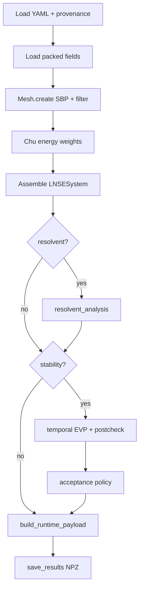

# Workflow

The shared pipeline is `linstabpy.driver.run`. Example scripts set
`LINSTABPY_CASE_CONFIG` and call it. `python -m linstabpy.driver.cli` is
the cache-aware entry: rank 0 compares `provenance_config_hash` and git SHA
against the current YAML/HEAD, then broadcasts whether to recompute.

Martini generated-mesh examples still build their own fields. Packed-field
cases go through `load_case_fields`.

## Stages

Named stages in `driver/run.py`:

| Stage | Function | Output |
|---|---|---|
| Config | `_stage_load_runtime_config` | YAML dict, config hash, git SHA |
| Fields | `_stage_load_case` | `X`, `Y`, `BaseFlow`, sponge |
| Mesh | `_stage_build_mesh` | `Mesh` with SBP operators, Mattsson filter, optional dissipation |
| Energy | `_stage_compute_chu_norm` | `W_diag`, `invW_diag` |
| Assembly | `_stage_assemble_operators` | `LNSESystem`, BC index sets |
| Resolvent | `_stage_run_resolvent` | gains, forcing, response |
| Stability | `_stage_run_stability` | eigenvalues, modes, solver info |
| Acceptance | `_stage_evaluate_stability_acceptance` | pass/fail metrics |
| Archive | `build_runtime_payload` + `save_results` | `.npz` |

The Mattsson alpha-filter is applied for every analysis stage, including
EVP-only runs. Turning it off on EVP-only cases left an SBP Nyquist mode.

Long stages emit a heartbeat (default 30 s, `LINSTABPY_STAGE_HEARTBEAT_SECONDS`).
Timing uses `time.perf_counter()`.

## Packed fields

Every packed case uses eight keys: `x`, `y`, `rho`, `u`, `v`, `w`, `T`,
`sponge`. YAML names the file. The loader does not guess a Song filename.
After an optional transpose the arrays are `(ny, nx)`: `stride_eta` walks
the first index, `stride_ksi` the second.

Filter, boundary sponge, and shock cleanup live in `baseflow.preprocess`,
not in the loader.

## Cache

`LINSTABPY_FORCE_RECOMPUTE=1` skips the cache check. A missing or corrupt
NPZ, a config-hash mismatch, or a git-SHA mismatch forces a recompute. A
missing config path trusts an existing cache. The decision is broadcast.
