# Architecture

**LinStabPy** is a Python CLI and library for linear stability and resolvent analysis of compressible viscous flows. It ports LinStab2D style linearized Navier-Stokes (LNSE) workflows from MATLAB to an MPI enabled HPC stack on [PETSc](https://en.wikipedia.org/wiki/PETSc) and [SLEPc](https://en.wikipedia.org/wiki/SLEPc), with sparse direct factorization ([MUMPS](https://en.wikipedia.org/wiki/MUMPS_(software)) by default, optional [cuDSS](https://docs.nvidia.com/cuda/cudss/)).

This document describes the packages, how they connect, the main processes, and how a case runs. It follows the tree and the module notes in `docs/architecture.md`.

!!! info "Math and solver conventions for this page"
    Temporal [eigenvalues](https://grokipedia.com/page/Eigenvalues_and_eigenvectors) are $\omega = \mathrm{eig}(i L_0)$ with $\exp(-i\omega t)$ time dependence. Unstable means $\mathrm{Im}(\omega) > 0$. The shift-invert target lives in $\omega$ space. The [resolvent](https://grokipedia.com/page/Resolvent_formalism) is $H = C F (L_0 - (\gamma + i\omega) I)^{-1} F B$ with $\sigma = \sqrt{\mathrm{Re}(\lambda)}$ from the weighted normal problem. [SBP](https://grokipedia.com/page/Summation_by_parts) orders are $2$, $4$, $6$, $8$ only. The default shifted solve is `KSPPREONLY` with `PCLU` through MUMPS, driven by SLEPc Krylov-Schur with `ST=SINVERT`. Assembly order is fixed: raw blocks, `inv(B/1j)` scaling, sponge, dissipation, then BC rows last. These statements match the code and take precedence over any paraphrase below.

---

## 1. Architecture overview

### 1.1 Architecture design philosophy

LinStabPy is designed as a **staged scientific pipeline**, not a service mesh or multi-tenant application. The system starts from [CFD](https://grokipedia.com/page/Computational_fluid_dynamics) mean-flow dumps and YAML case policy, and ends at spectra, modes, [gains](core-concepts.md), metrics, and provenance payloads.

Core design tenets:

| Principle | Manifestation in the codebase |
|-----------|-------------------------------|
| **Staged pipeline** | Driver coordinates discrete stages: config → baseflow → mesh → L0 → factorize → solve → payload, with stage timing and heartbeats |
| **Factorize-once, solve-many** | Shared `linalg.factorize` core underpins shift-invert eigenproblems and resolvent \(H\) applies |
| **Config as single policy source** | YAML + environment + defaults → schema validation → typed `Config` subsections |
| **Lazy loading** | PEP 562 `__getattr__` on package, mesh, BC, linalg, stability, resolvent, and router so help/version paths stay light and do not initialize PETSc/MPI |
| **SciPy and PETSc dual paths** | Local CSC/CSR assembly is possible; production path converts to distributed PETSc `Mat` |
| **Separation of concerns** | Physics (coefficients/assembly) vs. numerics (mesh/SBP) vs. routing (cost-aware sweeps) |
| **Reproducibility** | Config hash, git SHA, metrics schema, fixed NPZ contract keys |

The architectural style is a **modular layered scientific toolkit**:

```text
Orchestration → Domain Analysis → Discretization / Operators → Linear Algebra → Utilities
```

### 1.2 Core architecture patterns

1. **Pipeline and staged orchestration.** `driver/run.py` sequences the scientific stages in a fixed order.
2. **Shared kernel with multiple products.** One BC enforced LNSE operator family feeds temporal eigen, [adjoint](https://grokipedia.com/page/Adjoint) and sensitivity, spatial eigen, single frequency resolvent, and $\beta$ and $\omega$ maps.
3. **Strategy with backend registry.** Factor backends (MUMPS, [LU](https://grokipedia.com/page/LU_decomposition), cuDSS) are selected and probed under policy and RAM constraints.
4. **Facade with lazy public API.** `import linstabpy` exposes analysis entry points without initializing [MPI](https://grokipedia.com/page/Message_Passing_Interface) or PETSc.
5. **Declarative configuration and BC recipes.** Case behavior comes from YAML and BC rules, not hardcoded geometry branches.
6. **Cost aware routing.** Anchor factorization, [preconditioner](https://grokipedia.com/page/Preconditioner) reuse, residual gates, break-even logic, and RAM autoselect turn single point resolvent into scalable campaigns.

### 1.3 Technology stack overview

| Layer | Choice |
|-------|--------|
| Language | Python ≥3.10, <3.14 |
| Local arrays / sparse | NumPy, SciPy (CSC/CSR) |
| Parallel runtime | MPI via `mpi4py` |
| Distributed linear algebra | PETSc (`petsc4py`), **complex scalars required** |
| Eigenproblems | SLEPc (`slepc4py`), EPS / weighted normal problems |
| Sparse direct solvers | MUMPS (default via PCLU); optional cuDSS (GPU shell PC) |
| Configuration | PyYAML; typed dataclasses + schema validation |
| Packaging | conda-forge environment + editable pip install |
| Outputs | NPZ result payloads; `metrics.json` + provenance |

**Environment note:** `environment.yml` targets conda-forge **complex-scalar** PETSc/SLEPc. GPU PETSc is not a supported conda path; cuDSS is an optional, non-conda path. Plain `import linstabpy` does **not** initialize PETSc or MPI.

### 1.4 High-level deployable mental model

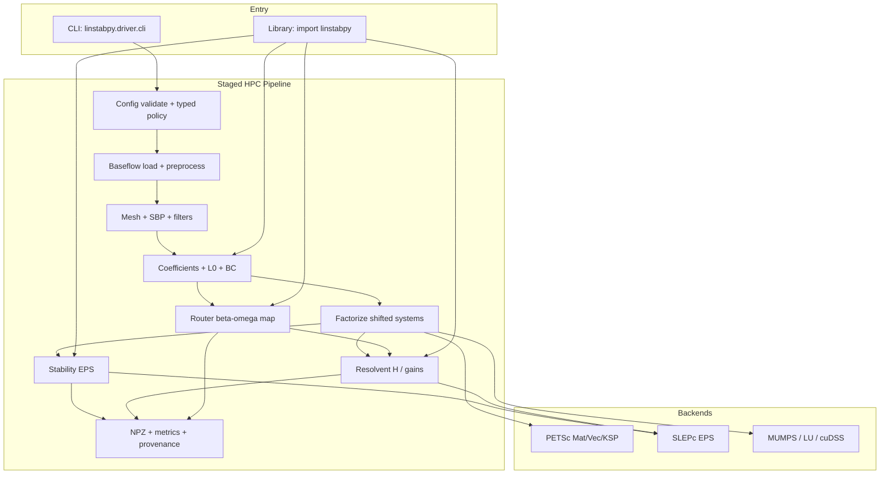

---

## 2. System context

Roles, scope, and external pieces are defined once in [overview](overview.md). The architecture-relevant cut is how the two entry points reach the runtime:

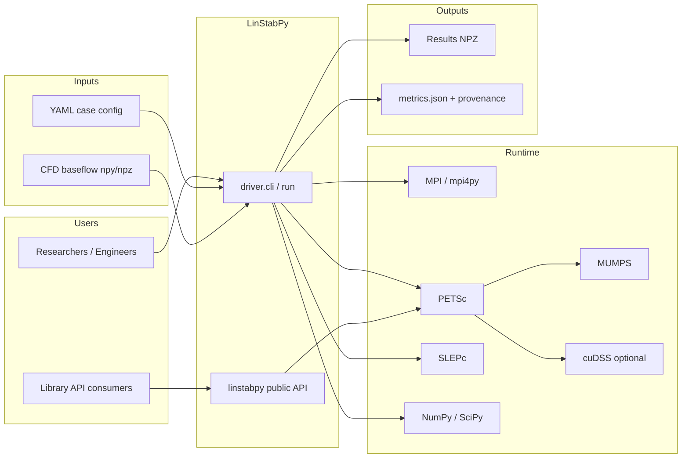

The CLI needs the full stack: MPI with PETSc and SLEPc plus MUMPS underneath, SciPy for local assembly, YAML and base-flow files in, NPZ results with metrics and provenance out. The library needs only NumPy and SciPy until a solve starts; PETSc enters lazily with the first distributed matrix or factorize call. Optional cuDSS factors ride as a PETSc preconditioner shell wherever the backend policy selects them. Solver vocabulary on this page is defined in the [solver glossary](solver-glossary.md).

---

## 3. Container view

Packages here are cohesive Python modules with a runtime and data contract. They run in one MPI process group as a single Python application.

### 3.1 Domain module division

| Domain | Type | Code paths | Role |
|--------|------|------------|------|
| **Case Orchestration** | Core | `driver/`, `__init__.py` | PETSc/MPI init, staged runs, CLI, payload, public lazy API |
| **Configuration Management** | Supporting | `config/` | Merge/validate YAML·env·defaults; typed solver policy |
| **Baseflow Management** | Core | `baseflow/` | Mean-flow ingest, sponge, shock cleanup, viscosity |
| **Mesh Discretization** | Core | `mesh/` | Geometry, SBP ops, filters, deformation, masking |
| **LNSE Operator Assembly** | Core | `operators/`, `boundary_conditions/` | Coefficients, L0/spatial assembly, BC recipes, Chu norm |
| **Stability Analysis** | Core | `stability/`, `solvers/eigenvalue.py`, `spatial_eig.py` | Temporal/adjoint/spatial EPS + sensitivity |
| **Resolvent Analysis** | Core | `resolvent/` | H operator, weighted gains, forcing models |
| **Solver Routing** | Core | `solvers/router/` | \(\beta\)/\(\omega\) maps, anchors, residual gates, RAM autoselect |
| **Linear Algebra** | Infrastructure | `linalg/`, `mumps_options.py` | Factor backends, shifted ops, cuDSS |
| **Shared Utilities** | Infrastructure | `utils/`, `metrics_schema.py` | PETSc bridge, YAML, cost, provenance, Floquet |

### 3.2 Domain module architecture

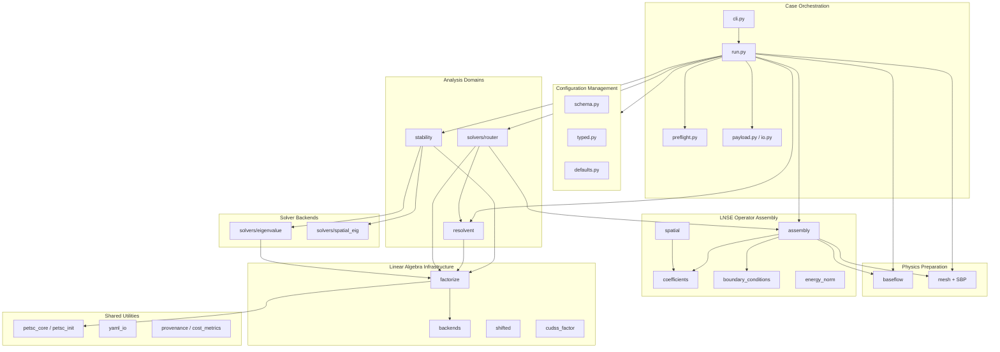

### 3.3 Storage design

LinStabPy is **file-oriented**, not database-backed.

| Store | Form | Contract |
|-------|------|----------|
| Case policy | YAML on disk / env overrides | Merged into typed `Config`; schema-validated |
| Mean flow | npy directory or npz | Primitives `RHO,U,V,W,T` on `(ny,nx)`; optional sponge |
| Runtime operators | In-memory SciPy CSC or PETSc `Mat` | Sparse \(5 N_{gp} \times 5 N_{gp}\) (or reduced free DOFs) |
| Results | NPZ | Fixed key contract in `driver.payload` |
| Metrics | JSON | `metrics_schema.SCHEMA`: provenance, problem, cost, quality |
| Provenance | Embedded in metrics / payload | Config hash/MD5, git SHA, hostname, factor backend/precision |

There is no persistent application database. Reproducibility is achieved through config hashing, schema versioning, and immutable result contracts rather than transactional storage.

### 3.4 Inter-domain module communication

Communication is **in-process Python calls** (service calls, composition, and data hand-off of arrays/matrices), not network RPC.

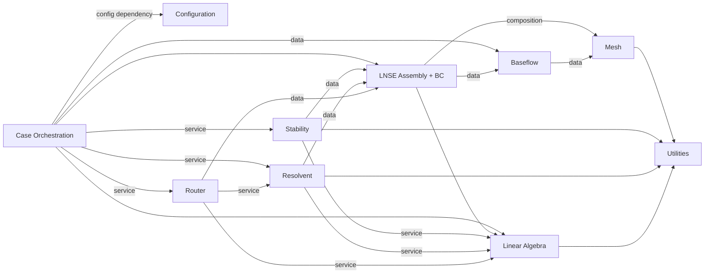

**Strength highlights**

- Orchestration ↔ Stability/Resolvent: primary service calls  
- Assembly ↔ Mesh / Baseflow: composition and data (~strongest physics coupling)  
- Stability / Resolvent / Router ↔ Factorization: shared factorize-once spine  

**Boundary-conditions note:** The `boundary_conditions/` package is physically separate but **logically part of LNSE Operator Assembly**; BC application is the last non-interchangeable step of operator finalization.

---

## 4. Component view

### 4.1 Project structure

```text
src/linstabpy/
├── __init__.py              # Lazy public API (no PETSc on import)
├── metrics_schema.py        # Run metrics JSON contract
├── mumps_options.py         # MUMPS option helpers
├── driver/                  # CLI + case pipeline
├── config/                  # Schema, typed Config, defaults
├── baseflow/                # BaseFlow + I/O + preprocess
├── mesh/                    # Mesh, SBP, filters, FD weights
├── operators/               # LNSE assembly, coefficients, spatial, norms
├── boundary_conditions/     # Dirichlet/Neumann recipes
├── stability/               # Eigenvalue services, acceptance, sensitivity
├── resolvent/               # Operator, gain, analysis
├── solvers/                 # EPS backends + router/
├── linalg/                  # factorize, backends, shifted, cuDSS
└── utils/                   # PETSc init/core, YAML, metrics, provenance
```

**Public library surface** (lazy exports from `linstabpy.__init__`):

- `build_lnse_system`, `build_lnse_operator`  
- `compute_chu_norm`  
- `temporal_eigenvalues`, `adjoint_eigenvalues`  
- `wavemaker`  
- `resolvent_analysis`, `resolvent_map`  
- `BaseFlow`  

**CLI entry:** `linstabpy.driver.cli.main` → lazy import of `driver.run` (so `--version` / `--help` avoid PETSc).

### 4.2 Core functional components

#### 4.2.1 Case orchestration (`driver`)

| Component | Responsibility |
|-----------|----------------|
| `cli.py` | Argparse; cache check (config hash / git SHA); force-recompute env |
| `run.py` | Full pipeline: init PETSc/MPI, load config/fields, mesh, assemble L0, stability/resolvent stages, payload |
| `preflight.py` | Non-blocking semantic advisories (dissipation vs mesh coupling, freestream scale, etc.) |
| `payload.py` / `io.py` | NPZ contract keys; save/load results |

Notable runtime behaviors:

- Stage wall-time and RSS delta logging; optional stage heartbeats  
- Env knobs: `LINSTABPY_CASE_CONFIG`, `LINSTABPY_CASE_OUTPUT_NPZ`, `LINSTABPY_FORCE_RECOMPUTE`, …  
- Alpha-filter treated as an **operator-level** property (not stage-dependent)  

#### 4.2.2 Configuration (`config`)

| Component | Responsibility |
|-----------|----------------|
| `schema.py` | Lenient allowed-key validation + FD-order checks → `ConfigValidationError` |
| `typed.py` | Dataclasses: `Config`, `EigenCfg`, `LinSolveCfg`, `ResolventCfg`, `SpatialCfg`, `MeshCfg`, `MpiCfg` |
| `defaults.py` | Dissipation and other apply defaults |

**Resolution order:** YAML case → environment → defaults.

#### 4.2.3 Baseflow (`baseflow`)

| Component | Responsibility |
|-----------|----------------|
| `BaseFlow` | `(ny, nx)` fields `RHO,U,V,W,T` + `Re,Ma,Pr,kappa,T_0`; viscosity via `sutherland_air` |
| `grid_fields` | npy directory / npz load |
| preprocess / sponge / shock_cleanup / viscosity | Readiness for linearization |

#### 4.2.4 Mesh (`mesh`)

| Component | Responsibility |
|-----------|----------------|
| `Mesh` | Mutable runtime carrier; views `MeshGeometry`, `MeshOperators`, `MeshRuntimeState` |
| SBP (`sbp.py`, `sbp_generator.py`, `fdweights.py`) | Differentiation, norms, dissipation, Mohseni–Colonius pole treatments |
| `filters` | Mattsson-style stabilization attached to mesh runtime |

PETSc-dependent mesh objects are lazy-imported.

#### 4.2.5 LNSE operator assembly (`operators` + `boundary_conditions`)

**Canonical PETSc assembly order** (documented in `assembly.py`; **non-interchangeable**):

1. Assemble raw block operator from coefficients + FD stencils  
2. Apply analytical `inv(B/1j)` left scaling → L0  
3. Add sponge damping  
4. Add artificial dissipation  
5. **Last:** apply BC recipe (Dirichlet/Neumann); free-DOF sets  

State vector: **`q = [ρ, u, v, w, T]`**.  
Supports Cartesian and cylindrical coefficient paths; SciPy CSC and PETSc `Mat` backends.

| Sub-module | Role |
|------------|------|
| Temporal Operator Assembly | Large sparse L0 for temporal/resolvent paths |
| Physical Coefficients | LNSE coeffs, metrics, Chu energy-norm weights |
| Spatial Operator Assembly | Spatial block operators reusing temporal helpers |
| Boundary Condition Recipes | Declarative Dirichlet/Neumann rules and free-DOF masks |

#### 4.2.6 Stability (`stability` + `solvers`)

| Sub-module | Role |
|------------|------|
| Stability Eigenvalue Services | `temporal_eigenvalues` / `adjoint_eigenvalues` / spatial entry; acceptance |
| Eigen Solver Backends | SLEPc EPS shift-invert; residual reorder; conjugate-pair completeness |
| Structural Sensitivity | `wavemaker` from direct + adjoint modes |

#### 4.2.7 Resolvent (`resolvent`)

\[
H = C\,(L_0 - i\omega I)^{-1}\,B
\]

- Factorize shifted operator once; reuse for forward/adjoint applies  
- Weighted normal operator shell for SLEPc; gains \(\sigma = \sqrt{\mathrm{Re}(\lambda)}\)  
- Optional conservative momentum forcing maps  

#### 4.2.8 Solver router (`solvers/router`)

| Piece | Role |
|-------|------|
| `resolvent_map` | Per-\(\beta\) L0 assembly; schedule frequency lines |
| `band_marking` | Label STABLE / SMOOTH / NEAR_POLE bands |
| `map_walk` / `anchors` | Real factor at anchors; later \(\omega\) uses factor as PC; residual gate → refactor |
| `stable_sweep` | Stable-regime sweep strategies |
| `recycling` / `break_even` | Cost-aware reuse decisions |
| `ram_autoselect` | Backend choice under memory policy |
| `certification` | Consistency / RSVD certification hooks |

**Config nuance:** Router dissipation strength is read from top-level `dissipation_epsilon`, while non-router paths may use nested `operator_dissipation.epsilon`. Both enable flags and strength must be set or dissipation is a **silent no-op**.

### 4.3 Technical support components

#### Linear algebra (`linalg`)

| Component | Responsibility |
|-----------|----------------|
| `factorize` / `Factorization` | solve, transpose solve, block solve, refactorize, destroy |
| `backends` | Normalize/probe availability, precision, MUMPS BLR/ordering |
| `shifted_operator` | Build \(L_0 - i\omega I\) and related shifts |
| `cudss_factor` | Optional GPU factor as PETSc PC shell |

**Default path:** KSPPREONLY + PCLU + MUMPS.

#### Shared utilities (`utils` + `metrics_schema`)

| Component | Responsibility |
|-----------|----------------|
| `petsc_init` / `petsc_core` | Init ordering (`mpi4py` before PETSc; thread level MULTIPLE when needed); SciPy↔PETSc conversion |
| YAML I/O, cost metrics, provenance | Cross-cutting reproducibility and ops telemetry |
| Floquet helpers | Supporting periodic-flow utilities |
| `metrics_schema` | Versioned metrics JSON groups |

### 4.4 Component responsibility division (summary)

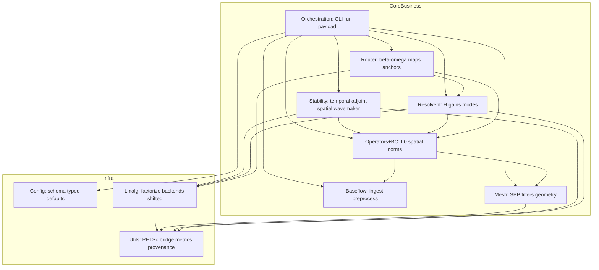

### 4.5 Component interaction relationships

- **Library consumers** may call assembly and analysis APIs directly, bypassing full CLI orchestration, but still depend on the same operator and factorization contracts.  
- **Router** is the only domain that systematically **re-assembles per \(\beta\)** and **walks many \(\omega\)** with measured cost feedback.  
- **Stability and Resolvent** never own mesh generation; they consume finalized operators and energy weights.  
- **Utilities** never own case flow; they underpin conversion, init, and telemetry.

---

## 5. Key processes

### 5.1 Core functional processes

#### 5.1.1 Temporal eigenvalue stability analysis (primary product path)

End-to-end [hydrodynamic stability](https://grokipedia.com/page/Hydrodynamic_stability) for compressible flows: load mean flow, assemble LNSE + BCs, factorize shifted systems, compute temporal (and optionally adjoint) eigenvalues/eigenvectors.

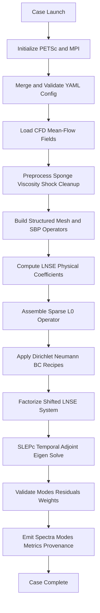

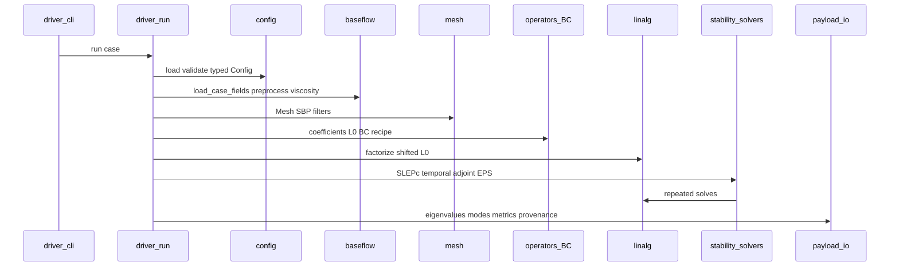

**Key steps**

1. Runtime initialization, PETSc/MPI, logging, distributed orchestration  
2. Configuration resolution, YAML/env/defaults; eigen/mesh/MPI policy  
3. Baseflow ingest, npy/npz → `BaseFlow` + preprocess/transport  
4. Mesh discretization, structured mesh, SBP (2, 4, 6, 8), filters, runtime state  
5. Coefficient generation, Cartesian or cylindrical compressible LNSE coeffs  
6. Operator assembly and BCs, [sparse](https://grokipedia.com/page/Sparse_matrix) L0 for \(q=[\rho,u,v,w,T]\); free DOFs  
7. [Shift-invert](solver-glossary.md) factorization, MUMPS/LU/cuDSS factorize-once  
8. Eigenanalysis, SLEPc [EPS](solver-glossary.md); residuals; optional structural sensitivity  
9. Result emission, NPZ + metrics + provenance  

#### 5.1.2 Resolvent gain analysis (single frequency)

Shares prep through L0, then specializes in \((L_0 - i\omega I)\) factors and weighted gain extraction.

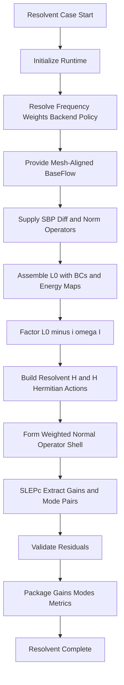

#### 5.1.3 Beta–frequency resolvent gain map (cost-critical production path)

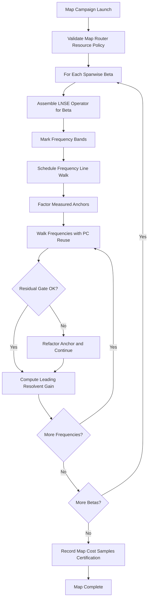

#### 5.1.4 Spatial stability eigenproblem

Config `solver.spatial` (fallback `solver.eigen`) → spatial block operators → generalized SLEPc EPS.

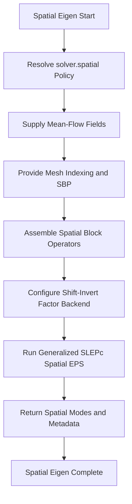

#### 5.1.5 Baseflow ingest and operator prep (shared foundation)

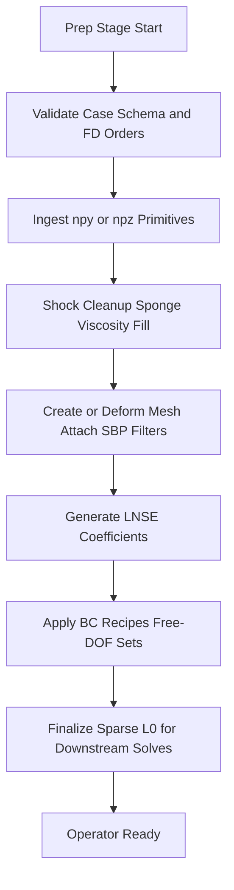

#### 5.1.6 Adjoint and structural sensitivity (supporting path)

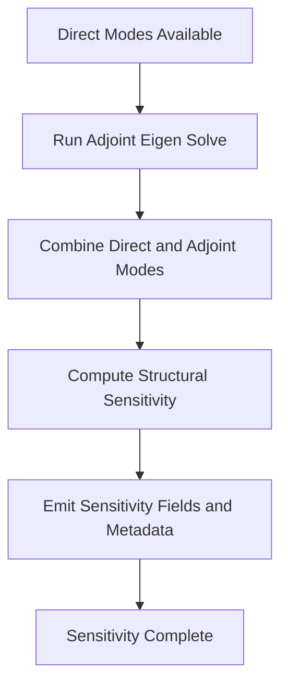

### 5.2 Technical processing workflows

| Concern | Mechanism |
|---------|-----------|
| PETSc init ordering | `mpi4py` before PETSc; complex scalars mandatory for production |
| Operator finalization | Fixed order: raw blocks → inv(B) scale → sponge → dissipation → BC last |
| Shift construction | `linalg.shifted` builds \(L_0 - i\omega I\) (and related) once per target |
| Eigen drive | SLEPc EPS shift-invert using factorization as PC/solve backend |
| Resolvent drive | MatShell weighted normal operator; repeated H / Hᴴ applies via factors |
| Map routing | Band mark → anchors → PC reuse → residual gate → optional stable sweep |
| Backend choice | Probe + RAM autoselect among MUMPS/LU/cuDSS |

### 5.3 Data flow paths

```text
YAML + npy/npz
    → Config (typed) + BaseFlow (ny,nx fields)
    → Mesh (X,Y, Dx,Dy, W, filters)
    → Coefficients + Energy weights (Chu W_diag / invW_diag)
    → L0 PETSc Mat + free-DOF IS + BC-enforced rows
    → Factorization handle(s)
    → Spectra / gains / modes (distributed Vec → gathered arrays)
    → NPZ payload + metrics.json (provenance, cost, quality)
```

**Key data objects**

| Object | Contract |
|--------|----------|
| `BaseFlow` | Parameters + `(ny,nx)` primitives; optional MU / dμ/dT |
| `Mesh` / operators | `X,Y`, SBP `Dx,Dy,…`, weights `W`, optional dissipation |
| `LNSESystem` / L0 | Sparse \(5 N_{gp} \times 5 N_{gp}\) (or reduced free DOFs) |
| BC recipe | Rules → enforced rows + free-DOF index sets |
| Energy weights | Chu norm diagonals `W_diag` / `invW_diag` |
| Runtime NPZ | Fixed keys in `driver.payload` |
| Metrics JSON | provenance, problem, cost, quality groups |

### 5.4 Exception handling and quality gates

| Gate | Behavior |
|------|----------|
| **Schema validation** | Unknown top-level keys / invalid FD orders → `ConfigValidationError` (fail fast before HPC cost) |
| **Preflight advisories** | Non-blocking warnings (dissipation vs mesh coupling, freestream scale) |
| **Residual gates (eigen)** | Mode residual checks, target distance, conjugate-pair completeness |
| **Residual gates (resolvent/map)** | Force refactor when PC-reuse accuracy degrades |
| **Acceptance services** | `stability/acceptance.py` post-checks before payload commit |
| **Certification hooks** | Router consistency / RSVD-style certification metadata |
| **Cache / recompute** | CLI config-hash and git-SHA cache checks; `LINSTABPY_FORCE_RECOMPUTE` override |

There is no distributed saga or compensating transaction model: failures abort the stage with logged metrics where available; partial map results may still be recorded depending on campaign progress.

---

## 6. Technical implementation

### 6.1 Core module implementation

#### Orchestration hub

`driver/run.py` is a large (~1.8k line) façade that owns stage sequencing, timing, and payload emission. This concentration is intentional for scientific reproducibility (one place defines "a case") but is an architectural pressure point for change risk. Library users can bypass it by calling domain APIs directly.

#### Operator assembly

Assembly is the mathematical heart of the system:

- Coefficients encode compressible LNSE physics (Cartesian/cylindrical).  
- SBP stencils supply discrete derivatives and norms with summation-by-parts stability properties.  
- Left scaling by analytical `inv(B/1j)` produces the [temporal operator](core-concepts.md) L0 used by eigen and resolvent paths.  
- Sponge and artificial dissipation are operator-level stabilizations.  
- BC recipes mutate rows/columns and publish free-DOF sets **last**, so solvers never see unconstrained boundary rows.

#### Factorization layer

`Factorization` is the performance spine:

- Default: **KSPPREONLY + PCLU + MUMPS**  
- API: solve, transpose solve, block solve, refactorize, destroy  
- Optional cuDSS as a PETSc PC shell for GPU-capable deployments  
- Shifted systems built once per \((\beta,\omega)\) (or eigen shift) and reused across SLEPc iterations and resolvent matvecs  

#### Analysis products

- **Stability:** SLEPc EPS on shifted L0; adjoint path; wavemaker from direct×adjoint  
- **Resolvent:** \(H = C (L_0 - i\omega I)^{-1} B\); weighted normal eigenproblem; \(\sigma = \sqrt{\mathrm{Re}(\lambda)}\)  
- **Router:** per-\(\beta\) assembly + frequency line walks with measured anchors and residual-gated reuse  

### 6.2 Key algorithm design

| Algorithm area | Design choice | Rationale |
|----------------|---------------|-----------|
| Spatial discretization | SBP FD orders 2, 4, 6, 8 + Mattsson-style filters | Energy-stable structured discretization; MATLAB LinStab2D parity |
| Axisymmetric poles | Mohseni–Colonius treatments | Correct pole behavior on cylindrical grids |
| Temporal eigen | Shift-invert via direct factors | Dense spectral regions near targets; robust on stiff LNSE |
| Resolvent gains | Weighted normal MatShell + SLEPc | Avoid forming dense H; reuse factors for H and Hᴴ |
| Map campaigns | Anchor factors as PC + residual gate | Amortize factorization across nearby \(\omega\); protect accuracy |
| Backend policy | RAM autoselect + MUMPS BLR options | Fit large free-DOF systems into node memory |
| Energy inner product | Chu norm diagonals | Physically meaningful compressible disturbance energy |

### 6.3 Data structure design

| Structure | Representation | Notes |
|-----------|----------------|-------|
| Mean-flow fields | NumPy `(ny, nx)` arrays on `BaseFlow` | Mesh-aligned primitives |
| Mesh operators | Sparse differentiation/norm matrices | Attached to `Mesh` runtime views |
| L0 / spatial blocks | SciPy CSC **or** PETSc `Mat` | Production path is PETSc distributed |
| Free DOFs | PETSc index sets / masks | After BC enforcement |
| Factors | Opaque `Factorization` handle | Owns KSP/PC lifecycle |
| Modes / gains | Distributed `Vec` → NumPy in payload | Gathered for NPZ contract |
| Map records | Structured arrays + cost samples | Router recording + certification |

State dimension scales as **5 degrees of freedom per grid point** (density, three velocities, temperature), reduced by Dirichlet eliminations.

### 6.4 Performance optimization strategies

1. **Factorize-once, solve-many**, Dominant cost is sparse direct factorization; eigen iterations and resolvent applies reuse factors.  
2. **Anchor + PC reuse on maps**, Pay full factor cost at anchors; nearby frequencies reuse as right preconditioners until residual gate trips.  
3. **Break-even / recycling logic**, Router estimates when refactor is cheaper than struggling iterative reuse.  
4. **RAM autoselect**, Choose MUMPS/LU/cuDSS under memory policy; MUMPS BLR compression where available.  
5. **Lazy imports**, Keep CLI help and library import off the PETSc critical path.  
6. **Stage metrics**, Wall time and RSS deltas identify which stage dominates (assembly vs factor vs EPS).  
7. **Optional parallelism across \(\beta\)**, Conceptual extension: parallelize independent \(\beta\) lines when memory allows; keep per-line \(\omega\) walks sequential for factor reuse.  
8. **SciPy local path**, Useful for small debugging assemblies without full MPI cost.

**Primary bottlenecks**

- Sparse direct factor memory and time (grows superlinearly with free DOFs)  
- Per-\(\beta\) reassembly on large maps  
- Monolithic `run.py` and large assembly/coefficient modules (developer throughput, not FLOPs)  
- Dual dissipation config paths (silent no-op risk → wasted or wrong HPC runs)

### 6.5 Scalability design

| Axis | Strategy |
|------|----------|
| **Grid size** | MPI-distributed PETSc matrices; direct sparse solvers |
| **Parameter space (\(\beta,\omega\))** | Router map campaigns with cost-aware reuse |
| **Analysis modes** | Same L0 family → many products without separate physics stacks |
| **Hardware** | CPU complex PETSc/MUMPS default; optional cuDSS GPU factors |
| **Embedding** | Library API for pipeline integration; CLI for batch cases |
| **Extension points** | New BC recipes; new factor backends via registry; new router band strategies; spatial/temporal coefficient models |

### 6.6 Security design

LinStabPy is a **trusted scientific HPC toolkit**, not a multi-tenant service. Security posture is appropriate to that model:

| Concern | Approach |
|---------|----------|
| Multi-tenant auth / isolation | **Out of scope**, runs under cluster user accounts and MPI job schedulers |
| Input trust | YAML and npy/npz are trusted researcher inputs; schema validation rejects unknown keys and bad FD orders but is not a sandbox |
| Code execution | No dynamic code execution from case files beyond configured numeric policy |
| Secrets | No cloud credentials subsystem; provenance records host/git/config hash, not secrets |
| Supply chain | conda-forge PETSc/SLEPc pins; editable package install in controlled envs |
| Result integrity | Config hash, git SHA, metrics schema, residual/certification gates support scientific integrity more than adversarial security |

Hardening guidance for operators: run inside standard HPC job isolation; treat case directories as trusted; do not expose the CLI as an unauthenticated network service.

---

## 7. Deployment architecture

### 7.1 Runtime environment requirements

| Requirement | Detail |
|-------------|--------|
| Python | ≥3.10, <3.14 |
| MPI | Working MPI + `mpi4py` |
| PETSc/SLEPc | **Complex scalar** builds via petsc4py/slepc4py |
| MUMPS | Default sparse-direct backend through PETSc |
| NumPy/SciPy/PyYAML | Local numerics and config |
| Optional cuDSS | GPU sparse direct; not the supported conda default path |
| Resources | Memory-bound for large free-DOF factors; multi-rank for distributed Mat |

**Init constraints**

- Initialize `mpi4py` before PETSc  
- Prefer thread level MULTIPLE when backends require it  
- Do not expect `import linstabpy` alone to set up the parallel runtime  

### 7.2 Deployment topology structure

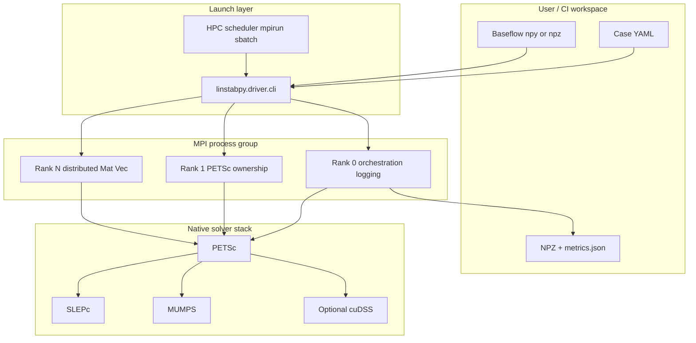

**Typical deployment unit:** one MPI job = one case (or one map campaign). There is no long-running application server.

**Library embedding topology:** parent Python process imports `linstabpy`, explicitly initializes PETSc/MPI when needed, and calls public analysis APIs; I/O may be owned by the parent pipeline.

### 7.3 Scalability in deployment

- **Strong scaling:** PETSc distribution of sparse operators and vectors across ranks  
- **Parameter scaling:** router \(\beta\) loops and frequency walks; future multi-\(\beta\) parallelism where memory permits  
- **Vertical scaling:** larger-memory nodes for MUMPS factors; BLR compression; optional GPU factors  
- **Throughput scaling:** many independent cases via scheduler array jobs (embarrassingly parallel across cases)

### 7.4 Monitoring and operations

| Signal | Source | Use |
|--------|--------|-----|
| Stage wall time | Driver stage logging | Find slow prep vs factor vs EPS |
| RSS / peak memory | Cost metrics | Backend and mesh sizing |
| Optional GPU memory | Metrics when enabled | cuDSS capacity planning |
| Residuals / acceptance | Stability & resolvent validators | Scientific quality gate |
| Map cost samples | Router recording | Tune anchors and break-even |
| Provenance | Config hash, git SHA, hostname, backend/precision | Reproduce and audit runs |
| Preflight advisories | `preflight.py` | Catch policy/mesh mismatches early |
| Heartbeats | Optional stage heartbeats | Long-running map health on HPC |

**Operations guidance**

1. Validate YAML with schema before large allocations.  
2. Start with single-frequency or single-shift cases before full \(\beta\)–\(\omega\) maps.  
3. Watch factor memory first; adjust ranks, BLR, or backend via RAM policy.  
4. Ensure dissipation enable + strength are set consistently (router top-level vs nested operator paths).  
5. Archive NPZ + `metrics.json` together for provenance.  
6. Use config-hash caching and `LINSTABPY_FORCE_RECOMPUTE` deliberately in CI or parameter sweeps.

### 7.5 Development guidance

| Audience | Guidance |
|----------|----------|
| **New contributors** | Learn the stage order and assembly order first; treat BC-last and factorize-once as invariants |
| **Physics developers** | Extend `operators/coefficients` and BC recipes; keep SciPy and PETSc paths aligned |
| **Solver developers** | Extend `linalg/backends` and router walk strategies; never bypass residual gates silently |
| **API consumers** | Prefer lazy public exports; initialize PETSc only on real solve paths |
| **Maintainers** | Consider splitting `run.py` into stage modules behind one façade; unify dissipation config; publish short ADRs for assembly order, factor policy, and router gates |

### 7.6 Architecture risks and recommendations

| Item | Severity | Notes / recommendation |
|------|----------|------------------------|
| No checked-in ADRs | Medium | Publish ADRs for assembly ordering, factor backend policy, residual gates, dissipation single source of truth |
| Monolithic `driver/run.py` | Medium | Extract prep / assemble / stability / resolvent / emit stages; keep one façade |
| Large assembly / coefficients / router modules | Medium | Add internal seams without breaking public contracts |
| Dual dissipation config paths | Medium | Unify nested fields; keep aliases with deprecation warnings |
| Typed config still migrating | Info | Consolidate `typed.py` with `utils._solver_cfg` dual resolution |
| Spatial path less CLI-central | Low | Document spatial and map entry points beside lazy public API |
| GPU path optional / non-conda | Info | Keep CPU complex PETSc as supported default; document cuDSS clearly |

---

## 8. Summary

LinStabPy implements a **clean, domain-aligned LNSE analysis architecture**:

- YAML-driven **Case Orchestration** feeds mesh-aligned **Baseflow** into **SBP Mesh** discretization.  
- **LNSE Operator Assembly** (with declarative **BC recipes**) produces a single family of BC-enforced operators.  
- A shared **Linear Algebra** factorization layer underpins **Stability**, **Resolvent**, and cost-aware **Router** campaigns on **PETSc/SLEPc**.  
- Package boundaries match scientific responsibilities; external CFD generation, GUIs, and unstructured 3D frameworks remain firmly out of scope.

The main architectural pressures are **orchestration monolith size**, **dual config paths for dissipation/solver policy**, and **missing formal ADRs**, not a mismatch between intended domains and the codebase layout.

**Confidence:** High for structure and interaction patterns (research materials corroborated by package APIs, module docs, and dependency wiring).

---

*LinStabPy, linear stability and resolvent analysis of compressible flows.*