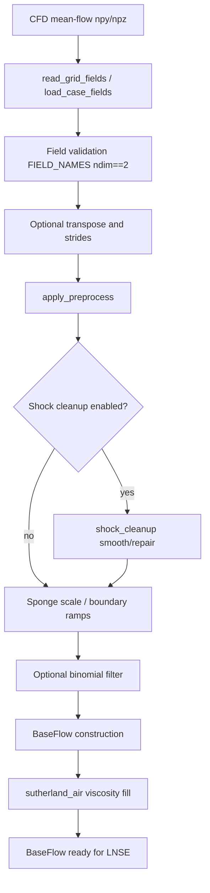
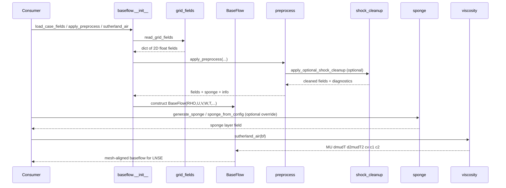

# Baseflow management

!!! info "What this package owns, in one paragraph"
    The base flow is the steady [compressible](https://grokipedia.com/page/Compressible_flow) solution you linearize about. This package loads it from `npy` or `npz` files, cleans it up ([sponge layers](https://grokipedia.com/page/Perfectly_matched_layer), shock treatment, viscosity from Sutherland), and hands mesh aligned `(ny, nx)` arrays to assembly. Fields are nondimensional primitives with freestream density, velocity, and temperature equal to 1. If spectra look wrong, start here: a misaligned or uncleaned base flow propagates directly into every [eigenvalue](https://grokipedia.com/page/Eigenvalues_and_eigenvectors) and [gain](../core-concepts.md).
    New to [PETSc](https://en.wikipedia.org/wiki/PETSc) or [SLEPc](https://en.wikipedia.org/wiki/SLEPc) vocabulary? The [solver glossary](../solver-glossary.md) defines every object named on this page.


## 1. Overview

**Baseflow Management** is a core business domain in LinStabPy. It turns on-disk [CFD](https://grokipedia.com/page/Computational_fluid_dynamics) mean-flow dumps into a mesh-aligned `BaseFlow` object that LNSE coefficient generation and operator assembly can consume.

The domain owns:

- Primitive field I/O (`npy` directories or a single `npz` archive)
- Optional preprocess (shock cleanup, sponge scaling/boundary ramps, binomial filtering)
- Structured sponge generation (presets and mesh-aware smooth profiles)
- Sutherland air viscosity and transport coefficient fill

It does **not** generate nonlinear CFD baseflows. Scope starts at loaded mean-flow files and ends at a completed `BaseFlow` plus sponge field ready for mesh/[SBP](https://grokipedia.com/page/Summation_by_parts) attachment and LNSE linearization.

**Package path:** `src/linstabpy/baseflow/`

**Public package exports** (`linstabpy.baseflow`):

| Symbol | Role |
|--------|------|
| `BaseFlow` | Mean-flow state container |
| `read_grid_fields` | Low-level field dictionary load |
| `load_case_fields` | Full load + preprocess + `BaseFlow` construction |
| `load_grid_fields` | Same as `load_case_fields` without preprocess report |
| `apply_preprocess` | Optional filter / sponge / shock pipeline |
| `generate_sponge` | Structured sponge field generator |
| `sponge_from_config` | Config/preset-driven sponge construction |
| `load_sponge_aux` | Optional MATLAB HDF5 `sponge_aux` loader |
| `sutherland_air` | In-place viscosity and derived coefficients |

`BaseFlow` is also exposed on the top-level lazy public API (`import linstabpy` → `BaseFlow`) without initializing PETSc/[MPI](https://grokipedia.com/page/Message_Passing_Interface).

---

## 2. Role in the System Pipeline

Baseflow Management is stage 3 of the staged scientific pipeline:

```text
config → baseflow → mesh/SBP → coefficients → L0 + BCs → factorize → eigen/resolvent → payload
```

All major analysis products (temporal/[adjoint](https://grokipedia.com/page/Adjoint) eigen, spatial eigen, [resolvent](https://grokipedia.com/page/Resolvent_formalism) gains, β–ω maps) share this preparation path. Downstream LNSE assembly reads primitives (`RHO,U,V,W,T`), parameters (`Re,Ma,Pr,kappa,T_0`), and viscosity derivatives (`MU,dmudT,d2mudT2,cv,c1,c2`). Sponge damping is applied later during operator assembly (after analytical `inv(B/1j)` scaling, before artificial dissipation and BC recipes).



---

## 3. Package Layout

```text
src/linstabpy/baseflow/
├── __init__.py          # Public re-exports
├── baseflow.py          # BaseFlow dataclass
├── grid_fields.py       # npy/npz I/O and case loaders
├── preprocess.py        # Filter, boundary sponge, shock integration
├── shock_cleanup.py     # Opt-in shock sensor / masked filter / shock sponge
├── sponge.py            # Structured sponge generators and presets
└── viscosity.py         # Sutherland air model (LinStab2D port)
```

| Sub-module | Responsibility |
|------------|----------------|
| **BaseFlow Model** | `(ny,nx)` field contracts and nondimensional parameters |
| **Grid Field I/O** | Rectilinear primitive load, stride/transpose, case assembly |
| **Preprocess and Transport** | Shock cleanup, sponge helpers, viscosity fill |

---

## 4. BaseFlow Data Model

### 4.1 Contract

`BaseFlow` (`baseflow.py`) is a plain `@dataclass` over NumPy arrays. All flow fields use shape **`(ny, nx)`**, matching the computational mesh.

| Group | Attributes | Notes |
|-------|------------|-------|
| Parameters | `Re`, `Ma`, `Pr`, `kappa`, `T_0` | Required at construction |
| Primitives | `RHO`, `U`, `V`, `W`, `T` | Required; 2-D float arrays |
| Viscosity | `MU`, `dmudT`, `d2mudT2` | Optional; filled by `sutherland_air` |
| Derived coeffs | `cv`, `c1`, `c2` | Optional scalars; filled by `sutherland_air` |

```python
@dataclass
class BaseFlow:
    Re: float
    Ma: float
    Pr: float
    kappa: float
    T_0: float
    RHO: np.ndarray
    U: np.ndarray
    V: np.ndarray
    W: np.ndarray
    T: np.ndarray
    MU: np.ndarray | None = None
    dmudT: np.ndarray | None = None
    d2mudT2: np.ndarray | None = None
    cv: float | None = None
    c1: float | None = None
    c2: float | None = None
```

### 4.2 Design notes

- Fields are **mutated in place** by loaders and `sutherland_air`; the object is a runtime carrier, not an immutable value object.
- Viscosity is intentionally deferred so cases can load geometry/primitives first, then fill transport once temperature and `T_0` are final.
- State vector convention for LNSE is `q = [ρ, u, v, w, T]`, aligned with these primitive names.

---

## 5. Grid Field I/O

### 5.1 Required field set

`grid_fields.FIELD_NAMES`:

```text
("x", "y", "rho", "u", "v", "w", "T", "sponge")
```

Every field must be present and **exactly 2-D**. Values are coerced to `float` via `_as_field`.

### 5.2 `read_grid_fields(source)`

Loads a dictionary of the eight fields from either:

1. **Single `.npz` file**, keys must match `FIELD_NAMES` exactly; missing keys raise `FileNotFoundError`.
2. **Directory of `.npy` files**, expects `{name}.npy` for each name in `FIELD_NAMES`.

Non-`.npz` files and missing directories raise clear path errors.

### 5.3 `load_case_fields(...)`

Primary case entry. Builds coordinates, a `BaseFlow`, the sponge array, and a preprocess report.

**Signature (keyword parameters after `source`):**

| Parameter | Default | Meaning |
|-----------|---------|---------|
| `Re`, `Ma`, `Pr`, `kappa`, `T_0` | required | Nondimensional / reference parameters |
| `stride_ksi` | `1` | Subsample along second index (`nx`) |
| `stride_eta` | `1` | Subsample along first index (`ny`) |
| `transpose_input` | `False` | Transpose all fields before strides |
| `zero_spanwise` | `False` | Force `W = 0` after preprocess |
| `refuse_asymmetric_stride` | `False` | Reject `stride_ksi != stride_eta` |
| `preprocess` | `None` | Optional preprocess config mapping |

**Processing order:**

1. `read_grid_fields`
2. Optional transpose (`arr.T` for every field)
3. Stride validation (`>= 1`; optional asymmetric refusal)
4. Subsample `arr[::sy, ::sx]` when strides &gt; 1
5. Shape consistency check against `x`
6. `apply_preprocess(X, Y, rho, u, v, w, T, sponge, preprocess)`
7. Optional zero spanwise velocity
8. Construct `BaseFlow` from cleaned primitives

**Returns:**

```text
(X, Y, baseflow, sponge, info)
```

where `info` is the preprocess diagnostic dictionary.

### 5.4 `load_grid_fields(...)`

Thin wrapper around `load_case_fields` that drops `info` and does not pass a preprocess config (preprocess remains disabled). Returns `(X, Y, baseflow, sponge)`.

### 5.5 Indexing convention

After optional transpose, arrays are `(ny, nx)`:

- `stride_eta` walks the **first** index
- `stride_ksi` walks the **second** index

This matches structured-mesh conventions used by mesh/SBP construction.

---

## 6. Preprocess Pipeline

### 6.1 Entry point

`apply_preprocess(X, Y, rho, u, v, w, T, sponge, preprocess_cfg)` applies optional operations and returns the same arrays plus an `info` report.

If `preprocess_cfg` is `None` or `enabled` is false, inputs are returned unchanged with `summary: "disabled"`.

When enabled, stages run in this order:

1. **Shock cleanup** (`preprocess.shock`), if nested `enabled`
2. **Sponge scale** (`preprocess.sponge.scale`)
3. **Boundary sponge ramps** (`preprocess.sponge.boundary`)
4. **Explicit binomial filter** (`preprocess.filter`)

Coordinates `X` and `Y` are currently passed through unchanged (reserved for future geometry-aware steps).

### 6.2 Boundary sponge (preprocess-local)

`_generate_boundary_sponge` builds quadratic ramps on edges ordered **`[top, right, bottom, left]`**:

- Top/bottom act on the first array axis (`ny`)
- Right/left act on the second array axis (`nx`)

Modes relative to the existing sponge field:

| Mode | Behavior |
|------|----------|
| `add` (default) | `sponge += generated` |
| `max` | `sponge = maximum(sponge, generated)` |
| `replace` | `sponge = generated` |

Config keys: `points` (ints), `amplitudes` (floats), both length-4 lists.

### 6.3 Explicit binomial filter

- Kernel: 5-point binomial `[1,4,6,4,1]/16` with edge padding
- Directions: `"x"` → axis 1, `"y"` → axis 0
- Default fields: `rho, u, v, T` (optional `w`)
- Optional wall-normal window via `eta_min_index` / `eta_max_index` (slice on first index)
- Multiple passes; relative L2 change recorded per field in `info`

### 6.4 Preprocess `info` contract

Typical keys:

- `enabled`, `applied` (list of stage tags), `summary`
- `filter`: enabled, passes, fields, directions, eta window, optional `relative_l2_change`
- `sponge`: scale, boundary details, final `max`
- `shock`: nested diagnostics when shock cleanup ran

---

## 7. Shock Cleanup

Module: `shock_cleanup.py`. Fully **opt-in** so default Case 1 / Case 2 workflows stay untouched.

### 7.1 Configuration merge

`_normalize_cfg` deep-merges user config onto defaults:

```python
_DEFAULT_CFG = {
    "enabled": False,
    "sensor": {
        "enabled": False,
        "kind": "compression_ducros",
        "compression_threshold": -1.0,
        "ducros_threshold": 0.95,
        "eps": 1.0e-14,
        "buffer_cells": 3,
        "blend_sigma": 0.0,
    },
    "filter": {
        "enabled": False,
        "passes": 1,
        "directions": ["x", "y"],
        "fields": ["rho", "u", "v", "T"],
    },
    "sponge": {
        "enabled": False,
        "amplitude": 0.0,
        "mode": "add",
        "smooth_sigma": 0.0,
    },
}
```

### 7.2 Shock sensors

Physical derivatives use computational gradients of `X,Y` and the field, with a safeguarded Jacobian.

| Kind | Logic |
|------|--------|
| `compression_ducros` (default) | Mask where `div ≤ compression_threshold` and Ducros ratio `div²/(div²+vort²+ε) ≥ ducros_threshold` |
| `compression_only` | Mask on divergence threshold only |
| `modified_ducros` | Reserved; raises `NotImplementedError` |

Post-processing:

- `buffer_cells`: binary dilation of the mask
- `blend_sigma`: Gaussian blend → `preserve_weight` in `[0,1]` (buffered cells forced to 1)

### 7.3 Masked filtering

`_apply_masked_filter` blends original and binomial-smoothed values:

```text
filtered = preserve_weight * original + (1 - preserve_weight) * candidate
```

Shock-adjacent cells are preserved; smooth regions are cleaned. Valid fields: `rho, u, v, w, T`.

### 7.4 Shock-local sponge

Optional amplitude field supported on the buffered mask (optional Gaussian smooth), combined with the existing sponge via `add` or `max`.

### 7.5 Guardrails

If filter or shock-sponge is enabled while `sensor.enabled` is false, cleanup raises:

```text
shock_cleanup.sensor.enabled must be true when filter or sponge cleanup is enabled
```

`apply_optional_shock_cleanup` always returns copies when enabled paths run, plus diagnostics (`mask_fraction`, L2 changes, sponge max, etc.).

---

## 8. Structured Sponge Generation

Module: `sponge.py`. Complements preprocess boundary ramps with full mesh-aware generators used when building or overriding sponge layers from YAML.

### 8.1 Edge ordering

```text
EDGE_NAMES = ("top", "right", "bottom", "left")
```

Direction vectors (`pts_dir`, `amp_dir`, `width_dir`, `width_frac_dir`) always use this order.

> **Implementation note:** Comments in `sponge.py` document that for index-based generators (`constant` / `parabolic` / `localized`), top/bottom act on the **second** array axis and right/left on the **first**. Smooth generators use physical arc-length distance fields derived from `X` and `Y` instead of pure index strips.

### 8.2 Presets (`SPONGE_PRESETS`)

| Preset | Type | Typical use |
|--------|------|-------------|
| `localized_stability` | `localized` | Stability absorbing layers |
| `localized_resolvent` | `localized` | Resolvent absorbing layers |
| `smooth_soft` / `smooth_medium` / `smooth_quarter` / `smooth_half` / `smooth_unit` / `smooth_double` | `smooth_localized` | Fraction-width smooth ramps with increasing amplitude |

### 8.3 `generate_sponge`

Supported `sponge_type` values:

| Type | Description |
|------|-------------|
| `constant` | Constant amplitude strips by point counts |
| `parabolic` | Quadratic ramp strips by point counts |
| `localized` | Product of edge masks × amplitude |
| `smooth` / `smooth_boundary` | Per-edge smooth ramps blended by `max` / additive / RSS |
| `smooth_localized` | Product of per-edge smooth ramps × max active amplitude |

Smooth types **require** `X` and `Y`. Widths may combine absolute `width_dir` with fractional `width_frac_dir` scaled by median boundary reference lengths.

Smooth profiles: `smoothstep`, `smootherstep` (default), `cosine`, `tanh` (uses `steepness`). Optional `power` exponent on the ramp.

### 8.4 `sponge_from_config`

```text
if not cfg or not enabled → zeros(shape)
else merge preset (if any) with explicit keys → generate_sponge
```

Unknown presets raise `ValueError` listing allowed keys.

### 8.5 `load_sponge_aux`

Optional MATLAB compatibility path: reads `sponge_aux` from an HDF5 `.mat` via `h5py` (optional dependency). Must be 2-D.

---

## 9. Viscosity and Transport Coefficients

### 9.1 `sutherland_air(bf)`

Port of LinStab2D `sutherland_air.m`. Mutates `bf` in place using NumPy only (no PETSc).

**Derived scalars:**

\[
c_v = \frac{1}{\kappa(\kappa-1)Ma^2},\quad
c_1 = (\kappa-1)\,Re\,Pr\,Ma^2,\quad
c_2 = \kappa\,Ma^2
\]

**Sutherland constants (air):**

| Symbol | Value |
|--------|-------|
| \(S_1\) | 110.4 K |
| \(T_{\mathrm{ref}}\) | 280.0 K |
| \(\mu_{\mathrm{ref}}\) | \(1.735\times 10^{-5}\) Pa·s |

Dimensional temperature: \(T^\* = T \cdot T_0\).

Viscosity and first two temperature derivatives are computed dimensionally, then nondimensionalized:

\[
\mu \leftarrow \mu/\mu_0,\quad
\frac{d\mu}{dT} \leftarrow \frac{d\mu}{dT^\*}\frac{T_0}{\mu_0},\quad
\frac{d^2\mu}{dT^2} \leftarrow \frac{d^2\mu}{dT^{*2}}\frac{T_0^2}{\mu_0}
\]

where \(\mu_0\) is Sutherland viscosity evaluated at reference \(T_0\).

### 9.2 Downstream use

LNSE coefficient generation needs `MU`, `dmudT`, and often `d2mudT2` for viscous linearization of compressible [Navier–Stokes](https://grokipedia.com/page/Navier–Stokes_equations). Call `sutherland_air` after preprocess and before coefficient assembly.

---

## 10. Interaction Sequence



### 10.1 Upstream consumers

- **Case Orchestration** (`driver`): loads case fields after config validation; records preprocess info in metrics/provenance.
- **Library API users**: construct `BaseFlow` manually or via loaders without PETSc init.

### 10.2 Downstream consumers

- **Mesh Discretization**: uses returned `X,Y` (and shape) for geometry/SBP.
- **LNSE Operator Assembly**: reads primitives, viscosity, and sponge; assembly order applies sponge after `inv(B)` scaling and before dissipation/BCs.
- **Stability / Resolvent / Router**: inherit prepared mean flow through assembled operators.

### 10.3 Domain relations (strength)

| Relation | Type | Strength |
|----------|------|----------|
| Case Orchestration → Baseflow | Data dependency | High |
| LNSE Assembly → Baseflow | Data dependency | High (~9.5) |
| Baseflow → Mesh | Data dependency (shape/geometry alignment) | Medium–High |

---

## 11. Configuration Patterns

Illustrative YAML fragments (keys as consumed by the baseflow modules):

```yaml
# Physical parameters supplied to load_case_fields
Re: 1000.0
Ma: 0.8
Pr: 0.72
kappa: 1.4
T_0: 288.15

# Optional preprocess block passed as preprocess=
preprocess:
  enabled: true
  shock:
    enabled: false
    sensor:
      enabled: true
      kind: compression_ducros
      compression_threshold: -1.0
      ducros_threshold: 0.95
      buffer_cells: 3
    filter:
      enabled: true
      passes: 1
      fields: [rho, u, v, T]
      directions: [x, y]
    sponge:
      enabled: false
      amplitude: 0.0
      mode: add
  sponge:
    scale: 1.0
    boundary:
      enabled: false
      mode: add
      points: [0, 0, 0, 0]
      amplitudes: [0.0, 0.0, 0.0, 0.0]
  filter:
    enabled: false
    passes: 0
    fields: [rho, u, v, T]
    directions: [x, y]

# Optional standalone sponge generator config (sponge_from_config)
sponge:
  enabled: true
  preset: localized_stability
  # or explicit:
  # type: smooth_localized
  # width_frac_dir: [0.0, 0.28, 0.28, 0.0]
  # amp_dir: [0.0, 1.0, 1.0, 0.0]
  # profile: smootherstep
```

Loader options such as `stride_ksi`, `stride_eta`, `transpose_input`, and `zero_spanwise` are typically wired from mesh/case sections by the driver.

---

## 12. Practical Usage

### 12.1 Standard case load

```python
from linstabpy.baseflow import load_case_fields, sutherland_air

X, Y, bf, sponge, info = load_case_fields(
    "path/to/meanflow_dir_or.npz",
    Re=1000.0,
    Ma=0.8,
    Pr=0.72,
    kappa=1.4,
    T_0=288.15,
    stride_ksi=1,
    stride_eta=1,
    preprocess={"enabled": False},
)
sutherland_air(bf)
# bf.MU, bf.dmudT, bf.d2mudT2, bf.cv, bf.c1, bf.c2 now populated
```

### 12.2 Manual BaseFlow + sponge preset

```python
import numpy as np
from linstabpy.baseflow import BaseFlow, sponge_from_config, sutherland_air

ny, nx = Y.shape
bf = BaseFlow(Re=..., Ma=..., Pr=..., kappa=..., T_0=...,
              RHO=rho, U=u, V=v, W=w, T=T)
sponge = sponge_from_config(
    (ny, nx),
    {"enabled": True, "preset": "smooth_unit"},
    X=X,
    Y=Y,
)
sutherland_air(bf)
```

### 12.3 Library embedding without PETSc

`from linstabpy.baseflow import BaseFlow, load_grid_fields, sutherland_air` does not initialize PETSc/MPI. This supports operator-prep debugging and embedding in larger pipelines before any eigen/resolvent solve.

---

## 13. Validation, Errors, and Diagnostics

| Check | Failure mode |
|-------|----------------|
| Missing npy/npz keys | `FileNotFoundError` |
| Non-2-D field | `ValueError` with shape |
| Mismatched field shapes | `ValueError` vs `x` shape |
| Invalid strides | `ValueError` (`< 1` or asymmetric when refused) |
| Bad preprocess types | `TypeError` for non-mappings |
| Bad edge vectors | `ValueError` (must be four entries) |
| Shock filter without sensor | `ValueError` |
| Unknown sponge preset/type/profile | `ValueError` |
| MATLAB sponge without h5py | `ModuleNotFoundError` |

Diagnostics are first-class: preprocess and shock cleanup return structured `info` dictionaries suitable for metrics/provenance logging (mask fractions, relative L2 changes, sponge maxima, applied stage tags).

---

## 14. Implementation Characteristics

| Aspect | Detail |
|--------|--------|
| Dependencies | NumPy core; SciPy `ndimage` for shock dilation/Gaussian; optional `h5py` for MATLAB sponge |
| Parallelism | Local array work; no MPI inside baseflow (distribution begins at PETSc conversion later) |
| Mutation model | In-place viscosity fill; preprocess returns new/updated arrays; shock path copies when active |
| MATLAB heritage | Viscosity law and field packing align with LinStab2D workflows |
| Safety default | Shock cleanup and most preprocess stages default **off** |

---

## 15. Extension Points

1. **Additional viscosity laws**, parallel to `sutherland_air`, mutating the same optional fields.
2. **New sponge profiles/presets**, extend `_smooth_profile` or `SPONGE_PRESETS`.
3. **Shock sensor kinds**, `modified_ducros` is reserved for a group-supplied formula.
4. **Geometry-aware preprocess**, `X,Y` already thread through `apply_preprocess` for future deformation-aware cleanup.
5. **Richer I/O**, `read_grid_fields` is the single choke point for new archive layouts.

---

## 16. Summary

Baseflow Management is the **mean-flow readiness layer** of LinStabPy. It enforces a strict `(ny,nx)` primitive contract, loads CFD dumps from `npy`/`npz`, optionally cleans shocks and builds absorbing layers, and fills Sutherland transport coefficients required by compressible LNSE linearization. The module is deliberately free of PETSc/SLEPc concerns so it can run as a lightweight library stage or as the shared foundation of every stability and resolvent workflow.

**Key files for implementers:**

- `baseflow.py`, state contract  
- `grid_fields.py`, I/O and case assembly  
- `preprocess.py`, orchestrated cleanup  
- `shock_cleanup.py`, opt-in shock treatment  
- `sponge.py`, absorbing-layer generation  
- `viscosity.py`, air transport fill