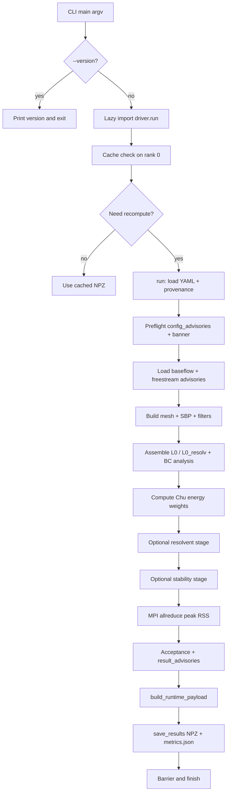
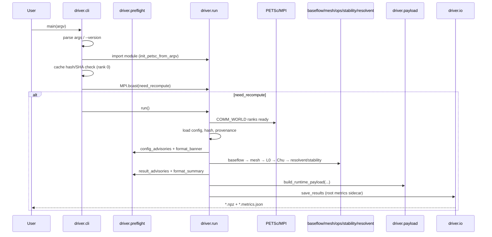
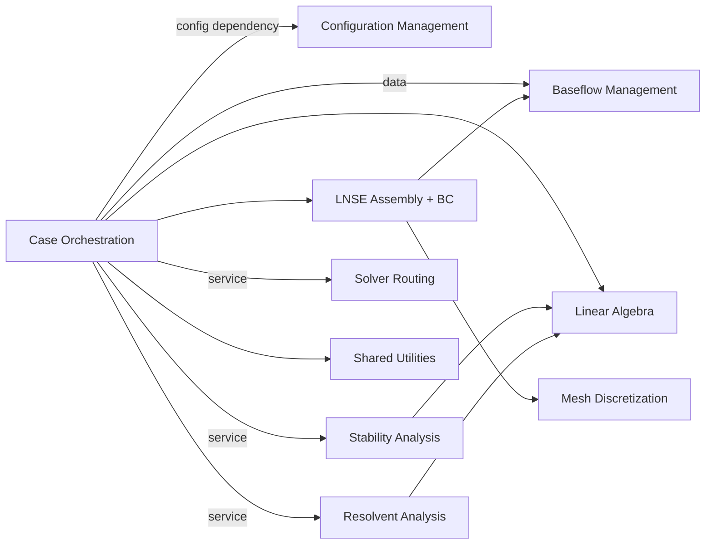

# Case orchestration

The driver in `driver/run.py` defines what a case means: init [MPI](https://grokipedia.com/page/Message_Passing_Interface) and [PETSc](https://en.wikipedia.org/wiki/PETSc) in the right order, merge and validate config, load fields, build mesh, assemble $L_0$, factorize, solve, postcheck, and write the `npz` payload with metrics and provenance. Library users can bypass it and call domain functions directly, but the stage order here is the reference. Heavy work starts only on solve paths. Plain imports stay light.

Solver objects (`KSP`, `PC`, `EPS`, `ST`, `MatShell`) are defined in the [solver glossary](../solver-glossary.md).


## Overview

**Case orchestration** is the end-to-end LNSE case pipeline. It turns a YAML case policy and [CFD](https://grokipedia.com/page/Computational_fluid_dynamics) mean-flow dumps into stability spectra, [resolvent](https://grokipedia.com/page/Resolvent_formalism) [gains](../core-concepts.md), metrics, and provenance artifacts on MPI-enabled HPC.

The domain does **not** implement physics discretization or eigen/resolvent numerics itself. It:

1. Initializes PETSc/MPI at the correct time (not on package import)
2. Resolves configuration, paths, and environment policy
3. Coordinates staged workflows across baseflow, mesh, operators, stability, and resolvent
4. Emits heartbeats, stage timing, and rank-aware logging
5. Assembles contract-stable NPZ payloads and metrics sidecars
6. Surfaces non-blocking semantic advisories for configurations that "run but lie"

| Attribute | Value |
|-----------|--------|
| **Primary package** | `src/linstabpy/driver/` |
| **Public package surface** | `src/linstabpy/__init__.py` |
| **Runtime hub** | `driver/run.py` (`run()`) |
| **CLI entry** | `driver/cli.py` (`main`) |


## Module Structure

```
src/linstabpy/
├── __init__.py                 # Package Public API (lazy, PETSc-free)
└── driver/
    ├── __init__.py             # Empty public surface; documents lazy boundary
    ├── cli.py                  # Cache-aware CLI entry
    ├── run.py                  # Staged pipeline driver (PETSc/MPI init on import)
    ├── preflight.py            # Non-blocking semantic advisories
    ├── payload.py              # RUNTIME_NPZ contract + payload merge
    └── io.py                   # Rank-aware NPZ + metrics.json I/O
```

### Sub-modules

| Sub-module | Paths | Role |
|------------|-------|------|
| **Runtime Pipeline Driver** | `run.py`, `preflight.py`, `driver/__init__.py` | PETSc/MPI init, config hashing, distributed orchestration, stage timing/heartbeats, stability/resolvent stage execution |
| **CLI and I/O Payload** | `cli.py`, `io.py`, `payload.py` | Argparse entry, cache invalidation, NPZ contract assembly, root-rank metrics sidecar |
| **Package Public API** | `linstabpy/__init__.py` | Lazy export of library symbols without starting PETSc/MPI |


## Design Principles

### Lazy loading and deferred PETSc/MPI

A plain `import linstabpy` **must not** initialize PETSc or MPI. This keeps `--help` / `--version`, unit tests, and library embedding lightweight.

- Package `__init__.py` uses PEP 562 `__getattr__` with `_LAZY_EXPORTS`.
- `driver/__init__.py` exports nothing and documents that the heavy runtime lives in `driver.run`.
- `cli.main` imports `linstabpy.driver.run` **only after** handling `--version`.
- `driver/run.py` calls `init_petsc_from_argv()` at module import time, then imports `mpi4py` / `petsc4py`. Importing `run` is therefore the intentional PETSc/MPI boundary.

### Staged scientific pipeline

The driver is a **staged pipeline**, not a service mesh:

```
config → baseflow → mesh/SBP → L0 + BCs → Chu norm → resolvent / stability → payload
```

Each expensive stage records wall time and RSS delta, and long stages emit periodic heartbeats so multi-hour HPC jobs remain observable.

### Advisories never block

`preflight.py` catches semantic traps that schema validation cannot see (legal keys that jointly produce meaningless results). Advisories are logged and the run continues. Only pre-existing hard errors (schema, solver failures, invalid `reduce_dirichlet_set`, root-assembly + resolvent conflict) abort.

### Reproducibility contracts

- Config SHA-256 hash (sorted-key JSON)
- Git SHA in provenance and default output filenames
- Fixed `RUNTIME_NPZ_CONTRACT_KEYS`
- Metrics schema groups: provenance, problem, cost, quality
- CLI cache check: reuse NPZ when config hash and git SHA still match


## Runtime Flow

### End-to-end flowchart



### Sequence (CLI → payload)




## Component Implementation

### Package Public API (`linstabpy/__init__.py`)

**Purpose:** Import-safe library surface for embedding LNSE workflows without a full case driver.

**Lazy exports** (`_LAZY_EXPORTS`):

| Public name | Target |
|-------------|--------|
| `build_lnse_system` | `operators.assembly.build_lnse_system` |
| `build_lnse_operator` | `operators.assembly.build_lnse_operator` |
| `compute_chu_norm` | `operators.energy_norm.compute_chu_norm` |
| `temporal_eigenvalues` | `stability._eigenvalues.eigenvalues` |
| `adjoint_eigenvalues` | `stability._eigenvalues.adjoint_eigenvalues` |
| `wavemaker` | `stability.sensitivity.wavemaker` |
| `resolvent_analysis` | `resolvent.analysis.resolvent_analysis` |
| `resolvent_map` | `solvers.router.resolvent_map.resolvent_map` |
| `BaseFlow` | `baseflow.BaseFlow` |

Version resolution prefers `pyproject.toml`, then installed package metadata, else `0.0.0+dev`.

**Usage pattern:**

```python
import linstabpy  # no PETSc/MPI

# First use loads the target module and caches the attribute
omega, modes = linstabpy.temporal_eigenvalues(...)
```


### CLI (`driver/cli.py`)

**Entry:** `python -m linstabpy.driver.cli` or `main(argv)`.

**Behavior:**

1. Build a minimal `argparse` parser (`--version` only; remaining argv goes through `parse_known_args`: single-dash tokens (plus one following value) are left for the PETSc option database; bare words and double-dash tokens warn on stderr (rank 0) and are ignored).
2. On `--version`, print package version and return **without** importing `run`.
3. Otherwise lazy-import `linstabpy.driver.run` (PETSc/MPI init side effect).
4. On rank 0, decide whether to recompute:
   - `LINSTABPY_FORCE_RECOMPUTE` in `{1, true, yes, on}` → always recompute
   - Else try `load_results(output_npz)` and compare:
     - `provenance_config_hash` vs current `_config_hash(config)[:16]`
     - `provenance_linstabpy_git_sha` vs `_git_head_sha()`
   - Missing/invalid cache → recompute
5. Broadcast `need_recompute` with `MPI.COMM_WORLD.bcast`.
6. If true, call `runtime.run()`.

The cache check reads the config path from `LINSTABPY_CASE_CONFIG`, as the driver does. The CLI stops with an error when the variable is unset.


### Runtime Pipeline Driver (`driver/run.py`)

`run.py` is the service hub (~1.8k lines). Importing it:

1. Calls `init_petsc_from_argv()` so PETSc/SLEPc parse process argv once
2. Imports `mpi4py.MPI` and `petsc4py.PETSc`
3. Pulls domain services (baseflow, mesh, assembly, stability, resolvent, router helpers)

#### Environment and path helpers

| Helper | Responsibility |
|--------|----------------|
| `_first_env(name)` | Stripped value of one environment variable, or `None` when unset or empty |
| `_runtime_config_path()` | Config path from `LINSTABPY_CASE_CONFIG`; raises `ConfigValidationError` when unset |
| `_output_npz_path()` | Explicit env path or `{prefix}_{config_md5}_{sha8}.npz` |
| `_log_prefix()` | `LINSTABPY_CASE_LOG_PREFIX` (default `linstabpy`) |
| `_config_hash(dict)` | SHA-256 of sorted-key JSON |
| `_log` / `_log_stage` | Rank-0 progress and machine-parseable stage lines |
| `_stage_heartbeat` | Daemon thread "still alive" logs (default 30 s) |
| `_effective_alpha_filter` | Operator-level filter; **not** stage-dependent |

**Important environment variables:**

| Variable | Role |
|----------|------|
| `LINSTABPY_CASE_CONFIG` | YAML case path |
| `LINSTABPY_CASE_OUTPUT_NPZ` | Output archive path |
| `LINSTABPY_FORCE_RECOMPUTE` | Skip cache |
| `LINSTABPY_CASE_LOG_PREFIX` | Log / default filename prefix |
| `LINSTABPY_STAGE_HEARTBEAT_SECONDS` | Heartbeat interval (float seconds) |
| `LINSTABPY_CASE_ROOT_ASSEMBLY` | Root-only operator assembly for iterative eigen (stability-only) |

#### Stage functions (internal)

| Stage | Function | Downstream domains |
|-------|----------|--------------------|
| Load config | `_stage_load_runtime_config` | Configuration Management |
| Load case fields | `_stage_load_case` | Baseflow Management |
| Build mesh | `_stage_build_mesh` | Mesh Discretization |
| Assemble operators | `_stage_assemble_operators` | LNSE Operator Assembly + BCs |
| Chu norm | `_stage_compute_chu_norm` | Operator energy norm |
| Resolvent | `_stage_run_resolvent` | Resolvent Analysis (+ router B/C maps) |
| Stability | `_stage_run_stability` | Stability Analysis |
| Acceptance | `_stage_evaluate_stability_acceptance` | Stability acceptance helpers |

Frozen dataclasses (`_AssemblyStageResult`, `_ResolventStageResult`, `_StabilityStageResult`, …) keep stage boundaries explicit and return shape-stable empty arrays when a stage is disabled.

#### `run()` pipeline body

1. **Config resolution**, load YAML, provenance, typed `Config`, analysis flags (`run_stability`, `run_resolvent`), dissipation effective epsilons per stage, sponge policy, alpha filter, solver backend provenance.
2. **Banner + preflight** (rank 0), `format_banner` of **effective** values; `config_advisories`.
3. **Baseflow**, `load_case_fields`, Sutherland viscosity; freestream advisories (`rho = u = T = 1`).
4. **Mesh**, structured mesh, [SBP](https://grokipedia.com/page/Summation_by_parts) operators, filters, optional dissipation attachment.
5. **Assembly**, `build_lnse_system_result` for stability epsilon; optional second assembly when resolvent epsilon differs; BC analysis ([Dirichlet](https://grokipedia.com/page/Dirichlet_boundary_condition)/[Neumann](https://grokipedia.com/page/Neumann_boundary_condition)/overlap index sets).
6. **[Chu](../core-concepts.md) weights**, `W_diag`, `invW_diag` for weighted eigen/resolvent.
7. **Resolvent (optional)**, `_forcing_response_mats` (same region masking as `resolvent_map`), then `resolvent_analysis` with residuals.
8. **Stability (optional)**, temporal path `eig(i*L0)` (MATLAB parity) or diagnostic `use_raw_eigs`; optional Dirichlet DOF reduction; postcheck residuals and BC leakage.
9. **Collective RSS**, `MPI.COMM_WORLD.allreduce(..., SUM)` **on every rank** before rank-0 save (avoids deadlock).
10. **Acceptance + summary**, residual gates, conjugate-pair completeness, `result_advisories`, `format_summary`.
11. **Emit**, `build_runtime_payload` → `save_results` → barrier.

#### Operator and numerics policies owned by the driver

- **Alpha filter** is an operator-level property. Earlier code silently forced `"none"` on EVP-only runs; that produced pixel-scale sawtooth [eigenvectors](https://grokipedia.com/page/Eigenvalues_and_eigenvectors). The driver now honors the configured value for every stage.
- **Dissipation** uses nested `numerics.operator_dissipation` with per-stage `apply_to_stability` / `apply_to_resolvent`. Effective epsilons:
  - `eps_stab = epsilon if enabled and apply_to_stability else 0`
  - `eps_resolv = epsilon if enabled and apply_to_resolvent else 0`
- **Root assembly** is allowed only with iterative eigen ST solvers and **must not** combine with resolvent under MPI (`RuntimeError` if both requested).
- **Stability convention:** default MATLAB parity uses `omega = eig(i * L0)`; `analysis.use_raw_eigs` is diagnostic-only.

#### Distributed helpers

- `_build_distributed_vec_from_global_array`, ownership-aware PETSc Vec fill
- `_restrict_operator_for_stability` / `_expand_reduced_modes`, free-DOF reduction for Dirichlet-constrained EVPs (SciPy CSC or PETSc submatrix)
- `_postcheck_stability_modes`, residual split (interior vs BC), Dirichlet leak stats, target distance


### Preflight Advisories (`driver/preflight.py`)

**Design rules (from module docstring):**

1. Advisories never block long jobs
2. Pure functions over plain data (no PETSc, no I/O)
3. Every advisory carries a greppable `code` and a concrete `remedy`

#### `Advisory` dataclass

```text
code: str          # stable, greppable
severity: str      # "warning" | "note"
message: str
remedy: str
render() -> str    # "[WARNING] CODE: message\n -> remedy"
```

#### Check families

| API | When | Examples |
|-----|------|----------|
| `config_advisories(config)` | Before assembly | `DISS-RESOLVENT-OFF`, `DISS-STABILITY-OFF`, `DISS-UNDECLARED`, `DISS-EPS-ZERO`, `STRIDE-NOT-FINAL`, `BACKEND-SHADOWED`, `BAND-MARKING-BACKEND` |
| `baseflow_advisories(rho, u, T)` | After load | `BASEFLOW-FREESTREAM` (note, with the share of the field at rho = u = T = 1 within `FREESTREAM_TOL` = 1e-2), `BASEFLOW-NORMALISATION`, `BASEFLOW-NONFINITE`, `BASEFLOW-SHAPE` |
| `mesh_advisories(X, Y, dissipation_enabled=...)` | After load, mesh known | `DISS-MESH` (note, with the measured coupling), `DISS-ABSENT` when the coupling is above `METRIC_COUPLING_GATE` and no dissipation is applied |
| `metric_cross_coupling(X, Y)` | Mesh geometry | Ratio of cross-direction spacing; gate `METRIC_COUPLING_GATE = 1e-8` separates rectilinear (~1e-17) from curvilinear (~0.26) meshes |
| `result_advisories(gains, residuals, …)` | After solve | `GAIN-OFF-SCALE` (>1e5), `RESIDUAL-HIGH` |
| `translate_solver_error(context)` | On factor failure | Maps MUMPS `INFOG(1)` codes (-9, -8, -13, -10) to workspace/OOM/singularity remedies |

**Band-marking backend trap:** resolvent map band-marking EVPs read `solver.eigen`, not `solver.resolvent`. A config that only scales the resolvent backend can stall for hours on the default direct eigen path. Preflight emits `BAND-MARKING-BACKEND` when that pattern is detected and band marking is not skipped.

**Formatting helpers:** `format_advisories`, `format_banner` (effective configuration), `format_summary` (closing verdict block for the log).


### Payload Contract (`driver/payload.py`)

`RUNTIME_NPZ_CONTRACT_KEYS` is the stable key list for runtime archives. Groups merged by `build_runtime_payload`:

| Group | Representative keys |
|-------|---------------------|
| **spectra** | `omega`, `direct_modes`, `gains`, `responses`, `forcings`, `resolvent_rho_*`, `omega_target`, `St`, `beta`, `fd_order` |
| **problem** | case geometry, strides, mode counts, flow parameters |
| **fields** | `X`, `Y`, `U`, `sponge`, BC index sets, `W_diag`, `invW_diag` |
| **stability** | EPS metadata, residuals, acceptance indices, conjugate diagnostics |
| **dissipation** | enabled/epsilon/order and apply-to flags |
| **provenance** | config hash, git SHA, factor backend/precision |

`save_results` later injects **cost** and full **provenance** keys from shared utilities.


### I/O (`driver/io.py`)

| Function | Behavior |
|----------|----------|
| `_jsonify_metrics_value` | NaN → `None`; NumPy scalars/arrays; complex → `{real, imag}` |
| `_is_root_rank` | `PETSc.COMM_WORLD` rank 0, or `True` if PETSc unavailable |
| `save_results` | Merge cost + provenance into payload; `np.savez_compressed`; on root write `<stem>.metrics.json` with schema validation |
| `load_results` | `np.load(..., allow_pickle=False)` |

**MPI note:** The write path does **not** perform collectives. Callers must allreduce peak RSS before invoking `save_results` (as `run()` does).

Metrics validation uses `linstabpy.metrics_schema.METRICS_SIDECAR_KEYS` / `validate_metrics`. Schema errors are logged and attached as `schema_errors` rather than aborting the write.


## Domain Interactions



| Relation | Strength | Description |
|----------|----------|-------------|
| Configuration Dependency | 9.0 | Typed YAML/env/defaults before heavy stages |
| Data Dependency → Baseflow | 9.0 | Mean-flow seeds all analyses |
| Service Call → Stability | 9.5 | Temporal/adjoint eigen stages |
| Service Call → Resolvent | 9.5 | Single-ω gain and residual postcheck |
| Service Call → Router | 9.0 | Map campaigns / shared B–C region masks |
| Module Dependency → Operators | 8.5 | BC-enforced L0 is the mathematical core |
| Module Dependency → Linalg | 8.5 | Factor backends via solver_cfg / provenance |
| Tool Support → Utilities | high | PETSc init, YAML I/O, cost metrics, provenance |

Orchestration is the **entry step** in the primary business flows:

- Temporal Eigenvalue Stability Analysis
- Resolvent Gain Analysis
- Beta–Frequency Resolvent [Gain Map](../core-concepts.md)
- Baseflow Ingest and Operator Prep  

Spatial eigenproblems are available primarily through the library/stability APIs; the shared case driver focuses on temporal stability + resolvent (+ map helpers).


## Data Contracts and Artifacts

### Inputs

| Input | Source |
|-------|--------|
| Case policy | YAML via env path or default parity config |
| Mean flow | npy directory / npz (and optional MATLAB sponge aux) |
| MPI/PETSc options | Process argv sanitized by `init_petsc_from_argv` |

### Outputs

| Artifact | Content |
|----------|---------|
| `*.npz` | Spectra, modes, gains, mesh fields, BC indices, stability diagnostics, dissipation flags, provenance stubs |
| `*.metrics.json` | Flat JSON sidecar: provenance, problem, cost, quality (schema-validated on rank 0) |
| stdout logs | Prefixed stage lines, heartbeats, banner, preflight/post-run advisories |

### Metrics schema (sidecar)

Groups in `metrics_schema.SCHEMA`:

- **provenance**, git SHA, config MD5, hostname, stack versions, MPI/[BLAS](https://en.wikipedia.org/wiki/BLAS) tags
- **problem**, case, FD order, strides, nx/ny/ndof/nnz, beta, targets, factor backend
- **cost**, wall times (total/assemble/factor/solve), peak RSS/GPU mem, ranks, PETSc options
- **quality**, optional residuals, acceptance counts, gains, reject codes  

Units: wall time in seconds; memory in bytes. No run date is written.


## Logging, Observability, and HPC Behavior

- **Rank-0 logging** only for human-readable progress (`[_log_prefix()] …`).
- **Stage lines:**  
  `stage complete: stage=<name> elapsed=<s> rss_peak_delta_bytes=<n>`
- **Heartbeats:**  
  `stage heartbeat: stage=<name> elapsed=<s>` (default every 30 s; disable with interval ≤ 0).
- **Collective safety:** peak RSS allreduce runs on all ranks before rank-0 I/O.
- **Final barrier** after save so ranks exit together.
- **Cache** avoids recomputing identical config+code on cluster resubmits unless forced.


## Error Handling and Trust Model

| Class | Mechanism |
|-------|-----------|
| Schema / type errors | Configuration Management (`ConfigValidationError`), fail fast |
| Semantic misconfiguration | Preflight advisories, log and continue |
| Factorization failures | Optional `translate_solver_error` for MUMPS INFOG codes |
| Mode quality | Postcheck residuals, BC leakage, acceptance gates, conjugate-pair checks |
| Result trust | Closing `format_summary` + `result_advisories` in the log and NPZ |

The orchestration layer's product is not only numbers, but **auditable numbers**: effective dissipation, backend provenance, acceptance indices, and greppable advisory codes.


## Extension and Maintenance Notes

1. **Keep PETSc off the import path** for package and CLI help/version. Any new public symbol should go through `_LAZY_EXPORTS` or an explicit runtime import.
2. **New analysis stages** should follow the existing pattern: frozen result dataclass, `_stage_*` function, heartbeat + `_log_stage`, empty defaults when disabled, payload group keys added to `RUNTIME_NPZ_CONTRACT_KEYS` and metrics schema as needed.
3. **`run.py` size** is the main architectural pressure. Stage functions already form extraction seams (prep / assemble / stability / resolvent / emit) behind a single `run()` façade.
4. **Advisories must stay pure** so they remain unit-testable without MPI. Prefer teaching effective values over requested values.
5. **Do not reintroduce stage-dependent alpha-filter overrides**; the filter is part of the discrete operator identity.
6. **Root-assembly + resolvent** remains unsupported; document any future dual-path carefully for MPI collectives and matrix ownership.


## Summary

Case Orchestration is LinStabPy's **runtime control plane**: a cache-aware CLI, a PETSc/MPI-backed staged driver, non-blocking semantic preflight, and contract-stable payload I/O. It connects Configuration, Baseflow, Mesh, LNSE Assembly, Stability, Resolvent, Solver Routing, and Linear Algebra into reproducible HPC campaigns while preserving a **lazy, PETSc-free** library import surface for developers who embed individual analysis APIs.

**Primary code anchors**

- `src/linstabpy/__init__.py`, lazy public API
- `src/linstabpy/driver/cli.py`, cache-aware entry
- `src/linstabpy/driver/run.py`, `run()` staged pipeline
- `src/linstabpy/driver/preflight.py`, advisories and banners
- `src/linstabpy/driver/payload.py`, NPZ contract
- `src/linstabpy/driver/io.py`, NPZ + metrics sidecar
- `src/linstabpy/metrics_schema.py`, metrics JSON schema