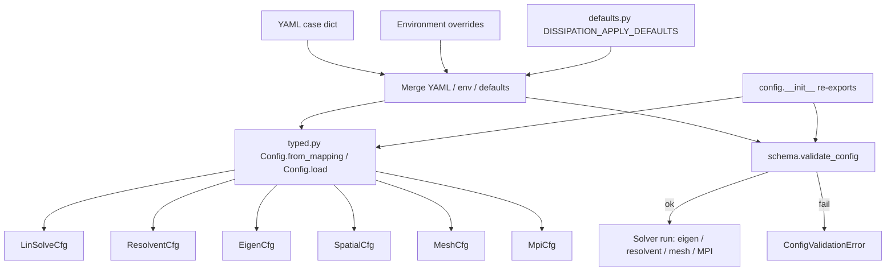
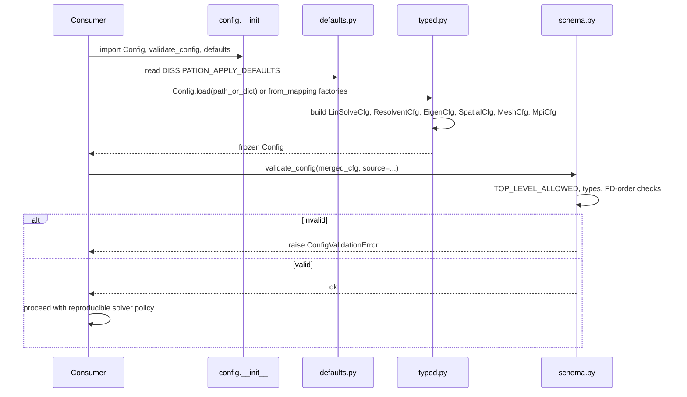

# Configuration management

One merged policy drives every run: YAML case file, then environment overrides, then compiled defaults, then schema validation into typed `Config` objects. Eigen, [resolvent](https://grokipedia.com/page/Resolvent_formalism), spatial, mesh, [MPI](https://grokipedia.com/page/Message_Passing_Interface), and router sections each have their own subsection. Unknown top level keys and invalid [SBP](https://grokipedia.com/page/Summation_by_parts) orders fail fast before any factorization. If a run surprises you, print the merged config first.

Solver objects (`KSP`, `PC`, `EPS`, `ST`, `MatShell`) are defined in the [solver glossary](../solver-glossary.md).


## Overview

**Configuration management** turns YAML case files, environment overrides, and centralized defaults into a **reproducible solver policy** before any expensive HPC work begins. It sits early in the staged pipeline:

**config → baseflow → mesh/SBP → LNSE assembly → factorize → eigen/resolvent → payload**

The package lives under `src/linstabpy/config/` and provides:

| Concern | Role |
|--------|------|
| **Typed policy model** | Frozen dataclasses for linear-solve, resolvent, eigen, spatial, mesh, and MPI settings |
| **Schema validation** | Lenient structural checks on fully merged case dictionaries |
| **Cross-layer defaults** | Single source of truth for dissipation stage-apply flags |
| **Public re-exports** | Stable import surface via `linstabpy.config` |

Without this layer, typoed keys, invalid [finite-difference](https://grokipedia.com/page/Finite_difference_method) orders, or stage-disagreed dissipation flags can silently change spectra and resolvent [gains](../core-concepts.md) on large MPI runs. Configuration is therefore the **reproducibility gate** for temporal, spatial, [adjoint](https://grokipedia.com/page/Adjoint), and resolvent workflows.


## Package Layout

```
src/linstabpy/config/
├── __init__.py              # Public API re-exports
├── defaults.py              # DISSIPATION_APPLY_DEFAULTS
├── schema.py                # ConfigValidationError, validate_config
└── typed.py                 # Config and subsection dataclasses
```

| File | Responsibility |
|------|----------------|
| `__init__.py` | Re-exports defaults, schema symbols, and typed dataclasses in `__all__` |
| `defaults.py` | Declares dissipation apply-to-stage defaults once for all layers |
| `schema.py` | Allowed top-level keys, type spot-checks, FD-order and Floquet-shift walks, `ConfigValidationError` |
| `typed.py` | YAML/env/default resolution into frozen `Config` and nested policy objects |


## Design Goals and Principles

1. **Config as single policy source**, Case YAML, environment variables, and code defaults resolve into one effective policy before mesh or operator work.
2. **Typed access without behavior change**, `typed.py` is the live resolution path; call sites read policy from its frozen dataclasses.
3. **Lenient but structured validation**, Optional fields are not required; unknown top-level keys, illegal FD orders, and unknown Floquet shift modes fail fast.
4. **Cross-layer agreement**, Defaults that multiple stages must share (especially dissipation apply flags) live in one place.
5. **HPC-safe fail-fast**, Invalid policy raises before PETSc factorization or β–ω map campaigns.


## Resolution Flow

### Logical pipeline



### Typical consumer sequence



### Precedence rules (typed resolvers)

Field-level helpers in `typed.py` generally follow:

1. **YAML subsection key present** → use YAML value
2. Else **environment variable** → use env
3. Else **code default** (often from `linstabpy.linalg.backends`)

Important exceptions (env-first, matching backend policy):

| Setting | Precedence |
|---------|------------|
| `factor_precision` | `LINSTABPY_FACTOR_PRECISION` → YAML → `DEFAULT_FACTOR_PRECISION` |
| `mumps_blr` | `LINSTABPY_MUMPS_BLR` → YAML → `DEFAULT_MUMPS_BLR` |
| `mumps_blr_tol` | `LINSTABPY_MUMPS_BLR_TOL` → YAML → `DEFAULT_MUMPS_BLR_TOL` |
| `mumps_ordering` | `LINSTABPY_MUMPS_ORDERING` → YAML → `None` |
| `auto_route_dof_threshold` | `LINSTABPY_AUTO_ROUTE_DOF_THRESHOLD` → YAML → `DEFAULT_AUTO_ROUTE_DOF_THRESHOLD` |

Boolean truthy set for string/env parsing: `{"1", "true", "yes", "on"}`.

Optional integers treat `""`, `"none"`, `"null"`, `"default"`, `"petsc"` as **unset** (`None`).


## Public API

Import through the package façade:

```python
from linstabpy.config import (
    DISSIPATION_APPLY_DEFAULTS,
    Config,
    ConfigValidationError,
    EigenCfg,
    LinSolveCfg,
    MeshCfg,
    MpiCfg,
    ResolventCfg,
    ResolventEpsCfg,
    SpatialCfg,
    validate_config,
)
```

`__all__` in `config/__init__.py` is the supported surface. Prefer this over deep imports so migration of internal helpers stays localized.


## Centralized Defaults (`defaults.py`)

### Purpose

`defaults.py` exists so **more than one layer agrees** on configuration defaults. It is not a numerics file: dissipation *shape* parameters remain in `mesh.sbp.DISSIPATION_DEFAULTS`.

### Historical mismatch

An earlier split set:

- `operator_dissipation.apply_to_stability = True`
- `operator_dissipation.apply_to_resolvent = False`

A case that "enabled dissipation" therefore got a **damped [eigenvalue](https://grokipedia.com/page/Eigenvalues_and_eigenvectors) problem** and a **bare resolvent**. On meshes with metric cross-coupling, the bare resolvent can admit odd–even content that the damped EVP does not. On rectilinear meshes the gain difference is smaller but still measurable; use `driver.preflight.metric_cross_coupling` rather than assuming either extreme.

### Current contract

```python
DISSIPATION_APPLY_DEFAULTS: dict[str, bool] = {
    "apply_to_stability": True,
    "apply_to_resolvent": True,
}
```

**Semantics:** enabling dissipation means enabling it for both stages unless the case explicitly opts out. Preflight reports effective values so silent stage disagreement does not recur.


## Schema Validation (`schema.py`)

### Role of schema validation

`validate_config(cfg, *, source=None)` performs **lenient structural checks** on a **fully merged** case dictionary. It does not require optional fields; it rejects known hazards:

- Unknown top-level keys (likely typos)
- Illegal `fd_order` values anywhere in the tree
- Wrong Python types for a curated set of flat keys

Failures raise `ConfigValidationError` (subclass of `ValueError`), optionally prefixed with `source` for diagnostics.

### Allowed top-level keys

`TOP_LEVEL_ALLOWED` covers nested driver blocks and flat Martini/Song-style keys still used by standalone examples:

| Category | Examples |
|----------|----------|
| Nested blocks | `paths`, `physics`, `numerics`, `analysis`, `preprocess`, `bc`, `solver`, `cases` |
| Versioning | `schema_version` |
| Discretization / mesh | `fd_order`, `alpha_filter`, `nx`, `ny`, `deform`, `xrange`, `yrange`, … |
| Physics scalars | `Re`, `Ma`, `Pr`, `kappa`, `T_0`, `beta`, `omega`, … |
| Run switches | `run_temporal`, `run_spatial`, `run_stability`, `run_resolvent` |
| Mode counts | `n_modes`, `n_modes_stability`, `n_modes_resolvent`, `ncv`, … |
| Parity / example keys | `floquet_shift`, `zero_dmudT`, `zero_dmudT_martini_parity`, `bc_mask_layout` |
| I/O hooks | `baseflow_input`, `baseflow_preprocess`, `assembly_backend` |

Unknown top-level keys produce messages such as:  
`unknown top-level key '...' (possible typo)`.

### Finite-difference order

- Allowed orders: **`{2, 4, 6, 8}`**
- `_iter_fd_order_values` recursively walks dicts and lists and yields every key named `fd_order`
- Non-integers, booleans, or values outside the set are violations

### Flat type spot-checks

When present at the **top level**, keys are checked against:

| Set | Expectation |
|-----|-------------|
| `_INT_FIELDS` | `int` (bool rejected) |
| `_NUMERIC_FIELDS` | `int` or `float` (bool rejected) |
| `_BOOL_FIELDS` | `bool` |
| `_STRING_FIELDS` | `str` |

Examples: `n_modes`, `nx`, `ny` → int; `Re`, `Ma`, `omega`, `mumps_blr_tol` → numeric; `run_stability`, `mumps_blr` → bool; `model`, `factor_precision`, `schema_version`, `$include` → str.

### What schema does *not* do

- Deep validation of nested `solver.*` trees (typed loaders handle resolution)
- Semantic physics checks (preflight advisories cover many of those)
- Loading YAML from disk (callers / `Config.load` / `utils.yaml_io` do that)


## Typed Config Model (`typed.py`)

### Role of the typed model

`typed.py` is the **typed configuration seam** for solver policy. It:

- Accepts a full case mapping, a `solver` subsection, a path, or `None`
- Resolves nested subsections and environment variables
- Produces **frozen dataclasses** for stable, attribute-style access
- Pulls backend defaults from `linstabpy.linalg.backends`
- Mirrors legacy resolution so behavior stays aligned during migration

### Subsection extraction helpers

| Helper | Behavior |
|--------|----------|
| `_solver_mapping(raw)` | Prefer `raw["solver"]` if it is a mapping; else treat `raw` as the solver map |
| `_subsection(solver, prefix)` | `LINSTABPY_RESOLVENT` → `solver.resolvent` falling back to `solver.linsolve`; `LINSTABPY_EIGEN` → `solver.eigen`; else `solver.linsolve` |
| `_spatial_subsection(solver)` | `solver.spatial` falling back to `solver.eigen` |
| `_resolvent_eps_subsection(solver)` | Resolvent subsection's nested `eigen`, else the resolvent map itself |

### Dataclass catalog

All policy dataclasses are **`@dataclass(frozen=True)`**.

#### `LinSolveCfg`

Linear [KSP](../solver-glossary.md)/PC and [sparse](https://grokipedia.com/page/Sparse_matrix)-direct factor policy used by general linear solves and as the resolvent linear block.

| Field | Typical default / notes |
|-------|-------------------------|
| `type` | `"mumps"` |
| `factor_backend` | Normalized backend; default `"mumps"` or solver-level fallback |
| `factor_precision` | From backends default / env / YAML |
| `mumps_blr`, `mumps_blr_tol`, `mumps_ordering` | MUMPS BLR and ordering policy |
| `ksp_type` | `"fgmres"` |
| `pc_type` | `"asm"` |
| `ksp_pc_side` | `"right"` |
| `ksp_rtol` / `ksp_atol` / `ksp_max_it` | `1e-10` / `1e-14` / `20000` |
| `asm_overlap` | `2` |
| `sub_ksp_type` / `sub_pc_type` | `"preonly"` / `"lu"` |
| `pc_factor_levels` | `0` |
| `pc_factor_shift_type` / `amount` | `"nonzero"` / `1e-12` |
| `ksp_monitor` | `False` |

Factory: `LinSolveCfg.from_mapping(cfg, env, prefix, solver_default=None)`  
Env prefix examples: `LINSTABPY_LINSOLVE_*`, `LINSTABPY_RESOLVENT_*`.

#### `ResolventEpsCfg`

SLEPc-side resolvent gain eigenproblem controls.

| Field | Default / notes |
|-------|-----------------|
| `eps_tol` | `1e-8` |
| `eps_max_it` | `1000` |
| `conv_test` | `""` (empty → backend default) |
| `true_residual` | `False` |
| `monitor` / `monitor_every` | `False` / `10` |
| `ncv` | Optional; only from YAML if present |
| `forcing_norm` | `"chu"` |

#### `ResolventCfg`

Composite: `linear: LinSolveCfg` + `eps: ResolventEpsCfg`.

#### `InexactCfg`

Nested under eigen for inexact [shift-invert](../solver-glossary.md) style paths (`ksp_type`, tolerances, ASM/ILU defaults). YAML-only nested map (no env prefix in factory).

#### `BackendProbeCfg`

`residual_rel_max` (default `1e-8`) and optional `enabled` flag for backend residual probes.

#### `EigenCfg`

Temporal/adjoint [EPS](../solver-glossary.md) and shift-invert policy, including:

- `st_solver` (default `"mumps"`) and derived `st_factor_backend` via `_st_factor_backend`
- Factor precision / [MUMPS](https://en.wikipedia.org/wiki/MUMPS_(software)) BLR / ordering
- Condition-number warnings (`cond_warn`, thresholds)
- KSP/PC settings (eigen defaults differ slightly from linsolve, e.g. `ksp_type="gmres"`, `ksp_pc_side="left"`)
- EPS tolerance, residual error type, monitors, `true_residual` (defaults **True** for `inexact`, `fgmres_lu`, `strumpack_fgmres`)
- `extract_all_converged`, `weighted_norm_tol`, optional `ncv`
- `eps_max_it_explicit` + method `eps_max_it(ndof)` → explicit value or `max(500, 10 * ndof)`
- `auto_route_dof_threshold` for deferred `"auto"` backend resolution once DOF count is known

#### `SpatialCfg`

Spatial eigen policy with fallback path from YAML:

- Reads `solver.spatial`, else `solver.eigen`
- `st_solver` env: `LINSTABPY_SPATIAL_ST_SOLVER`
- Factor backend/precision/MUMPS fields aligned with direct spatial EPS

#### `MeshCfg`

Assembly backend and assembly-metrics emission:

| Field | Notes |
|-------|------|
| `assembly_backend` | Default `"scipy"` (`LINSTABPY_ASSEMBLY_BACKEND`) |
| `assembly_metrics` | Bool switch |
| `assembly_metrics_output` / `_dir` / `_tag` | Optional path/tag strings |
| `assembly_metrics_log_explicit` | `None` if unset so callers can apply dynamic default (= metrics enabled); otherwise bool via `_scfg_bool` |

#### `MpiCfg`

MPI/PETSc init-time options:

| Field | Default / notes |
|-------|-----------------|
| `petsc_matrix_mode` | `"auto"` |
| `root_scatter` | `False` |
| `mumps_icntl_14` | optional int, default `100` |
| `mumps_icntl_24` | optional int, default `1` |

**Removed knobs (hard errors):**

- YAML `mumps_icntl_7` → `ValueError: mumps_icntl_7 is gone. Set mumps_ordering: metis.`
- Env `LINSTABPY_PETSC_SET_MUMPS_ICNTL_7` → analogous error pointing at `LINSTABPY_MUMPS_ORDERING`

#### `Config` (root)

```text
Config
├── linsolve: LinSolveCfg
├── resolvent: ResolventCfg
│     ├── linear: LinSolveCfg
│     └── eps: ResolventEpsCfg
├── eigen: EigenCfg
├── spatial: SpatialCfg
├── mesh: MeshCfg
└── mpi: MpiCfg
```

### `Config.load`

```python
Config.load(yaml_path_or_dict, env=os.environ) -> Config
```

| Input | Behavior |
|-------|----------|
| `str` / `Path` | `load_config(...)` then resolve |
| `None` | empty mapping → all defaults / env |
| `Mapping` | use as raw case dict |

Resolution steps inside `load`:

1. Extract `solver` mapping
2. Build linsolve / resolvent / eigen / spatial subsections
3. Read optional **solver-level** `factor_backend` as lowest-priority fallback (`solver_default`)
4. Construct nested frozen configs

**Why solver-level `factor_backend` matters:** historically every resolver received only a *sub*-config, so a top-of-`solver` `factor_backend` was ignored (e.g. intended GPU path ran entirely on CPU). It is now a **lowest-priority** fallback under per-stage keys and environment, without changing already-resolving configurations.

### Shift-invert factor backend selection (`_st_factor_backend`)

Given `st_solver`:

| `st_solver` class | Factor backend behavior |
|-------------------|-------------------------|
| Direct, and equals default factor backend | Apply solver-level / YAML / env factor backend (generic direct route) |
| Direct, named backend | Do not override with solver-level default; stage naming wins |
| Iterative eigen types | Factor backend only if `pc_type == "lu"`; else `None` |
| `strumpack_fgmres` | Default factor backend `"strumpack"` |
| `fgmres_lu` | Default factor backend = package default (MUMPS-class) |
| Other | `None` |

This prevents band-marking EVPs from being stranded on CPU MUMPS while resolvent runs on another backend when the user intended a shared direct preference.


## Example registry

The live example list is `run_all_examples.sh` `EXAMPLE_SPECS` (module,
plot module, and label per example), not a YAML catalog. There is no
packaged registry file; document expected artifacts alongside the case
(module + NPZ name) instead.


## Integration with the Rest of the System

### Case orchestration

`driver/run.py` (and CLI) merge case YAML with environment and defaults, validate, and obtain typed policy before baseflow/mesh/assembly. Config hash / provenance for cache and metrics depend on this resolved policy.

### Downstream consumers of typed subsections

| Consumer domain | Config slices of interest |
|-----------------|---------------------------|
| Mesh / assembly | `MeshCfg` (`assembly_backend`, metrics) |
| Stability / SLEPc EPS | `EigenCfg`, `SpatialCfg` |
| Resolvent | `ResolventCfg` (linear + EPS) |
| Linear algebra | Factor backend, precision, MUMPS BLR/ordering from linsolve/eigen/spatial |
| Router maps | Schema-validated map/router sections; dissipation apply defaults |
| MPI/PETSc init | `MpiCfg` |

### Relationship to shared utilities

- YAML load path uses `linstabpy.utils.yaml_io.load_config`
- Backend normalization and defaults come from `linstabpy.linalg.backends`
- Direct vs iterative solver type sets come from `linstabpy.utils._solver_cfg`
- Remaining `utils._solver_cfg` usage is shared type sets and small helpers (`cfg_get`, `as_bool`, `SolverConfig` for EPS helpers), not a parallel resolution path

### Dissipation configuration caution

Architecture research notes a **dual path** risk outside pure typed loaders:

- Router paths may read top-level `dissipation_epsilon`
- Non-router assembly may use nested `operator_dissipation.epsilon`

Both **enable** flags and **strength** must be set consistently or dissipation can become a silent no-op. Stage apply flags should follow `DISSIPATION_APPLY_DEFAULTS` unless explicitly overridden. Prefer one nested source of truth going forward; keep aliases only with clear deprecation.


## Practical Usage Patterns

### Library-style load

```python
from linstabpy.config import Config, validate_config

cfg_dict = {...}  # fully merged case dict
validate_config(cfg_dict, source="my_case.yaml")
policy = Config.load(cfg_dict)

# Attribute access
backend = policy.eigen.st_factor_backend
rtol = policy.resolvent.linear.ksp_rtol
asm = policy.mesh.assembly_backend
```

### Path load with process environment

```python
policy = Config.load("cases/blasius.yaml")  # uses os.environ
```

### Fail-fast validation in prep workflows

Baseflow ingest and operator prep workflows call schema validation first so illegal `fd_order` or unknown keys never reach SBP generation or L0 assembly.

### Spatial fallback

If `solver.spatial` is absent, spatial policy falls back to `solver.eigen`, matching the spatial stability workflow documented for streamwise eigenproblems.

### Environment overrides (illustrative)

Common env knobs resolved by typed factories include:

- `LINSTABPY_FACTOR_BACKEND`, `LINSTABPY_FACTOR_PRECISION`
- `LINSTABPY_MUMPS_BLR`, `LINSTABPY_MUMPS_BLR_TOL`, `LINSTABPY_MUMPS_ORDERING`
- `LINSTABPY_EIGEN_ST_SOLVER`, `LINSTABPY_EIGEN_KSP_*`, `LINSTABPY_EIGEN_EPS_*`
- `LINSTABPY_RESOLVENT_*` (linear and EPS)
- `LINSTABPY_ASSEMBLY_BACKEND`, `LINSTABPY_ASSEMBLY_METRICS*`
- `LINSTABPY_PETSC_MATRIX_MODE`, `LINSTABPY_PETSC_ROOT_SCATTER`, `LINSTABPY_PETSC_MUMPS_ICNTL_*`
- `LINSTABPY_AUTO_ROUTE_DOF_THRESHOLD`

(Exact key lists follow the `from_mapping` implementations in `typed.py`.)


## Error Model

| Error | When |
|-------|------|
| `ConfigValidationError` | Unknown top-level key, bad `fd_order`, bad `floquet_shift`, flat type mismatch |
| `ValueError` from `MpiCfg.from_mapping` | Use of removed `mumps_icntl_7` / `LINSTABPY_PETSC_SET_MUMPS_ICNTL_7` |
| Backend normalize errors | Invalid factor backend / precision / ordering strings (via `linalg.backends` helpers) |

Validation messages are joined with `"; "` and may be prefixed with `source` (e.g. file path) for multi-case orchestration.


## Implementation Notes and Migration Status

1. **Frozen dataclasses** make policy snapshots safe to share across stages and ranks without accidental mutation.
2. **Typed seam is the live path**; shared type sets and small helpers still come from `utils._solver_cfg`.
3. **Schema is intentionally shallow** on nested solver trees; depth is handled by typed loaders and runtime preflight.
4. **Example registry lives in the runner**; `run_all_examples.sh` `EXAMPLE_SPECS` is the single source of truth for example modules and artifacts.
5. **Solver-level `factor_backend`** is documented in code as a past silent no-op; treat per-stage keys and env as higher priority.
6. **Auto factor routing** stores DOF threshold on `EigenCfg`; concrete backend choice happens later when `ndof` is known (`resolve_auto_factor_backend` in the eigenvalue path).


## Summary

Configuration management in LinStabPy:

1. **Merges** YAML cases, environment overrides, and agreed defaults
2. **Validates** merged dictionaries for typos, FD orders, and basic types
3. **Materializes** frozen typed policy (`Config` and subsections) for linear solves, resolvent, eigen, spatial, mesh assembly, and MPI/PETSc init
4. **Anchors** cross-stage dissipation apply behavior in `DISSIPATION_APPLY_DEFAULTS`
5. **Gates** expensive stability and resolvent work so HPC campaigns remain reproducible and fail fast on structural mistakes  

Primary code paths: `src/linstabpy/config/{__init__,defaults,schema,typed}.py`. Consumers should import from `linstabpy.config`, call `validate_config` on the merged case dict, and obtain solver policy via `Config.load` or the subsection `from_mapping` factories before entering mesh, operator, or solver stages.