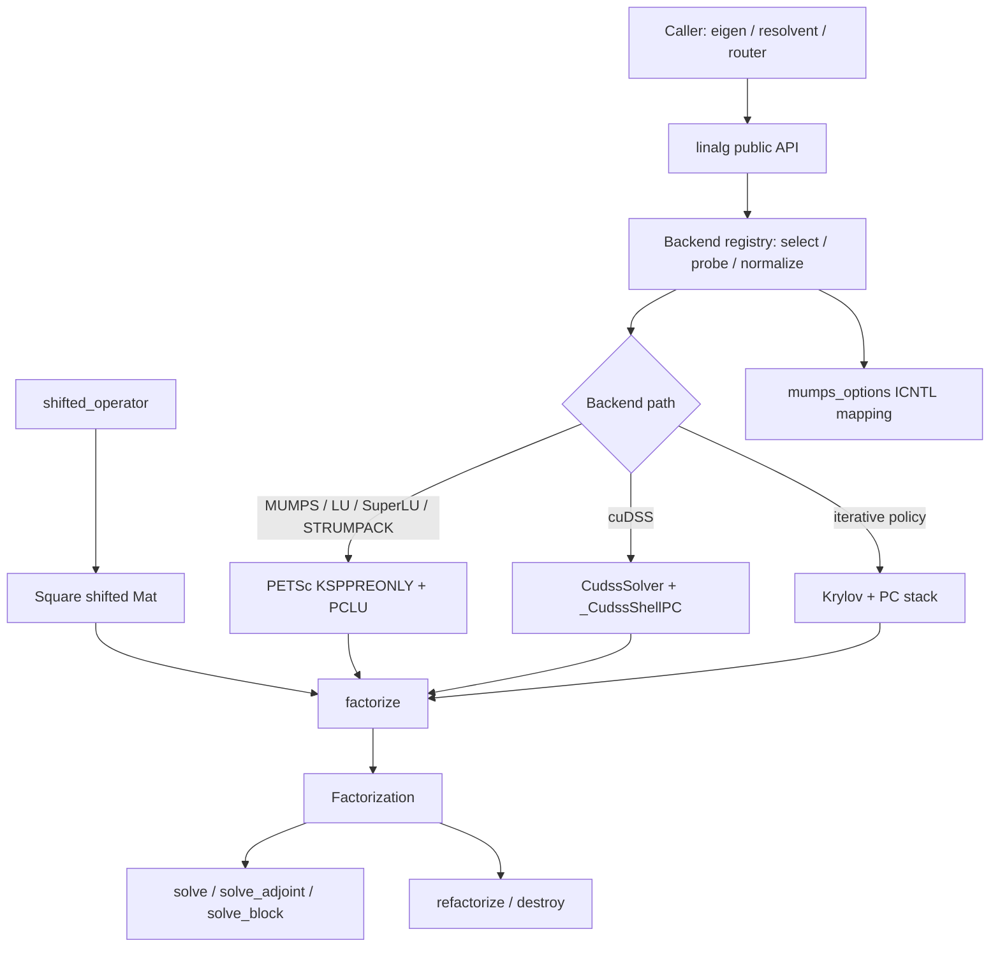
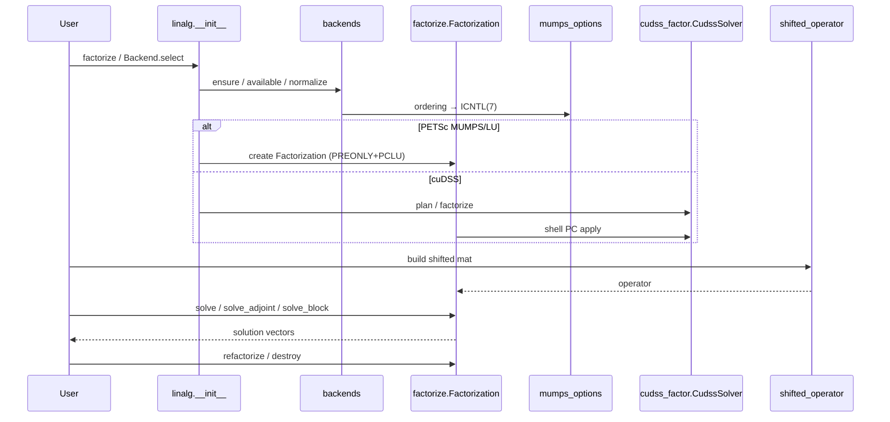

# Linear Algebra Infrastructure

!!! info "Math you need for this page"
    One factorization serves many solves. The default shifted solve is `KSPPREONLY` with `PCLU` through [MUMPS](https://en.wikipedia.org/wiki/MUMPS_(software)). [SLEPc](https://en.wikipedia.org/wiki/SLEPc) calls it repeatedly inside shift-invert Krylov-Schur and inside every $H$ and $H^H$ apply. A direct factor belongs to exactly one shift $(\omega, \gamma)$. Reuse across shifts happens only in the router as [preconditioning](https://grokipedia.com/page/Preconditioner) under a residual gate, never as an exact solve. Iterative paths are explicit opt-in, never silent fallback.
    New to [PETSc](https://en.wikipedia.org/wiki/PETSc) or SLEPc vocabulary? The [solver glossary](../solver-glossary.md) defines every object named on this page.


## 1. Overview

The **Linear Algebra Infrastructure** domain is the shared numerical core of LinStabPy. It provides reusable [sparse](https://grokipedia.com/page/Sparse_matrix) factorization, backend selection, and shifted-operator helpers so that stability eigenproblems and [resolvent](https://grokipedia.com/page/Resolvent_formalism) analyses can **factorize once and solve many times**.

In the staged LNSE pipeline this domain sits after operator assembly and before SLEPc-driven eigen/resolvent work. Callers hand it a square sparse operator, typically a shifted linearized [Navier–Stokes](https://grokipedia.com/page/Navier–Stokes_equations) system such as \(L_0 - i\omega I\), and receive a `Factorization` object that exposes forward solves, Hermitian-[adjoint](https://grokipedia.com/page/Adjoint) solves, block right-hand sides, in-place refactorization on a fixed sparsity pattern, residual checks, and explicit resource teardown.

**Design posture**

| Principle | Realization |
|-----------|-------------|
| Direct-by-default | Production path is `KSPPREONLY` + `PCLU` + MUMPS |
| Explicit iterative policy | Krylov / FGMRES / ASM paths are opt-in, not silent fallbacks |
| Lazy PETSc | Importing `linstabpy.linalg` does not initialize PETSc/MPI |
| Factorize-once, solve-many | Symbolic analysis is paid once; numeric factors are reused across RHS and nearby frequencies |
| Backend registry | Typed names, availability probes, and option normalizers for MUMPS / SuperLU / STRUMPACK / cuDSS |
| Honest failure | Diverged KSP, defective adjoints, and unavailable backends raise rather than return silent garbage |

**Primary code paths**

```
src/linstabpy/linalg/
├── __init__.py          # Public API (eager Backend helpers, lazy heavy symbols)
├── backends.py          # Backend registry, option resolution, probes
├── factorize.py         # Factorization dataclass and factorize() factory
├── shifted.py           # SciPy / PETSc shifted operators
└── cudss_factor.py      # PETSc-free NVIDIA cuDSS wrapper
src/linstabpy/mumps_options.py   # PETSc-free MUMPS ICNTL(7) ordering map
```

**External dependencies**

| System | Role |
|--------|------|
| PETSc / petsc4py | Distributed `Mat`/`Vec`, KSP/PC, sparse-direct factor packages |
| MUMPS | Default sparse-direct LU via PETSc `PCLU` |
| SuperLU / SuperLU_DIST / STRUMPACK | Alternate PETSc factor packages |
| cuDSS (via nvmath-python) | Optional GPU LU used as a Python PC shell inside FGMRES |
| NumPy / SciPy | Local dense/sparse kernels, CSC/CSR conversion |
| MPI | Collective pattern checks and distributed vector ownership |

---

## 2. Role in the System

Linear Algebra Infrastructure is an **infrastructure domain** consumed by:

- **Stability Analysis**, [shift-invert](../solver-glossary.md) temporal, spatial, and adjoint [EPS](../solver-glossary.md)
- **Resolvent Analysis**, repeated applies of \(H = C\,(L_0 - i\omega I)^{-1}\,B\)
- **Solver Routing**, anchor factorization, preconditioner reuse, residual-gated refactor on \(\beta\)–\(\omega\) maps
- **Case Orchestration**, backend policy from YAML/env and cost/provenance metrics

It does **not** assemble LNSE physics, choose [eigenpairs](https://grokipedia.com/page/Eigenvalues_and_eigenvectors), or schedule frequency walks. Those domains call into this layer for linear solves only.



---

## 3. Public API Surface

Package entry: `linstabpy.linalg`.

### 3.1 Eager vs lazy exports

**Eager** (import-safe, no PETSc init):

- `Backend`
- `available`
- `ensure`
- `select`

**Lazy** (loaded on first attribute access via PEP 562 `__getattr__`):

| Symbol | Module |
|--------|--------|
| `Factorization` | `linalg.factorize` |
| `factorize` | `linalg.factorize` |
| `shifted_operator` | `linalg.shifted` |
| `CudssSolver` | `linalg.cudss_factor` |
| `cudss_available` | `linalg.cudss_factor` |

This keeps `import linstabpy` and light library use free of PETSc/[MPI](https://grokipedia.com/page/Message_Passing_Interface) startup cost.

### 3.2 Typical call pattern

```python
from linstabpy.linalg import Backend, factorize, shifted_operator, select, ensure

# Optional: resolve and probe backend policy
backend = select(solver_cfg)          # Backend | None
ensure(backend)                       # raises if unavailable

# Build shifted system (SciPy CSC or PETSc Mat preserved)
K = shifted_operator(L0, omega=omega, gamma=0.0)

# Factor once
F = factorize(K, env_prefix="LINSTABPY_RESOLVENT", solver_cfg=solver_cfg)

# Solve many
x = F.solve(b)
y = F.solve_adjoint(c)                # Hermitian adjoint path
X = F.solve_block(B)                  # multi-RHS when direct path supports it

# Same sparsity, new values (e.g. nearby frequency)
F.refactorize(K_new)

F.destroy()
```

---

## 4. Backend Registry (`backends.py`)

### 4.1 Purpose

`backends.py` is the **typed registry and policy layer** for sparse-direct factor packages. It normalizes configuration, probes availability, applies PETSc PC options, and exposes diagnostic residual probes for shift-invert KSPs.

Importing this module stays PETSc-free until a function actually needs PETSc (lazy `_get_petsc()` / module `__getattr__` for `PETSc`).

### 4.2 `Backend` enumeration

```python
class Backend(StrEnum):
    MUMPS = "mumps"
    SUPERLU = "superlu"
    SUPERLU_DIST = "superlu_dist"
    STRUMPACK = "strumpack"
    CUDSS = "cudss"
```

Unknown strings are accepted via `_missing_`, producing a dynamic enum member so experimental PETSc packages can be named without hard-coding every build.

### 4.3 Defaults and constants

| Constant | Default | Meaning |
|----------|---------|---------|
| `DEFAULT_FACTOR_BACKEND` | `"mumps"` | Production direct backend |
| `DEFAULT_FACTOR_PRECISION` | `"double"` | Factor arithmetic |
| `DEFAULT_MUMPS_BLR` | `False` | Block Low-Rank compression off |
| `DEFAULT_MUMPS_BLR_TOL` | `1e-4` | BLR tolerance when enabled |
| `DEFAULT_AUTO_ROUTE_DOF_THRESHOLD` | `224_000` | DOF threshold for `factor_backend="auto"` (MUMPS vs STRUMPACK) |
| `PRECONDITIONER_PROBE_RESIDUAL_REL_MAX` | `1e-4` | Sanity ceiling when factor is only a PC |
| `ERR_SUP` | `92` | PETSc "not supported" error code used by availability probes |

The auto-route threshold is a **measured approximation** (c9, dual A6000): MUMPS wins below ~224k DOF; [STRUMPACK](https://portal.nersc.gov/project/sparse/strumpack/) wins near ~900k DOF. The true crossover is not fully mapped; treat the constant as tunable, not universal.

### 4.4 Option resolution

Resolution helpers merge YAML, environment, and defaults with documented precedence.

| Helper | Keys / env | Precedence |
|--------|------------|------------|
| `resolve_factor_backend` | `factor_backend`, `LINSTABPY_FACTOR_BACKEND` | YAML → optional env → global env → default |
| `resolve_factor_precision` | `factor_precision`, `LINSTABPY_FACTOR_PRECISION` | **env → YAML → default** |
| `resolve_mumps_blr` | `mumps_blr`, `LINSTABPY_MUMPS_BLR` | env → YAML → default |
| `resolve_mumps_blr_tol` | `mumps_blr_tol`, `LINSTABPY_MUMPS_BLR_TOL` | env → YAML → default |
| `resolve_mumps_ordering` | `mumps_ordering`, `LINSTABPY_MUMPS_ORDERING` | env → YAML → default |

Normalization rules:

- Backend tokens `""`, `"none"`, `"null"`, `"default"`, `"petsc"` → `None` (PETSc default package)
- `"auto"` is preserved as an intent token and **must** be resolved later with `resolve_auto_factor_backend(ndof, …)` once DOF count is known
- Precision must be `"double"` or `"single"`
- Ordering must be a key of `MUMPS_ORDERING_TO_ICNTL_7` (see §7)

### 4.5 Auto backend routing

```text
resolve_auto_factor_backend(ndof, threshold=224_000, strumpack_available=…)
  → "strumpack"  if ndof >= threshold AND strumpack_available
  → "mumps"      otherwise (including STRUMPACK absent)
```

`apply_factor_backend` **rejects** unresolved `"auto"` so miswired call sites fail early instead of silently picking a package.

### 4.6 Applying a backend to a PETSc PC

`apply_factor_backend(pc, backend, *, options_prefix="", factor_precision=…, mumps_blr=…, mumps_blr_tol=…, mumps_ordering=…)` runs after `pc.setType("lu")` and:

1. Validates BLR / ordering only with MUMPS  
2. Rejects `factor_backend="cudss"` as a PETSc factor type ([cuDSS](https://docs.nvidia.com/cuda/cudss/) is a shell PC on the iterative path)  
3. Currently **refuses** `factor_precision="single"` on PETSc [SuperLU_DIST](https://portal.nersc.gov/project/sparse/superlu/) paths: measured PETSc builds ignore `-pc_precision`, which would silently keep double factors while provenance claimed single  
4. Calls `ensure_factor_backend_available`  
5. Writes PETSc options (`pc_factor_mat_solver_type`, optional MUMPS ICNTL/CNTL keys), `pc.setFromOptions()`, `pc.setFactorSolverType(backend)`, then clears transient option keys  

MUMPS BLR keys are explicitly deleted when BLR is off so a previous BLR-enabled setup cannot stick in the process-global options database. Ordering key `mat_mumps_icntl_7` is **not** cleared when unset, so user CLI options remain valid.

### 4.7 Availability and registry helpers

| API | Behavior |
|-----|----------|
| `factor_backend_available(backend)` | Cached probe: tiny complex AIJ LU setup, or `cudss_available()` for cuDSS |
| `ensure_factor_backend_available` / `ensure` | Raise `RuntimeError` with PETSc version and rebuild guidance |
| `select(cfg, …)` | Return `Backend` enum member (or `None`) |
| `available()` | `{Backend: bool}` map for all known members |

### 4.8 Shifted-KSP residual probe

`shifted_ksp_probe_residual(ksp, rhs_seed=17)` solves one deterministic complex RHS and returns absolute/relative residual, iteration count, [KSP](../solver-glossary.md) reason, and PC metadata. It is a **diagnostic**, not eigen acceptance policy.

`should_probe_backend` / `backend_probe_is_preconditioner_role` distinguish:

- **Genuine direct solves**, default MUMPS skips the probe; other backends probe by default  
- **Preconditioner role** (iterative eigen families / [FGMRES](https://grokipedia.com/page/Generalized_minimal_residual_method)+[LU](https://grokipedia.com/page/LU_decomposition)), probe remains diagnostic even for MUMPS unless disabled; outer [Krylov](https://grokipedia.com/page/Krylov_subspace)/SLEPc convergence is the primary gate  

---

## 5. Factorization Layer (`factorize.py`)

### 5.1 Purpose

`factorize(operator, *, env_prefix="LINSTABPY_LINSOLVE", solver_cfg=None, cfg=None) -> Factorization` builds the reusable solve object used throughout LinStabPy.

Module contract (from source):

- Default path: **KSPPREONLY + PCLU + MUMPS**
- Release tests and reference examples use exact direct solves
- Iterative path is for large memory-bound cases and is an **explicit** solver-policy choice

### 5.2 `Factorization` dataclass

| Field / method | Role |
|----------------|------|
| `backend` | Realized backend label (e.g. `MUMPS`, `PETSc-iterative`, `cudss-fgmres`) |
| `solve(rhs)` | NumPy complex vector → solution |
| `solve_adjoint(rhs)` | Hermitian adjoint solve \(A^H x = b\) (lazy dual-factor heal may redirect) |
| `solve_vec` / `solve_adjoint_vec` | PETSc `Vec` variants preserving distribution |
| `solve_transpose` / `solve_transpose_vec` | Backward-compatible aliases of adjoint APIs |
| `residual(rhs, x)` | \(\|A x - b\|_2\) for NumPy inputs |
| `solve_block(rhs_block)` | Multi-RHS; uses factor `matSolve` on direct path, column loop otherwise |
| `refactorize(operator)` | Numeric refactor on **identical** nonzero pattern |
| `destroy()` | Destroy owned KSP, Mat, and optional `CudssSolver` |
| `metrics` | Counters/timings for refactor, block solves, dual-factor heal, cuDSS |
| `probe_family` | Optional production RHS generator for adjoint self-test (single-precision cuDSS) |

### 5.3 Factory setup sequence

1. Lazy-init PETSc; load typed `Config` (`cfg` or `Config.load(solver_cfg)`).  
2. `require_complex`, production PETSc builds must be complex-scalar.  
3. Validate square operator; copy PETSc Mat or convert SciPy → PETSc via `scipy_to_petsc`.  
4. Map `env_prefix`:
   - `LINSTABPY_LINSOLVE` → `cfg.linsolve`
   - `LINSTABPY_RESOLVENT` → `cfg.resolvent.linear`
5. Build KSP/PC according to solver type (direct vs iterative).  
6. Install solve closures, block solve, refactorize, residual.  
7. Wrap adjoint entry points with **lazy dual-factor auto-heal**.  
8. Return `Factorization` and bind symbols back onto the parent package module if needed.

### 5.4 Direct path

For solver types in `DIRECT_SOLVER_TYPES` (e.g. `mumps`, `direct`, `lu`):

- `ksp.setType(PREONLY)`
- `pc.setType(LU)`
- `apply_factor_backend(pc, lin.factor_backend, …)`
- Log MUMPS ordering from `ICNTL(7)` when queryable

This is the default scientific path for shift-invert eigen and resolvent factorizations.

### 5.5 Iterative path

For types in `ITERATIVE_LINEAR_SOLVER_TYPES` (`iterative`, `krylov`, `petsc`, …):

Configurable pieces include KSP type, PC type/side, tolerances, ASM overlap, sub-KSP/sub-PC, ILU/ICC fill levels, factor shift type/amount, and optional KSP monitor.

**cuDSS branch** (iterative + `pc_type=lu` + `factor_backend=cudss`):

- Single-rank only (raises if MPI size > 1)
- Extract CSR from the PETSc Mat
- Construct `CudssSolver` with configured precision
- Install `_CudssShellPC` as `PC.Type.PYTHON` (one cuDSS solve per apply)
- Record plan/factor seconds and optional `lu_nnz` in metrics
- Outer FGMRES owns accuracy; cuDSS iterative refinement is disabled inside the wrapper

**ASM / block-Jacobi**: after outer `setUp`, configure sub-KSPs with hard-fail on local divergence and optional pivot shift (default NONZERO for stiff [non-normal](https://en.wikipedia.org/wiki/Defective_matrix) LNSE operators).

Diverged outer KSP raises in `_raise_if_diverged` so a failed FGMRES cannot appear as a silently wrong resolvent mode.

### 5.6 Adjoint / transpose semantics

Native adjoint path:

1. Conjugate RHS  
2. `ksp.solveTranspose`  
3. Conjugate solution  

That implements a **Hermitian** adjoint solve suitable for complex LNSE operators.

#### Dual-factor auto-heal

Some backends do not provide a correct transpose solve through PETSc:

- **STRUMPACK**: missing registered `solvetranspose` can silently fall back to a **forward** solve when symmetry is "unknown", measured adjoint identity defects ~\(10^{-2}\)
- **cuDSS**: no transpose/adjoint solve API at all

On **first** adjoint use, `_maybe_run_adjoint_test_and_heal`:

1. Runs a deterministic adjoint identity self-test  
   \(\lvert\langle A^{-1}a,\,b\rangle - \langle a,\,A^{-H}b\rangle\rvert / \max(\ldots)\)  
2. If defect \(\le 10^{-8}\), keeps the native path  
3. Otherwise builds a second factorization of \(A^H\) via the **same** `factorize` machinery and redirects adjoint solves to a **forward** solve on that factor  
4. Re-checks the adjoint identity (truth gate) and an oracle residual \(\|A^H x - b\|/\|b\|\)  
5. If the heal does not improve over native, keeps native and records `adjoint_heal_rejected=no_improvement`  
6. If both paths are unusable, raises  

`_CudssShellPC` intentionally omits `applyTranspose` so a missing method fails loudly instead of solving the wrong system.

For single-precision cuDSS, dense random probes can stall FGMRES; the resolvent driver may attach a **production `probe_family`** (forcing-masked RHS). Without it, single-precision cuDSS adjoint heal fails with a clear error.

### 5.7 Block solves

On direct solvers, `solve_block` prefers `pc.getFactorMatrix().matSolve` on dense multi-RHS mats. On failure or iterative types it falls back to column-by-column `solve`, counting fallbacks in metrics.

### 5.8 Refactorization

`refactorize(new_operator)`:

1. Requires identical global shape  
2. Compares AIJ CSR patterns; on multi-rank, **allreduces** the mismatch flag so ranks never split on collective KSP setup  
3. Copies values into the **existing** Mat with `SAME_NONZERO_PATTERN` so MUMPS/PETSc keep symbolic analysis (measured savings vs allocating a new Mat each time)  
4. If cuDSS is active, pushes new CSR values through `CudssSolver.refactorize`  
5. `ksp.setOperators(A)` + `setUp`  
6. If dual-factor heal is active, refactorizes \(K^H\) with the same Hermitian-transpose recipe and re-validates the adjoint identity  

Hermitian transpose of PETSc mats always uses `hermitianTranspose(out=PETSc.Mat())` so the caller's pristine operator is never transposed in place.

### 5.9 Metrics dictionary (selected keys)

| Key | Meaning |
|-----|---------|
| `refactor_count` / `refactor_seconds` | Numeric refactor usage |
| `solve_block_calls` / `solve_block_rhs` / `solve_block_seconds` | Multi-RHS path |
| `solve_block_fallback_calls` | Column-loop fallback |
| `dual_factor_active` | Adjoint heal engaged |
| `adjoint_self_test_defect` / `adjoint_healed_defect` / `adjoint_oracle_residual` | Heal diagnostics |
| `adjoint_refactor_count` | \(K^H\) refactor count |
| `cudss_precision` / `cudss_plan_seconds` / `cudss_factor_seconds` / `cudss_lu_nnz` | GPU factor telemetry |

These feed router cost samples and case provenance.

---

## 6. Shifted Operators (`shifted.py`)

### 6.1 API

```python
def shifted_operator(
    operator: sp.spmatrix | PETSc.Mat,
    omega: complex,
    gamma: float = 0.0,
) -> sp.csc_matrix | PETSc.Mat
```

Returns

\[
\text{operator} - (\gamma + i\omega)\,I
\]

while **preserving backend**:

| Input | Implementation |
|-------|----------------|
| PETSc `Mat` | `copy()`, `shift(-(gamma + 1j*omega))`, `assemble()` |
| SciPy sparse | CSC copy; diagonal updated with `setdiag` |

Importing the module does not initialize PETSc; a live PETSc Mat path calls `init_slepc_from_argv()` for argv-parsing consistency.

### 6.2 Usage in workflows

| Workflow | Typical shift |
|----------|----------------|
| Temporal shift-invert | Around target eigenvalue / frequency |
| Resolvent | \(L_0 - i\omega I\) (\(\gamma=0\)) |
| Spatial / generalized | Backend-specific shifts via the same helper family |
| Router line walks | New \(\omega\) → new values, often same pattern → `refactorize` |

---

## 7. MUMPS Options (`mumps_options.py`)

PETSc-free constants shared by config validation and PETSc wiring:

```python
MUMPS_ORDERING_TO_ICNTL_7 = {
    "amd": 0,
    "pord": 4,
    "metis": 5,
    "qamd": 6,
    "auto": 7,
}
```

Human-readable ordering names map to MUMPS `ICNTL(7)`. Keeping this module free of petsc4py allows config layers to validate ordering without starting the parallel runtime.

Related runtime options (via backends / factorize):

- **BLR**: `ICNTL(35)` mode and `CNTL(7)` tolerance when `mumps_blr` is enabled  
- **Ordering**: `mat_mumps_icntl_7` from the table above  

---

## 8. cuDSS GPU Factor Path (`cudss_factor.py`)

### 8.1 Scope

PETSc-free wrapper around NVIDIA cuDSS through **nvmath-python**. PETSc coupling lives only in `factorize._CudssShellPC`.

Install: optional extra `pip install 'linstabpy[cudss]'` ([CUDA](https://en.wikipedia.org/wiki/CUDA) 12 + NVIDIA GPU).

### 8.2 Lifecycle operations

| Operation | Role |
|-----------|------|
| **plan** | Analysis / reordering once per sparsity pattern |
| **factorize** | Numeric LU |
| **refactorize** | New values, same pattern; no new analysis |
| **solve** | One RHS per call |
| **free** | Release device resources |

### 8.3 Precision policy (measured on ~450k-DOF SWBLI resolvent)

| Precision | Behavior |
|-----------|----------|
| `double` | complex128 factor; no matching; no equilibration; FGMRES ~1–2 iters; ~1e-12 vs MUMPS |
| `single` | complex64 factor; ~6–9× faster factor, ~½ device memory; **force-enables** `MAX_DIAG_PRODUCT` matching and double-precision row/column equilibration before cast |

Equilibration produces \(D_r K D_c\); solves apply \(x = D_c F^{-1}(D_r b)\). Iterative refinement inside cuDSS is off (`ir_num_steps = 0`); outer FGMRES owns accuracy.

### 8.4 Host threading

- `find_threading_layer()` locates `libcudss_mtlayer_gomp` in NVIDIA wheels (halves analysis time in measurements)  
- Override: `LINSTABPY_CUDSS_MT_LIB` (path or `none`)  
- Threads: `LINSTABPY_CUDSS_THREADS` or process CPU affinity  

### 8.5 Availability

`cudss_available()` (cached): import nvmath, factor a 2×2 complex system on GPU, check residual. Any wheel/driver/device failure → `False`.

### 8.6 CSR contract

Matrices are converted to sorted **int32** CSR complex128 copies so value updates land on stable entry order. `refactorize` requires identical `indptr`/`indices`.

---

## 9. Configuration and Environment Contract

### 9.1 Solver config subsections

`factorize` reads typed linear-solve policy from:

- General / eigen path: `cfg.linsolve` when `env_prefix="LINSTABPY_LINSOLVE"`
- Resolvent path: `cfg.resolvent.linear` when `env_prefix="LINSTABPY_RESOLVENT"`

YAML `solver` subsections mirror the same split (`resolvent` vs `linsolve`).

### 9.2 Important environment variables

| Variable | Effect |
|----------|--------|
| `LINSTABPY_FACTOR_BACKEND` | Global default factor package |
| `LINSTABPY_FACTOR_PRECISION` | `double` / `single` (env beats YAML) |
| `LINSTABPY_MUMPS_BLR` / `_TOL` | MUMPS BLR switch and tolerance |
| `LINSTABPY_MUMPS_ORDERING` | amd / pord / metis / qamd / auto |
| `LINSTABPY_CUDSS_MT_LIB` | cuDSS threading library path |
| `LINSTABPY_CUDSS_THREADS` | Host threads for cuDSS analysis |

Prefix-specific linear-solve knobs (KSP type, PC, rtol, …) are resolved through the typed config / env-prefix machinery used by `Config` and `utils._solver_cfg`.

### 9.3 Hard constraints worth remembering

- Complex PETSc scalars required for production  
- `factor_backend="cudss"` is **not** a PETSc `mat_solver_type`; use iterative + LU PC shell  
- cuDSS is **one-rank**  
- PETSc `factor_precision=single` is currently refused (would silently stay double)  
- Single-precision cuDSS is the supported mixed-precision GPU route  
- `factor_backend="auto"` must be resolved with known `ndof` before `apply_factor_backend`  

---

## 10. Interaction with Upstream and Downstream Domains

### 10.1 Upstream

| Provider | Data |
|----------|------|
| LNSE Operator Assembly | BC-enforced sparse \(L_0\) (SciPy CSC or PETSc Mat) |
| Configuration | Backend, precision, BLR, ordering, KSP/PC policy |
| Shared Utilities | `scipy_to_petsc`, PETSc init ordering, complex-mode checks |

### 10.2 Downstream consumers

| Consumer | How it uses linalg |
|----------|--------------------|
| Stability EPS | Factor shifted operators for shift-invert; repeated solves inside SLEPc |
| Resolvent | Factor \((L_0 - i\omega I)\); forward/adjoint applies for \(H\), \(H^H\) |
| Router map walks | Anchor `factorize`; nearby \(\omega\) as PC or `refactorize`; residual gates |
| Payload / metrics | Backend name, precision, dual-factor flags, cuDSS timings, refactor counts |

### 10.3 Sequence (conceptual)



---

## 11. Performance and Correctness Notes

### 11.1 Factorize-once economics

- Symbolic analysis (ordering) dominates large sparse LU cost  
- Value-copy refactor into the **same** Mat object preserves analysis (measured multi-second savings per frequency on ~450k-DOF operators)  
- Router anchors pay full factor cost; nearby frequencies reuse factors as right preconditioners until residual gates force refactor  

### 11.2 Adjoint correctness over convenience

The dual-factor heal exists because a wrong adjoint silently corrupts resolvent \(H^H\) actions and [structural sensitivity](../core-concepts.md). The identity gate rejects plain-transpose mistakes that residual-only checks would miss on non-normal complex operators.

### 11.3 Probe discipline

- Default MUMPS direct path skips redundant accuracy probes  
- Preconditioner-role backends still get diagnostic probes  
- Single-precision cuDSS adjoint tests must use production RHS families  

### 11.4 Collective safety

Refactor pattern mismatch is reduced with `MPI.LOR` so one rank never raises while others enter collective KSP setup, preventing communicator hangs.

---

## 12. Implementation Checklist for Extenders

When extending this domain:

1. Keep new public symbols either eager-and-PETSc-free or lazy via `_LAZY_EXPORTS`.  
2. Resolve `"auto"` backends only where `ndof` is known.  
3. Do not treat cuDSS as `pc.setFactorSolverType("cudss")`.  
4. Prefer `hermitianTranspose(out=new Mat)` over in-place transpose of caller-owned operators.  
5. Any new transpose-capable backend should pass the adjoint identity self-test or opt into dual-factor heal.  
6. Refactor paths must enforce identical sparsity and update dual factors when heal is active.  
7. Record backend/precision/heal/cuDSS metrics for provenance.  
8. Fail loudly on KSP divergence and unavailable packages, never return the last iterate as success.  

---

## 13. Summary

**Linear Algebra Infrastructure** is LinStabPy's reusable factorization stack: a backend registry (MUMPS by default, SuperLU family, STRUMPACK, optional cuDSS), a `Factorization` object with NumPy and PETSc solve surfaces, shifted-operator helpers for SciPy and PETSc, and MUMPS ordering constants shared with configuration.

It underpins the project's performance spine, **factorize once, solve many**, for temporal/spatial/adjoint eigenproblems, resolvent [gain](../core-concepts.md) extraction, and cost-aware \(\beta\)–\(\omega\) campaigns, while enforcing complex-arithmetic correctness, honest backend availability, and Hermitian-adjoint integrity through dual-factor healing where vendor transpose paths are incomplete.