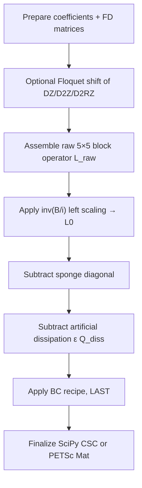
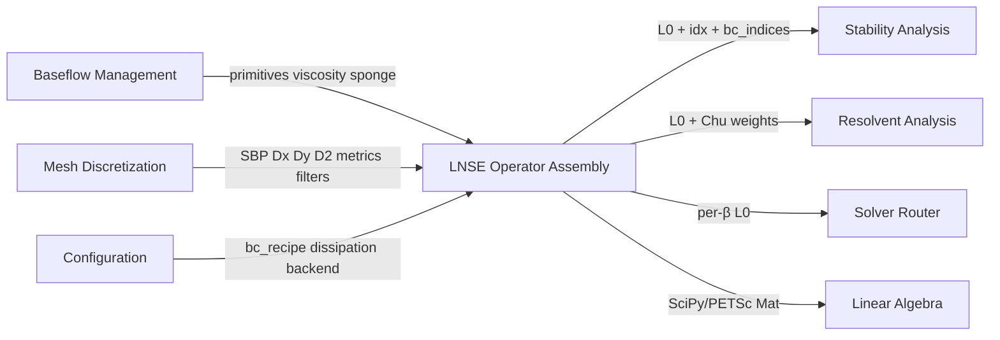
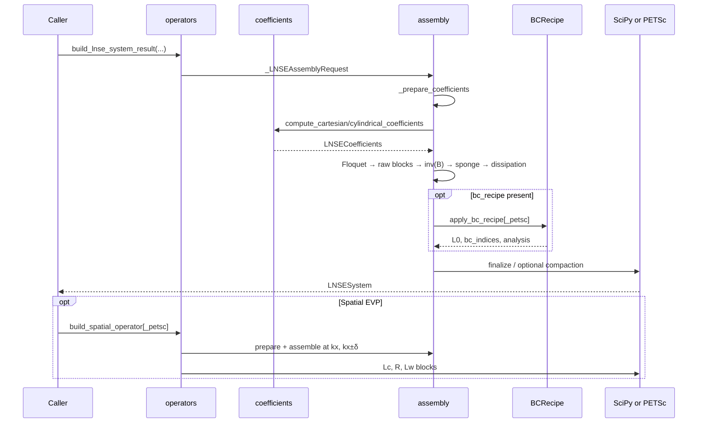

# LNSE operator assembly

!!! info "Math you need for this page"
    Assembly builds $\partial_t q' = L_0 q'$ for $q' = [\rho', u', v', w', T']^T$ in a fixed order: raw coefficient blocks, `inv(B/1j)` scaling, sponge damping, artificial dissipation $L_0 \leftarrow L_0 - \varepsilon Q_{\mathrm{diss}}$, then BC row overwrite last. Temporal [eigenvalues](https://grokipedia.com/page/Eigenvalues_and_eigenvectors) downstream are $\omega = \mathrm{eig}(i L_0)$. The [Chu](../core-concepts.md) energy diagonal is $W = \mathrm{diag}(W_{\rho}, W_u, W_v, W_w, W_T)$ from quadrature weights, base $\rho$ and $T$, $\kappa$, and $Ma$, with an extra radial factor in axisymmetric mode. BCs publish free degree sets that solvers must respect.
    New to [PETSc](https://en.wikipedia.org/wiki/PETSc) or [SLEPc](https://en.wikipedia.org/wiki/SLEPc) vocabulary? The [solver glossary](../solver-glossary.md) defines every object named on this page.


## 1. Overview

**LNSE Operator Assembly** is the mathematical core of LinStabPy. It turns mesh-aligned mean-flow fields and [summation-by-parts](https://grokipedia.com/page/Summation_by_parts) (SBP) finite-difference operators into large sparse linearized [Navier–Stokes](https://grokipedia.com/page/Navier–Stokes_equations) (LNSE) systems that downstream stability, resolvent, and routing stages consume.

The domain spans two packages that are physically separate in the tree but form one logical pipeline:

| Package | Role |
|---------|------|
| `src/linstabpy/operators/` | Physical coefficients, temporal/spatial sparse assembly, Chu energy norm, assembly metrics |
| `src/linstabpy/boundary_conditions/` | Declarative Dirichlet/Neumann recipes, free-DOF index sets, SciPy and PETSc enforcement |

**State vector** (physical ordering):

\[
q = [\rho',\, u',\, v',\, w',\, T']
\]

**[Discrete temporal operator](../core-concepts.md)** \(L_0\) satisfies \(\partial_t q = L_0 q\). Eigenvalues of \(i L_0\) are code frequencies \(\omega_{\mathrm{code}} = -\omega_{\mathrm{OS}}\); unstable modes have \(\operatorname{Im}(\omega_{\mathrm{code}}) < 0\).

**Supported flow models**

- **`2D`**, Cartesian [compressible](https://grokipedia.com/page/Compressible_flow) boundary-layer / shear form with Fourier spanwise [wavenumber](https://grokipedia.com/page/Wavenumber) `kx`
- **`axy`**, Cylindrical axisymmetric form with azimuthal mode `m` and optional [Floquet](https://grokipedia.com/page/Floquet_theory) streamwise shift

**Backends**

- SciPy CSC (reference path, full feature set)
- Direct PETSc AIJ (validated for selected 2D/axy combinations)
- SciPy → PETSc conversion fallback when direct PETSc cannot host a requested numerical term

---

## 2. Module Map and Public API

### 2.1 Source layout

```
src/linstabpy/operators/
├── __init__.py          # Public re-exports
├── assembly.py          # L0 pipeline, LNSESystem, SciPy/PETSc backends (~1946 lines)
├── coefficients.py      # Cartesian / cylindrical LNSECoefficients (~1781 lines)
├── spatial.py           # Spatial EVP block operators (Lc, R, Lw)
├── energy_norm.py       # Chu compressible energy weights
└── metrics.py           # Stage timing, JSON metrics, CSR derivative caches

src/linstabpy/boundary_conditions/
├── __init__.py          # Lazy PEP 562 exports (no eager petsc4py)
├── recipe.py            # BCRule / BCRecipe / analyze / apply
├── dirichlet.py         # Row/column zeroing + penalty diagonal
└── neumann.py           # Normal-derivative boundary rows
```

### 2.2 Public entry points

From `linstabpy.operators`:

| Symbol | Purpose |
|--------|---------|
| `build_lnse_operator` | Pre-BC SciPy \(L_0\) + index dict |
| `build_lnse_operator_petsc` | Pre-BC PETSc \(L_0\) + index dict |
| `build_lnse_system` | Full system (optional BCs); legacy tuple `(operator, idx, bc_indices)` |
| `build_lnse_system_result` | Full system as `LNSESystem` (preferred) |
| `LNSESystem` | Operator + BC metadata + backend provenance |
| `compute_cartesian_coefficients` / `compute_cylindrical_coefficients` | Coefficient tensors |
| `compute_chu_norm` | Energy-norm diagonals |
| `build_spatial_operator` / `build_spatial_operator_petsc` | Spatial EVP blocks |
| `spatial_lhs_with_dirichlet` | Combine spatial LHS then apply Dirichlet |

Boundary-condition symbols resolve lazily from `linstabpy.boundary_conditions` (`BCRecipe`, `apply_bc_recipe`, `apply_dirichlet`, `apply_neumann`, spatial variants, analysis helpers).

---

## 3. Mathematical Formulation

### 3.1 Continuous linearized system

Coefficient generation produces pointwise \(5\times5\) tensors such that

\[
B \frac{\partial q}{\partial t}
=
\bigl(
A_0 + A_x D_x + A_y D_y
+ A_{xx} D_{xx} + A_{yy} D_{yy} + A_{xy} D_{xy}
\bigr) q.
\]

Each of \(A_0, A_x, A_y, A_{xx}, A_{yy}, A_{xy}, B\) has shape `(5, 5, ngp)`. Entry `[i, j, :]` multiplies the \(j\)-th perturbation variable in the \(i\)-th equation at every active grid point.

### 3.2 Discrete temporal operator

Assembly builds the raw block operator from coefficients and FD stencils, then left-scales by the analytical inverse of \(B/i\):

\[
L_0 = \operatorname{inv}(B/i)\, L_{\mathrm{raw}}.
\]

Optional sponge damping and artificial dissipation are added to this \(L_0\). Boundary-condition recipes overwrite boundary rows **last**.

### 3.3 Coordinate conventions

Callers always use the **physical** frame:

```
        +y (wall-normal)
        |
        |______ +x (streamwise)
       /
      /
     +z (spanwise / Fourier)
```

MATLAB LinStab2D used an internal coefficient frame (x spanwise, z streamwise, with sign flips). `coefficients.py` absorbs that mapping so assembly and solvers never apply it again.

Internal source-block names map to physical tensors as:

| MATLAB / internal | Physical |
|-------------------|----------|
| `A0` | `A0` |
| `Ar` | `Ay` |
| `Az` | `Ax` |
| `Arr` | `Ayy` |
| `Azz` | `Axx` |
| `Arz` | `Axy` |
| `B` | `B` |

---

## 4. Physical Coefficients (`coefficients.py`)

### 4.1 `LNSECoefficients`

Frozen-layout dataclass holding seven complex arrays of shape `(5, 5, ngp)`.

### 4.2 Cartesian path, `compute_cartesian_coefficients`

Ports `getCoeffsLaminar_Cartesian.m` plus the variable-order transforms from `GetLinProblem.m`.

**Inputs (all length `ngp` unless noted)**

- Primitives: `U, V, W, RHO, T, MU, P`
- Parameters: `kx, Re, Ma, Pr, kappa`
- First/second derivatives of velocity, density, temperature, pressure
- Viscosity derivatives `dmudT`, `d2mudT2`

**Internal steps**

1. Map physical fields into the coefficient coordinate system  
   (`Uc = -W`, `Vc = V`, `Wc = U`, `kz = -kx`, derivative sign flips).
2. Evaluate the full set of compressible LNSE coefficient formulas (175 entries).
3. Pack results into physical variable order via `_PhysicalCoefficientBuilder` / `_pack_coefficients_in_physical_order`, applying permutation indices and sign conventions (including the MATLAB `-LHS` flip).

### 4.3 Cylindrical path, `compute_cylindrical_coefficients`

Axisymmetric compressible coefficients for model `axy`, driven by radial/axial derivatives and azimuthal mode `m`. Velocity components are remapped in preparation (`U_c ← V`, `V_c ← W`, `W_c ← U` in physical mesh axes) before coefficient evaluation.

### 4.4 Builder pattern

`_PhysicalCoefficientBuilder.set(source_name, row, col, value)` writes each formula result directly into the final physical tensors, avoiding large intermediate `locals()` packs while preserving MATLAB formula order and validation of expected keys.

---

## 5. Temporal Operator Assembly (`assembly.py`)

### 5.1 Canonical pipeline order (non-interchangeable)

Documented in the module header and enforced by both SciPy and PETSc backends:



**Why order matters**

- Sponge and dissipation are \(L_0\)-level corrections; they must not be applied to \(L_{\mathrm{raw}}\) before \(\operatorname{inv}(B/i)\).
- BC rows must be written **after** every operator contribution. Applying BCs earlier lets sponge/dissipation overwrite them; applying \(\operatorname{inv}(B)\) after BCs corrupts enforced rows.

### 5.2 Coefficient preparation, `_prepare_coefficients`

Shared by temporal and spatial assembly:

1. Restrict baseflow fields to active points `mesh.used_ind` (Fortran-order ravel).
2. Form pressure \(P = \rho T / (Ma^2 \kappa)\).
3. Materialize baseflow derivatives via mesh SBP operators (`Dx, Dy, D2x, D2y, Dxy`, …), recording matvec metrics.
4. Call Cartesian or cylindrical coefficient functions.
5. Attach differentiation matrices used in block assembly:
   - **2D:** `DR=Dy`, `D2R=D2y`, `DZ=Dx`, `D2Z=D2x`, `D2RZ=mesh.Dxy` (matches MATLAB `Dz*Dr`).
   - **axy:** parity-aware radial/axial blocks from `_create_axy_diff_matrices` (symmetric/asymmetric pole treatments by mode `m`).

Returns a prep dict: `coeffs`, FD matrices, primitives, `kappa`, `Ma`, `mesh`, `ngp`, `model`.

### 5.3 Floquet shift, `_apply_floquet_shift`

Used when `floquet_exp ≠ 0` (primarily cylindrical). Modes via `LINSTABPY_FLOQUET_SHIFT` or explicit argument:

| Mode | Behavior |
|------|----------|
| **`continuum`** (default) | \(D_Z \mathrel{+}= i\alpha I\), \(D_{2RZ} \mathrel{+}= i\alpha D_R\), \(D_{2Z}\) uses **unshifted** \(D_Z\) |
| **`matlab_parity`** | LinStab2D discrete algebra: \(D_{2RZ} \mathrel{+}= i\alpha I\), \(D_{2Z}\) uses **shifted** \(D_Z\) |

### 5.4 Raw block assembly

For each variable pair \((i,j)\), the `ngp × ngp` block is

\[
\operatorname{diag}(A_0^{ij})
+ \operatorname{diag}(A_y^{ij}) D_R
+ \operatorname{diag}(A_x^{ij}) D_Z
+ \operatorname{diag}(A_{yy}^{ij}) D_{2R}
+ \operatorname{diag}(A_{xx}^{ij}) D_{2Z}
+ \operatorname{diag}(A_{xy}^{ij}) D_{2RZ}.
\]

Implementation highlights:

- CSR derivative caches (`metrics._CSRDerivativeCache`) avoid repeated format conversion.
- `_build_block_csr` skips empty coefficient contributions and uses direct CSR fill for multi-term blocks (no unsafe cross-call layout memoization).
- SciPy path: `_assemble_block_operator_csr` → global CSR via `hstack`/`vstack`.
- PETSc path: `_assemble_block_operator_petsc` inserts rows into AIJ (local or distributed under validated configs).

### 5.5 \(\operatorname{inv}(B/i)\) scaling

**Cartesian (`2d`)**, \(B/i = \operatorname{diag}(1,\rho,\rho,\rho,\rho)\). Applied as pure CSR/PETSc row scaling by \(1/\rho\) on momentum/energy blocks.

**Axisymmetric (`axy`)**, \(B/i\) is lower-triangular (conservative→primitive structure). Analytical \(5\times5\) inverse at each point is applied as a block [sparse](https://grokipedia.com/page/Sparse_matrix) multiply (SciPy) or via SciPy transform then PETSc rebuild (sequential only). Distributed PETSc + `axy` raises a clear `RuntimeError`.

### 5.6 Sponge and dissipation

- **Sponge:** if `mesh.sponge` is set, subtract \(\operatorname{diag}(\mathrm{tile}(\mathrm{sponge}, 5))\) from \(L_0\).
- **Artificial dissipation:** when `dissipation_epsilon > 0` and mesh `Q_diss_x` / `Q_diss_y` exist,

\[
L_0 \leftarrow L_0 - \varepsilon\, \operatorname{blkdiag}(Q_{\mathrm{diss}}^{2D},\ldots,Q_{\mathrm{diss}}^{2D}).
\]

Direct PETSc `build_lnse_operator_petsc` currently **rejects** nonzero `dissipation_epsilon` (`NotImplementedError`); the system builder falls back to SciPy (or SciPy→PETSc) so the term is not silently dropped.

### 5.7 Index structure, `_build_index_structure`

Produces the DOF map used by BCs and solvers, including:

- Border grid indices: `bi`, `ti`, `li`, `ri` (and mask `mi` when present)
- Variable blocks: `rho_j`, `u_j`, `v_j`, `w_j`, `T_j`
- Combined keys `{border}_{var}` for each border/variable pair

Global size is \(5 N_{gp}\).

---

## 6. System Builder and Backend Selection

### 6.1 Request / result types

```text
_LNSEAssemblyRequest
  mesh, baseflow, kx, model, m, floquet_exp,
  dissipation_epsilon, bc_recipe, bc_penalty,
  backend, solver_cfg

LNSESystem
  operator          # sp.csc_matrix | PETSc.Mat
  idx               # index dict
  bc_indices        # constrained DOFs
  bc_analysis       # optional recipe analysis
  backend_metadata  # requested/resolved backend, reasons
  resolvent_operator_data  # reserved extension slot
```

### 6.2 API layers

| Function | BC | Return |
|----------|----|--------|
| `build_lnse_operator` / `_petsc` | No (pre-BC) | `(L0, idx)` |
| `build_lnse_system` | Optional | `(operator, idx, bc_indices)` legacy tuple |
| `build_lnse_system_result` | Optional | `LNSESystem` |

New runtime code should prefer `build_lnse_system_result` so backend decisions and BC ownership remain attached to the operator.

### 6.3 Backend decision

`_LNSEBackendDecision` records:

- `requested_backend` / `resolved_backend` (`scipy`, `petsc`, `auto`, …)
- Whether distributed matrices were requested
- Whether direct PETSc assembly is supported for the model
- Fallback reason when SciPy assembly + conversion is used

**Direct PETSc support (current)**

- Models `2D` and `axy` only
- Distributed direct assembly validated primarily for `2D`
- Dissipation forces non-direct path
- Complex-scalar PETSc required (`require_complex`)

### 6.4 Shared backend orchestration

`_assemble_from_prepared_with_backend` runs Floquet → raw blocks → inv(B) → sponge → finalize through:

- `_ScipyLNSEAssemblyBackend`
- `_PetscLNSEAssemblyBackend`

Representation-specific details (CSR vs AIJ, diagonal sponge updates, compaction) stay inside the backend objects; physics order stays shared.

---

## 7. Boundary Condition Recipes

### 7.1 Design

YAML-friendly declarative rules applied **sequentially**. Later rules own overlapping rows. That order is part of the numerical contract (no separate precedence field).

**Border characters:** `l` left, `r` right, `b` bottom, `t` top, `m` mask/inner  
**Variable characters:** `r` ρ, `u`, `v`, `w`, `T`

Example recipe:

```yaml
bc_recipe:
  - type: dirichlet
    borders: "lt"
    variables: "ruvwT"
  - type: neumann
    borders: "b"
    variables: "T"
    exclude_corners: true
```

### 7.2 `BCRule` / `BCRecipe`

- `BCRule.from_mapping`, normalize and validate one rule
- `BCRecipe.from_config`, list/dict or existing recipe
- `apply_to` / `apply_to_petsc`, temporal operators
- `apply_to_spatial` / `apply_to_spatial_petsc`, doubled spatial matrices ([Dirichlet](https://grokipedia.com/page/Dirichlet_boundary_condition)-only)
- `analyze`, effective row owners without mutating a matrix

### 7.3 Dirichlet (`dirichlet.py`)

Ports `BC_Dirichlet.m`:

1. Collect DOF indices for all (border, variable) pairs.
2. Zero **rows** and **columns** at those DOFs (remove equation and remove constrained variable from interior couplings, MATLAB parity).
3. Set diagonal entries to `penalty` (default `1e4`).
4. `eliminate_zeros` to keep sparsity clean.

Also provides spatial helpers that apply Dirichlet on the doubled EVP after \(L_c + \omega L_w\) is formed, and optional restriction matrices / free-DOF utilities.

### 7.4 Neumann (`neumann.py`)

Ports `BC_Neumann.m`:

- Supported borders: `b, t, l, r` only (not `m`).
- Replaces boundary rows with scaled normal-derivative stencils from `mesh.Dx` / `mesh.Dy`.
- **Cartesian-mapped normals** from geometry gradients, or **`curvilinear_normals=True`** using mesh metric terms `J11…J22`.
- `exclude_corners` drops shared corner points from a border.
- Ambiguous multi-border corner DOFs raise `ValueError` instead of silently picking one normal.

### 7.5 Analysis output (`analyze_bc_recipe`)

Useful fields for free-DOF construction and diagnostics:

- `dirichlet_indices` / `neumann_indices`
- `effective_dirichlet_indices` / `effective_neumann_indices` (after sequential ownership)
- `column_zeroed_dirichlet_indices` (all Dirichlet rules that ran, even if a later [Neumann](https://grokipedia.com/page/Neumann_boundary_condition) overwrote the row)
- `overlap_indices`, `total_bc_indices`, per-rule reports

### 7.6 Lazy import policy

`boundary_conditions/__init__.py` uses PEP 562 `__getattr__` so pure-math entry points do not force `petsc4py` load. PETSc variants import petsc4py inside their modules.

---

## 8. Spatial Operator Assembly (`spatial.py`)

Ports LinStab2D `GetSpatialLinProblem.m`.

### 8.1 Finite-difference in streamwise wavenumber

At fixed Floquet exponent, assemble three temporal operators in the Fourier argument `kx`:

\[
\begin{aligned}
R_0 &= L(k_x), \\
R_1 &= \frac{L(k_x+\delta)-L(k_x-\delta)}{2\delta}, \\
R_2 &= \frac{L(k_x+\delta)-R_0-R_1\delta}{\delta^2}.
\end{aligned}
\]

Default `kx=0`, `delta=1` matches MATLAB's `{0,+1,-1}` stencil. Floquet is **not** the FD direction.

### 8.2 Doubled pencil

With \(q' = [q;\, \alpha q]\):

\[
L_c =
\begin{bmatrix} 0 & I \\ -R_0 & 0 \end{bmatrix},
\quad
R =
\begin{bmatrix} I & 0 \\ R_1 & R_2 \end{bmatrix},
\quad
L_w =
\begin{bmatrix} 0 & 0 \\ -i I & 0 \end{bmatrix},
\]

so

\[
(L_c + \omega L_w)\, q' = \alpha\, R\, q'.
\]

### 8.3 Dirichlet on spatial systems

`spatial_lhs_with_dirichlet` forms \(L = L_c + \omega L_w\) **first**, then applies Dirichlet to both \(L\) and \(R\). Applying BCs only to \(L_c\) would leave \(L_w\) contaminating second-half boundary rows (MATLAB-aligned fix).

Spatial recipes currently require Dirichlet-only analysis (`_require_spatial_dirichlet_recipe`).

### 8.4 PETSc spatial path

`build_spatial_operator_petsc` reuses `_prepare_coefficients` and `_assemble_from_prepared_petsc`, builds \(R_1/R_2\) with `Mat.axpy`, assembles block matrices via CSR row insertion, and destroys intermediate Mats. Targets the validated local/sequential direct-PETSc path.

---

## 9. Energy Norm (`energy_norm.py`)

`compute_chu_norm` implements Chu's compressible energy weights (from `GetCompEnergyNorm.m`):

\[
W_{ii} = \frac12
\begin{bmatrix}
\bar T/(\bar\rho\,\kappa\,\mathrm{Ma}^2) \\
\bar\rho \\
\bar\rho \\
\bar\rho \\
\bar\rho/[\kappa(\kappa-1)\bar T\,\mathrm{Ma}^2]
\end{bmatrix}
\odot w_{\mathrm{int}}.
\]

Returns `W_diag` and `invW_diag` of length `5*ngp`. For `model="axy"`, integration weights are multiplied by radial coordinate \(r\) (clamped away from zero). Used by [resolvent](https://grokipedia.com/page/Resolvent_formalism) weighted [gains](../core-concepts.md) and modal energy post-processing, not by raw \(L_0\) assembly itself.

---

## 10. Assembly Metrics (`metrics.py`)

Optional instrumentation without changing operator APIs:

- Context-var session around assembly stages
- Stage wall time and peak RSS deltas
- Derivative matvec counts/bytes, coefficient tensor sizes, nnz pre/post BC
- JSON output paths with `{rank}` / `{size}` placeholders for [MPI](https://grokipedia.com/page/Message_Passing_Interface)
- CSR derivative cache helpers shared by block builders

Enabled through solver/config assembly-metrics knobs; collectors finish with structured payloads for cost analysis and regression tracking.

---

## 11. Interactions with Adjacent Domains



| Dependency | Nature |
|------------|--------|
| **Baseflow** | Data: \(\rho,u,v,w,T,\mu,\partial\mu/\partial T\), Re/Ma/Pr/κ |
| **Mesh** | Composition: geometry, SBP stencils, sponge, dissipation, Jacobians, pole parity ops |
| **Stability / Resolvent / Router** | Consumers of BC-enforced \(L_0\) (and spatial blocks / energy weights) |
| **Linear algebra** | Factorization of shifted \(L_0 - i\omega I\) after assembly |
| **Config / driver** | Supplies model, `kx`/`m`/Floquet, BC recipe, dissipation, backend policy |

Boundary conditions are a separate package for import hygiene and MATLAB module parity, but functionally belong to this domain: free-DOF sets are part of the assembled system contract.

---

## 12. Runtime Sequence



---

## 13. Implementation Notes and Constraints

1. **Pre-BC vs full system**, Low-level `build_lnse_operator*` never apply BCs so SciPy, PETSc, and conversion paths share one post-operator ordering.
2. **Dissipation dual config risk (project-wide)**, Assembly takes an explicit `dissipation_epsilon`. Router campaigns may read top-level keys while other paths use nested `operator_dissipation`; mismatched enable/strength can silently no-op dissipation. Callers must pass a consistent strength into assembly.
3. **Direct PETSc gaps**, No validated PETSc-side \(Q_{\mathrm{diss}}\) insertion; axy inv(B) is sequential-only; distributed direct assembly is model-limited.
4. **Complex arithmetic**, Production PETSc builds must be complex-scalar.
5. **Sparsity hygiene**, Dirichlet/Neumann paths zero data in place where possible and eliminate structural zeros after penalty insertion.
6. **MATLAB parity knobs**, Floquet `matlab_parity` vs continuum-correct default; coefficient packing absorbs LinStab2D coordinate and LHS sign conventions.
7. **Performance**, Coefficient prep materializes many derivative vectors (instrumented); CSR caches and direct block fill reduce assembly cost; PETSc compaction can run after sequential direct assembly.
8. **Spatial BC rule**, Always combine \(L_c + \omega L_w\) before Dirichlet; spatial recipes are Dirichlet-centric today.

---

## 14. Practical Usage Patterns

### 14.1 Library: full temporal system (preferred)

```python
from linstabpy.operators import build_lnse_system_result

system = build_lnse_system_result(
    mesh,
    baseflow,
    kx=beta,              # spanwise / streamwise Fourier param as configured
    model="2D",
    dissipation_epsilon=eps,
    bc_recipe=bc_recipe,  # list[dict] or BCRecipe
    backend="auto",
    solver_cfg=solver_cfg,
)
L0 = system.operator
idx = system.idx
bc = system.bc_indices
```

### 14.2 Pre-BC operator for custom BC application

```python
from linstabpy.operators import build_lnse_operator
from linstabpy.boundary_conditions import apply_bc_recipe

L0, idx = build_lnse_operator(mesh, baseflow, kx=0.0, model="2D")
L0, bc_indices = apply_bc_recipe(L0, mesh, idx, recipe, penalty=1e4)
```

### 14.3 Spatial EVP blocks

```python
from linstabpy.operators import build_spatial_operator, spatial_lhs_with_dirichlet

Lc, R, Lw, idx = build_spatial_operator(mesh, baseflow, model="2D", kx=0.0, delta=1.0)
L, R, bc = spatial_lhs_with_dirichlet(
    Lc, Lw, R, omega_spatial, idx, borders="lrbt", variables="ruvwT",
    ngp=mesh.ngp, use_petsc=False,
)
```

### 14.4 Energy weights for resolvent

```python
from linstabpy.operators import compute_chu_norm

W_diag, invW_diag = compute_chu_norm(
    W_int, RHO, T, kappa, Ma, ngp, model="2D"
)
```

---

## 15. Summary

LNSE Operator Assembly is the bridge from [CFD](https://grokipedia.com/page/Computational_fluid_dynamics) mean flow and SBP discretization to the sparse linear operators that define LinStabPy's scientific products. It:

- Generates **Cartesian and cylindrical** compressible LNSE coefficient tensors in a stable physical ordering  
- Assembles **\(5N_{gp}\times5N_{gp}\)** temporal operators with a **fixed, documented** transform order  
- Enforces **declarative Dirichlet/Neumann** recipes and free-DOF metadata  
- Extends the same preparation path to **spatial EVP** block pencils  
- Supplies **Chu energy norms** and **assembly metrics** for resolvent and HPC cost control  
- Offers **SciPy reference** and **PETSc direct/fallback** backends under explicit capability gates  

All major analysis workflows, temporal/[adjoint](https://grokipedia.com/page/Adjoint) eigenproblems, resolvent gains, β–frequency maps, and spatial stability, depend on this domain producing a correct, BC-consistent \(L_0\) (or spatial equivalent) before any factorization or SLEPc solve.