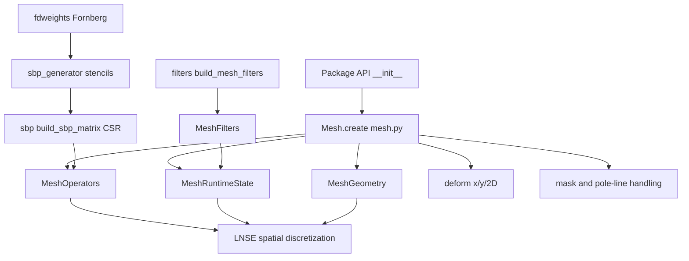
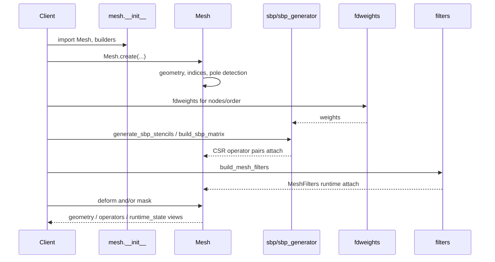

# Mesh Discretization, Technical Implementation Documentation

!!! info "Math you need for this page"
    Structured 2D grids with [SBP](https://grokipedia.com/page/Summation_by_parts) [finite differences](https://grokipedia.com/page/Finite_difference_method) at even orders $2$, $4$, $6$, $8$ only, each with validated boundary closures and diagonal norm $H$. Filters are implicit 10th order Mattsson style with `alpha_filter` strength control. Artificial dissipation is the Mattsson, Svard, and Nordstrom operator $Q_{\mathrm{diss}}$ scaled by $\varepsilon$ and applied as $L_0 - \varepsilon Q$. Deformation chain rules the derivatives and scales quadrature by $|\det J|$. Fortran order flattening keeps indices aligned with the MATLAB reference.
    New to [PETSc](https://en.wikipedia.org/wiki/PETSc) or [SLEPc](https://en.wikipedia.org/wiki/SLEPc) vocabulary? The [solver glossary](../solver-glossary.md) defines every object named on this page.


## 1. Overview

The **Mesh Discretization** domain (`src/linstabpy/mesh/`) is the structured-mesh foundation of LinStabPy. It supplies geometry, summation-by-parts (SBP) finite-difference operators, integration weights, optional artificial dissipation, spatial filters, mesh deformation, pole-line handling, and masking for linearized [Navier–Stokes](https://grokipedia.com/page/Navier–Stokes_equations) (LNSE) spatial discretization on structured 2-D grids.

The implementation ports LinStab2D MATLAB workflows (`CreateMesh.m`, `AddDW2mesh.m`, `DeformMesh.m`, `GetFilter.m` / `CreateFilter.m`, `Dmats_SBP.m`) into Python dataclasses and SciPy [sparse](https://grokipedia.com/page/Sparse_matrix) linear algebra. Downstream LNSE assembly, energy norms, stability eigenproblems, and [resolvent](https://grokipedia.com/page/Resolvent_formalism) analysis all consume this mesh contract.

**Scope**

| In scope | Out of scope |
|----------|--------------|
| Structured rectangular / deformed 2-D meshes | Unstructured or full 3-D volume frameworks |
| SBP FD orders 2, 4, 6, 8 | Arbitrary high-order SBP beyond validated closures |
| Axisymmetric pole treatments (Mohseni–Colonius) | Nonlinear CFD mesh generation |
| Implicit 10th-order filters, MSN artificial dissipation | PETSc-distributed mesh partitioning |

---

## 2. Package Layout and Public API

```
src/linstabpy/mesh/
├── __init__.py          # Public surface + lazy imports
├── mesh.py              # Mesh core: geometry, operators, deform, mask
├── sbp.py               # SBP stencils, matrices, pole ops, dissipation
├── sbp_generator.py     # Automatic SBP stencil generation
├── fdweights.py         # Fornberg finite-difference weights
└── filters.py           # MeshFilters and 10th-order filter builders
```

### 2.1 Public exports (`linstabpy.mesh`)

| Symbol | Role |
|--------|------|
| `Mesh`, `MeshGeometry`, `MeshOperators`, `MeshRuntimeState` | Core mesh object and frozen views |
| `MeshFilters`, `build_mesh_filters` | Direct / adjoint filter callables |
| `sbp_stencils`, `build_sbp_matrix` | Stencil tables and 1-D D1/D2 CSR pairs |
| `build_sbp_pole_matrices` | Symmetric / antisymmetric pole operators |
| `build_sbp_dissipation_matrices` | MSN artificial dissipation + norm |
| `min_points` | Minimum grid size for a given FD order |
| `fdweights` | Fornberg weights for arbitrary nodes |

**Lazy loading.** `Mesh*` and filter symbols are imported via PEP 562 `__getattr__` so lightweight imports (help, version, stencil-only use) avoid pulling the full mesh stack until needed. Eager exports cover SBP builders and `fdweights`.

---

## 3. Architecture and Data Flow





**Pipeline position.** In the staged case workflow, mesh construction sits after baseflow ingest/preprocess and before LNSE coefficient generation and `L0` assembly:

`config → baseflow → mesh/SBP/filters → coefficients → L0 + BCs → factorize → eigen/resolvent`.

---

## 4. Core Data Model

### 4.1 `Mesh` (mutable runtime carrier)

Do not construct `Mesh` with the dataclass constructor in application code. Use `Mesh.create(...)`.

**Geometry and indexing**

| Field | Contract |
|-------|----------|
| `X`, `Y` | Physical coordinates, shape `(ny, nx)` |
| `ngp` | Number of **used** grid points (`used_ind.size`; equals `nx*ny` when unmasked) |
| `used_ind` | Column-major (Fortran-order) indices of active points |
| `idx` | Boundary index sets: `bi` (bottom), `ti` (top), `li` (left), `ri` (right) |
| `y_symmetry`, `x_periodicity` | Axisymmetric / periodic flags |

**Operators (SciPy CSR)**

| Field | Meaning |
|-------|---------|
| `fd_order` | SBP order 2 / 4 / 6 / 8 |
| `Dx`, `D2x`, `Dy`, `D2y` | First and second derivatives |
| `Dxy`, `Dyx` | Mixed derivatives `Dx@Dy`, `Dy@Dx` |
| `Dy_symm`, `D2y_symm`, `Dy_asymm`, `D2y_asymm` | Pole-aware y operators (axisymmetric) |
| `Dxy_*`, `Dyx_*` | Mixed derivatives with pole variants |
| `W`, `W_symm`, `W_asymm` | Integration weights `(ny, nx)` (and symmetry variants) |
| `Q_diss_x`, `Q_diss_y` | Optional 1-D MSN dissipation along ξ / η |

**Runtime extras**

| Field | Meaning |
|-------|---------|
| `sponge` | Optional sponge profile (carried; primary sponge path is baseflow/assembly) |
| `alpha_filter`, `filters` | Filter strength and `MeshFilters` pair |
| `J11`–`J22` | Computational→physical Jacobian on used points |

### 4.2 Frozen views

Callers should declare which contract slice they need:

| View | Contents |
|------|----------|
| `mesh.geometry` → `MeshGeometry` | `X`, `Y`, `ngp`, `used_ind`, `idx`, symmetry/periodicity |
| `mesh.operators` → `MeshOperators` | All derivative / weight / dissipation operators |
| `mesh.runtime_state` → `MeshRuntimeState` | Sponge, filters, Jacobians |

Views are frozen dataclasses; the underlying `Mesh` remains the mutable carrier for construction and deformation.

### 4.3 Indexing convention

All flattened arrays and sparse operators use **column-major (Fortran) order**, matching MATLAB LinStab2D. Boundary indices in `idx` refer to this flattened layout. Baseflow fields are expected on the same `(ny, nx)` grid.

---

## 5. Mesh Construction (`Mesh.create`)

### 5.1 Signature and validation

```text
Mesh.create(
    xrange, yrange, nx, ny, fd_order,
    y_symmetry=False,
    x_periodicity=False,
    alpha_filter="none",
    numerics_operator_dissipation=None,
) -> Mesh
```

Validation (`_validate_create_inputs`):

- `xrange` / `yrange` must be finite, distinct endpoint pairs.
- `nx`, `ny`, `fd_order` must be integers.
- `nx` and `ny` must be at least `min_points(fd_order)` (closure width of the SBP boundary block).

### 5.2 Grid generation

1. **x-direction**  
   - Non-periodic: `linspace(x_min, x_max, nx)`.  
   - Periodic: open right endpoint (`linspace(..., nx+1)[:-1]`) so periodic neighbors are not duplicated; requires `nx >= 3`.

2. **y-direction**  
   - Standard: `linspace(y_min, y_max, ny)`.  
   - With `y_symmetry` and `y_min ≈ 0`: MATLAB-compatible half-cell shift  
     `dy = y_max / (ny - 0.5)`, then grid from `y_min + dy/2` to `y_max` (avoids placing a node exactly on the axis).

3. `meshgrid` → `X`, `Y` with shape `(ny, nx)`; initially `used_ind = arange(nx*ny)`.

### 5.3 Operator attachment

`_build_operators` builds global sparse operators:

- **Fast path (unmasked rectangular):** Kronecker products of 1-D SBP matrices (`_build_operators_kron`) for efficiency.
- **Slow path (masked):** line-by-line LIL assembly over unique y- or x-levels, splitting segments at gaps.

For each direction:

- Non-periodic lines: `build_sbp_matrix(n_line, spacing, fd_order)`.
- Periodic x-lines of full width: periodic 1-D operators.
- With `y_symmetry`: pole matrices from `build_sbp_pole_matrices` for symmetric/antisymmetric radial derivatives.

Integration weights accumulate 1-D SBP norm factors along each line (diagonal-norm quadrature). Mixed derivatives are formed as products of first-derivative operators.

### 5.4 Filters and dissipation at create time

- `build_mesh_filters(X, Y, used_ind, alpha_filter)` attaches direct and [adjoint](https://grokipedia.com/page/Adjoint) filters.
- If `numerics_operator_dissipation` is provided with `enabled=True`, `build_sbp_dissipation_matrices` fills `Q_diss_x` / `Q_diss_y` (1-D operators on the reference ξ / η lines). Defaults for the MSN \(A_{2p}\) profile live in `DISSIPATION_DEFAULTS` (`transition_fraction`, `endpoint_exponent`, `interior_value`).

### 5.5 Boundary index sets

`_build_indices` computes `bi`, `ti`, `li`, `ri` on the used grid, respecting periodicity, symmetry, and optional masks so internal walls (e.g. cavities) remain consistent after deformation.

---

## 6. SBP Operators

### 6.1 Theory and references

Diagonal-norm SBP operators of interior order \(2p\) use boundary closures of order \(p\). The first-derivative operator satisfies the discrete integration-by-parts identity

\[
Q + Q^T = B, \quad Q = H D_1, \quad B = \mathrm{diag}(-1,0,\ldots,0,1),
\]

with diagonal norm \(H\). Stencils follow Strand (1994) and Mattsson & Nordström (2004). Axisymmetric pole closures follow Mohseni & Colonius.

### 6.2 `sbp_stencils(order)`

Returns hardcoded reference tables for orders **2, 4, 6, 8**:

| Key | Content |
|-----|---------|
| `a_i1`, `a_i2` | Interior first- / second-derivative stencils |
| `a_b1`, `a_b2` | Boundary closure blocks shape `(r, m)` |

Unsupported even orders fall through to `generate_sbp_stencils` (validated norms exist only for 2–8; higher orders raise).

### 6.3 `min_points(order)`

Minimum number of points equals the boundary closure width \(m = a_{b1}.\mathrm{shape}[1]\). Mesh creation enforces this on both `nx` and `ny`.

### 6.4 `build_sbp_matrix(n, dz, order)`

Constructs 1-D CSR pair `(D1, D2)`:

1. Interior rows \(j = w \ldots n-r-1\): centered stencils scaled by \(1/dz\) and \(1/dz^2\).
2. Plus boundary (top): mirrored closures with sign flip on first derivatives.
3. Minus boundary (bottom): direct boundary rows.

Results are **LRU-cached** (`functools.lru_cache`) for repeated line lengths and orders.

### 6.5 Pole matrices (`build_sbp_pole_matrices`)

For axisymmetric meshes, returns:

\[
(D1_s,\; D1_a,\; D2_s,\; D2_a)
\]

symmetric (`s`) and antisymmetric (`a`) first- and second-derivative operators. Implementation mirrors MATLAB `Dmats_SBP.m`:

- Interior and outer-boundary rows use standard SBP.
- Near-axis rows use Mohseni–Colonius reflected stencils (`_mohseni_pole_stencil`) with parity \(h = \pm 1\).
- Rows \(w \ldots r-1\) stay interior-like (not standard minus-boundary closures).

These feed `Dy_symm` / `Dy_asymm` (and second-derivative / mixed counterparts) on the mesh.

### 6.6 Artificial dissipation (`build_sbp_dissipation_matrices`)

Mattsson–Svärd–Nordström (MSN) dissipation for interior orders **4, 6, 8**:

\[
Q_{\mathrm{diss}} = h^{2p+1}\, H^{-1} D_p^T B_p D_p,
\]

with \(p = \mathrm{order}/2\), diagonal \(H\) from SBP norms, \(D_p\) a divided \(p\)-th derivative (Vandermonde-centered interior; one-sided boundary aliases), and \(B_p\) the \(A_{2p}\) ramp profile.

**Phase-1 constraint:** `order_diss` must equal `order_interior` (decoupled dissipation order is deferred). Callers apply regularization as \(L_{\mathrm{reg}} = L - \varepsilon Q_{\mathrm{diss}}\). The factor \(h^{2p+1}\) is required for dimensional consistency with the full-norm formulation.

---

## 7. Automatic Stencil Generation

### 7.1 `fdweights` (Fornberg 1988)

`fdweights(xi, x, m)` returns finite-difference weights of derivative order \(m\) at evaluation point `xi` for arbitrary nodes `x`. Implementation uses a cached recursive Fornberg algorithm (`functools.cache` on the recursive weight function).

### 7.2 `sbp_generator`

| Function | Role |
|----------|------|
| `fornberg_interior(order, deriv)` | Centered interior stencil via `fdweights` |
| `_sbp_norm_weights(order)` | Known diagonal-norm boundary weights \(h_0\ldots h_{r-1}\) |
| `_solve_d1_closure` / `_solve_d2_closure` | Boundary blocks under \(Q+Q^T=B\) and accuracy conditions |
| `_solve_rational_lstsq` | Exact rational Gaussian elimination (avoids ill-conditioning for order ≥ 8) |
| `sbp_boundary_closure(order)` | Public D1/D2 boundary closures |
| `generate_sbp_stencils(order)` | Full `{a_i1, a_i2, a_b1, a_b2}`; matches hardcoded tables to machine precision for 2–8 |

This path is the algorithmic source of truth for regenerating tables and for any future validated higher-order closures.

---

## 8. Mesh Filters

### 8.1 Purpose

Implicit **10th-order** spatial filters stabilize discrete operators and resolvent applies. Ported from MATLAB `GetFilter.m` / `CreateFilter.m`. Filters are **operator-level** mesh state (not stage-dependent): create-time filters are retained across `deform` (MATLAB `DeformMesh` updates derivatives/weights only).

### 8.2 `MeshFilters`

```text
MeshFilters(
  filter:    Callable[[ndarray], ndarray],   # direct
  filter_ct: Callable[[ndarray], ndarray],   # adjoint-compliant
)
```

### 8.3 Construction (`build_mesh_filters`)

- **`alpha_filter == "none"` (or `""`):** identity pass-through (no filtering).
- **Numeric `alpha_filter`:** builds line-separable 2-D operators.  
  **Important MATLAB convention:** numeric `0.0` is **not** "off"; it is maximum-strength filtering with \(M = I\). Only the string `"none"` disables filters.

Pipeline:

1. `filter_O10_diffMat(n, alpha)` builds 1-D tridiagonal implicit \(M\) and explicit 10th-order \(F\) with MATLAB boundary closures.
2. `_build_2d_filter_pair` groups used points into constant-coordinate lines, applies 1-D filters on segments longer than 10 points.
3. Separable apply: \(F_x\) then \(F_z\) (never the dense product, sparsity and cost).
4. Implicit solves via `_build_filter_solver`: identity fast path when \(M=I\); otherwise one SciPy [SuperLU](https://portal.nersc.gov/project/sparse/superlu/) factor per direction.

**Performance note (in-code measurement).** Filters intentionally avoid PETSc/[MUMPS](https://en.wikipedia.org/wiki/MUMPS_(software)). On a 300×300 resolvent case, identity MUMPS filter solves previously dominated ~62% of one \(H^H H\) apply; sequential SuperLU / identity copies removed that overhead.

Adjoint path: transpose solves and Hermitian transpose of \(F\) factors so energy-weighted adjoint/resolvent paths remain consistent.

---

## 9. Deformation

`Mesh.deform(Y_new=None, X_new=None)` returns a **new** `Mesh` with updated physical coordinates and chain-ruled operators (MATLAB `DeformMesh.m`).

| Branch | Condition | Transformation |
|--------|-----------|----------------|
| X-only | `X_new` set, `Y_new` None | 1-D chain rule on x operators: \(D_x' = (x_\xi)^{-1} D_x\), second derivatives via \(x_{\xi\xi}\) |
| Y-only | `Y_new` set, `X_new` None | Analogous chain rule on y (and pole variants) |
| Full 2-D | both set | Full Jacobian \(J\), inverse metrics, first- and second-derivative transforms |

Details:

- Integration weights update as \(W \leftarrow W\,|\det|\).
- Jacobian entries `J11`–`J22` store \(\partial(X,Y)/\partial(\xi,\eta)\) on used points.
- Degenerate maps (`|det J| < 1e-15`) raise `ValueError`.
- Filters and `Q_diss_*` are **kept** from the parent mesh (not rebuilt on physical coordinates).
- Effective mask is reconstructed from `used_ind` so internal boundaries survive deformation.
- Separable axisymmetric deformations may recompute pole y-operators via sequential x-then-y deformation for MATLAB parity.

Helpers `_axm_diag` and `_transform_second_derivatives` implement sparse diagonal scaling and second-derivative metric transforms.

---

## 10. Masking

`Mesh.mask(...)` (and related helpers) restrict the active domain:

- Rebuild operators on the slow line-by-line path with `active_mask`.
- Update `used_ind`, `ngp`, boundary `idx`, and weights on the reduced set.
- Rebuild filters on the masked used set.
- Reset Jacobians to identity metrics on the computational used grid unless a subsequent `deform` is applied.
- Preserve dissipation 1-D operators from the parent when appropriate.

Gap detection (`_line_breaks`) splits FD lines at holes so cavity walls and multi-block-like masks remain well-defined.

---

## 11. Integration with Downstream Domains

| Consumer | Mesh contract used |
|----------|--------------------|
| **Baseflow** | Fields live on `(ny, nx)` aligned with `X`, `Y` |
| **LNSE coefficients / assembly** | `Dx, Dy, D2*, Dxy, Dyx`, pole variants, `W`, metrics `J*`, optional `Q_diss_*` |
| **Energy norm (Chu)** | Integration weights `W` (and symmetry variants) |
| **Boundary conditions** | `idx` boundary sets + `used_ind` free-DOF geometry |
| **Resolvent** | Differentiation + norms for \(L_0\) and weighted gains; filters on mode/forcing paths when enabled |
| **Spatial eigenproblems** | Same SBP indexing and operators for block spatial assembly |
| **Shared utilities** | SciPy CSR → PETSc conversion occurs **after** mesh-local assembly |

Mesh discretization does not initialize PETSc. Sparse operators remain SciPy CSR until the linear-algebra / assembly layer converts them for distributed solves.

---

## 12. Configuration Touchpoints

Typical YAML / typed config fields that affect this domain:

| Setting | Effect |
|---------|--------|
| Mesh extents and `nx`, `ny` | `Mesh.create` domain and resolution |
| `fd_order` (2/4/6/8) | SBP stencil order; schema-validated |
| `y_symmetry`, `x_periodicity` | Pole operators / periodic x stencils |
| `alpha_filter` | `"none"` vs numeric strength (note `0.0` ≠ off) |
| `numerics.operator_dissipation` | Enables `Q_diss_x/y`; strength \(\varepsilon\) applied at assembly |

Invalid FD orders fail early in config schema validation before expensive HPC stages.

---

## 13. Design Principles and Implementation Notes

1. **MATLAB parity.** Indexing, half-cell axis shift, filter conventions, deformation branches, and pole closures track LinStab2D so spectra and [gains](../core-concepts.md) remain comparable.

2. **SBP stability.** Diagonal-norm SBP + optional MSN dissipation provide a discrete energy estimate compatible with well-posed LNSE boundary treatments.

3. **Separation of concerns.** Geometry, derivative basis, and runtime extras (filters, sponge, Jacobians) are view-separated but stored on one carrier for orchestration simplicity.

4. **Performance.**  
   - Kronecker fast path for full rectangles.  
   - Cached 1-D SBP builds.  
   - Local SuperLU / identity filter solves (no PETSc on the filter path).  
   - Separable filter application without forming \(F_x F_z\) explicitly.

5. **Immutability of results.** `deform` and `mask` return new `Mesh` instances; callers can retain the computational mesh if needed.

6. **Single source of dissipation defaults.** `DISSIPATION_DEFAULTS` in `sbp.py` must be referenced by mesh and driver layers rather than re-declared literals.

---

## 14. Practical Usage Sketch

```python
from linstabpy.mesh import Mesh

mesh = Mesh.create(
    xrange=(0.0, 100.0),
    yrange=(0.0, 20.0),
    nx=400,
    ny=200,
    fd_order=4,
    y_symmetry=False,
    x_periodicity=False,
    alpha_filter="none",
    numerics_operator_dissipation={"enabled": True},  # optional
)

# Optional physical mapping (e.g. wall-normal clustering)
mesh = mesh.deform(Y_new=Y_clustered)

ops = mesh.operators   # Dx, Dy, W, ...
geo = mesh.geometry    # X, Y, idx, used_ind
```

Library consumers assembling LNSE systems should take `mesh.operators` (and metrics from `runtime_state` when deformed) rather than rebuilding FD stencils ad hoc.

---

## 15. Limitations and Extension Points

| Topic | Status |
|-------|--------|
| SBP orders | Validated closures 2–8 only |
| Dissipation order decoupling | Phase 3 (`NotImplementedError` if `order_diss ≠ order_interior`) |
| Unstructured / 3-D | Explicitly out of system scope |
| Filter on deformed physical lines | Filters stay on create-time computational structure (MATLAB parity) |
| Distributed mesh ownership | Mesh is rank-local SciPy; distribution happens at PETSc Mat conversion |

Natural extensions: validated higher-order SBP tables via `sbp_generator`, decoupled dissipation orders, and richer multi-block masking, without changing the public `Mesh` / view contract consumed by operator assembly.

---

## 16. Summary

**Mesh Discretization** provides LinStabPy's entire spatial discrete infrastructure: structured geometry, SBP differentiation and norms (including axisymmetric poles), MSN artificial dissipation, adjoint-consistent filters, deformation metrics, and masking. The `Mesh` object unifies these pieces; frozen views expose clean contracts to LNSE assembly, energy norms, stability, and resolvent workflows. Implementation fidelity to LinStab2D, careful sparse-algebra performance choices, and strict FD-order validation make the module the reliable foundation for large-scale [compressible](https://grokipedia.com/page/Compressible_flow) LNSE [eigenvalue](https://grokipedia.com/page/Eigenvalues_and_eigenvectors) and resolvent studies on HPC.