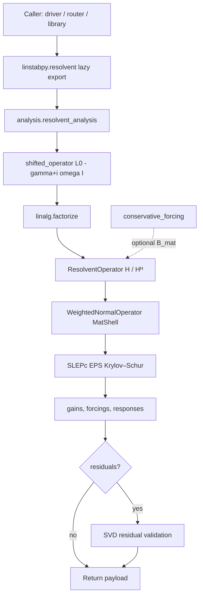
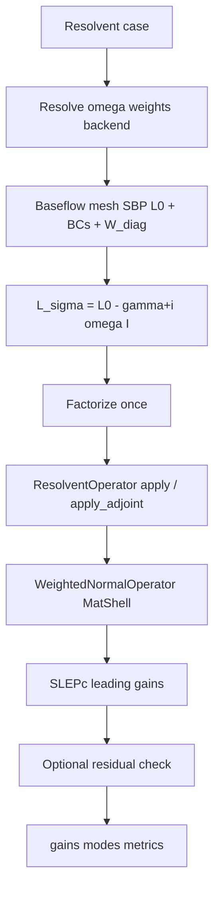
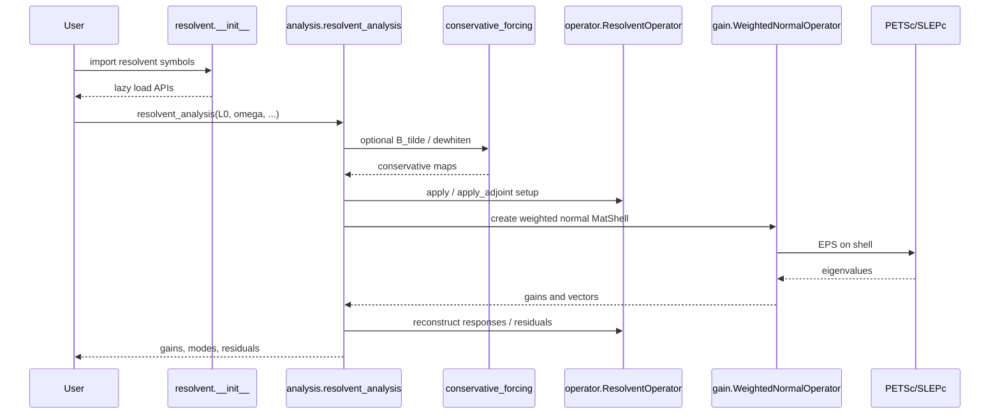

# Resolvent analysis

!!! info "Math you need for this page"
    $H = C F (L_0 - (\gamma + i\omega) I)^{-1} F B$ with filters $F$ inside the $B$ and $C$ masks. [Gains](../core-concepts.md) solve $W^{-1} H^H W H v = \sigma^2 v$ for `chu` forcing norm or $H^H W H v = \sigma^2 v$ for `l2`, with $\sigma = \sqrt{\mathrm{Re}(\lambda)}$ and response $u = Hv/\sigma$. Forward residual $\rho_{\mathrm{fwd}}$ is near roundoff by construction. [Adjoint](https://grokipedia.com/page/Adjoint) residual $\rho_{\mathrm{adj}}$ is the quality signal and should track the [SLEPc](https://en.wikipedia.org/wiki/SLEPc) tolerance. A factor belongs to one $(\omega, \gamma)$ pair.
    New to [PETSc](https://en.wikipedia.org/wiki/PETSc) or SLEPc vocabulary? The [solver glossary](../solver-glossary.md) defines every object named on this page.


## 1. Overview

**[Resolvent](https://grokipedia.com/page/Resolvent_formalism) Analysis** is a core scientific domain in LinStabPy. It constructs the frequency-domain resolvent operator of the linearized [Navier–Stokes](https://grokipedia.com/page/Navier–Stokes_equations) (LNSE) system, extracts optimal forcing/response pairs and energy gains, and validates singular triplets with residual checks. The domain supports amplifier and receptivity studies for [compressible](https://grokipedia.com/page/Compressible_flow) viscous flows and is the computational kernel used by single-frequency cases and by large \(\beta\)–\(\omega\) map campaigns.

The mathematical object is

\[
H = C\,F\,(L_0 - (\gamma + i\omega)I)^{-1}\,F\,B,
\]

where \(L_0\) is the BC-enforced LNSE operator, \(\omega\) is the angular frequency, \(\gamma\) is an optional real [discount](../core-concepts.md) parameter, \(B\) and \(C\) are input/output maps, and \(F\) denotes optional spatial filters placed **inside** the masks (MATLAB-aligned composition).

Gains are obtained from a weighted normal eigenproblem on a PETSc `MatShell`:

\[
H^\dagger W H\,v = \sigma^2 v
\quad\text{(or}\quad
W^{-1} H^\dagger W H\,v = \sigma^2 v
\text{ for [Chu](../core-concepts.md)-normalized forcing)},
\]

with [singular values](https://grokipedia.com/page/Singular_value_decomposition) recovered as \(\sigma = \sqrt{\mathrm{Re}(\lambda)}\) and [response modes](../core-concepts.md) as \(u = H(v)/\sigma\).

### Package location

```
src/linstabpy/resolvent/
├── __init__.py                 # Lazy public exports
├── analysis.py                 # Driver: resolvent_analysis + residuals
├── operator.py                 # ResolventOperator (H / Hᴴ actions)
├── gain.py                     # WeightedNormalOperator + SLEPc gain EPS
└── conservative_forcing.py     # Conservative-momentum B maps and dewhitening
```

### Role in the system

Resolvent Analysis sits downstream of baseflow ingest, mesh/[SBP](https://grokipedia.com/page/Summation_by_parts) discretization, and LNSE operator assembly. It depends on the shared factorization layer (`linalg.factorize`) for factorize-once, solve-many shifted solves, and is invoked by:

- Case orchestration (`driver/run.py`) for single-frequency resolvent stages  
- Solver routing (`solvers/router/`) for \(\beta\)–frequency [gain maps](../core-concepts.md)  
- Library consumers via the lazy public API (`resolvent_analysis`)

---

## 2. Design Goals and Principles

| Principle | Realization in code |
|-----------|---------------------|
| **MATLAB parity** | Filter placement inside \(B\)/\(C\); weighted \(H^\dagger W H\) eigenproblem; \(\sigma=\sqrt{\mathrm{Re}(\lambda)}\) recovery |
| **Factorize once, apply many** | One factorization of \(L_\sigma = L_0-(\gamma+i\omega)I\) serves all forward and adjoint resolvent matvecs |
| **Lazy loading** | Package `__getattr__` defers PETSc/SLEPc import until a resolvent symbol is first used |
| **Norm flexibility without new EPS branches** | `forcing_norm` in `{"chu","l2"}`; conservative momentum uses column whitening + `"l2"` instead of a third branch |
| **Exact-frequency factorization boundary** | A MUMPS factor is valid only for the \((\omega,\gamma)\) pair used to build \(L_\sigma\) |
| **Residual-gated quality** | Optional SVD residuals \(\rho_\mathrm{fwd}\), \(\rho_\mathrm{adj}\) with norm-consistent \(W\)- or \(L^2\)-measures |

---

## 3. Module Architecture



### 3.1 Submodules

| Submodule | Path | Responsibility |
|-----------|------|----------------|
| **Resolvent Analysis Driver** | `analysis.py` | Public `resolvent_analysis`, input validation, shift + factorize orchestration, residual post-checks, timing info |
| **Resolvent Operator** | `operator.py` | `ResolventOperator.apply` / `apply_adjoint`; optional SciPy/PETSc \(B\), \(C\); filter composition; production probe family |
| **Gain Extraction** | `gain.py` | `WeightedNormalOperator` MatShell, NCV resolution, SLEPc EPS, mode normalization and ordering |
| **Conservative Forcing** | `conservative_forcing.py` | Map conservative momentum forcing into primitive space; whitened \(B_\tilde\); dewhitening helpers |
| **Package surface** | `__init__.py` | Lazy re-exports of the public symbols listed below |

### 3.2 Public API (lazy exports)

```text
ResolventOperator
WeightedNormalOperator
resolvent_analysis
build_conservative_momentum_matrix
conservative_momentum_coefficients
dewhiten_forcing
```

Import pattern (no PETSc initialization on package import alone):

```python
from linstabpy.resolvent import resolvent_analysis, ResolventOperator
# or
from linstabpy import resolvent_analysis
```

---

## 4. Mathematical Formulation

### 4.1 Shifted LNSE operator

Given BC-enforced \(L_0\) (state \(q=[\rho,u,v,w,T]\)):

\[
L_\sigma = L_0 - (\gamma + i\omega)\,I.
\]

- Default \(\gamma = 0\): classical resolvent \(L_0 - i\omega I\).  
- \(\gamma > 0\): discounted resolvent that damps poles and keeps the shifted solve well-posed near [eigenvalues](https://grokipedia.com/page/Eigenvalues_and_eigenvectors) on the imaginary axis.

Implementation: `linstabpy.linalg.shifted.shifted_operator`, preserving SciPy CSC or PETSc `Mat` backend.

### 4.2 Resolvent action (forward)

\[
Hv = C\,F\bigl(L_\sigma^{-1}\,F(Bv)\bigr).
\]

Filter \(F\) is applied **after** \(B\) and **before** \(C\), matching MATLAB `resolvent.m`. The composition does not commute with diagonal masks; an earlier \(F C R B F\) ordering shifted leading jet gains by about 0.5%.

### 4.3 Adjoint resolvent action

\[
H^H v = B^H\,F_\mathrm{ct}\bigl((L_\sigma^H)^{-1}\,F_\mathrm{ct}(C^H v)\bigr),
\]

where \(F_\mathrm{ct}\) is the adjoint-compliant filter (typically `mesh.filters.filter_ct`).

### 4.4 Weighted gain eigenproblem

| `forcing_norm` | Shell operator | Forcing normalization |
|----------------|----------------|------------------------|
| `"chu"` (default) | \(W^{-1} H^H W H\) | \(v^H W v = 1\) |
| `"l2"` | \(H^H W H\) | \(v^H v = 1\) |

Response modes are always recovered by \(u = Hv/\sigma\) and are consistent with the energy weight \(W\) used in the response half of the product.

Gains are sorted descending after extraction.

### 4.5 SVD residual definitions

With consistent norms (both numerator and denominator in the same \(W\)- or \(L^2\)-norm):

\[
\rho_\mathrm{fwd} = \frac{\|Hv - \sigma u\|}{\sigma\|v\|},
\qquad
\rho_\mathrm{adj} =
\begin{cases}
\dfrac{\|W^{-1}H^H(Wu) - \sigma v\|}{\sigma\|v\|} & \text{chu}, \\[6pt]
\dfrac{\|H^H(Wu) - \sigma v\|}{\sigma\|v\|} & \text{l2}.
\end{cases}
\]

- \(\rho_\mathrm{fwd}\) is near machine precision by construction (\(u\) is defined from \(Hv\)).  
- \(\rho_\mathrm{adj}\) is the primary quality signal and should track SLEPc tolerance (\(\sim 10^{-12}\)) for correct discrete solves.  
- Using a 2-norm numerator with a \(W\)-norm denominator previously amplified [MPI](https://grokipedia.com/page/Message_Passing_Interface) floating-point jitter under Chu weights spanning many orders of magnitude; the implementation keeps norms consistent on both sides.

---

## 5. Implementation Details

### 5.1 Driver: `resolvent_analysis`

**File:** `src/linstabpy/resolvent/analysis.py`

#### Signature (conceptual)

```text
resolvent_analysis(
    L0, omega, n_modes, W_diag,
    B_mat=None, C_mat=None,
    filter_fn=None, filter_ct_fn=None,
    solver_cfg=None, cfg=None,
    *,
    residuals=False, gamma=0.0, return_info=False,
) -> (gains, responses, forcings [, rho_fwd, rho_adj] [, info])
```

#### Pipeline stages

1. **Validate inputs**, square SciPy/PETSc \(L_0\); finite \(\omega\), \(\gamma\); `n_modes >= 1`; `W_diag` length equals `ndof`.  
2. **Resolve config**, `Config.load(solver_cfg)` when `cfg` is omitted; `require_complex` for production PETSc.  
3. **Form \(L_\sigma\)**, `shifted_operator(L0, omega, gamma=gamma)`.  
4. **Factorize**, `factorize(L_sigma, env_prefix="LINSTABPY_RESOLVENT", ...)`. Default path is direct (KSPPREONLY + PCLU + [MUMPS](https://en.wikipedia.org/wiki/MUMPS_(software))); backend may follow typed config / env. The shifted PETSc copy is destroyed after factorize copies internally.  
5. **Build `ResolventOperator`**, wraps factorization, \(B\), \(C\), filters.  
6. **Gain [EPS](../solver-glossary.md)**, `compute_leading_gains(...)` on the weighted normal shell.  
7. **Optional residuals**, reuse the **same** factorization via `op.apply` / `op.apply_adjoint` (no second factor when `residuals=True`).  
8. **Destroy factorization**, always in a `finally` block.  
9. **Return**, historical three-tuple by default; optional residual arrays and/or `info` with `resolvent_discount_gamma`, `factor_s`, `svd_s`, `residual_s`.

#### Return payload variants

| Flags | Return |
|-------|--------|
| defaults | `(gains, responses, forcings)` |
| `residuals=True` | `(gains, responses, forcings, rho_fwd, rho_adj)` |
| `return_info=True` | appends `info` dict to either of the above |

#### Standalone residual post-check

`compute_resolvent_svd_residuals(...)` rebuilds \(L_\sigma\) and factorizes again for callers that separate analysis and post-check stages. **`gamma` has no default** on this path: it must match the analysis discount, or residuals measure a different operator. Prefer `resolvent_analysis(..., residuals=True)` when both stages can share one factor.

### 5.2 Operator: `ResolventOperator`

**File:** `src/linstabpy/resolvent/operator.py`

```text
class ResolventOperator:
    def __init__(self, lu, B_mat, C_mat, filter_fn, filter_ct_fn)
    def apply(self, v) -> np.ndarray          # H v
    def apply_adjoint(self, v) -> np.ndarray  # Hᴴ v
```

**Forward chain:** optional \(B\) mult → filter → `lu.solve` → filter → optional \(C\) mult.  
**Adjoint chain:** optional \(C^H\) → filter_ct → `lu.solve_transpose` → filter_ct → optional \(B^H\).

Helpers:

- `_apply_optional_matrix` / `_apply_optional_adjoint_matrix`, SciPy `@` / `.conj().T @`, or PETSc `mult` / `multHermitian` with temporary vectors.  
- `_make_production_probe_family`, when \(B\) is present, attaches unit-norm probes of the form \(F(Bv)\) to the factorization's `probe_family` for adjoint self-tests (relevant for backends such as single-precision [cuDSS](https://docs.nvidia.com/cuda/cudss/)).

`None` for \(B\) or \(C\) means identity. Filters default to identity callables.

### 5.3 Gain extraction: `WeightedNormalOperator` and SLEPc

**File:** `src/linstabpy/resolvent/gain.py`

#### MatShell mult

```text
v → H(v) → W * · → Hᴴ(·) → [invW * · if chu else identity]
```

Distributed ownership: on multi-rank communicators, only the local ownership range is written into the PETSc result vector.

#### `compute_leading_gains`

| Setting | Source / default behavior |
|---------|---------------------------|
| Problem type | SLEPc `NHEP` |
| Method | `KRYLOVSCHUR` |
| Target | `LARGEST_MAGNITUDE` |
| `nev` | `n_modes` |
| `ncv` | `_resolve_resolvent_ncv`: default `min(max(2*n_modes+3, 20), ndof-1)`; user `ncv` must be `> nev` |
| Tolerance / max it | `cfg.resolvent.eps.eps_tol`, `eps_max_it` |
| Convergence test | optional `cfg.resolvent.eps.conv_test` |
| True residual | optional `cfg.resolvent.eps.true_residual` |
| Monitor | optional EPS monitor with label `"resolvent"` |

Extraction loop:

1. Eigenpair \(\lambda\) → \(\sigma = \sqrt{\max(\mathrm{Re}(\lambda), 0)}\).  
2. Normalize forcing in Chu or \(L^2\) sense.  
3. `response = op.apply(forcing) / sigma`.  
4. Sort all modes by descending gain.  
5. Return `(gains, responses, forcings, W_vec, invW_vec)`.

Zero entries in `W_diag` raise at shell construction (`cannot build invW weighting`). Partial EPS convergence logs a warning and returns the converged subset.

### 5.4 Conservative-momentum forcing

**File:** `src/linstabpy/resolvent/conservative_forcing.py`

Default optimization variables are primitive perturbations \(q'=(\rho',u',v',w',T')\). For shear-layer / shock problems, physical forcing often acts on conservative momentum \((\rho u)',(\rho v)',(\rho w)'\).

#### Pointwise map (primitive block order \(\rho,u,v,w,T\))

At each active grid point:

\[
\begin{aligned}
e_{\rho u} &\mapsto \bigl(0,\; 1/\bar\rho,\; 0,\; 0,\; -\kappa(\kappa-1)\mathrm{Ma}^2\,\bar u/\bar\rho\bigr), \\
e_{\rho v} &\mapsto \bigl(0,\; 0,\; 1/\bar\rho,\; 0,\; -\kappa(\kappa-1)\mathrm{Ma}^2\,\bar v/\bar\rho\bigr), \\
e_{\rho w} &\mapsto \bigl(0,\; 0,\; 0,\; 1/\bar\rho,\; -\kappa(\kappa-1)\mathrm{Ma}^2\,\bar w/\bar\rho\bigr).
\end{aligned}
\]

No inter-point coupling. Density and temperature are **outputs** of the map, not free forcing inputs.

#### Whitening (avoid a third `forcing_norm`)

Physical norm on conservative forcing:

\[
\|f_c\|_F^2 = \sum_j w_{\mathrm{int},j}\,|f_{c,j}|^2
\]

(same integration weights as Chu-norm construction). Columns of \(B\) are whitened:

\[
B_\tilde = B\,\mathrm{diag}(w)^{-1/2}.
\]

Callers run resolvent with `forcing_norm="l2"`. Then \(\|g\|_2\) of the returned coefficient vector equals the mass-weighted conservative norm of \(f_c\), and

\[
f_c = \mathrm{diag}(w)^{-1/2}\,g
\]

on momentum DOFs (`dewhiten_forcing`).

#### `build_conservative_momentum_matrix`

Embeds the physically rectangular map into a **square** `ndof × ndof` CSR matrix so existing `ResolventOperator` / `WeightedNormalOperator` paths need no change:

- Momentum block slots (`u_j`, `v_j`, `w_j`) store whitened coefficients \(g\).  
- \(\rho_j\) / \(T_j\) columns are zero; induced temperature rows receive \(T\) coefficients.  
- BC-excluded DOFs drop momentum columns; temperature BC rows stay untouched.  
- Returns `(B_tilde, momentum_dewhiten, info)` with `n_region`, `momentum_dofs`, `vars`.

#### Validation

`validate_conservative_momentum_vars` accepts only subsets of `("u","v","w")` (default all three). Density/temperature entries raise.

---

## 6. Runtime Workflows

### 6.1 Single-frequency resolvent gain analysis

Shared prep with temporal stability through BC-ready \(L_0\), then:



**Key steps**

1. Resolve frequency, energy weights, filters, \(B\)/\(C\), solver backend.  
2. Reuse mesh-aligned baseflow and assembled \(L_0\).  
3. Factor \(L_\sigma\); build \(H\) actions.  
4. Solve weighted normal eigenproblem; extract \(\sigma\), forcing, response.  
5. Validate residuals; package payload / NPZ metrics.

### 6.2 \(\beta\)–frequency resolvent gain map (consumer of this domain)

The router (`solvers/router/resolvent_map.py` and walk engines) is **not** inside `resolvent/`, but it repeatedly calls the resolvent driver:

1. Assemble one LNSE operator per spanwise [wavenumber](https://grokipedia.com/page/Wavenumber) \(\beta\).  
2. Mark frequency bands (stable / smooth / near-pole).  
3. Factor measured anchors; reuse factors as right [preconditioners](https://grokipedia.com/page/Preconditioner) along the line.  
4. Residual gate forces refactor when accuracy degrades.  
5. At each scheduled \(\omega\), invoke leading-gain resolvent analysis.  
6. Record map gains, cost samples, and certification metadata.

**Important:** factorization reuse across nearby frequencies is a **router** concern (preconditioner recycling). Inside `resolvent_analysis` itself, a direct factor is tied to one \((\omega,\gamma)\) pair.

### 6.3 Sequence (library call)



---

## 7. Configuration and Dependencies

### 7.1 Upstream data contracts

| Input | Origin | Notes |
|-------|--------|-------|
| `L0` | `operators.assembly` + BC recipes | Square sparse SciPy or PETSc; BCs already applied |
| `W_diag` | `operators.energy_norm` (Chu × quadrature) | Length `ndof`; no zeros for Chu path |
| `B_mat` / `C_mat` | Identity, region masks, or conservative \(B_\tilde\) | Optional; square `ndof×ndof` |
| `filter_fn` / `filter_ct_fn` | `mesh.filters` | Optional; adjoint pair must match |
| `omega`, `gamma` | Case YAML / caller | Finite scalars |
| `cfg` / `solver_cfg` | `config.typed.Config` | Resolvent EPS and linear-solve policy |

### 7.2 Downstream / peer services

| Dependency | Role |
|------------|------|
| `linalg.shifted_operator` | Build \(L_\sigma\) |
| `linalg.factorize` | Direct/iterative factor; solve + transpose solve |
| `solvers._eps_helpers` | EPS monitor and convergence-test resolution |
| `solvers.petsc_utils` | Shape checks, complex policy, vec conversion |
| `utils.petsc_init` / `petsc_core` | SLEPc init ordering; SciPy↔PETSc vectors |
| `solvers/router` | Map campaigns calling this domain repeatedly |

### 7.3 Config knobs (resolvent EPS)

Consumed primarily via `cfg.resolvent.eps`:

- `forcing_norm`: `"chu"` | `"l2"`  
- `ncv`, `eps_tol`, `eps_max_it`  
- `conv_test`, `true_residual`  
- `monitor`, `monitor_every`  

Linear-solve backend selection flows through `factorize` and may honor `LINSTABPY_RESOLVENT_*` environment prefixes.

### 7.4 MPI / PETSc init constraints

Modules that touch PETSc/SLEPc (`analysis.py`, `gain.py`) call `init_slepc_from_argv()` and import `mpi4py.MPI` **before** `petsc4py` so the MPI thread level remains `MPI_THREAD_MULTIPLE` (required by some factor backends). Plain `import linstabpy` or `import linstabpy.resolvent` does not initialize PETSc until a heavy symbol is resolved.

---

## 8. Data Flow Summary

```text
CFD mean flow → BaseFlow → Mesh/SBP → LNSE coefficients
    → L0 (+ sponge, dissipation, BC last)
    → W_diag (Chu energy weights)
    → [optional B/C masks or conservative B_tilde]
    → L_sigma = L0 - (gamma + i omega) I
    → Factorization (solve / solve_transpose)
    → H / Hᴴ matvecs
    → MatShell (Hᴴ W H or invW Hᴴ W H)
    → SLEPc gains σ, forcing v, response u
    → optional (ρ_fwd, ρ_adj)
    → case payload / map record
```

State dimension is typically \(5 N_{gp}\) (or free-DOF reduced size consistent with the assembled operator).

---

## 9. Quality, Validation, and Operational Notes

### 9.1 Residual interpretation

| Residual | Expected scale | Meaning |
|----------|----------------|---------|
| \(\rho_\mathrm{fwd}\) | \(\sim\) machine eps | Consistency of \(u = Hv/\sigma\) |
| \(\rho_\mathrm{adj}\) | \(\lesssim\) SLEPc tol | Adjoint half of the weighted SVD relation |

Always pass the **same** `gamma` (and filters/\(B\)/\(C\)) used in analysis when calling the standalone residual API.

### 9.2 Factorization reuse boundary

Documented explicitly in the driver: a factorization cannot travel across different \(\omega\) or \(\gamma\) without a tested symbolic-reuse design. Map-level PC reuse is orthogonal and lives in the router.

### 9.3 Conservative forcing checklist

1. Build \(B_\tilde\) with positive integration weights on the region.  
2. Set `forcing_norm="l2"`.  
3. Export physical \(f_c\) with `dewhiten_forcing` on `momentum_dofs`.  
4. Do not request \(\rho'\)/\(T'\) as conservative optimization variables.

### 9.4 Failure modes

| Condition | Behavior |
|-----------|----------|
| Non-square or non-sparse `L0` | `TypeError` / `ValueError` |
| `W_diag` length mismatch or zeros | `ValueError` |
| SLEPc `nconv == 0` | `RuntimeError` |
| Partial convergence | Warning + truncated mode set |
| Empty conservative region after BC mask | `ValueError` (widen region or adjust BC masking) |
| \(\bar\rho = 0\) in conservative map | `ValueError` (singular map) |

### 9.5 Performance spine

Cost is dominated by:

1. [Sparse](https://grokipedia.com/page/Sparse_matrix) direct factorization of \(L_\sigma\) (once per frequency in the single-point path).  
2. Many \(H\)/\(H^H\) applies inside [Krylov–Schur](../solver-glossary.md) (each apply = two filters + one solve or transpose solve + \(B\)/\(C\)).  

Optional `return_info` exposes exclusive stage timers `factor_s`, `svd_s`, `residual_s` for routing and provenance.

---

## 10. Integration with Case Orchestration

Within the staged LinStabPy pipeline:

1. Config validate → baseflow → mesh/SBP → coefficients → \(L_0\) + BCs + energy maps.  
2. **Resolvent stage** calls `resolvent_analysis` (or router map → many analyses).  
3. Payload emission packages gains, forcing/response modes, residuals, metrics, and provenance.

The domain does **not** own [CFD](https://grokipedia.com/page/Computational_fluid_dynamics) generation, visualization, or unstructured 3D discretization. It consumes mesh-aligned LNSE operators and returns frequency-domain amplifier structure for [transition](http://www.scholarpedia.org/article/Transition_to_turbulence), receptivity, and control-oriented studies.

---

## 11. References (as cited in code)

- McKeon, B. J., & Sharma, A. S. (2010). A critical-layer framework for turbulent pipe flow. *J. Fluid Mech.*, 658, 336–382.  
- Frantz, R. A. S., Loiseau, J.-Ch., & Robinet, J.-Ch. (2023). [Krylov](https://grokipedia.com/page/Krylov_subspace) methods for large-scale dynamical systems: application in fluid dynamics. *Appl. Mech. Rev.*, 75(3), 030802.

---

## 12. Summary

The **Resolvent Analysis** package implements a production-grade, MATLAB-aligned resolvent pipeline on PETSc/SLEPc:

- **`analysis.py`** orchestrates shift, factorize-once solves, gain extraction, and residual validation.  
- **`operator.py`** realizes \(H\) and \(H^H\) with correct filter-in-mask ordering.  
- **`gain.py`** builds the weighted normal `MatShell` and runs Krylov–Schur for leading gains.  
- **`conservative_forcing.py`** injects physically motivated momentum forcing via whitened \(B\) without extending the EPS norm taxonomy.  

Together with LNSE assembly and the factorization layer, this domain delivers single-point resolvent products and the per-frequency kernel of cost-aware \(\beta\)–\(\omega\) map campaigns used throughout LinStabPy.