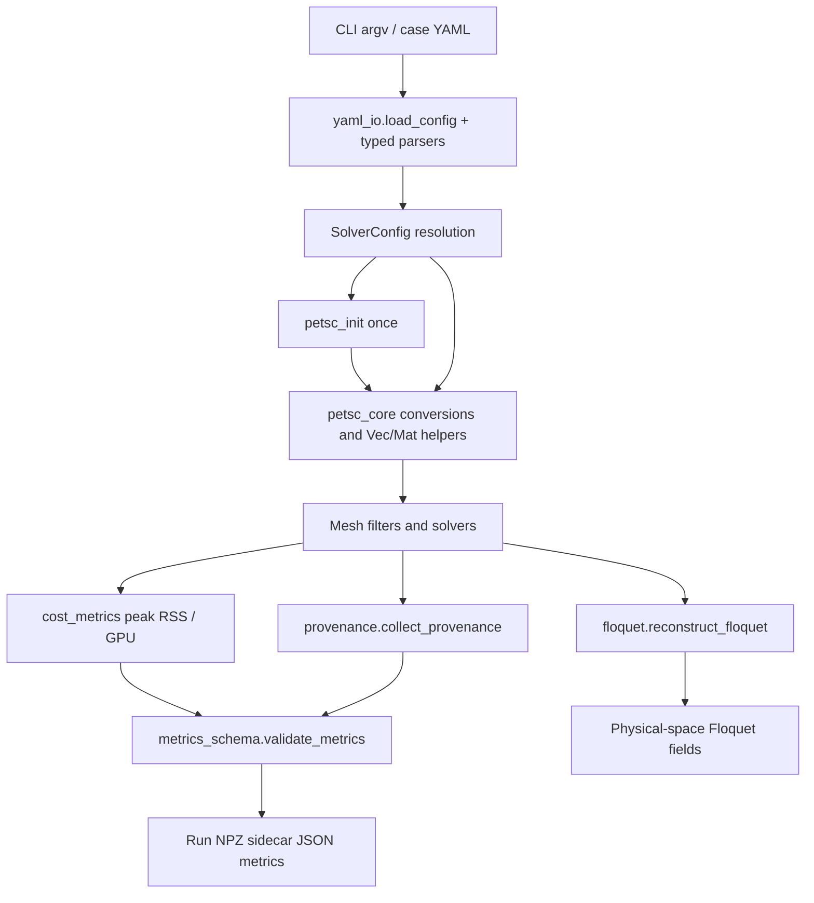
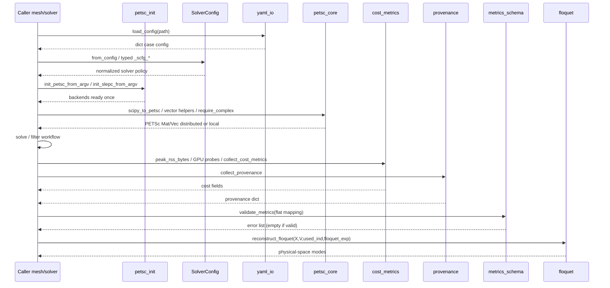

# Shared scientific utilities

!!! info "What this package owns, in one paragraph"
    Crosscutting helpers with no physics of their own: [PETSc](https://en.wikipedia.org/wiki/PETSc) init order and SciPy to PETSc conversion in `petsc_core`, YAML IO, cost and provenance recording, [Floquet](https://grokipedia.com/page/Floquet_theory) helpers, and the versioned metrics schema. If two domains need the same conversion or the same provenance key, it lives here so the spelling stays identical. These modules never own case flow.
    New to PETSc or [SLEPc](https://en.wikipedia.org/wiki/SLEPc) vocabulary? The [solver glossary](../solver-glossary.md) defines every object named on this page.


## 1. Overview

**Shared Scientific Utilities** is the cross-cutting infrastructure domain of LinStabPy. It sits beneath mesh discretization, LNSE operator assembly, linear algebra, stability, and [resolvent](https://grokipedia.com/page/Resolvent_formalism) analysis, and provides the common services those layers need without owning any scientific workflow of its own.

The domain covers two logical sub-modules:

| Sub-module | Primary code | Role |
|------------|--------------|------|
| **PETSc Core Bridge** | `utils/petsc_init.py`, `utils/petsc_core.py` | One-time PETSc/SLEPc initialization; SciPy ↔ PETSc Mat/Vec conversion; ownership, compaction, and parity helpers; complex-scalar and MUMPS ICNTL policy |
| **Config I/O, Metrics, and Provenance** | `utils/_solver_cfg.py`, `utils/yaml_io.py`, `utils/cost_metrics.py`, `utils/provenance.py`, `utils/floquet.py`, `metrics_schema.py` | Solver-policy resolution, YAML case loading, runtime cost metrics, reproducibility provenance, Floquet reconstruction, and flat metrics JSON validation |

Package layout:

```
src/linstabpy/
├── metrics_schema.py          # Run metrics JSON contract (package root)
├── mumps_options.py           # PETSc-free MUMPS ordering constants
└── utils/
    ├── __init__.py            # Public re-exports (Floquet + YAML parsers)
    ├── petsc_init.py          # Process-wide PETSc/SLEPc init
    ├── petsc_core.py          # SciPy↔PETSc bridge and Mat/Vec helpers
    ├── _solver_cfg.py         # SolverConfig + typed cfg readers
    ├── yaml_io.py             # Case YAML load + complex/int list parsers
    ├── cost_metrics.py        # Peak RSS, GPU memory, cost field assembly
    ├── provenance.py          # Git/config/stack provenance dict
    └── floquet.py             # Physical-space Floquet mode reconstruction
```

**Design goals**

- Keep `import linstabpy` and light CLI paths free of PETSc/[MPI](https://grokipedia.com/page/Message_Passing_Interface) initialization.
- Give mesh filters and solver backends one shared SciPy–PETSc bridge so those packages do not depend on each other.
- Unify YAML / environment / default precedence for solver policy across eigen, resolvent, and linear-solve paths.
- Persist reproducible, privacy-safe cost and provenance sidecars next to run NPZ artifacts.

---

## 2. Architectural Role

In the staged LinStabPy pipeline, utilities are **tool support**, not a business stage:



**Consumers (from domain relations)**

| Consumer domain | How utilities are used |
|-----------------|------------------------|
| Mesh Discretization | SciPy–PETSc conversion for filters and distributed operator paths |
| Stability Analysis | PETSc init helpers, cfg mirrors, residual/metrics utilities |
| Resolvent Analysis | PETSc vector helpers and init-order constraints |
| Linear Algebra Infrastructure | Matrix/vector conversion and initialization under factorization backends |
| Case Orchestration | YAML load, cost/provenance collection, metrics validation before payload write |

---

## 3. Public Package Surface

`linstabpy.utils.__init__` re-exports a small, PETSc-free public set:

```python
from .floquet import reconstruct_floquet
from .yaml_io import (
    load_config,
    parse_complex,
    parse_complex_list,
    parse_int_list,
)
```

Everything else is imported by qualified path (for example `linstabpy.utils.petsc_core`, `linstabpy.utils.petsc_init`, `linstabpy.metrics_schema`). That keeps help/version and pure-NumPy post-processing paths light.

---

## 4. PETSc Core Bridge

### 4.1 Initialization (`petsc_init.py`)

PETSc and SLEPc must parse process argv **exactly once** so flags such as `-eps_monitor` and `-st_ksp_*` reach the options database, while the top-level package import stays PETSc-free.

**Process-wide flags**

- `_PETSC_INIT_DONE`
- `_SLEPC_INIT_DONE`

**Public API**

| Function | Behavior |
|----------|----------|
| `init_petsc_from_argv(argv=None)` | Import `mpi4py.MPI` **before** `petsc4py`, sanitize argv, call `petsc4py.init` once |
| `init_slepc_from_argv(argv=None)` | Ensure PETSc init, then `slepc4py.init` once |

**Argv sanitizer (`_sanitize_petsc_argv`)**

Keeps PETSc-style single-dash options and drops Python/application noise:

- Drops launcher flags `-c` / `-m` and their payloads.
- Drops GNU long options (`--foo`, `--foo=bar`) and optional values.
- Keeps single-dash tokens (`-eps_*`, `-st_*`, `-ksp_*`, …) and an immediate non-dash value when present.
- Normalizes a leading dash-only `argv[0]` to `"python"`.

Leftover application flags would otherwise produce "unused option" warnings or silently alter solver behavior.

**MPI ownership rule**

`mpi4py` must bind to the launcher's MPI **before** `petsc4py.init`. On some Linux MPICH/Hydra setups, an earlier `petsc4py` import leaves every process with `COMM_WORLD` size 1 under `mpiexec`. Solver modules and installer checks share this order through `init_petsc_from_argv`.

Idempotency: if PETSc/SLEPc report "already initialized", the helper swallows that case and still marks the module flag done.

### 4.2 Lazy PETSc access (`petsc_core.py`)

`import linstabpy.utils.petsc_core` does **not** initialize PETSc. External access to the name `PETSc` uses PEP 562 `__getattr__`, which calls `init_petsc_from_argv()` then imports `petsc4py.PETSc`.

Internal functions cannot rely on bare `PETSc` globals (PEP 562 does not fire for same-module `LOAD_GLOBAL`). Each PETSc-touching function starts with:

```python
PETSc = _get_petsc()
```

Duck-typed helpers avoid loading PETSc when only SciPy objects are present:

- `_is_petsc_matrix(operator)`, module/name check on `petsc4py` `Mat`
- `_operator_shape` / `_matrix_nnz`, SciPy or PETSc without forcing an import for pure SciPy paths

### 4.3 Complex-scalar policy and MUMPS defaults

```text
require_complex(solver_cfg=None)
```

1. Asserts `PETSc.ScalarType` is complex-floating; otherwise raises `RuntimeError` (production stability requires `--with-scalar-type=complex`).
2. On first successful call only (`_petsc_configured`), installs project [MUMPS](https://en.wikipedia.org/wiki/MUMPS_(software)) ICNTL defaults into the process-global PETSc options database from typed `Config.mpi` via `mumps_icntl_petsc_options`.

`mumps_icntl_petsc_options(mpi: MpiCfg)` maps:

| Config field | PETSc option |
|--------------|--------------|
| `mumps_icntl_14` | `mat_mumps_icntl_14` |
| `mumps_icntl_24` | `mat_mumps_icntl_24` |

ICNTL(7) ordering is **not** set here; it is controlled by `mumps_ordering` / `LINSTABPY_MUMPS_ORDERING` and the PETSc-free map in `mumps_options.MUMPS_ORDERING_TO_ICNTL_7` (`amd`, `pord`, `metis`, `qamd`, `auto`).

One-shot configuration prevents later solver-module imports from rewriting options behind an already-created [KSP](../solver-glossary.md)/[EPS](../solver-glossary.md).

### 4.4 Matrix layout policy

`petsc_matrix_mode` (YAML via `Config.mpi`, overridable by env such as `LINSTABPY_PETSC_MATRIX_MODE`) selects conversion layout:

| Mode | Behavior |
|------|----------|
| `local` / `serial` | Full CSR → sequential AIJ on `COMM_SELF` |
| `distributed` / `mpi` / `parallel` | Ownership-aware MPI AIJ |
| `auto` (default) | Distributed when `COMM_WORLD` size > 1; else local; if PETSc missing, local |

### 4.5 SciPy → PETSc conversion

| Function | Purpose |
|----------|---------|
| `scipy_to_petsc(mat, solver_cfg=None)` | Entry point; routes by matrix mode |
| `scipy_to_petsc_distributed(mat, comm=...)` | Full SciPy matrix on every rank → local row insert into MPI AIJ |
| `scipy_to_petsc_distributed_from_root(mat, shape=..., root=0, comm=...)` | Root holds global SciPy CSR; scatter row blocks; non-root may pass `mat=None` with `shape` |
| `create_distributed_aij(shape, nnz_diag=..., nnz_offdiag=...)` | Empty MPI AIJ with scalar or per-row NNZ preallocation (clips to local block widths; optional `NEW_NONZERO_ALLOCATION_ERR=False` for estimated per-row counts) |
| `insert_local_csr_rows` / `assemble_matrix` | Local CSR insertion and assembly helpers |
| `compact_petsc_matrix(mat, solver_cfg=None)` | Rebuild after in-place row/column edits; drops structural zeros/duplicates that can perturb direct factors; preserves options prefix, block sizes, nullspace / near-nullspace when present |

Local path uses `dtype=complex` CSR and `createAIJ(..., csr=(indptr, indices, data), comm=COMM_SELF)`.

### 4.6 PETSc → SciPy and ownership

| Function | Purpose |
|----------|---------|
| `petsc_to_scipy(mat, format="csr"\|"csc")` | Sequential AIJ only; raises `NotImplementedError` for multi-rank communicators |
| `ownership_range(matrix)` | Global owned row range `[rstart, rend)` |
| `petsc_owned_rows(mat, copy=True)` | Local CSR (`indptr`, `indices`, `data`) plus `row_ids` and ownership; column indices in global numbering |

### 4.7 Vectors

| Function | Purpose |
|----------|---------|
| `petsc_vec(arr)` | Full-global 1-D NumPy → PETSc Vec. Under MPI, builds global size `N` and fills only the ownership slice (avoids accidental `N * nranks` replication from `createWithArray` on a full copy per rank) |
| `vec_to_numpy(v)` | Uses read-only `array_r` (safe inside MatShell callbacks). Multi-rank: `Scatter.toAll` then return global 1-D copy |
| `numpy_columns_to_petsc_vecs(template, modes)` | Dense full-state mode columns → ownership-compatible Vec list (optional column normalize); row count must match operator size |

### 4.8 Parity and residual diagnostics

Used by tests and assembly validation:

| Function | Purpose |
|----------|---------|
| `compare_sparse_matrices(reference, candidate, ...)` | Shape, structure, max abs/rel residual, Frobenius relative residual, largest mismatch terms |
| `compare_petsc_against_scipy(reference, candidate, ...)` | PETSc candidate vs SciPy reference via sequential extract |
| `petsc_matvec_residual(reference, candidate, seed=..., trials=...)` | Random complex matvec trials comparing SciPy `@` to PETSc `mult` |

Reports include a boolean `pass` against `abs_tol + rel_tol * scale` style thresholds.

---

## 5. Solver Configuration Helpers (`_solver_cfg.py`)

Solver modules share one precedence rule:

> **YAML values win → environment variables → project defaults**

### 5.1 Solver family constants

```text
DIRECT_SOLVER_TYPES          = {mumps, direct, lu}
ITERATIVE_LINEAR_SOLVER_TYPES = {iterative, krylov, petsc}
ITERATIVE_EIGEN_SOLVER_TYPES  = {iterative, krylov, slepc}
INEXACT_EIGEN_SOLVER_TYPES    = {inexact}
```

These frozensets are the policy boundary for backend name normalization across [eigenvalue](https://grokipedia.com/page/Eigenvalues_and_eigenvectors), resolvent, and linear-solve paths.

### 5.2 `SolverConfig`

Frozen dataclass implementing `Mapping[str, Any]` over the legacy `solver_cfg` dict:

- `from_config(cfg)`, wrap mapping or pass through existing `SolverConfig` / `None`
- Mapping protocol: `__getitem__`, `__iter__`, `__len__`
- `subsection(env_prefix)`:
  - `LINSTABPY_RESOLVENT` → `resolvent` if present, else `linsolve`
  - `LINSTABPY_EIGEN` → `eigen`
  - otherwise → `linsolve`

Resolvent reuses linear-solve policy by default but may override under `solver.resolvent`, preserving older YAML while allowing sweep-specific knobs.

### 5.3 Typed readers

| Helper | Role |
|--------|------|
| `_scfg` | String; lowercased strip |
| `_scfg_float` / `_scfg_int` | Numeric with env fallback |
| `_scfg_optional_int` | `None` / `"none"` / `"null"` / `"default"` / `"petsc"` → `None` |
| `_scfg_bool` | Bool or truthy strings `1/true/yes/on` |
| `cfg_get(cfg, key, default=None, section=None)` | Mapping or attribute-style objects; top-level key wins, then nested `section` |
| `as_bool(value, name=None)` | Strict boolean-like parse; empty/`none` → False; invalid raises `ValueError` |

**Note:** Typed config in `config.typed` is the long-term seam; `_solver_cfg` remains the legacy mirror used heavily by solvers. Both must stay behavior-compatible during migration.

---

## 6. YAML Case I/O (`yaml_io.py`)

### 6.1 `load_config(path)`

- Accepts only `.yaml` / `.yml` suffixes.
- Uses `_CaseLoader` (`yaml.SafeLoader` subclass) with an extra implicit resolver for **unsigned scientific floats** (`1e5`, `1.0e5`) that plain YAML 1.2 would not always treat as floats.
- Top-level value must be a mapping; otherwise `ValueError`.

### 6.2 Typed value parsers

| Function | Accepts | Notes |
|----------|---------|-------|
| `parse_complex` | `[real, imag]`, int/float (real), or `complex()`-parseable string | |
| `parse_complex_list` | Iterable of the above | |
| `parse_int_list` | Iterable of ints | Each value `max(1, int(v))` (positive clamp) |

These parsers are part of the public `linstabpy.utils` surface for case authors and driver code.

---

## 7. Cost Metrics (`cost_metrics.py`)

Uniform runtime cost fields for saved result artifacts.

### 7.1 Memory probes

| API | Behavior |
|-----|----------|
| `peak_rss_bytes()` | `resource.RUSAGE_SELF.ru_maxrss`; Linux multiplies by 1024 (kB→bytes); macOS already bytes; returns `0` if `resource` unavailable |
| GPU used memory | CuPy `Device().mem_info` first; else `nvidia-smi --query-gpu=memory.used` (device 0, MiB→bytes). Returns `nan` when `cost_gpus <= 0` or both probes fail |

**Important semantics:** GPU field is a **single device-wide sample at artifact write**, not a true process peak. It can include other processes on the same card. Treat as order-of-magnitude occupancy.

### 7.2 `collect_cost_metrics(stage_wall, *, git_sha, peak_rss_bytes)`

Builds the cost subsection dict:

| Key | Source |
|-----|--------|
| `cost_wall_total_s` | Sum of all `stage_wall` values |
| `cost_wall_assemble_s` | `stage_wall["assemble_operator_bc"]` or `nan` |
| `cost_wall_factor_s` | Currently `nan` (placeholder for future factor timing) |
| `cost_wall_solve_s` | Sum of `stability` + `resolvent` stage walls when present |
| `cost_peak_rss_bytes` | Caller-supplied **already cross-rank-aggregated** peak |
| `cost_peak_gpu_mem_bytes` | GPU probe when `LINSTAB2D_GPUS` > 0 |
| `cost_mpi_ranks` | `PETSc.COMM_WORLD` size, or `1` |
| `cost_gpus` | `int(os.getenv("LINSTAB2D_GPUS", "0"))` |
| `cost_petsc_options` | Sorted `key=value` join of `PETSc.Options().getAll()` |
| `cost_hardware_tag` | `LINSTAB2D_HARDWARE_TAG` or `"unknown"` |
| `cost_git_sha` | Passed-in git SHA string |

**MPI safety:** The body must contain **no MPI collective**. Callers aggregate peak RSS in a collective region on every rank, then invoke this helper only on the rank-0 save path. An allreduce inside would deadlock multi-rank runs.

**Privacy:** Hardware tag defaults to `"unknown"`; machine identity is opt-in only.

---

## 8. Provenance (`provenance.py`)

`collect_provenance(config_path)` returns a **string-valued** dict whose key order is fixed by `_PROVENANCE_KEYS` (asserted at return):

| Key | Collection |
|-----|------------|
| `git_sha` | `git rev-parse HEAD` (timeout 5 s) or `"unknown"` |
| `config_md5` | MD5 of raw config file bytes, or `""` if absent |
| `hostname` | `LINSTABPY_HOSTNAME` or `"unknown"`, **never** `socket.gethostname()` by default |
| `compute_mode` | `LINSTABPY_COMPUTE_MODE` ∈ `{cpu, gpu, mixed}` (default `cpu`) |
| `mpi_stack` | `LINSTABPY_MPI_STACK` or `"unknown"` |
| `python_version` | `sys.version` first token |
| `numpy_version` / `scipy_version` / `petsc4py_version` / `slepc4py_version` | `importlib.metadata.version` or `"unavailable"` |
| `petsc_arch` | `petsc4py.get_config()` / `PETSC_ARCH` / `petscconfiginfo.h` |
| `mumps_version` | PETSc external package check + MUMPS C header `MUMPS_VERSION` |
| `mpi_impl` | First line of `MPI.Get_library_version()` |
| `blas` | Family name from PETSc `BLASLAPACK_LIB` (`mkl`, `openblas`, `reference`, `accelerate`, or raw link line) |

Failed probes degrade to `"unavailable"` via `_probe_string` rather than aborting the run.

**Why [BLAS](https://en.wikipedia.org/wiki/BLAS) is first-class:** factorization cost is not comparable across BLAS families; reference Fortran BLAS has been measured substantially slower than MKL on the same code and commit. Cost rows without `blas` cannot be ranked against each other.

**Privacy policy:** Artifacts may be published (papers, Zenodo). Hostname and hardware tags stay generic unless the operator deliberately sets environment labels.

---

## 9. Metrics Schema (`metrics_schema.py`)

Rank 0 writes `<stem>.metrics.json` beside the run NPZ after `save_results`. The JSON is a **flat** dict. `SCHEMA` groups the same keys for error messages only.

### 9.1 Groups

| Group | Purpose | Required examples |
|-------|---------|-------------------|
| **provenance** | Stack identity | All `_PROVENANCE_KEYS` fields as strings |
| **problem** | Case geometry and solver targets | `case`, `fd_order`, `stride`, `nx`, `ny`, `ndof`, `nnz`, `beta`, `lambda_over_L`, `omega_target`, EPS tol/ncv, `provenance_factor_backend` |
| **cost** | Wall time, memory, ranks | `cost_wall_*`, `cost_peak_rss_bytes`, `cost_mpi_ranks`, `cost_gpus`, `cost_petsc_options`, … |
| **quality** | Optional scientific QA | Residuals, gains, acceptance counts, present only when relevant |

Units:

- Wall time: seconds (`cost_wall_*_s`, `stability_eps_*_seconds`)
- Memory: bytes (`cost_peak_rss_bytes`, `cost_peak_gpu_mem_bytes`)
- No run date is written by emitters

Optional problem keys include `stride_ksi` / `stride_eta` for older JSON compatibility. Quality keys are optional so a resolvent run may omit eigenvalue residuals and a stability run may omit [gains](../core-concepts.md).

### 9.2 `validate_metrics(d) -> list[str]`

- Never fills defaults.
- Reports **every** missing required key and every present key with wrong type.
- Error strings are prefixed with the schema group (`provenance.git_sha: missing required key`).
- `METRICS_SIDECAR_KEYS` is the frozenset of all known keys across groups.
- `FieldSpec(types, required=True)` encodes accepted Python/NumPy type unions.

---

## 10. Floquet Reconstruction (`floquet.py`)

```text
reconstruct_floquet(X, V, used_ind, floquet_exp) -> ndarray
```

Rebuilds a Floquet mode in physical space:

1. Phase field \(e^{i\,\beta x}\) from coordinates `X` and Floquet exponent `floquet_exp`.
2. Scatter active-point values `V` into a full flat grid using `used_ind` (indices into `np.ravel(X, order="F")`).
3. Multiply by the phase and reshape Fortran-order to `X.shape`.

**Input shapes**

- `V` 1-D length `len(used_ind)` → output shaped like `X`.
- `V` 2-D with one axis equal to `len(used_ind)` → ensemble/fields axis; output `(n_fields, ny, nx)`-style.

This is pure NumPy post-processing and is safe without PETSc.

---

## 11. Runtime Sequence

Typical mesh/solver caller interaction:



---

## 12. Implementation Contracts and Pitfalls

| Contract | Detail |
|----------|--------|
| **No PETSc on import** | `utils` public exports and `petsc_core` module import stay free of init; solvers call init explicitly |
| **mpi4py before petsc4py** | Required for correct multi-rank `COMM_WORLD` under common launchers |
| **Complex PETSc build** | `require_complex` fails fast on real-scalar builds |
| **Options database is process-global** | MUMPS defaults applied once; do not re-enter configuration after KSP/EPS creation |
| **Rank-0 metrics assembly** | Aggregate RSS collectively first; never collective inside `collect_cost_metrics` |
| **Privacy defaults** | Hostname and hardware tag default to `"unknown"` |
| **`petsc_to_scipy` sequential-only** | Distributed gather is not implemented; use ownership CSR helpers instead |
| **`petsc_vec` under MPI** | Always pass full-global arrays; helper slices by ownership |
| **Dual config seams** | Prefer `config.typed.Config` for new code; keep `_solver_cfg` behavior aligned |
| **Env name legacy** | Some cost env vars still use `LINSTAB2D_*` prefixes (`GPUS`, `HARDWARE_TAG`) alongside `LINSTABPY_*` elsewhere |

---

## 13. Extension Guidelines

1. **New solver policy knobs**, Add family constants and `_scfg_*` readers in `_solver_cfg` first so eigen/resolvent/linsolve stay consistent; mirror into `config.typed` when promoting to the typed seam.
2. **New PETSc helpers**, Keep lazy `_get_petsc()` at the top of each function; avoid module-level PETSc imports.
3. **New metrics fields**, Extend `SCHEMA` with `FieldSpec`, document units, and ensure emitters and `validate_metrics` stay in lockstep. Prefer optional quality keys for analysis-mode-specific data.
4. **New provenance probes**, Append to `_PROVENANCE_KEYS` and `collect_provenance` together; keep values strings; fail soft to `"unavailable"`.
5. **Do not** put business orchestration, LNSE physics, or factorization strategy in this package, those belong to driver, operators, and `linalg`.

---

## 14. Summary

Shared Scientific Utilities is the **infrastructure substrate** of LinStabPy:

- **PETSc Core Bridge** guarantees correct one-time init order, complex-scalar enforcement, and a single SciPy ↔ PETSc conversion path for local and MPI layouts, shared by mesh filters and all solver backends.
- **Config I/O, Metrics, and Provenance** unify case YAML parsing, solver-policy precedence, cost accounting, stack fingerprinting, Floquet post-process, and schema-validated metrics sidecars for reproducible HPC campaigns.

Together they enable the factorize-once stability and resolvent pipelines without coupling mesh and solver packages, without initializing PETSc on library import, and without sacrificing artifact reproducibility or operator privacy defaults.