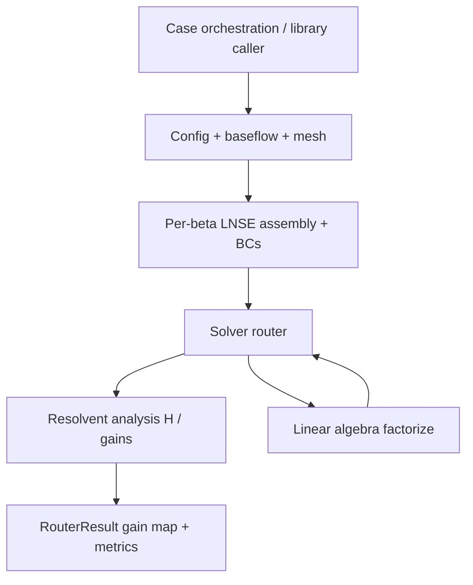
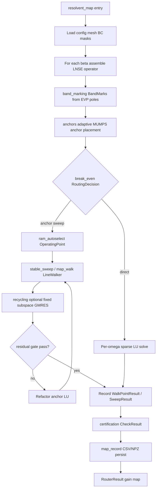
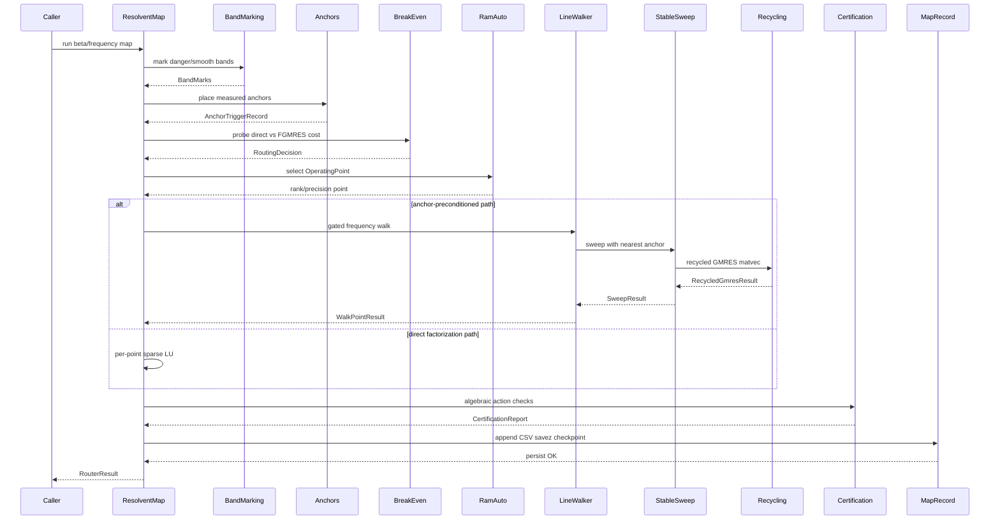

# Solver routing and sweep optimization

A $(\beta, \omega)$ map pays for a few exact factorizations at anchor frequencies, then reuses each anchor as a right [preconditioner](https://grokipedia.com/page/Preconditioner) for nearby $\omega$ until a residual gate forces refactor. One $L_0$ per spanwise [wavenumber](https://grokipedia.com/page/Wavenumber) $\beta$. Bands are labeled stable, smooth, or near pole to pick walk strategy. Cost samples (factor time, memory, compression) feed anchor placement and backend choice. Failed points become recorded reason codes, not aborted campaigns.

Solver objects (`KSP`, `PC`, `EPS`, `ST`, `MatShell`) are defined in the [solver glossary](../solver-glossary.md).


## Overview

**Solver Routing and Sweep Optimization** is the cost-aware orchestration layer that turns single-point [resolvent](https://grokipedia.com/page/Resolvent_formalism) analysis into large parametric \(\beta\)–\(\omega\) [gain](../core-concepts.md)-map campaigns on HPC. It lives under `src/linstabpy/solvers/router/` and is a first-class domain in LinStabPy: researchers and engineers can walk dense frequency lines without paying a full [sparse](https://grokipedia.com/page/Sparse_matrix) factorization at every frequency.

The module's design goal is **factorize-once, reuse-many** under residual and wall-time gates:

1. Assemble one BC-enforced LNSE operator \(L_0(\beta)\) per spanwise wavenumber.
2. Mark frequency bands from temporal EVP pole distances.
3. Place measured sparse-direct **anchors** (typically [MUMPS](https://en.wikipedia.org/wiki/MUMPS_(software))/[LU](https://grokipedia.com/page/LU_decomposition)).
4. Walk subsequent frequencies with the nearest anchor as a right preconditioner ([FGMRES](https://grokipedia.com/page/Generalized_minimal_residual_method)), optionally with fixed-subspace recycling.
5. Residual-gate and cost-probe force refactor when accuracy or amortization fails.
6. Certify inexact resolvent actions before RSVD, then persist incremental CSV/NPZ checkpoints.

Public entry points are re-exported from `linstabpy.solvers.router` (and the package-level `resolvent_map` lazy export). Importing the router package does **not** initialize PETSc; PETSc is pulled lazily inside sweep engines.


## Package Layout and Public Surface

| File | Role |
|------|------|
| `__init__.py` | Facade: eager re-exports of types/helpers; lazy `RouterResult`, `SweepResult`, `stable_sweep`, `sweep_stable_regime` via PEP 562 |
| `resolvent_map.py` | Turnkey \(\beta\)/\(f\) map orchestration → `RouterResult` |
| `band_marking.py` | EVP-distance labels: `stable` / `near-pole` / `smooth` |
| `anchors.py` | Adaptive pre-sweep anchor placement + trigger provenance |
| `map_walk.py` | Residual-gated `LineWalker` with measured MUMPS anchors |
| `stable_sweep.py` | Anchor-preconditioned stable-regime FGMRES sweeps |
| `recycling.py` | Fixed-subspace recycled right-preconditioned GMRES |
| `break_even.py` | Measured direct vs anchor-FGMRES routing decision |
| `ram_autoselect.py` | RAM-calibrated backend / precision / rank operating point |
| `certification.py` | Algebraic checks + certified RSVD for inexact \(H\) actions |
| `map_record.py` | Atomic CSV append, NPZ checkpoint, job-deadline helpers |

**Primary public types**

- `RouterResult`, `SweepResult`
- `BandMarks`, `AnchorTriggerRecord`, `IterProbeResult`
- `RoutingDecision`, `BreakEvenProbeResult`
- `OperatingPoint`, `SymbolicProbeResult`
- `CertificationReport`, `CheckResult`
- `WalkPointResult` (map walk engine)

**Primary public functions**

- `resolvent_map`, `stable_sweep` / `sweep_stable_regime`
- `label_band`, `mark_unstable_band`, `choose_anchors_adaptive`
- `break_even_decision`, `ram_autoselect`
- `certified_rsvd`, `randomized_resolvent_svd`, and individual `check_*` helpers


## Role in the LinStabPy Pipeline



**Upstream dependencies**

- **LNSE Operator Assembly**, one \(L_0(\beta)\) (and energy weights, \(B\)/\(C\) maps) per \(\beta\).
- **Linear Algebra**, `factorize`, `shifted_operator`, backend registry (MUMPS/LU/[cuDSS](https://docs.nvidia.com/cuda/cudss/)).
- **Resolvent Analysis**, leading-gain extraction (SLEPc path) and \(H\)/\(H^H\) actions.
- **Stability**, optional temporal EVP spectrum for band marking.
- **Config / utilities**, router subsections, cost metrics, PETSc bridge, job deadlines.

**Downstream consumers**

- Driver payload / NPZ emission
- Resume-from-CSV map campaigns
- Cost and certification sidecars for provenance


## End-to-End Control Flow






## Component Design

### Resolvent Map Orchestration (`resolvent_map.py`)

**Responsibility.** Turnkey \(\beta\)–frequency [gain map](../core-concepts.md): validate coordinates, resolve mesh/BC policy, assemble one operator per \(\beta\), schedule frequency-line walks, collect gains and cost metrics, and return a structured `RouterResult`.

**`RouterResult` contract**

| Field | Meaning |
|-------|---------|
| `beta`, `f` | 1-D validated sweep coordinates; `f` is passed through as resolvent \(\omega\) with **no unit conversion** |
| `gain` | Shape `(len(beta), len(f))`; failures are `NaN` |
| `regime_label` | Band labels (`stable` / `near-pole` / `smooth`); routing labels, not physics regimes |
| `reason_code` | `0` OK, `1` failed, `-1` pending |
| `cost_metrics` | CP3 cost sidecar (wall stages, RSS, MPI ranks, git SHA, …) |
| `failure_records` / `point_records` | Structured per-point success/skip/failure; failures do not abort the campaign |

**Config resolution order** for router keys: top-level → `router` → `solver.router` → `solver`. Analysis flags may also live under `analysis`.

**Mesh resolution.** Requires `cfg['mesh']`, `base_flow.mesh`, or `mesh_config` / geometry keys sufficient to call `Mesh.create`.

**Dissipation policy (critical gotcha).** Whether a map needs [SBP](https://grokipedia.com/page/Summation_by_parts) sawtooth dissipation is a **mesh** property (metric cross-coupling \(\mathrm{Ji}_{12}/\mathrm{Ji}_{21}\)). On rectilinear tensor meshes, dissipation is often a pure cost with negligible gain change; on doubly curvilinear meshes, undamped operators can inject spurious near-singular resonances.

The router reads dissipation from the same `numerics.operator_dissipation` block as every other path: `enabled` builds \(Q_{\mathrm{diss},x}/Q_{\mathrm{diss},y}\) on the mesh, and `epsilon` (with `apply_to_resolvent`) is the strength subtracted from \(L_0\). The old top-level `dissipation_epsilon` / `eps_resolv` keys are refused with an error, and so is a nonzero strength on a caller-supplied mesh that carries no \(Q_{\mathrm{diss}}\). Values are mesh-specific (e.g. Song SWBLI fd4 stride-4 curved-wall LES used \(\sim 0.10\); \(1.0\) can over-damp physical ridges by orders of magnitude). Measure coupling with `driver.preflight.metric_cross_coupling(X, Y)` (threshold \(\sim 10^{-8}\)).

**Operational behavior**

- Stage heartbeats via `logging.stage_heartbeat_seconds` or `LINSTABPY_STAGE_HEARTBEAT_SECONDS` (default 30 s).
- Per-point failures are recorded and retryable on resume; the sweep continues.
- Leading gains still come from the certified/direct resolvent engine (SLEPc path), even when linear solves use anchor-preconditioned FGMRES.


### Band Marking (`band_marking.py`)

**Responsibility.** Label requested real forcing frequencies by distance to a supplied temporal EVP spectrum **without** performing shifted linear or resolvent solves.

**Pole geometry**

- Resolvent forms \(L_\sigma = (\gamma - i\omega) I - L_0\) (the LinStab2D sign \(L_0 - (\gamma + i\omega) I\) under `solver.resolvent_sign_convention: matlab_parity`).
- Temporal EVP returns \(\omega_{\mathrm{eig}} = \mathrm{eig}(i L_0)\).
- Associated resolvent pole: \(\omega_{\mathrm{pole}} = +\omega_{\mathrm{eig}}\) (\(-\omega_{\mathrm{eig}}\) under `matlab_parity`).
- Distance at request \(\omega_{\mathrm{req}}\): \(\min|\omega_{\mathrm{req}} - \omega_{\mathrm{eig}}|\) (\(+\) under `matlab_parity`).

**Labels**

| Constant | String | Meaning |
|----------|--------|---------|
| `STABLE` | `"stable"` | Default non-danger label |
| `NEAR_POLE` | `"near-pole"` | Distance \(<\) danger radius |
| `SMOOTH` | `"smooth"` | Opt-in: outside danger radius **and** inside a configured smooth interval |

**`BandMarks` fields:** `omegas`, `labels`, `distances`, `danger_radius`.

**Danger radius resolution** (first hit wins):

1. `cfg["danger_radius"]`
2. `cfg["band_marking"]["danger_radius"]`
3. `cfg["solver"]["router"]["band_marking"]["danger_radius"]`
4. Default: \(0.5 \times \mathrm{median}(\mathrm{diff}(\mathrm{unique\ finite\ omegas}))\)

If fewer than two distinct finite frequencies exist, default radius is `0.0` (no near-pole labels). The least-damped \(|\mathrm{Im}\,\omega_{\mathrm{eig}}|\) scale is **intentionally unused**, it collapses near stability thresholds exactly when a no-go band is most needed.

**Smooth regions** are opt-in via `smooth_regions` (pairs `(lo, hi)` or `{min, max}` mappings).

**API**

- `label_band(eigs, omegas, cfg=None) -> BandMarks`
- `mark_unstable_band(...)`, higher-level helper that can obtain EVP [eigenvalues](https://grokipedia.com/page/Eigenvalues_and_eigenvectors) from \(L_0(\beta)\) when needed


### Adaptive Anchors (`anchors.py`)

**Responsibility.** Deterministic adaptive anchor placement **before** a stable sweep, with full trigger provenance.

**Trigger kinds**

| Constant | Meaning |
|----------|---------|
| `COARSE_TRIGGER` (`"coarse"`) | Initial coarse grid anchors |
| `EVP_DISTANCE_TRIGGER` (`"evp_distance"`) | Sample near a pole (band distance \(<\) radius) |
| `FGMRES_ITERATIONS_TRIGGER` (`"fgmres_iterations"`) | Probe iterations exceed threshold (default 40) |
| `FGMRES_RESIDUAL_TRIGGER` (`"fgmres_residual"`) | Probe residual exceeds threshold (default \(10^{-6}\)) |

**`choose_anchors_adaptive(omega_range, band_marks, cfg)`**

1. Build initial anchors from `coarse_anchors` or `coarse_anchor_count`.
2. For each sample \(\omega\) (from `sample_omegas` or the grid):
   - Evaluate EVP distance and optional FGMRES probe (`iter_probe` or tabulated iterations/residuals).
   - If triggers fire and spacing allows, insert a new anchor (respecting `min_insert_spacing`, `duplicate_tol`, `max_insertions`).
   - If too close to an existing anchor, annotate that anchor's `AnchorTriggerRecord` instead.
3. Return sorted complex anchors plus `tuple[AnchorTriggerRecord, ...]`.

Config may live at top level or under `adaptive_anchors`. Explicit `None` values count as unset.

**`AnchorTriggerRecord`** stores \(\omega\), sample \(\omega\), trigger tuple, insertion flag, EVP distance/radius, FGMRES stats, and nearest-anchor geometry before insertion.


### Line Walk Engine (`map_walk.py`)

**Responsibility.** Walk one frequency line per \(\beta\) with a **single live factor**, residual/cost gates, and job-deadline awareness.

**Defaults**

| Symbol | Value | Role |
|--------|-------|------|
| `DEFAULT_N_ANCHOR` | 2 | First \(N\) frequencies pay real factorization |
| `DEFAULT_WALK_RTOL` | \(10^{-10}\) | Walk residual tolerance |
| `WALK_PROBE_ITER_CAP` / `WALK_SOLVE_ITER_CAP` | 4 | Max GMRES iters for probe/gated solve |
| `WALK_COST_SLACK` | 0.25 | Amortization slack vs last factor wall |
| `WALK_APPLY_FLOOR` | 40 | Floor on SLEPc apply count in cost model |

**`LineWalker` lifecycle**

1. **Anchor phase** (`n_direct < n_anchor` or no live factor): full `factorize` of \((\gamma - i\omega) I - L_0\); measure factor wall and apply counts; extract leading gain.
2. **Reuse phase:** build a gated right-preconditioned GMRES solve against the live factor.
3. **Probe:** forward + [adjoint](https://grokipedia.com/page/Adjoint) solves on `probe_right_hand_side` (last response, else seeded complex Gaussian, **never** a ones vector).
4. **`walk_is_cheaper`:** reuse only if residual ≤ rtol, iters ≤ cap, and  
   \(\texttt{probe\_s} \times \max(n_{\mathrm{applies}}, 40) < 0.25 \times T_{\mathrm{fact}}\).
5. On failure or cost miss: destroy live factor, refactor at current \(\omega\), continue.
6. **`WalkDeferred`:** remaining job wall (`job_remaining_s` / `LINSTABPY_JOB_DEADLINE` or `SLURM_JOB_END_TIME`) is shorter than the last factor cost, safe stop for checkpoint/resume.
7. **`WalkAborted`:** residual or wall budget miss during a gated solve.

**`WalkPointResult`:** `gain`, `residual`, `source`, `iterations`, `factor_s`, `solve_s`, optional [SVD](https://grokipedia.com/page/Singular_value_decomposition) residuals `rho_fwd` / `rho_adj` for certification parity.

Always call `LineWalker.close()` to destroy the live PETSc factor when a \(\beta\) line finishes.


### Stable Sweep (`stable_sweep.py`)

**Responsibility.** Anchor-preconditioned frequency sweeps in the stable regime: nearest-anchor indexing, optional compressed anchors ([STRUMPACK](https://portal.nersc.gov/project/sparse/strumpack/)/BLR-style PETSc options), optional recycling, stage timing, and certification hooks.

**`SweepResult` fields**

- Coordinates and quality: `omega`, `gain`, `iterations`, `residuals`, `anchor_indices`
- Modes: `responses`, `forcings`
- `certification_reports: tuple[CertificationReport, ...]`
- Stage timers: `stage_factor_s`, `stage_gmres_s`, `stage_rsvd_s`, `stage_recycle_setup_s`
- Free-form `metrics` dict

**Key controls**

| Control | Config keys | Behavior |
|---------|-------------|----------|
| GMRES budget | `fgmres_maxiter` (default 200), `fgmres_restart` (default 50, max 512) | Restart is **Krylov length**, never system size |
| Compressed anchors | `compressed_anchor` / `compressed_anchors` | Temporary PETSc options (`mat_strumpack_compression`, rel/abs tol, leaf size, …); optional exact-LU measurement |
| Recycling | `recycling` / `gcrodr_recycling` / `recycle` | `max_dim` (default 8), `orth_tol` (default \(10^{-12}\)), `measure_baseline` |

**Implementation notes**

- PETSc is imported lazily (`_get_petsc` / module `__getattr__`) so importing band marking or the router facade does not start PETSc.
- `_temporary_petsc_options` scopes compression options and restores prior values.
- Matvecs support SciPy sparse and PETSc `Mat` (including Hermitian transpose for adjoints).
- Nearest-anchor selection indexes the precomputed factor list for each \(\omega\).


### Fixed-Subspace Recycling (`recycling.py`)

**Responsibility.** Algebraic core for **fixed** recycle subspaces used with right-preconditioned GMRES. The subspace is prepared **outside** each RSVD/certification pass and **never adapted inside a solve**, preserving the linear map assumed by certification.

**Pipeline**

1. `combine_recycle_bases(*bases, max_dim, orth_tol)`, modified Gram–Schmidt merge; earlier bases have priority; cap at `max_dim`.
2. `prepare_recycle_subspace(matvec, basis, n=..., max_dim=...)`, form orthonormal image \(C\) and matching solution basis \(U\) with \(A U \approx C\); count setup matvecs separately.
3. `recycled_right_preconditioned_gmres(matvec, precondition, rhs, ...)` → `RecycledGmresResult` (`x`, iterations, residual, matvecs, recycle_rank, candidate_basis for the next shift).

Empty bases are `n × 0` complex arrays via `empty_recycle_basis`.


### Break-Even Routing (`break_even.py`)

**Responsibility.** Measured cost model choosing `"direct"` vs `"fgmres-sweep"` for a planned frequency count. Designed as an **additive pre-routing** decision (tests inject `break_even_probe`); it does not silently rewrite production paths without an explicit caller.

**Cost model**

\[
\begin{aligned}
C_{\mathrm{direct}} &\approx N_f \cdot T_{\mathrm{fact}} \\
C_{\mathrm{sweep}} &\approx K_{\mathrm{anchors}} \cdot T_{\mathrm{fact}} + N_f \cdot N_{\mathrm{iters}} \cdot T_{\mathrm{apply}} \\
N_f^\* &= \frac{K_{\mathrm{anchors}}}{1 - N_{\mathrm{iters}} T_{\mathrm{apply}} / T_{\mathrm{fact}}}
\end{aligned}
\]

If \(N_{\mathrm{iters}} T_{\mathrm{apply}} \ge T_{\mathrm{fact}}\), crossover is \(\infty\) and the path stays `"direct"`.

**Measurement.** Fabricate a well-conditioned CSC matrix sharing the supplied nonzero pattern; time one SciPy `splu` factorization and one representative solve. `K_anchors` from `k_anchors` / `K_anchors` / `n_anchors` or `len(anchors)`.

**`RoutingDecision`:** `path`, `crossover_nf`, measured times, iterations, `k_anchors`, `n_frequencies`, human-readable `note`.


### RAM Autoselect (`ram_autoselect.py`)

**Responsibility.** Choose resource-only knobs so a factorization/sweep fits memory. **Never** mutates physics choices (grid, FD order, modes, \(\beta\)/\(\omega\) ranges).

**Memory model (prior, then measured fill)**

\[
\mathrm{mem} \approx \frac{\mathrm{nnz}\cdot c_{\mathrm{val}}\cdot\mathrm{prec} + \mathrm{fill}\cdot\mathrm{prec} + m\cdot n\cdot\mathrm{prec}}{\mathrm{ranks}}
\]

Each call runs an empirical sparse-LU analysis probe on the pattern; measured fill count and bytes-per-nonzero replace symbolic fill priors.

**`OperatingPoint`**

| Field | Values |
|-------|--------|
| `backend` | `"direct"` or `"compressed-sweep"` |
| `reorder` | e.g. `colamd`, `natural`, `mmd_ata`, … |
| `compression_level` | float or `None` (direct) |
| `restart` | Krylov restart (0 for direct) |
| `ranks` | MPI rank count for footprint scaling |
| `precision` | `"double"` or `"single"` |

**Selection order**

1. Prefer double-precision direct if footprint ≤ budget (`memory_fraction` × available RAM, default 0.80).
2. Else search compression levels × precision × rank candidates; return first fit; if none fit, raise `MemoryError` with smallest estimate.

Available RAM: cfg injection (`available_ram_bytes`, …) → `/proc` mem available → platform fallbacks. Tests inject `symbolic_probe` for determinism.


### Certification (`certification.py`)

**Responsibility.** Certify algebraic assumptions of **inexact** resolvent actions before they are safe for RSVD. Independent of the sweep router; each check is unit-testable.

**Core checks**

| Function | Assumption |
|----------|------------|
| `derive_solve_tolerance` / `check_tolerance_tied_to_sigma_accuracy` | Inner solve rtol no looser than \(\mathrm{safety}\cdot\sigma_{\mathrm{tol}} / \|K^{-1}\|\) |
| `check_forward_adjoint_consistency` | Matching forward/adjoint tols and comparable realized residuals |
| `check_adjoint_of_approx_factor` | Hilbert-adjoint identity on probe pairs |
| `check_deterministic_linearity` | \(A(a+b)=A(a)+A(b)\) at fixed tolerance (no adaptive internals) |
| `check_multi_seed_rsvd` | Multi-seed stability of randomized SVD |
| `certified_rsvd` | Run checks, then small dense Rayleigh–Ritz RSVD via `apply_H` / `apply_H_adj` |

**`CertificationReport`:** map of `CheckResult`, `derived_solve_tol`, `seeds`; `.passed` is true iff all checks pass. Reports serialize via `.as_dict()` for metrics/payloads.

Fixed recycle subspaces (see [Fixed-Subspace Recycling](#fixed-subspace-recycling-recyclingpy) above) exist specifically so these linearity/adjoint checks remain valid.


### Map Record and Job Budget (`map_record.py`)

**Responsibility.** Crash-safe incremental persistence and wall-clock budgeting for long map jobs.

| API | Behavior |
|-----|----------|
| `append_row(path, fields, row)` | Create parent dirs; write header if new; flush + `fsync` |
| `finished_pairs` / `remaining` | Resume: skip \((\beta, f)\) already in CSV (`atol=1e-12`) |
| `atomic_savez` | Write `*.tmp.npz` then `os.replace` |
| `last_factor_seconds` | Last positive `factor_s` from CSV (for deferred-walk estimates) |
| `job_remaining_s` | From `LINSTABPY_JOB_DEADLINE` or `SLURM_JOB_END_TIME` (ms or s) |
| `time_left_for_factor` | True if no deadline or remaining wall \(>\) needed factor time |


## Data Contracts Summary

```text
BandMarks
  omegas: float[Nf]
  labels: object[Nf]   # "stable" | "near-pole" | "smooth"
  distances: float[Nf]
  danger_radius: float

AnchorTriggerRecord
  omega, sample_omega: complex
  triggers: tuple[str, ...]
  inserted: bool
  evp_distance, evp_radius, fgmres_*, nearest_anchor_*

WalkPointResult / SweepResult / RouterResult
  # see sections 5.1, 5.4, 5.5

RoutingDecision
  path: "direct" | "fgmres-sweep"
  crossover_nf, t_fact_seconds, t_apply_seconds, iterations, k_anchors, n_frequencies, note

OperatingPoint
  backend, reorder, compression_level, restart, ranks, precision

CertificationReport
  checks: dict[str, CheckResult]
  derived_solve_tol: float
  seeds: tuple[int, ...]
```

**Reason codes (map):** `REASON_OK = 0`, `REASON_PENDING = -1`, `REASON_FAILED = 1`.

**CP3 cost keys** collected into `RouterResult.cost_metrics` include wall totals for assemble/factor/solve, peak RSS/GPU memory, [MPI](https://grokipedia.com/page/Message_Passing_Interface) ranks, PETSc options tag, hardware tag, and git SHA.


## Configuration Reference (Router-Centric)

Typical YAML nesting (all of the following are accepted where noted):

```yaml
numerics:
  operator_dissipation:
    enabled: true           # builds Q_diss on mesh
    epsilon: 0.10           # strength subtracted from L0
    apply_to_resolvent: true

router:                     # or solver.router
  band_marking:
    danger_radius: null     # null → median half-spacing default
    smooth_regions:
      - [0.2, 0.8]
      # or {min: 0.2, max: 0.8}

  adaptive_anchors:
    coarse_anchor_count: 4
    # coarse_anchors: [...]
    sample_omegas: null
    enable_evp_distance: true
    enable_fgmres_probe: true
    fgmres_iter_threshold: 40
    fgmres_residual_threshold: 1.0e-6
    min_insert_spacing: 0.0
    duplicate_tol: 1.0e-12
    max_insertions: null

  break_even:
    k_anchors: 2
    # representative_iterations: ...
    # break_even_probe: <injectable>

  ram_autoselect:
    memory_fraction: 0.80
    ranks: 1
    reorder: colamd
    restart: 40
    # available_ram_bytes: <injectable for tests>

  recycling:
    enabled: false
    max_dim: 8
    orth_tol: 1.0e-12
    measure_baseline: true

  compressed_anchor:
    enabled: false
    compression: blr
    rel_tol: 1.0e-4
    measure_exact_lu: true

  fgmres_maxiter: 200
  fgmres_restart: 50

logging:
  stage_heartbeat_seconds: 30
```

Environment:

- `LINSTABPY_STAGE_HEARTBEAT_SECONDS`
- `LINSTABPY_JOB_DEADLINE` or `SLURM_JOB_END_TIME` (seconds or milliseconds since epoch)


## Integration Patterns

### Library call (conceptual)

```python
from linstabpy.solvers.router import resolvent_map

result = resolvent_map(
    base_flow,
    beta=betas,
    f=frequencies,
    cfg=case_dict,  # mapping, YAML path, or Config-compatible object
)
# result.gain[i_beta, i_f], result.regime_label, result.reason_code
# result.cost_metrics, result.failure_records
```

Callers supply config, mesh (or mesh_config), BC masks/recipes, and optional heartbeat-friendly logging. Engines return `WalkPointResult`, `SweepResult`, and `RouterResult` structures for payload packaging.

### Driver campaign

`driver/run.py` launches the map stage after config validation; assembly uses the same LNSE + BC path as single-point resolvent; the router owns \(\beta\) loops, band marks, walks, and recording. Payload emission stores map arrays, cost samples, and certification metadata.

### Resume semantics

1. On start, `finished_pairs(csv)` loads completed \((\beta, f)\).
2. `remaining(frequencies, done, beta=...)` schedules only unfinished points.
3. `append_row` + `atomic_savez` keep partial progress durable under preemption.
4. `WalkDeferred` cooperates with SLURM end time so the last incomplete factor is not started unsafely.


## Performance and Correctness Principles

1. **One \(L_0\) per \(\beta\)**, spanwise wavenumber changes the operator; frequency walks reuse it.
2. **Pay factorization at anchors; amortize with FGMRES**, residual and cost probes decide reuse vs refactor.
3. **Measure, don't guess**, break-even and RAM autoselect use real sparse-LU probes on the operator pattern (or injectable fakes in tests).
4. **Certify before RSVD**, inexact \(K^{-1}\) actions must pass adjoint, linearity, and tolerance-budget checks; recycle subspaces stay fixed during a solve.
5. **Failures are data**, NaN gains + reason codes + failure records beat aborting a multi-hour map.
6. **Import lightness**, lazy PETSc keeps `import linstabpy` and band-marking-only imports free of MPI/PETSc init.
7. **Dissipation is dual-key**, mesh operators and top-level epsilon must both be set for the router path.


## Extension and Maintenance Notes

| Concern | Guidance |
|---------|----------|
| New routing path | Prefer additive helpers (`break_even_decision`-style) with injectable probes; wire explicitly from `resolvent_map` |
| New certification check | Implement pure `CheckResult` function; register in `certified_rsvd` |
| Backend-specific accuracy | Tie residual gates to MUMPS BLR / cuDSS profiles carefully; keep defaults conservative |
| Parallel \(\beta\) | Memory-bound; per-line walks should stay sequential for factor reuse; multi-\(\beta\) parallelism is an orchestration concern |
| Config drift | Unify dissipation keys long-term; keep aliases with clear docs until then |
| Monolith size | `resolvent_map.py` and `stable_sweep.py` are large; new features should land in focused modules and re-export from the facade |


## Summary

**Solver Routing and Sweep Optimization** is LinStabPy's production path for large resolvent gain maps. It combines EVP-aware band marking, adaptive anchor placement, residual-gated line walks, stable-regime FGMRES with optional recycling and compressed factors, measured break-even and RAM policies, algebraic certification, and crash-safe map recording. Together these components implement a disciplined **cost-aware, factor-reuse** strategy on top of the shared LNSE assembly and PETSc/MUMPS factorization core, enabling dense \(\beta\)–\(\omega\) studies that would be prohibitive if every frequency paid a full sparse direct factorization.