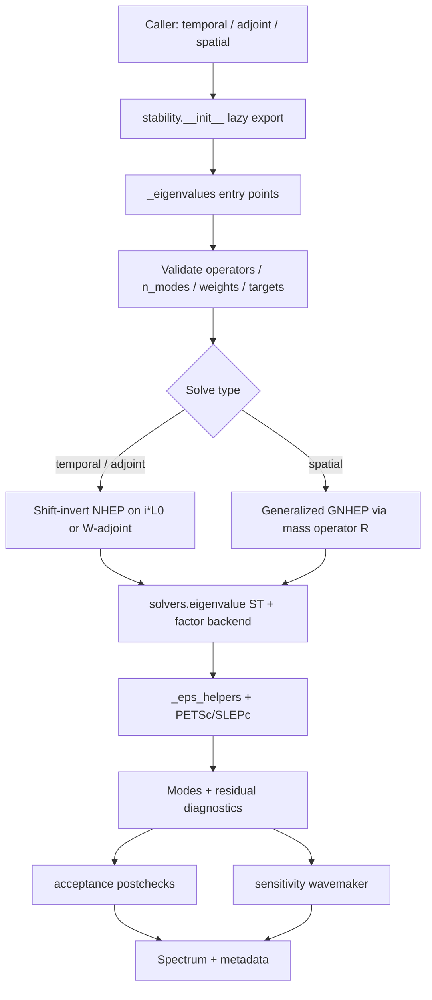
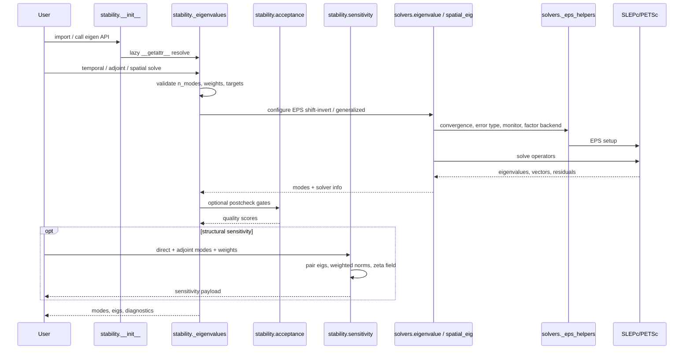

# Stability analysis

!!! info "Math you need for this page"
    Temporal [eigenvalues](https://grokipedia.com/page/Eigenvalues_and_eigenvectors) are $\omega = \mathrm{eig}(i L_0)$ with $\exp(-i\omega t)$ time dependence, so $\mathrm{Im}(\omega) > 0$ is unstable. [Adjoint](https://grokipedia.com/page/Adjoint) modes come from $W^{-1} L_0^H W$ with the Chu weight $W$. The wavemaker is the pointwise product of direct and adjoint magnitudes. Spatial problems are generalized $Ax = \lambda R x$ with singular $R$ rows from BCs, solved by [QZ](https://en.wikipedia.org/wiki/QZ_algorithm) at tiny sizes and [shift-invert](../solver-glossary.md) EPS otherwise. Acceptance checks residuals, boundary leakage, target distance, and conjugate completeness before any mode is trusted.
    New to [PETSc](https://en.wikipedia.org/wiki/PETSc) or [SLEPc](https://en.wikipedia.org/wiki/SLEPc) vocabulary? The [solver glossary](../solver-glossary.md) defines every object named on this page.


## 1. Overview

**Stability Analysis** is a core scientific domain in LinStabPy. It turns a BC-enforced linearized [Navier–Stokes](https://grokipedia.com/page/Navier–Stokes_equations) (LNSE) operator into temporal, spatial, and adjoint spectra, plus [structural sensitivity](../core-concepts.md) ([wavemaker](../core-concepts.md)) fields used for [transition](http://www.scholarpedia.org/article/Transition_to_turbulence) prediction, receptivity, and flow-control studies.

The domain is split across two cooperating packages:

| Package | Role |
|---------|------|
| `linstabpy.stability` | Public eigenvalue services, acceptance gates, structural sensitivity |
| `linstabpy.solvers` | SLEPc EPS backends (temporal/adjoint shift-invert, generalized spatial), shared EPS helpers, PETSc utility re-exports |

Heavy PETSc/SLEPc imports are deferred. A plain `import linstabpy` or `import linstabpy.stability` does **not** initialize PETSc/[MPI](https://grokipedia.com/page/Message_Passing_Interface). Public names resolve on first use through PEP 562 `__getattr__` loaders.

**Primary scientific products**

- Temporal eigenvalues \(\omega = \mathrm{eig}(i L_0)\) with \(\mathrm{Im}(\omega) > 0\) unstable under the \(\mathrm{e}^{-i\omega t}\) convention  
- Adjoint eigenvalues of the [Chu](../core-concepts.md)-weighted operator \(W^{-1} L_0^H W\)  
- Spatial eigenvalues \(\alpha\) of \((L_c + \omega L_w)\,v = \alpha\, R\, v\)  
- Giannetti–Luchini wavemaker \(\zeta(x,y)\) from paired direct/adjoint modes  

---

## 2. Module Layout

```
src/linstabpy/
├── stability/
│   ├── __init__.py          # Lazy exports: eigenvalues, adjoint_*, spatial_*
│   ├── _eigenvalues.py      # Temporal / adjoint / spatial entry points
│   ├── acceptance.py        # Target-distance & residual acceptance gates
│   └── sensitivity.py       # wavemaker structural sensitivity
└── solvers/
    ├── __init__.py          # Lazy exports (temporal/adjoint/spatial aliases)
    ├── eigenvalue.py        # SLEPc ST configuration, residual reorder, ST backends
    ├── spatial_eig.py       # Generalized spatial EPS (GNHEP)
    ├── _eps_helpers.py      # Convergence tests, monitors, cfg subsection bridge
    └── petsc_utils.py       # Re-export of utils.petsc_core helpers
```

**Associated public surface** (`linstabpy.__init__`):

| Public name | Implementation |
|-------------|----------------|
| `temporal_eigenvalues` | `stability._eigenvalues.eigenvalues` |
| `adjoint_eigenvalues` | `stability._eigenvalues.adjoint_eigenvalues` |
| `wavemaker` | `stability.sensitivity.wavemaker` |

Spatial solves are available as `linstabpy.stability.spatial_eigenvalues` (preferred). The older `linstabpy.solvers.spatial_eig.spatial_eigenvalues` path emits a deprecation warning and forwards to the stability API.

---

## 3. Architecture and Control Flow



### 3.1 Sequence (temporal path)



---

## 4. Mathematical Formulation

### 4.1 Temporal eigenvalue problem

Given the assembled LNSE state operator \(L_0\) (state \(q = [\rho, u, v, w, T]\)):

\[
\frac{\partial q}{\partial t} = L_0 q
\quad\Rightarrow\quad
\omega = \mathrm{eig}(i L_0)
\]

Implementation scales the operator by \(i\) (`_scaled_operator(operator, 1j)`) and solves a non-Hermitian [EPS](../solver-glossary.md) (NHEP) with shift-invert about a complex target \(\sigma\):

\[
(A - \sigma I)^{-1} v = \mu v,\qquad
A = i L_0,\quad
\omega \approx \sigma + 1/\mu
\]

Convention:

| Quantity | Meaning |
|----------|---------|
| \(\mathrm{Re}(\omega)\) | Oscillation frequency |
| \(\mathrm{Im}(\omega)\) | Growth rate (positive = unstable) |

### 4.2 Adjoint eigenvalue problem

Chu-weighted adjoint operator:

\[
L^\dagger = W^{-1} L_0^H W
\]

Built in `_build_adjoint_operator` as [sparse](https://grokipedia.com/page/Sparse_matrix) products of diagonal weight matrices with \(L_0^H\).

When `temporal=True`:

- Internal search target: \(\sigma_\mathrm{int} = i\,\overline{\omega_\mathrm{target}}\)  
- Returned eigenvalues mapped back: \(\omega_\mathrm{adj} = -i\,\overline{\lambda_\mathrm{adj}}\) so that \(\omega_\mathrm{adj} \approx \overline{\omega_\mathrm{dir}}\)  

Eigenvectors are normalized in the weighted inner product \(v^H W v = 1\).

**Note:** `adjoint_eigenvalues` currently requires SciPy sparse assembly (`backend='scipy'`). PETSc `Mat` input raises `NotImplementedError`.

### 4.3 Spatial eigenvalue problem

\[
(L_c + \omega L_w)\, v = \alpha\, R\, v
\]

`spatial_eigenvalues` forms the left-hand side \(L_c + \omega L_w\), then calls `_solve_near_target(..., mass_operator=R)`, which delegates to `_eigs_generalized` (GNHEP). Small problems fall back to SciPy QZ (`scipy.linalg.eig`) because \(R\) is often singular on BC/constraint rows.

### 4.4 Structural sensitivity (wavemaker)

\[
\zeta(x,y) = \frac{|q_\mathrm{dir}(x,y)|\,|q_\mathrm{adj}(x,y)|}{|\langle q_\mathrm{adj}, q_\mathrm{dir}\rangle_W|}
\]

Modes are unit-normalized in \(W\) before the pointwise product. Pairing uses \(|\lambda_\mathrm{dir} - \overline{\lambda_\mathrm{adj}}|\) with a finite tolerance; ambiguous pairs raise `ValueError`. Spatial reshape is **Fortran order** per state component block.

---

## 5. Public APIs

### 5.1 `eigenvalues` / `temporal_eigenvalues`

```text
eigenvalues(
    L0, n_modes, target,
    W_diag=None, ncv=None, initial_space=None,
    solver_cfg=None, cfg=None, return_info=False,
) -> (omega, modes) | (omega, modes, info)
```

| Argument | Description |
|----------|-------------|
| `L0` | Square SciPy sparse matrix or PETSc `Mat` from operator assembly |
| `n_modes` | Number of eigenpairs (`1 … ndof`) |
| `target` | Complex shift-invert center |
| `W_diag` | Optional Chu-norm diagonal for weighted normalization |
| `ncv` | Arnoldi subspace size; default \(\min(\max(2 n_\mathrm{modes}+3, 30), n_\mathrm{dof}-1)\) |
| `initial_space` | Optional seed vectors (1-D or column matrix) |
| `solver_cfg` / `cfg` | Raw YAML solver dict and/or typed `Config` |
| `return_info` | When true, also return solver diagnostics dict |

**[STRUMPACK](https://portal.nersc.gov/project/sparse/strumpack/) fallback:** if factorization fails with `StrumpackFactorizationFailed` (static pivoting ZERO_PIVOT), the temporal path rebuilds a clean [MUMPS](https://en.wikipedia.org/wiki/MUMPS_(software))-direct config via `_mumps_direct_solver_cfg` and retries once, recording `factor_backend_fallback*` keys in `info`.

### 5.2 `adjoint_eigenvalues`

```text
adjoint_eigenvalues(
    L0, n_modes, target, W_diag, invW_diag,
    ncv=None, solver_cfg=None, cfg=None, temporal=False,
) -> (eigs, modes)
```

Requires both `W_diag` and `invW_diag`. Set `temporal=True` when the target and return values should match the temporal \(\omega\) convention used by `eigenvalues`.

### 5.3 `spatial_eigenvalues`

```text
spatial_eigenvalues(
    Lc, Lw, R, omega, n_modes, target,
    ncv=None, solver_cfg=None, cfg=None,
) -> (alpha, modes)
```

All of `Lc`, `Lw`, and `R` must be square and same-sized. Config prefers `solver.spatial`, with fallback to `solver.eigen` through typed `Config`.

### 5.4 `wavemaker`

```text
wavemaker(
    direct_modes, adjoint_modes, direct_eigs, adjoint_eigs,
    weight, grid_shape, pairing_tol=1e-8,
) -> dict
```

Returns:

| Key | Content |
|-----|---------|
| `zeta` | `(n_modes, Ny, Nx)` sensitivity magnitude fields |
| `pairing` | Per-pair indices, eigenvalues, distances, normalizations |
| `normalization_constants` | Complex biorthogonal products \(\langle q_\mathrm{adj}, W q_\mathrm{dir}\rangle\) |
| `grid_shape` | `(Ny, Nx)` |
| `n_components` | `ndof / (Ny·Nx)` (typically 5) |

Adjoint modes must already be physical weighted-adjoint modes from `adjoint_eigenvalues` (no extra \(W^{-1}\) transform inside `wavemaker`).

---

## 6. Solver Backend Implementation

### 6.1 Core shift-invert path (`_solve_near_target`)

1. Validate complex PETSc scalar mode (`require_complex`).  
2. Optional ill-[conditioning](https://en.wikipedia.org/wiki/Condition_number) warning on the shifted operator.  
3. **Dense fallback** when `ndof ≤ 2` or `n_modes ≥ ndof - 1` (`numpy.linalg.eig` or SciPy QZ for generalized).  
4. Convert SciPy CSC → PETSc `Mat` (optional root-scatter for multi-rank iterative ST).  
5. Create SLEPc `EPS`:
   - Type: [Krylov–Schur](../solver-glossary.md)  
   - Problem: NHEP (temporal/adjoint) or GNHEP (spatial)  
   - Which: `TARGET_MAGNITUDE`  
   - ST: `SINVERT` with **explicit** `st.setShift(target)`  
6. Configure ST [KSP](../solver-glossary.md)/PC via `_configure_st_for_eigenvalue`.  
7. Optional FieldSplit IS setup for five-block state (`ndof % 5 == 0`): fluid \(\{\rho,u,v,T\}\) vs \(w\).  
8. `setFromOptions` on KSP/ST/EPS; solve; extract pairs; destroy PETSc objects.  
9. Sort by distance to target with deterministic tie-break (`_nearest_order` / `_sort_nearest`).  
10. Reorder residual arrays to match returned order (`_reorder_info_residuals`).

### 6.2 `st_solver` modes (`solver.eigen`)

| `st_solver` | Behavior |
|-------------|----------|
| `mumps` / `direct` / `lu` (default) | `KSPPREONLY` + `PCLU` + factor backend (MUMPS reference) |
| `iterative` / `krylov` / `slepc` | Krylov ST solve; PC from `pc_type` (ASM, BJacobi, FieldSplit, LU, …) |
| `inexact` | FGMRES + ASM + local ILU; options under `solver.eigen.inexact` |
| `fgmres_lu` / `strumpack_fgmres` | FGMRES outer + direct LU PC; STRUMPACK default for the latter |

**Direct path factor backend resolution**

1. `solver.eigen.factor_backend` / typed `st_factor_backend`  
2. Environment `LINSTABPY_FACTOR_BACKEND`  
3. Default `mumps`  

Unavailable backends fail loudly (probe), with no silent fallback, except the documented one-shot STRUMPACK→MUMPS retry on temporal EVP ZERO_PIVOT.

When `st_factor_backend == "auto"`, routing uses `ndof` and `auto_route_dof_threshold` plus STRUMPACK availability (`resolve_auto_factor_backend`) before PC setup.

### 6.3 Spatial backend (`solvers/spatial_eig.py`)

- Operators `(A, B) = (Lc+ω Lw, R)`  
- Direct ST uses `cfg.spatial.st_solver` and `cfg.spatial.factor_backend`  
- Default tolerances: `tol=1e-10`, `max_it = max(500, 10·ndof)`  
- Partial convergence logs a warning and returns available pairs  

### 6.4 Shared EPS helpers (`_eps_helpers.py`)

| Helper | Purpose |
|--------|---------|
| `_resolve_eps_convergence_test` | Map `abs` / `rel` / `norm` → SLEPc conv enum |
| `_resolve_eps_error_type` | Map absolute / relative / backward residual types |
| `_install_eps_monitor` | Sparse progress logging with mutable monitor state |
| `_monitor_state_details` | Format monitor fields for errors/logs |
| `_resolve_solver_cfg_subsection` | Bridge env-prefix families through `SolverConfig` |

### 6.5 Residual and info contract

Typical `info` keys from temporal solves (when `return_info=True`):

- `method`, `ndof`, `nev_requested`, `ncv_used`, `nconv`  
- `eps_iterations`, `eps_reason`, `ksp_reason`, `eps_tol`, `eps_max_it`, `st_solver`  
- `residual_estimates`, `residual_absolute`, `residual_relative`, `residual_backward`  
- Backend probe fields (`backend_probe_*`)  
- Optional weighted-norm check: `leading_weighted_norm_error`, `weighted_norm_tol`  
- Optional fallback markers after STRUMPACK failure  

---

## 7. Acceptance and Quality Gates

Module: `stability/acceptance.py`.

### 7.1 Target distance

`_postcheck_target_distance(omega, target, conjugate_aware=...)`

For real baseflows, \(L\) is real, so \((\omega, v)\) and \((\overline{\omega}, \overline{v})\) are both eigenpairs of the same physical wave. With `conjugate_aware=True` (default):

\[
d = \min\bigl(|\omega - \sigma|,\; |\omega - \overline{\sigma}|\bigr)
\]

Disable only for complex operators ([Floquet](https://grokipedia.com/page/Floquet_theory) shifts, complex baseflow tracking) where conjugate partners are not physical.

### 7.2 `evaluate_stability_acceptance`

Optional gates (any NaN threshold disables that gate; all NaN → empty dict for back-compat):

| Gate | Physical meaning | Reject bit |
|------|------------------|------------|
| `postcheck_rel_max` | Full-operator relative residual | bit 0 (=1) |
| `target_distance_max` | Distance to shift target | bit 1 (=2) |
| `omega_real_abs_max` | Cap on \(|\mathrm{Re}\,\omega|\) | bit 2 (=4) |
| `omega_imag_abs_max` | Cap on \(|\mathrm{Im}\,\omega|\) | bit 3 (=8) |

Return payload includes `accepted_indices`, `rejected_indices`, `reject_reason_code`, `acceptance_conjugate_aware`, and summary statistics over accepted modes.

### 7.3 Conjugate-pair completeness diagnostic

`check_conjugate_pair_completeness` does **not** change acceptance. For off-axis accepted modes it reports:

- `missing_partner_indices`, conjugate absent from the returned spectrum  
- `partner_rejected_indices`, conjugate present but not accepted  

Useful for SWBLI-style families (e.g. OM-1 oblique Mack waves) where both branches matter.

---

## 8. Integration with the Case Pipeline

Stability sits downstream of operator assembly and upstream of payload emission:

1. **Case Orchestration** (`driver/run.py`) initializes PETSc/MPI and stages the run.  
2. **Configuration** merges YAML/env/defaults into typed `Config` (`solver.eigen` / `solver.spatial`).  
3. **Baseflow + Mesh + LNSE Assembly + BCs** produce square \(L_0\) (and spatial blocks when needed).  
4. **Linear Algebra** supplies factor backends used inside ST (MUMPS default).  
5. **Stability** runs EPS, acceptance, optional wavemaker.  
6. **Payload** stores eigenvalues, modes, metrics, and provenance.

Library users can call the public APIs directly after assembling \(L_0\), without the full CLI pipeline. Prefer:

```python
from linstabpy import temporal_eigenvalues, adjoint_eigenvalues, wavemaker
```

over importing `petsc4py`/`slepc4py` at module load.

---

## 9. Configuration Touchpoints

| Source | Effect |
|--------|--------|
| `solver.eigen.*` | ST solver, factor backend, EPS tol/max_it, ncv, monitor, conv test, residual error type, iterative/inexact knobs |
| `solver.spatial.*` | Spatial ST/factor policy; falls back to eigen section |
| `LINSTABPY_FACTOR_BACKEND` | Global factor backend override |
| `LINSTABPY_FACTOR_PRECISION` | Experimental precision (e.g. single with SuperLU_DIST only) |
| `LINSTABPY_MUMPS_BLR` / `_TOL` / `_ORDERING` | Experimental MUMPS knobs (env-enforced at factor time) |
| Typed `Config.eigen` / `Config.spatial` / `Config.mpi` | Validated dataclasses consumed by solve paths |

**Backend posture (conservative):**

- **MUMPS**, default reference path  
- **STRUMPACK**, experimental; documented mainly for [FGMRES](https://grokipedia.com/page/Generalized_minimal_residual_method)+[LU](https://grokipedia.com/page/LU_decomposition) diagnostics  
- **[SuperLU_DIST](https://portal.nersc.gov/project/sparse/superlu/)**, rejected on tested [CUDA](https://en.wikipedia.org/wiki/CUDA) builds  
- **[cuDSS](https://docs.nvidia.com/cuda/cudss/)**, not wired into the eigen PETSc factor interface in this domain  

---

## 10. Validation, Errors, and Operational Constraints

### 10.1 Input validation

- Operators must be 2-D square SciPy sparse, ndarray, or PETSc `Mat`  
- `n_modes` integer ≥ 1 and ≤ `ndof`  
- Targets and weights must be finite; weight length equals `ndof`  
- Adjoint requires matching `W_diag` / `invW_diag` without zero inverse entries  
- Wavemaker validates grid shape vs `ndof`, positive diagonal weights, and unique eig pairing  

### 10.2 Runtime constraints

- **Complex-scalar PETSc/SLEPc** required for production solves  
- **MPI thread level:** `mpi4py` must initialize before PETSc (`MPI_THREAD_MULTIPLE`) so STRUMPACK/SLATE factors do not fail with PETSc error 57  
- **ASM/BJacobi sub-PC:** settings that need the matrix are deferred until after `eps.setUp()` via `_make_sub_pc_applier`  
- Iterative ST options on a direct path are ignored with a warning  

### 10.3 Failure modes

| Condition | Behavior |
|-----------|----------|
| Zero converged pairs | `RuntimeError` from EPS |
| Backend unavailable | Loud probe failure (no silent substitute) |
| STRUMPACK ZERO_PIVOT (temporal) | One MUMPS retry + info markers |
| Weighted norm drift | Warning if \(\|v^H W v - 1\|\) exceeds `weighted_norm_tol` |
| Ambiguous direct/adjoint pairing | `ValueError` with full eig lists |

---

## 11. Design Principles

1. **Lazy loading**, Keep help/version and pure-Python tooling free of PETSc init.  
2. **Factorize-once ST**, Shift-invert centers expensive LU work; Krylov–Schur reuses ST solves.  
3. **Physics vs numerics separation**, Stability owns spectra/sensitivity; assembly owns \(L_0\); `linalg` owns factor backends.  
4. **Explicit spectral conventions**, Temporal \(\omega = \mathrm{eig}(i L_0)\); adjoint temporal mapping documented and testable.  
5. **Conjugate-aware quality**, Real-baseflow spectra keep both physical branches under acceptance gates.  
6. **Loud configuration**, Missing backends, pairing failures, and sub-PC mismatches raise rather than silently degrade science results.  
7. **LinStab2D parity**, Temporal/adjoint/spatial/wavemaker workflows mirror the MATLAB reference while scaling on MPI HPC.

---

## 12. Extension Guidance

| Goal | Suggested hook |
|------|----------------|
| New ST inner solver | Extend `_configure_st_for_eigenvalue` and typed `EigenCfg` |
| Richer acceptance physics | Add gates in `evaluate_stability_acceptance` with new reject bits |
| PETSc-native adjoint | Implement weighted adjoint matvecs without forcing SciPy assembly |
| Floquet / complex-baseflow | Call acceptance with `conjugate_aware=False`; document operator symmetry |
| Driver packaging of sensitivity | Invoke `wavemaker` after dual solves and add keys to `driver.payload` |
| Spatial CLI discoverability | Prefer `stability.spatial_eigenvalues` in orchestration feature flags |

---

## 13. Summary

The **Stability Analysis** domain is LinStabPy's primary spectral product layer. `stability._eigenvalues` validates inputs and exposes temporal, adjoint, and spatial solves; `solvers.eigenvalue` / `spatial_eig` drive SLEPc shift-invert (and generalized) EPS with configurable MUMPS-centric factorization; `acceptance` enforces residual and target-distance quality with conjugate-pair awareness for real baseflows; and `sensitivity.wavemaker` turns paired direct/adjoint modes into structural sensitivity fields. Together they convert BC-ready LNSE operators into reproducible [hydrodynamic stability](https://grokipedia.com/page/Hydrodynamic_stability) results for research and aerospace analysis on MPI clusters.