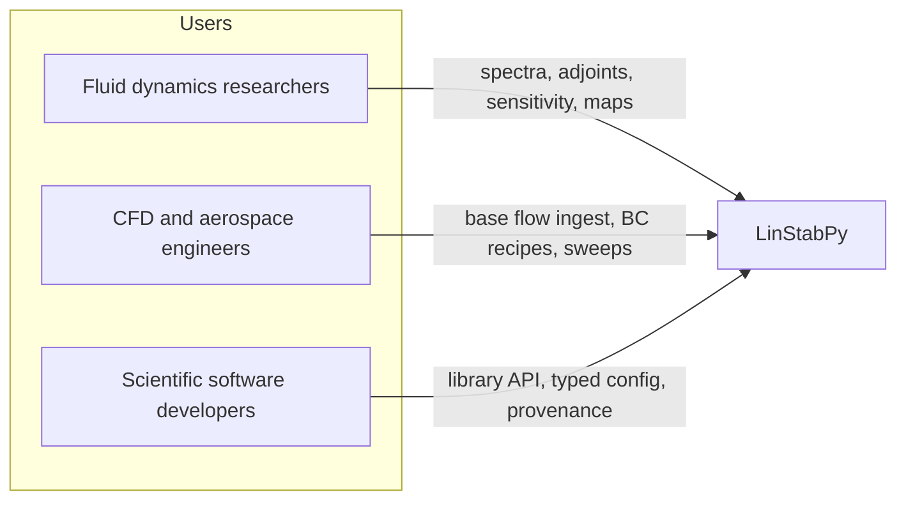
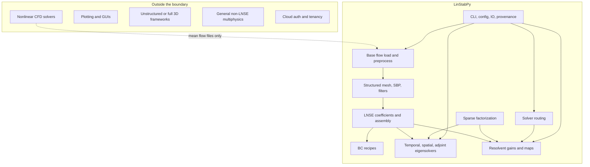
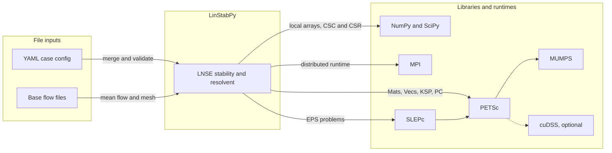
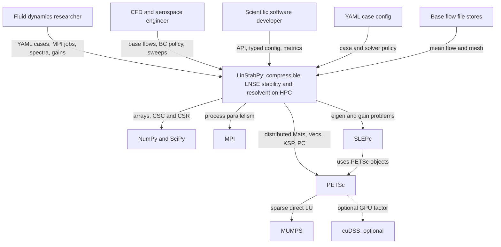

# Project overview

| Attribute | Value |
|-----------|--------|
| **System** | LinStabPy |
| **Project type** | CLI and scientific library |
| **Domain** | Compressible flow linear stability and resolvent analysis |
| **Audience** | Master students and researchers fluent in math, linear algebra, and HPC, plus CFD engineers and scientific developers |

---

!!! info "Conventions used everywhere in this repo"
    The discrete perturbation state is $q' = [\rho', u', v', w', T']^T$ at each grid point. Assembly builds the [sparse](https://grokipedia.com/page/Sparse_matrix) matrix $L_0$ with $\partial_t q' = L_0 q'$ in the interior, then applies sponge, dissipation, and boundary conditions in that fixed order.

    Temporal [eigenvalues](https://grokipedia.com/page/Eigenvalues_and_eigenvectors) are $\omega = \mathrm{eig}(i L_0)$ with time factor $\exp(-i\omega t)$. Growth in time is $\mathrm{Im}(\omega) > 0$. Targets you pass in YAML live in $\omega$ space. This matches `stability/_eigenvalues.py`, which is the source of truth.

    The [resolvent](https://grokipedia.com/page/Resolvent_formalism) at $(\beta, \omega)$ with real discount $\gamma$ is $H = C F (L_0 - (\gamma + i\omega) I)^{-1} F B$. Gains are weighted [singular values](https://grokipedia.com/page/Singular_value_decomposition). The default energy is the diagonal Chu norm described in Architecture.

    [SBP](https://grokipedia.com/page/Summation_by_parts) orders are exactly $2$, $4$, $6$, $8$ (even only, with validated boundary closures). The default shifted solve is `KSPPREONLY` with `PCLU` through [MUMPS](https://en.wikipedia.org/wiki/MUMPS_(software)), driven by [SLEPc](https://en.wikipedia.org/wiki/SLEPc) `EPS` with Krylov-Schur and shift-invert. Every solver term here is defined in the [solver glossary](solver-glossary.md).

---

## 1. Project introduction

### 1.1 Project name and description

**LinStabPy** is a Python toolkit for **linear stability** and **resolvent analysis** of [compressible](https://grokipedia.com/page/Compressible_flow) flows. It started as a Python port of LinStab2D style MATLAB workflows and now runs distributed on HPC through [MPI](https://grokipedia.com/page/Message_Passing_Interface), [PETSc](https://en.wikipedia.org/wiki/PETSc), and SLEPc.

A run starts from two inputs you supply. One is the **base flow**, a steady compressible [Navier-Stokes](https://grokipedia.com/page/Navier–Stokes_equations) solution stored as arrays on a structured grid. The code linearizes about it and never computes it. The other is a short **YAML case file** with physics, numerics, and solver policy. From there the pipeline builds the **linearized Navier-Stokes (LNSE)** matrix $L_0$ with **summation-by-parts (SBP)** [finite differences](https://grokipedia.com/page/Finite_difference_method), enforces boundary conditions, and solves one or more of:

* **Temporal** eigenproblem, $\omega = \mathrm{eig}(iL_0)$ near a target
* **Spatial** eigenproblem, generalized $Ax = \lambda Rx$ for streamwise [wavenumber](https://grokipedia.com/page/Wavenumber)
* **[Adjoint](https://grokipedia.com/page/Adjoint)** eigenproblem, $W^{-1} L_0^H W$ for receptivity and sensitivity
* **Resolvent** problem, leading [gains](core-concepts.md) and forcing and [response modes](core-concepts.md) of $H$

Large sparse algebra runs through **PETSc and SLEPc**. The spine is **factorize once, solve many**. One sparse direct factorization of the shifted operator serves all [Krylov](https://grokipedia.com/page/Krylov_subspace) iterations and all $H$ and $H^H$ applies at that shift. The default backend is **MUMPS**. An optional **[cuDSS](https://docs.nvidia.com/cuda/cudss/)** path exists for GPU factors.

### 1.2 What you get

| Capability | What it gives you |
|------------|-------------------|
| Large LNSE eigen and resolvent studies on HPC without MATLAB | Same analysis semantics as LinStab2D, on clusters, with a reproducible Python stack |
| Mean flow files turned into modes, gains, and sensitivity fields | A direct bridge from RANS, LES, or DNS averages to transition and control insight |
| Temporal, spatial, and adjoint spectra with structural sensitivity | Growth rates, frequencies, wavenumbers, and wavemaker maps |
| Resolvent gain maps over frequency $\omega$ and spanwise wavenumber $\beta$ | Quantified nonnormal amplification, even where all modes are stable |
| YAML driven runs with schema checks and provenance | Config hash, git SHA, backend, and cost recorded with every result |

In short, LinStabPy turns [CFD](https://grokipedia.com/page/Computational_fluid_dynamics) mean flow dumps into stability spectra, resolvent gains, and sensitivity results for **[transition](http://www.scholarpedia.org/article/Transition_to_turbulence)** and **flow control** work.

### 1.3 How it is built

* **Language and delivery.** Python CLI plus importable library. Plain `import linstabpy` stays light and does not initialize PETSc or MPI. The driver initializes them when a solve stage starts.
* **Discretization.** Structured grids. SBP differences at even orders $2$ to $8$. Cartesian and cylindrical (axisymmetric) coefficient paths. Optional Mattsson style filters and artificial dissipation.
* **State and operators.** LNSE for $q' = [\rho', u', v', w', T']$. Sparse $L_0$ with sponge and [Dirichlet](https://grokipedia.com/page/Dirichlet_boundary_condition) and [Neumann](https://grokipedia.com/page/Neumann_boundary_condition) recipes applied last.
* **Solvers.** SLEPc `EPS` for eigenproblems. Resolvent through a weighted normal `MatShell` with repeated shifted solves.
* **Parallelism.** MPI distribution of matrices, vectors, and case orchestration through `petsc4py` and `slepc4py`. Complex scalars are required for production paths.
* **Linear algebra core.** PETSc `KSP` and `PC`. Sparse direct [LU](https://grokipedia.com/page/LU_decomposition) through MUMPS by default. Optional GPU sparse direct through cuDSS as a PETSc [preconditioner](https://grokipedia.com/page/Preconditioner) shell.
* **Local numerics and IO.** NumPy and SciPy for arrays and CSC and CSR assembly before PETSc conversion. Base flow from `npy` directories or `npz` archives. Cases from YAML.
* **Architecture style.** Staged pipeline with a dedicated **solver router** for cost aware $\beta$ and frequency campaigns with anchors, factor reuse, and residual gates.

---

## 2. Who uses it

### 2.1 Roles

| Role | Description |
|------|-------------|
| :microscope: **Fluid dynamics researchers** | People studying hydrodynamic stability, transition, and receptivity in compressible flow. |
| :small_airplane: **CFD and aerospace engineers** | People who already hold a mean flow and need its linear modes and amplifier behavior. |
| :material-laptop: **Scientific software developers** | People who embed LNSE stages in larger pipelines and need a clean API and contracts. |

If you are a master student, start in the researcher row. You need the base flow idea, the $\omega$ convention above, and one example. MPI and Krylov details can wait until your first map campaign feels slow.

### 2.2 Usage scenarios

| Scenario | Who | What happens |
|----------|-----|--------------|
| **Temporal eigenvalue analysis** | Researchers, engineers | Load mean flow and mesh, assemble $L_0$ with boundary conditions, factorize the shifted system, run SLEPc near the target, emit $\omega$, modes, residuals, and provenance. |
| **Resolvent gain analysis** | Researchers, engineers | Build $H$ from $L_0$ at target $\omega$, solve the weighted normal eigenproblem, return gains with forcing and response pairs. |
| **Gain map over $\beta$ and $\omega$** | Researchers on HPC | One $L_0$ per spanwise wavenumber $\beta$, frequency bands marked, anchors factorized, nearby $\omega$ points reuse factors as preconditioners under a residual gate. |
| **Spatial eigenproblem** | Researchers, engineers | Assemble spatial block pair $(A, R)$, run generalized SLEPc for streamwise wavenumber and spatial growth. |
| **Base flow ingest and operator prep** | Engineers, developers | `npy` or `npz` dumps pass through sponge, shock cleanup, and viscosity setup, then mesh and SBP, then BC ready $L_0$. |
| **Library embedding** | Developers | Import analysis functions without PETSc init on import, use typed config, SciPy and PETSc bridges, metrics and provenance. |

### 2.3 What each role needs

**Researchers need:**

* Temporal and spatial spectra with a clear $\omega$ convention
* Adjoint modes and [structural sensitivity](core-concepts.md) ([wavemaker](core-concepts.md)) fields
* [Gain maps](core-concepts.md) over $\omega$ and $\beta$ with residuals attached
* YAML cases that rerun bit reproducibly on MPI clusters

**Engineers need:**

* Ingest of `npy` and `npz` base flows without reformatting by hand
* Dirichlet and Neumann recipes expressed as data, not code edits
* Direct sparse solves with MUMPS, with GPU factors available
* Sweeps that reuse factors instead of refactoring at every point

**Developers need:**

* Importable API that stays free of PETSc init on import
* Typed config with schema validation
* SciPy and PETSc conversion helpers in one place
* Provenance and metrics with stable key names

---

## 3. System boundaries

### 3.1 Scope

**In scope** starts from **loaded mean flow and mesh geometry** and ends at **results, metrics, and payloads**.

Inside that envelope, LinStabPy:

1. Assembles $L_0$ and spatial pairs on structured SBP grids
2. Enforces boundary condition recipes
3. Factorizes shifted systems once per shift
4. Runs eigen and resolvent workflows, including parametric maps
5. Orchestrates cases through CLI and driver code with validation, IO, and provenance

It does **not** generate nonlinear base flows or ship visualization products.

### 3.2 Included components

| Component | Role |
|-----------|------|
| Base flow load and preprocess | Ingest mean fields and make them safe to linearize |
| Structured mesh with SBP and filters | Discrete derivatives, norms, quadrature, stabilization |
| LNSE coefficients and assembly | Build sparse $L_0$ and spatial pairs |
| Boundary condition recipes | Enforce Dirichlet and Neumann rows and publish free degrees of freedom |
| Temporal, spatial, and adjoint eigensolvers | Core stability product |
| Resolvent operator, gains, and maps | Amplifier and receptivity product |
| Sparse factorization layer | Factorize once, solve many |
| Solver routing with anchors and sweeps | Cost aware parametric campaigns |
| CLI and driver with config, IO, and provenance | Reproducible HPC entry and exit |

**Internal modules.**
Case Orchestration, Configuration Management, Baseflow Management, Mesh Discretization, LNSE Operator Assembly (including boundary conditions), Stability Analysis, Resolvent Analysis, Solver Routing and Sweep Optimization, Linear Algebra Infrastructure, Shared Scientific Utilities.

### 3.3 Excluded components

| Excluded | Why |
|----------|-----|
| Nonlinear CFD solvers | Upstream data providers only, coupled through files |
| GUIs and interactive visualization | Results are files for external tools |
| Unstructured or fully 3D volume frameworks | Scope is structured grids |
| General non-LNSE multiphysics | Single purpose toolkit |
| Cloud deployment, auth, and tenancy | HPC CLI and library, not a hosted service |

---

## 4. External pieces

### 4.1 List

| External piece | Type | What it does here |
|----------------|------|-------------------|
| **PETSc** | Library | Distributed `Mat` and `Vec`, `KSP` and `PC`, parallel runtime |
| **SLEPc** | Library | `EPS` eigensolvers for temporal, spatial, adjoint, and resolvent normal problems |
| **MUMPS** | Backend via PETSc | Default sparse direct LU for shifted systems |
| **MPI** | Runtime | Process parallelism for matrices, vectors, and orchestration |
| **cuDSS** | Optional backend | Optional GPU sparse direct path, wrapped as a PETSc shell |
| **NumPy and SciPy** | Libraries | Arrays, CSC and CSR assembly, local kernels before PETSc conversion |
| **Base flow file stores** | File input | Mean fields as `npy` directories or `npz` archives |
| **YAML case config** | File input | Case, mesh, eigen, resolvent, and solver policy |

### 4.2 How they connect

**File inputs.**

* **YAML case config.** Merged with environment overrides and defaults, then schema checked for eigen, resolvent, mesh, MPI, and router policy before any heavy stage runs.
* **Base flow file stores.** Nondimensional primitives and mesh plus optional sponge fields. No live coupling to a CFD process.

**Libraries and runtimes.**

* **NumPy and SciPy.** Host side fields and sparse assembly before distributed conversion.
* **MPI with PETSc.** Distributed execution fabric, matrices and vectors, direct and preconditioned solves.
* **MUMPS through PETSc.** Primary sparse direct backend.
* **cuDSS, optional.** GPU direct factor where selected by resource policy.
* **SLEPc.** Eigenvalue and gain eigenproblems on PETSc objects.

### 4.3 Which dependencies matter most

| Dependency | Criticality | Notes |
|------------|-------------|-------|
| PETSc with MPI | Required for distributed paths | Core parallel algebra and orchestration runtime |
| SLEPc | Required for eigen and resolvent outputs | Built on PETSc structures |
| MUMPS | Default direct path | Reached as a PETSc backend, not a separate app |
| NumPy and SciPy | Required | Local numerics and IO bridge |
| cuDSS | Optional | Probed for capability, chosen under RAM and cost policy |
| Base flow files | Required as data source | One way file dependency |
| YAML configs | Required for CLI campaigns | Policy source of truth after merge and validation |

LinStabPy **consumes** CFD artifacts and HPC libraries. Edges are library linkage and file IO, not service APIs.

---

## 5. System context

### 5.1 Context diagram

### 5.2 Main flows

#### Flow A. Temporal eigenvalue analysis

1. Launch CLI or call the stability API.
2. Initialize PETSc and MPI. Merge and validate YAML, env, and defaults.
3. Load and preprocess mean flow. Build structured mesh with SBP.
4. Compute LNSE coefficients. Assemble sparse $L_0$. Apply BC recipes.
5. Factorize the shifted operator at the $\omega$ target.
6. Run SLEPc near the target. Validate modes by residuals and boundary leakage.
7. Emit eigenvalues, vectors, metrics, and provenance.

#### Flow B. Resolvent gain analysis

1. Resolve frequency, weights, $B$ and $C$ maps, and backend policy.
2. Reuse the same base flow, mesh, and $L_0$ foundation as Flow A.
3. Factorize $(L_0 - (\gamma + i\omega) I)$. Apply $H$ and $H^H$ through that factor.
4. Run SLEPc on the weighted normal shell. Extract gains with $\sigma = \sqrt{\mathrm{Re}(\lambda)}$.
5. Package gains, modes, residuals, and solver metrics.

#### Flow C. Gain map over $\beta$ and $\omega$

1. Validate map, router, and resource policy.
2. Assemble one $L_0$ per spanwise wavenumber $\beta$.
3. Mark frequency bands. Walk lines with **anchor factorizations**, preconditioner reuse, residual gated refactor, and optional stable sweeps.
4. Probe MUMPS, LU, and cuDSS backends under RAM and cost policy.
5. Record leading gains with cost samples and certification metadata.

#### Flow D. Spatial stability

1. Resolve `solver.spatial` policy, with fallback to `solver.eigen`.
2. Assemble spatial block pair from prepared coefficients and mesh.
3. Configure direct shift-invert backend. Run generalized SLEPc solve for streamwise wavenumber and growth.

### 5.3 Decisions visible at this level

| Decision | What it means | Consequence |
|----------|---------------|-------------|
| **Port MATLAB workflows to Python HPC** | Keep LinStab2D analysis semantics, add MPI orchestration | Familiar quantities, no MATLAB runtime |
| **File based CFD boundary** | Mean flow enters only as `npy` and `npz` | Clean split from nonlinear solvers |
| **PETSc and SLEPc as algebra stack** | No custom distributed eigensolver | Strong fit with cluster numerical ecosystems |
| **Factorize once, solve many** | Direct factors serve shift-invert and resolvent applies | MUMPS and optional cuDSS appear explicitly |
| **YAML with schema as contract** | Validate before heavy compute | Config files are first class inputs |
| **No GUI and no cloud tenancy** | CLI with library and file payloads | Plotting and multi tenant ops stay outside |
| **Structured SBP only** | Exclude unstructured and full 3D frameworks | Narrow, deep scope |
| **Lazy library import** | Public API without PETSc init on import | Embeddable without forcing MPI at import time |

---

## 6. Technical architecture

### 6.1 Stack

| Layer | Choice |
|-------|----------------|
| **Language and packaging** | Python, CLI entry plus importable package |
| **Configuration** | YAML cases, env overrides, defaults, typed models, schema checks |
| **Local arrays and sparse** | NumPy, SciPy CSC and CSR |
| **Discretization** | Structured mesh, SBP orders $2$, $4$, $6$, $8$, filters, pole treatments |
| **Parallel runtime** | MPI |
| **Distributed algebra** | PETSc `Mat` and `Vec`, `KSP`, `PC` |
| **Eigen and gain algebra** | SLEPc `EPS` |
| **Sparse direct backends** | MUMPS by default through PETSc, optional cuDSS |
| **Data in** | `npy` directories, `npz` archives, YAML |
| **Data out** | Result payloads with eigenvalues and vectors, gains, modes, metrics, provenance |

### 6.2 Patterns

| Pattern | Where it shows up |
|---------|-------------------|
| **Staged pipeline** | Config, base flow, mesh, operators and BCs, factorize, solve, payload |
| **File and library boundary** | Domain science inside, CFD files and PETSc and SLEPc and MPI outside |
| **Factorize once, solve many** | Shared layer under shift-invert eigen and resolvent applies |
| **Strategy and backend registry** | MUMPS, LU, and cuDSS selection under cost and RAM policy |
| **Router optimized sweep** | Anchors, recycling, residual gates, stable sweeps for $\beta$ and $\omega$ maps |
| **Declarative BC recipes** | Dirichlet and Neumann rules sequenced onto operators with free degree sets |
| **Lazy facade API** | Public surface defers heavy runtime init |

### 6.3 Key design choices

1. **Single policy source.** Merged, validated YAML with env and defaults drives mesh, eigen, resolvent, MPI, and router behavior.
2. **Single operator family.** Stability, adjoint, sensitivity, and resolvent consume BC enforced assembled operators, not ad hoc matrices per product.
3. **HPC first.** MPI distributed vectors and matrices with case orchestration are first class. MATLAB parity is a workflow goal, not the scaling ceiling.
4. **Cost aware maps.** Large $\beta$ and $\omega$ studies use the router. Factorization cost is explicit in metrics and certification, not hidden in a double loop.
5. **Strict boundary.** Nonlinear CFD, visualization, unstructured 3D, general multiphysics, and cloud tenancy stay out of scope.
6. **Dual use.** CLI and driver for full cases, importable library for embedding. Both share the same pipeline without forcing PETSc on import.

### 6.4 What connects most strongly inside

At context level the software is one bubble. The strongest internal relations, which explain why PETSc and SLEPc and MUMPS matter, are:

* Case Orchestration calls Configuration, Baseflow, Stability, Resolvent, Routing, Operators, and Linear Algebra
* Operator Assembly composes Mesh and consumes Baseflow data
* Stability and Resolvent consume Operators for $L_0$ and Linear Algebra for factorized shifted solves
* Routing calls Resolvent and Linear Algebra for map walks and anchor reuse

Package detail lives in Architecture and the Module guide.

---

## 7. Summary

**LinStabPy** is an HPC Python **CLI and library** for **compressible LNSE stability and resolvent analysis** on **structured SBP grids**. It starts from **base flow files** and **YAML cases** and delivers **spectra, modes, gains, sensitivity, metrics, and provenance**. It excludes CFD generation, GUIs, and cloud service layers.

**People** are researchers, engineers, and developers.
**System** is LinStabPy.
**External pieces** are YAML and base flow file stores, NumPy and SciPy, MPI, PETSc, SLEPc, MUMPS, and optional cuDSS.

This overview sets the boundary for the rest of the docs.
