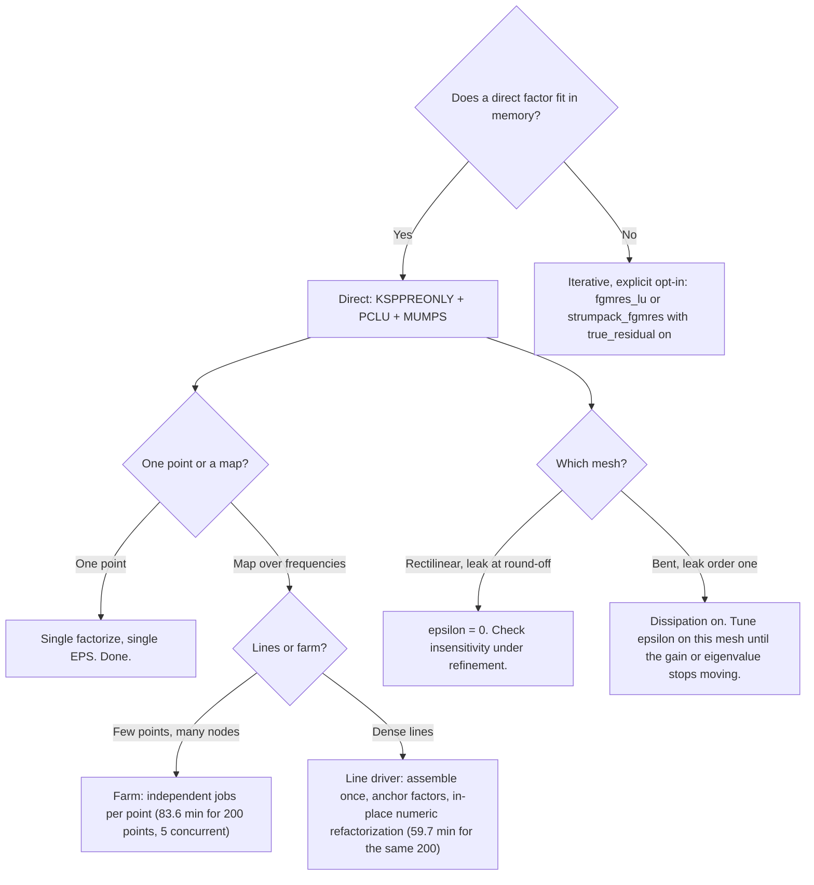

# PETSc and SLEPc glossary

Every solver term used in this wiki, defined from zero and linked to the official docs. I assume you know linear algebra ([Krylov](https://grokipedia.com/page/Krylov_subspace) subspaces, [LU](https://grokipedia.com/page/LU_decomposition), [eigenvalues](https://grokipedia.com/page/Eigenvalues_and_eigenvectors)) and have never touched these two libraries. Readers who already use PETSc can skip to section 7, which lists the exact solver chains this repo runs.

**The two libraries.** [PETSc](https://petsc.org/release/manual/ksp/) (Portable, Extensible Toolkit for Scientific Computation) owns distributed vectors and matrices plus linear solvers. [SLEPc](https://slepc.upv.es/documentation/current/docs/manualpages/EPS/EPSSetProblemType/) (Scalable Library for Eigenvalue Problem Computations) sits on top of PETSc and owns eigensolvers. LinStabPy drives both through their Python bindings, [petsc4py](https://petsc4py.readthedocs.io/en/stable/) and [slepc4py](https://slepc4py.readthedocs.io/en/stable/), over [mpi4py](https://mpi4py.readthedocs.io/) for [MPI](https://grokipedia.com/page/Message_Passing_Interface). The install guide explains how to build this stack. This page explains what the objects mean. Physics and math vocabulary (growth rate, gain, Chu norm, wavemaker) lives in the [core concepts](core-concepts.md) companion.

Repo conventions used below: $\omega = \mathrm{eig}(i L_0)$, unstable exactly when $\mathrm{Im}(\omega) > 0$; [resolvent](https://grokipedia.com/page/Resolvent_formalism) $H = C F (L_0 - (\gamma + i\omega) I)^{-1} F B$.

---

## 1. The five-minute mental model

Four object pairs cover nearly everything:

| Pair | Library | Job in one line |
|---|---|---|
| [`Mat`](https://petsc.org/release/manualpages/Mat/Mat/) and [`Vec`](https://petsc.org/release/manualpages/Vec/Vec/) | PETSc | A sparse matrix and a vector, distributed across MPI ranks. |
| [`KSP`](https://petsc.org/release/manual/ksp/) and [`PC`](https://petsc.org/release/manual/ksp/) | PETSc | A linear solver (`KSP`) split from its preconditioner (`PC`), so any iteration can pair with any preconditioner. |
| [`EPS`](https://slepc.upv.es/documentation/current/docs/manualpages/EPS/EPSSetProblemType/) and [`ST`](https://slepc.upv.es/documentation/current/docs/manualpages/ST/STSetShift/) | SLEPc | An eigensolver (`EPS`) split from its spectral transformation (`ST`), so any eigensolver can pair with shift-invert. |
| Shell matrices | PETSc | A `Mat` you never assemble. You provide the multiply function and PETSc calls it. |

A typical LinStabPy solve wires all four: a distributed `Mat` holds the shifted operator, a `KSP` with `PC` factors it once, an `EPS` with `ST` runs shift-invert Krylov-Schur calling that factor on every iteration, and the resolvent path adds a shell matrix whose multiply applies $H$ through the same factor.

---

## 2. PETSc basics

**PETSc** is a C library (with Python bindings) for vectors, matrices, and solvers on distributed memory. Start with the [KSP manual chapter](https://petsc.org/release/manual/ksp/). It covers linear solves end to end and is the best single document behind this page.

**Communicators.** Every PETSc object lives on an MPI communicator, almost always `COMM_WORLD` here. Ranks own disjoint row ranges of each matrix and vector. Only the owning rank writes its range. When the docs say "rank 0 owns logging and IO decisions," that is convention in our driver, not a PETSc requirement.

**[`Mat`](https://petsc.org/release/manualpages/Mat/Mat/) and [`Vec`](https://petsc.org/release/manualpages/Vec/Vec/).** The distributed matrix and vector types. The default [sparse](https://grokipedia.com/page/Sparse_matrix) CPU format is AIJ (compressed sparse row across ranks). LinStabPy assembles locally in SciPy CSC or CSR, then converts to a distributed `Mat` in `utils/petsc_core.py`. Sizes here are $5$ unknowns per grid point before boundary elimination, so a $300 \times 100$ grid gives a $150{,}000 \times 150{,}000$ complex sparse matrix.

**SciPy CSC and CSR.** The two compressed formats from [`scipy.sparse`](https://docs.scipy.org/doc/scipy/reference/sparse.html) (background: [sparse matrix](https://grokipedia.com/page/Sparse_matrix)). CSR stores row by row: values plus column indices plus row-start pointers. CSC stores the transpose pattern: values plus row indices plus column-start pointers. Same entries, different access direction. Assembly here builds small blocks in CSR and finalizes the full $L_0$ as complex CSC. Both convert to each other freely, and every solver entry point accepts either; the bridge normalizes to CSR on the way into PETSc.

**PETSc AIJ.** PETSc's sparse format: a distributed CSR. Each rank owns a contiguous row range and stores its rows as `(indptr, indices, data)` triples, created via `Mat().createAIJ(size, csr, comm)`. Two layouts exist. *Local* AIJ on `COMM_SELF` holds the whole matrix on one rank (single-rank style). *Distributed* AIJ on `COMM_WORLD` splits rows across ranks by ownership ranges. Same object type, different communicator and row distribution.

**The bridge (`utils/petsc_core.py`).** One module owns every conversion so call sites never hand-roll them:

| Function | Job |
|---|---|
| `scipy_to_petsc` | SciPy matrix to PETSc AIJ `Mat`. Layout follows `petsc_matrix_mode` (below). |
| `scipy_to_petsc_distributed`, `scipy_to_petsc_distributed_from_root` | Ownership-aware distributed AIJ, scattering rows to owner ranks. |
| `petsc_to_scipy` | PETSc `Mat` back to SciPy (`csr` or `csc`). Used for comparison, parity, and SciPy-only paths. |
| `create_distributed_aij`, `insert_local_csr_rows`, `assemble_matrix` | Lower-level distributed construction used inside assembly and conversion. |
| `ownership_range`, `petsc_owned_rows` | Which global rows this rank owns, and their CSR data. |
| `require_complex` | Asserts complex-scalar PETSc and installs one-time MUMPS defaults. Fails fast otherwise. |
| `compare_sparse_matrices`, `compare_petsc_against_scipy`, `petsc_matvec_residual` | Parity helpers proving the two paths hold the same operator. |

**`assembly_backend`: where $L_0$ gets built.** YAML or `LINSTABPY_ASSEMBLY_BACKEND`, default `scipy`. `scipy` assembles CSC locally and converts on demand: the cross-machine baseline, and mandatory for adjoint workflows (`adjoint_eigenvalues` rejects PETSc matrices today). `petsc` assembles AIJ directly, but with two documented limits: direct PETSc assembly cannot apply `dissipation_epsilon`, and distributed direct assembly covers model `2D` only. When in doubt, SciPy-assemble then convert.

**`petsc_matrix_mode`: local or distributed AIJ.** YAML or `LINSTABPY_PETSC_MATRIX_MODE`, default `auto`. `local` and `serial` force single-rank AIJ. `distributed`, `mpi`, and `parallel` force ownership-split AIJ. `auto` picks distributed exactly when the MPI world has more than one rank (and local when PETSc is absent). Anything else raises `ValueError` naming the valid words.

**Rule of thumb.** Small cases, debugging, adjoint work, and MATLAB parity: `scipy` backend with local matrices. Production MPI runs: same SciPy assembly, converted to distributed AIJ for the factorize and eigensolve stages. The operator values are identical either way; only the layout changes.

**Complex scalars.** PETSc compiles for either real or complex floating point, chosen at build time. This repo requires complex builds: eigenvalues, shifts, and modes are complex throughout. `install.sh --check` asserts this. A real-scalar PETSc imports fine and then fails real work, which is why the check exists.

**Init order.** Import `mpi4py` before `petsc4py` so MPI initializes with thread level `MULTIPLE`, which some factor backends need. Plain `import linstabpy` initializes neither. The driver and solver modules initialize them when a solve stage starts. Solver modules that need SLEPc call the shared init helper first.

**Options database.** PETSc and SLEPc read command-line style options at runtime (`-ksp_type`, `-eps_monitor`, and hundreds more). Any example can receive them after `--` through the runner, for example `-- -eps_monitor` to watch eigensolver convergence. YAML and env policy in this repo set the important ones explicitly, but the options database is always available as an override and debugging channel.

---

## 3. KSP: linear solvers and the PREONLY direct path

**[`KSP`](https://petsc.org/release/manual/ksp/)** (Krylov Subspace Solver) is PETSc's linear solver object: given $Ax = b$, it produces $x$. The key design point is the split: `KSP` chooses the *iteration* (or none), [`PC`](https://petsc.org/release/manual/ksp/) chooses the *[preconditioner](https://grokipedia.com/page/Preconditioner)*. You can pair [GMRES](https://grokipedia.com/page/Generalized_minimal_residual_method) with LU, or no iteration with LU, without touching calling code. SLEPc shift-invert and our resolvent applies both consume `KSP` objects through this interface.

**[`KSPPREONLY`](https://petsc.org/release/manualpages/KSP/KSPPREONLY/)** means: no Krylov iteration at all, just apply the preconditioner once. When the preconditioner is an exact LU factorization, that single apply *is* the direct solve. This is why our default shifted solve is described as "`KSPPREONLY` with `PCLU` through [MUMPS](https://en.wikipedia.org/wiki/MUMPS_(software))": mathematically it is sparse direct LU, reached through the `KSP` interface so every consumer (eigen shift-invert, resolvent applies, transpose solves) shares one code path. Stated in `linalg/factorize.py`: the default path is `KSPPREONLY` + `PCLU` + MUMPS.

**[`KSPGMRES`](https://petsc.org/release/manualpages/KSP/KSPGMRES/)** is restarted GMRES, the standard Krylov method for nonsymmetric systems. GMRES builds an orthogonal basis of the Krylov subspace and minimizes the residual over it, restarting every *restart* steps to bound memory (default 50 in our router). This repo uses GMRES in exactly one place: the $\beta$ and $\omega$ map router reuses an anchor factorization as a right preconditioner for nearby frequencies, solving each nearby system with right-preconditioned GMRES (restart 50, max 200 iterations) until a residual gate forces a fresh factorization. See the Solver Routing page.

**[`KSPFGMRES`](https://petsc.org/release/manualpages/KSP/KSPFGMRES/)** is flexible GMRES, which tolerates a preconditioner that changes between iterations (for example an inner iterative solve). Ours uses it on two explicit opt-in paths: `fgmres_lu` (FGMRES around an LU preconditioner) and `strumpack_fgmres` (FGMRES around a [STRUMPACK](https://portal.nersc.gov/project/sparse/strumpack/) approximate factor), plus the [cuDSS](https://docs.nvidia.com/cuda/cudss/) GPU path where the GPU factor preconditions an FGMRES outer iteration. Iterative paths are never silent fallback here. They require explicit solver policy.

**[`KSPSetTolerances`](https://petsc.org/release/manualpages/KSP/KSPSetTolerances/)** sets relative tolerance, absolute tolerance, divergence tolerance, and maximum iterations for the Krylov iteration. On the default `KSPPREONLY` path these knobs do nothing, because there is no iteration. Accuracy there comes from the factorization quality and from EPS-side settings instead. The `ksp_rtol`, `ksp_atol`, and `ksp_max_it` knobs matter only on iterative paths, which is a common source of confusion worth stating twice.

---

## 4. PC: preconditioners, LU, and MUMPS

**`PC`** (preconditioner) is the other half of the `KSP` split. A preconditioner approximates $A^{-1}$ cheaply so the outer iteration converges fast, or in our default case *is* $A^{-1}$ computed exactly by factorization.

**[`PCLU`](https://petsc.org/release/manualpages/PC/PCLU/)** means the preconditioner is an LU factorization: on setup it factors $A = LU$ (with pivoting), on apply it runs triangular solves. With `KSPPREONLY` in front, setup plus one apply equals a direct solve. In parallel the factorization itself is distributed (see MUMPS below).

**[`PCFactorSetMatSolverType`](https://petsc.org/release/manualpages/Mat/MATSOLVERMUMPS/)** selects *which* sparse direct package performs the LU inside `PCLU`. This one call is our entire backend seam. Resolution order in this repo: YAML `factor_backend`, then per-solver env override, then `LINSTABPY_FACTOR_BACKEND`, then the call-site default. An unavailable backend fails loudly during setup. It never falls back silently.

**[`MATSOLVERMUMPS`](https://petsc.org/release/manualpages/Mat/MATSOLVERMUMPS/) ([MUMPS](https://mumps-solver.org/))** is the default backend: a [MUltifrontal](https://en.wikipedia.org/wiki/Multifrontal_method) Massively Parallel sparse direct Solver that factors distributed matrices across MPI ranks. "Multifrontal" names the algorithm family (dense frontal matrices eliminated in a tree order). Practical knobs exposed here: ordering selection mapped to MUMPS `ICNTL(7)` (`amd`, `pord`, `metis`, `qamd`, `auto`), optional block low-rank compression (`LINSTABPY_MUMPS_BLR` with tolerance), and precision selection. MUMPS uses dynamic pivoting, which is why the temporal eigensolver retries a failed STRUMPACK factor (static pivoting, `ZERO_PIVOT`) once with MUMPS.

**Other backends, one line each.** STRUMPACK: structured and rank-compressed direct and approximate solver, experimental here, used through FGMRES. [SuperLU_DIST](https://portal.nersc.gov/project/sparse/superlu/): distributed-memory sparse LU, experimental here, GPU offload unvalidated. cuDSS: NVIDIA GPU sparse direct LU, validated here *as a preconditioner inside FGMRES* (one rank, one GPU, with a second factorization of the conjugate transpose for [adjoint](https://grokipedia.com/page/Adjoint) applies), matching MUMPS to 1e-12 on tested cases, not as a PETSc-native factor type. The backend audit lives in `docs/COMPUTE_BACKENDS.md`.

**[`PCBJACOBI`](https://petsc.org/release/manualpages/PC/PCBJACOBI/) and [`PCASM`](https://petsc.org/release/manualpages/PC/PCASM/)** are [domain-decomposition](https://grokipedia.com/page/Domain_decomposition_methods) preconditioners: block Jacobi (each rank factors its own diagonal block, no overlap) and additive Schwarz (overlapping blocks). They appear as the baseline direction for the memory-bound iterative eigensolver path. One API trap the code documents: sub-preconditioner options must be applied *after* `EPS.setUp()`, or they attach to nothing.

**Transpose solves.** Adjoint work and $H^H$ applies need $A^H x = b$, not $Ax = b$. The factorization object exposes `solve_transpose` alongside `solve`, reusing the same LU factors. No second factorization is needed for the adjoint half of resolvent or stability analysis.

---

## 5. MatShell: matrices you never assemble

**[`MatCreateShell`](https://petsc.org/release/manualpages/Mat/MatCreateShell/)** creates a PETSc `Mat` with no stored entries. You register callback functions (at minimum the multiply `y = Ax`, optionally transpose and others) and PETSc treats the result as a matrix: it can sit inside `KSP`, `EPS`, and `ST` exactly like an assembled `AIJ` matrix. "Shell" contrasts with "assembled." The multiply runs your code, typically a few operator applies and triangular solves.

**Why the resolvent needs it.** The resolvent $H = C F (L_0 - (\gamma + i\omega) I)^{-1} F B$ is dense even though $L_0$ is sparse. Forming it explicitly at $150{,}000$ unknowns is out of the question. Instead `WeightedNormalOperator` is a shell whose multiply chains existing cheap pieces: apply $H$ (two filters plus one factored solve plus $B$ and $C$ maps), weight by $W$, apply $H^H$ (adjoint filters plus one transpose solve), and for the [Chu](core-concepts.md) forcing norm multiply by $W^{-1}$. SLEPc then runs an eigensolver that only ever calls this multiply. [Gains](core-concepts.md) come out as $\sigma = \sqrt{\mathrm{Re}(\lambda)}$ without $H$ ever existing as entries.

**Ownership detail.** On multi-rank communicators the multiply callback writes only its rank's local row range into the result vector. Getting this wrong silently corrupts outer iterations, which is why the shell code is explicit about ranges.

---

## 6. SLEPc: EPS eigensolvers and ST spectral transformations

**SLEPc** extends PETSc to eigenvalue problems. It operates on PETSc `Mat` and `Vec` objects, so everything in sections 2 to 5 carries over. Its Python binding is [slepc4py](https://slepc4py.readthedocs.io/en/stable/).

**[`EPS`](https://slepc.upv.es/documentation/current/docs/manualpages/EPS/EPSSetProblemType/)** (Eigenvalue Problem Solver) is the eigensolver object, the analogue of `KSP` for $Ax = \lambda Bx$. You set the problem type, the method, how many pairs you want, which ones, the tolerance, and the spectral transformation, then call solve and extract pairs one by one.

**Problem types ([`EPSSetProblemType`](https://slepc.upv.es/documentation/current/docs/manualpages/EPS/EPSSetProblemType/)).** This repo uses two. `NHEP`: standard ($B = I$) non-Hermitian problem, used for temporal stability ($\omega = \mathrm{eig}(iL_0)$) and for the weighted normal resolvent problem. `GNHEP`: generalized non-Hermitian $Ax = \lambda Bx$, used for spatial stability where the $B$ matrix carries boundary rows and algebraic constraints (and is often singular, which matters below). Hermitian types exist and are not used here because LNSE operators are [nonnormal](https://en.wikipedia.org/wiki/Defective_matrix).

**[`EPSKRYLOVSCHUR`](https://slepc.upv.es/documentation/current/docs/manualpages/EPS/EPSKRYLOVSCHUR/)** is the restarted Krylov-Schur eigensolver, our method on every path. Think restarted [Arnoldi](https://grokipedia.com/page/Arnoldi_iteration) with a cleaner restart: build a Krylov subspace, project the problem, keep the wanted Ritz information in a Krylov-Schur decomposition, expand again. After $m$ Arnoldi steps the factorization reads $AV = VH + \beta v_{m+1} e_m^T$ with $V$ orthonormal and $H$ upper Hessenberg. Each eigenpair $(\lambda_i, y_i)$ of the small $H$ lifts to a **Ritz pair** $(\lambda_i, Vy_i)$ of $A$, with residual exactly $|\beta|\,|e_m^T y_i|$, so convergence is tested with no extra matvecs. Krylov-Schur (Stewart, 2001) keeps $H$ in Schur form instead, which makes restarting clean: truncate to the wanted Schur vectors and expand again, bounding memory at subspace size rather than iteration count. Like all Krylov eigensolvers it finds exterior eigenvalues of the operator it sees, which is exactly why shift-invert (next object) precedes it for interior targets. Full development in Frantz, Loiseau and Robinet (2023), *Krylov methods for large-scale dynamical systems*, sections on Krylov subspaces and large-scale eigensolvers.

**[`EPSSetDimensions`](https://slepc.upv.es/documentation/current/docs/manualpages/EPS/EPSSetDimensions/)** sets `nev` (eigenpairs wanted) and `ncv` (Krylov subspace size, the accuracy and cost knob). `ncv` must exceed `nev`, and larger `ncv` helps crowded or nonnormal neighborhoods where small subspaces stall. Repo defaults: temporal uses $\max(2\cdot\mathrm{nev}+3, 30)$ clipped to matrix size; spatial uses $\min(\max(4\cdot\mathrm{nev}, 30), \mathrm{ndof}-1)$; resolvent uses $\min(\max(2\cdot\mathrm{nev}+3, 20), \mathrm{ndof}-1)$. A user-passed `ncv` must be larger than `nev` or setup raises.

**[`EPSSetWhichEigenpairs`](https://slepc.upv.es/documentation/current/docs/manualpages/EPS/EPSSetWhichEigenpairs/)** picks *which* eigenvalues to want. Temporal and spatial paths use `TARGET_MAGNITUDE`: closest to the shift target in magnitude, combined with shift-invert. The resolvent path uses `LARGEST_MAGNITUDE`: the normal operator's largest eigenvalues are the squared leading gains by construction, so no shift is needed there.

**Krylov convergence practice.** Two results from the review govern expectations. First, isolated eigenvalues converge geometrically fast while branches crawl: the error bound scales with $\kappa(V)\,(\rho/|\mu_i - c|)^k$ for an eigenvalue $\mu_i$ outside a disk of radius $\rho$, and dense branches are the worst case on both factors (poor isolation times large eigenvector conditioning from nonnormality). Crowded or branch-heavy targets are exactly where raising `ncv` pays. Second, Arnoldi favors eigenvectors with large components in the starting vector, so genuinely random starts are the default unless prior knowledge says otherwise; a start nearly orthogonal to the wanted mode stalls. Time-stepper codes add heuristics this repo does not need (matrix-forming factors replace sampling periods), but the diagnosis transfers: slow convergence near a branch means widen the subspace or move the shift, not just tighten the tolerance. See Frantz, Loiseau and Robinet (2023), observations on eigenvalue convergence.

**[`EPSSetTolerances`](https://slepc.upv.es/documentation/current/docs/manualpages/EPS/EPSSetTolerances/)** sets the eigenpair tolerance and restart limit. Three finer points the code exposes: the *convergence test* (`abs`, `rel`, or `norm`) decides how the residual is measured during the solve; the *reported residual* need not equal the tested one; and `true_residual=true` forces the expensive untransformed residual on shift-invert runs, because the cheap transformed estimate can look converged while the true pair is poor. Temporal and resolvent tolerances come from YAML (`eps_tol`, `eps_max_it`); spatial currently uses fixed `tol=1e-10`, `max_it=max(500, 10\cdot\mathrm{ndof})`. Monitor output (`-eps_monitor`) prints per-restart convergence and is the first thing to ask for when a spectrum looks wrong.

**[`ST`](https://slepc.upv.es/documentation/current/docs/manualpages/ST/STSetShift/) and [`STSINVERT`](https://slepc.upv.es/documentation/current/docs/manualpages/ST/STSINVERT/)** (spectral transformation, shift-invert). Krylov methods find exterior eigenvalues, but stability targets sit in the spectrum interior. Shift-invert replaces the operator with $(A - \sigma B)^{-1} B$, whose *largest* eigenvalues are exactly the $\lambda$ closest to the shift $\sigma$, with eigenvectors unchanged. Each `ST` apply is one linear solve with the shifted matrix, which is why the `KSPPREONLY` + `PCLU` + MUMPS factor from sections 3 and 4 sits underneath every shift-invert eigensolve. [`STSetShift`](https://slepc.upv.es/documentation/current/docs/manualpages/ST/STSetShift/) sets $\sigma$. This repo sets the shift explicitly on `ST` rather than relying only on `EPS.setTarget`, so the generalized shift center is never implicit. Temporal targets live in $\omega$ space ($\sigma$ near the wanted $\omega$); the solver internally handles the $iL_0$ scaling.

---

## 7. The exact chains this repo runs

One scoping note: this repo is matrix-forming (assembled $L_0$ plus direct factors), not matrix-free time-stepping, so the review's Newton-Krylov, monodromy, and sampling-period machinery does not apply here. What transfers fully is the Krylov eigensolver core below: Arnoldi factorization, Ritz convergence, and shift-invert.

| Analysis | Operator seen by EPS | EPS setup | ST and linear backend |
|---|---|---|---|
| **Temporal EVP** | $iL_0$, target $\sigma$ in $\omega$ space | `NHEP`, Krylov-Schur, `TARGET_MAGNITUDE`, YAML tol and max it | `SINVERT` at $\sigma$, factorize-once `KSPPREONLY` + `PCLU` + MUMPS |
| **Spatial EVP** | $(A, R)$ block pair | `GNHEP`, Krylov-Schur, `TARGET_MAGNITUDE`, `tol=1e-10` | `SINVERT`, same direct backend. Tiny or near-full problems (`ndof ≤ 2` or `nev ≥ ndof-1`) switch to dense QZ (`scipy.linalg.eig`) because $R$ is singular from BC rows and QZ handles that natively. |
| **Resolvent gain** | Shell: $W^{-1}H^HWH$ (`chu`) or $H^HWH$ (`l2`) | `NHEP`, Krylov-Schur, `LARGEST_MAGNITUDE`, YAML tol and max it | No `ST`. Each shell multiply applies $H$ and $H^H$ through one `KSPPREONLY` + `PCLU` factor of $L_\sigma$. |
| **Router reuse** | Nearby $K(\omega)$ | Same gain EPS per point | Anchor factor as *right preconditioner* inside GMRES (restart 50, max 200). Residual gate decides reuse, refactor, or defer. |
| **Adjoint EVP** | $W^{-1}L_0^H W$ (SciPy path) | Same temporal EPS shape near mapped target | Transpose solves through the existing factors. |
| **Iterative opt-ins** | Same operators | Same EPS shape | `fgmres_lu` or `strumpack_fgmres`, explicit policy only, with `true_residual` defaulted on because transformed residuals can lie. |

Two boundaries worth memorizing. A direct factor belongs to exactly one shift $(\omega, \gamma)$. Reuse across shifts happens only as router preconditioning under a residual gate, never as an exact solve. And iterative linear solvers are never automatic downgrade from direct factors. They require explicit solver policy so accuracy changes stay visible.

---

## 8. Knobs: YAML, env, and options database

| Knob | Where | Effect |
|---|---|---|
| `solver.eigen` / `solver.spatial` / `solver.resolvent` YAML blocks | Case file | Targets, `nev`, `ncv`, `eps_tol`, `eps_max_it`, convergence test, true residual flag, monitor flag per analysis. Spatial falls back to the eigen block when absent. |
| `factor_backend` | YAML solver subsection, then `LINSTABPY_FACTOR_BACKEND`, then call-site default | Which package backs `PCLU`: `mumps` (default), `strumpack`, `superlu_dist`, `cudss` route. Per-solver env overrides exist for eigen and resolvent paths. |
| `LINSTABPY_MUMPS_ORDERING`, `LINSTABPY_MUMPS_BLR`, `LINSTABPY_MUMPS_BLR_TOL`, `LINSTABPY_FACTOR_PRECISION` | Env | MUMPS ordering, low-rank compression, factor precision on paths that consume them. |
| `ncv`, `eps_tol`, `eps_max_it`, `conv_test`, `true_residual`, `monitor` | YAML `eps` subsection | Subspace size, tolerance, restart cap, how convergence is measured, whether to compute true residuals, whether to print monitor lines. |
| `-eps_monitor`, `-ksp_monitor`, `-eps_view`, … | Options database (after `--`) | Runtime inspection without editing files. `-eps_monitor` is the single most useful flag when a spectrum misbehaves. |
| `ksp_rtol`, `ksp_atol`, `ksp_max_it`, `pc_type` | YAML, iterative paths only | Meaningful only when a real Krylov iteration runs. Inert on `KSPPREONLY`. |

---

## 9. Choosing a configuration

Start here when the knobs in section 8 feel like too many degrees of freedom. Every number below is measured on the Savarino resolvent case (450k unknowns, 23.4M nonzeros, dual Xeon Silver 4210R) unless stated otherwise.

Why the defaults are the defaults, with the measurements behind them:

| Decision | Evidence |
|---|---|
| Direct first | One point costs 60 s factorize from scratch (54 s numeric refactor reusing symbolic analysis), 0.44 s per forward solve, 0.43 s per adjoint solve, 5.8 s for the gain eigensolve. The factor is four fifths of a point; everything else is noise next to it. |
| Small Krylov spaces | Cutting `ncv` from 20 to 5 cut solves per point from 40 to 10 and moved the gain by less than $10^{-10}$. Subspace size sets cost, not precision, past the threshold. |
| Trust but verify reuse | Farm and line modes agree on all 200 map gains to $4.7\times 10^{-10}$ relative (median $7.9\times 10^{-11}$). Worst residuals over the map: $8.0\times 10^{-8}$ forward, $9.8\times 10^{-9}$ adjoint. Reuse without residuals is hope; with residuals it is a method. |
| Dissipation by measurement | Leak below $10^{-11}$ (Song, Savarino meshes): $\varepsilon = 0$ is the declared choice, moving gains by at most 1.4% when raised to 0.1. Leak order one (bent meshes): dissipation required. Full procedure in the [FAQ](faq.md). |
| Ranks last | 4 to 16 ranks bought 22% less time for twice the memory (18.6 to 40.6 GiB) on one point. Scale out across cases before scaling up ranks. |

All figures: the linstabpy paper, computational performance section, with per-point CSVs under `examples/savarino/`.

## 10. Reading list

In the order I would read them:

1. Frantz, Loiseau and Robinet (2023), *Krylov methods for large-scale dynamical systems: application in fluid dynamics*, *Appl. Mech. Rev.* 75(3), 030802. The review behind sections 3, 5, and 6 of this page: Arnoldi factorization, Ritz convergence, non-modal bounds, and Krylov practice in fluids.
2. The [PETSc KSP manual chapter](https://petsc.org/release/manual/ksp/). Linear solves, `KSP` with `PC`, direct versus iterative, the options database. Covers sections 2 to 4 of this page with examples.
3. [`KSPPREONLY`](https://petsc.org/release/manualpages/KSP/KSPPREONLY/) and [`PCLU`](https://petsc.org/release/manualpages/PC/PCLU/). Short pages. Together they are our default solve.
4. [`MATSOLVERMUMPS`](https://petsc.org/release/manualpages/Mat/MATSOLVERMUMPS/) and the [MUMPS homepage](https://mumps-solver.org/). What the default factor backend does and its controls.
5. [`MatCreateShell`](https://petsc.org/release/manualpages/Mat/MatCreateShell/). Matrix-free operators in PETSc vocabulary.
6. [`EPSSetProblemType`](https://slepc.upv.es/documentation/current/docs/manualpages/EPS/EPSSetProblemType/), [`EPSKRYLOVSCHUR`](https://slepc.upv.es/documentation/current/docs/manualpages/EPS/EPSKRYLOVSCHUR/), [`STSINVERT`](https://slepc.upv.es/documentation/current/docs/manualpages/ST/STSINVERT/). The three pages behind every eigensolve here.
7. [petsc4py](https://petsc4py.readthedocs.io/en/stable/) and [slepc4py](https://slepc4py.readthedocs.io/en/stable/) docs. Python-side API used throughout `src/`.
8. [SciPy sparse matrices](https://docs.scipy.org/doc/scipy/reference/sparse.html). CSC and CSR formats behind the assembly side of the dual path.
9. Schmid and Henningson, *Stability and [Transition](http://www.scholarpedia.org/article/Transition_to_turbulence) in Shear Flows* (Springer, 2001). The fluids-side companion: what the eigenvalues and gains mean physically once the solvers return them.

If a solver term appears elsewhere in this wiki without a link, that is a bug in that page. Link it here.
