# Core workflows

!!! info "Math conventions for this page"
    $\omega = \mathrm{eig}(i L_0)$, $\exp(-i\omega t)$ in time, unstable iff $\mathrm{Im}(\omega) > 0$. [Resolvent](https://grokipedia.com/page/Resolvent_formalism) $H = C F (L_0 - (\gamma + i\omega) I)^{-1} F B$. [SBP](https://grokipedia.com/page/Summation_by_parts) orders $2$, $4$, $6$, $8$. Default shift solve `KSPPREONLY` with `PCLU` through [MUMPS](https://en.wikipedia.org/wiki/MUMPS_(software)). Assembly order is fixed with BC rows last.

## 1. Workflow overview

### 1.1 System positioning

LinStabPy is a Python CLI/library toolkit for **linear stability and resolvent analysis of [compressible](https://grokipedia.com/page/Compressible_flow) flows**. It ports LinStab2D-style LNSE workflows to [MPI](https://grokipedia.com/page/Message_Passing_Interface)-enabled HPC. Operationally it is a **staged scientific pipeline**:

**config → baseflow → mesh/SBP → coefficients → L0 + BCs → factorize → eigen/resolvent → payload**

The goal is to turn mean flow dumps into stability modes, resolvent [gains](core-concepts.md), and sensitivity results for [transition](http://www.scholarpedia.org/article/Transition_to_turbulence) prediction, receptivity, and flow-control design, without MATLAB, on reproducible YAML-driven MPI runs.

**In scope:** baseflow ingest/preprocess, structured SBP meshes, LNSE assembly and BC recipes, temporal/spatial/[adjoint](https://grokipedia.com/page/Adjoint) eigenproblems, resolvent gains and β–ω maps, [sparse](https://grokipedia.com/page/Sparse_matrix) factorization (MUMPS/[LU](https://grokipedia.com/page/LU_decomposition)/optional [cuDSS](https://docs.nvidia.com/cuda/cudss/)), cost-aware solver routing, CLI orchestration, provenance.

**Out of scope:** nonlinear [CFD](https://grokipedia.com/page/Computational_fluid_dynamics) that produces the mean flow, GUIs/visualization products, unstructured or full 3D volume frameworks, multiphysics outside LNSE, cloud multi-tenancy.

### 1.2 System main workflows

| Workflow | Role | Importance | Primary entry |
|---|---|---|---|
| **Temporal eigenvalue stability analysis** | Primary scientific product: spectra, modes, optional adjoint/sensitivity | Highest | `driver/run.py`, `stability._eigenvalues` |
| **Resolvent gain analysis** | Optimal forcing/response and energy gains at target ω | Very high | `resolvent.analysis`, driver stages |
| **Beta–frequency resolvent gain map** | Production parametric HPC campaign over (β, ω) | Very high (cost-critical) | `solvers/router/resolvent_map.py` |
| **Spatial Stability Eigenproblem** | Streamwise wavenumber / spatial growth | High | `solvers/spatial_eig.py`, spatial assembly |
| **Baseflow ingest and operator prep** | Shared foundation for all analysis products | High (shared spine) | driver preflight/setup |
| **Adjoint and structural sensitivity** | Control/receptivity extension of temporal path | Supporting | `stability` adjoint + `wavemaker` |

### 1.3 Core execution paths

There are two complementary execution surfaces:

1. **CLI / case driver path** (`src/linstabpy/driver/run.py`), heavy runtime hub: [PETSc](https://en.wikipedia.org/wiki/PETSc)/MPI init, staged logging/heartbeats, config resolution, distributed vectors, end-to-end orchestration, payload emission.
2. **Library API path** (`import linstabpy`), lightweight: **does not** start PETSc/MPI on import; public symbols load lazily (`temporal_eigenvalues`, `resolvent_analysis`, `resolvent_map`, `build_lnse_system`, `BaseFlow`, etc.).

Both paths converge on the same operator core and factorization spine.

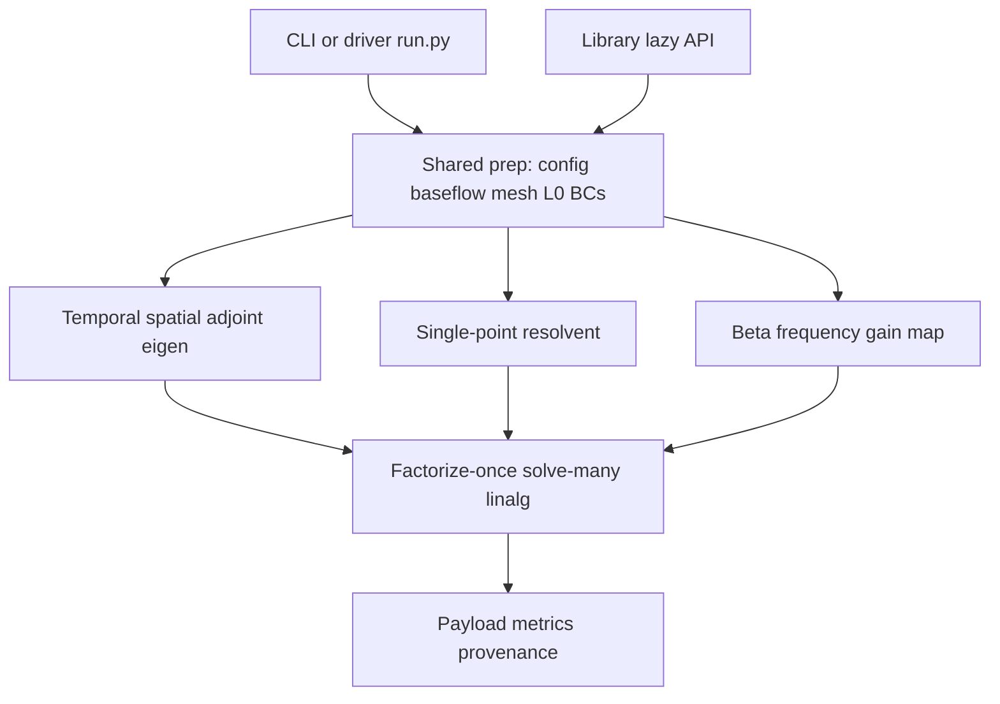

### 1.4 Key process nodes

| Node | Domain | Contract |
|---|---|---|
| Runtime init | Case Orchestration | PETSc/MPI, rank-0 logging, stage timers, heartbeats |
| Config merge/validate | Configuration | YAML + env + defaults → typed policy; schema gate |
| BaseFlow load/preprocess | Baseflow | npy/npz → mesh-aligned primitives + transport |
| Mesh + SBP | Mesh | Geometry, even-order SBP (2, 4, 6, 8), filters, masking, poles |
| Coefficients | LNSE Assembly | Cartesian/cylindrical LNSE coeffs from mean flow |
| L0 + BC recipes | LNSE Assembly | Sparse operator for `q = [ρ, u, v, w, T]`; free-DOF sets |
| Factorization | Linear Algebra | Default KSPPREONLY + PCLU + MUMPS; optional cuDSS/iterative |
| SLEPc EPS / gain | Stability / Resolvent | Shift-invert eigen or weighted normal operator |
| Router walk | Solver Routing | Anchors, PC reuse, residual gates, certification |
| Payload | Case Orchestration | Spectra/modes/gains, cost metrics, provenance NPZ |

### 1.5 Process coordination mechanisms

- **Single orchestration hub:** `driver/run.py` sequences stages; domains do not call each other ad hoc across the full case.
- **One operator family, many products:** temporal, adjoint, spatial, resolvent, and maps all consume BC-enforced LNSE operators (spatial reuses temporal prep helpers).
- **Factorize-once, solve-many:** shared performance spine for [shift-invert](solver-glossary.md) eigen and resolvent \(H\) actions.
- **Config as reproducibility gate:** invalid structure/FD orders fail before expensive factors.
- **MPI coordination:** distributed Mat/Vec via PETSc; rank-0 owns human-readable logs and many I/O decisions.
- **Router feedback loop:** measured factor time/memory/compression samples inform reuse, backend choice, and certification on map campaigns.

---

## 2. Main workflows

### 2.1 Baseflow ingest and operator prep (shared foundation)

**Why it matters:** Converts on-disk CFD mean flow into a mathematically consistent, BC-ready discrete LNSE operator. Every analysis product depends on this path.

**Entry:** driver preflight/setup stages; library callers that build systems via `build_lnse_system` / related assembly APIs.

#### Execution order and dependencies

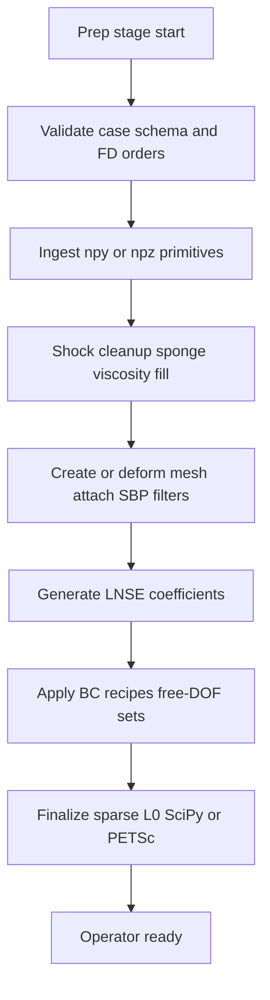

| Step | Operation | Inputs | Outputs | Code anchors |
|---|---|---|---|---|
| 1 | Schema validation | Merged case dict | Pass or `ConfigValidationError` | `config/schema.py` |
| 2 | Field I/O | npy dir or npz | Dict of 2-D float fields | `baseflow/grid_fields.py` |
| 3 | Preprocess/transport | Raw primitives | Cleaned BaseFlow + μ, sponge | `preprocess`, `sponge`, `viscosity` |
| 4 | Mesh/SBP | x, y, FD order, deformation | `Mesh` + operators + runtime state | `mesh/mesh.py`, `mesh/sbp.py` |
| 5 | Coefficients | BaseFlow + metrics | Physical LNSE coefficient blocks | `operators/coefficients.py` |
| 6 | BC recipes | YAML-style rules, mesh indices | Enforced rows/cols, free-DOF sets | `boundary_conditions/recipe.py`, `dirichlet.py` |
| 7 | Finalize L0 | Coeffs, FD mats, sponge, backend request | SciPy CSC or PETSc `Mat` L0 | `operators/assembly.py` |

**State transitions:** `raw files → validated config → BaseFlow (ny,nx) → MeshRuntimeState → coefficient tensors → sparse L0 (constrained) → free-DOF mask`.

**Notes for implementers:**

- BaseFlow fields are contractually **(ny, nx)** on the computational mesh.
- SBP covers even **orders 2, 4, 6, 8**, including Mohseni–Colonius pole treatments for axisymmetric grids.
- Boundary conditions are a separate package but **functionally part of operator assembly**.
- SciPy CSC is typical for local assembly; PETSc Mat is used for distributed solve paths (`utils/petsc_core.py` bridge).

---

### 2.2 Temporal eigenvalue stability analysis (primary product path)

**Why it matters:** [Hydrodynamic stability](https://grokipedia.com/page/Hydrodynamic_stability) spectra and [eigenvectors](https://grokipedia.com/page/Eigenvalues_and_eigenvectors) for transition and control studies; reference orchestration pattern for other modes.

**Entry:** `src/linstabpy/driver/run.py` or `temporal_eigenvalues` / stability APIs.

#### End-to-end flow

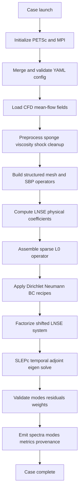

#### Key technical process details

1. **Runtime initialization**  
   - `init_petsc_from_argv()` then MPI/PETSc imports in the driver.  
   - Stage wall-clock and RSS deltas (`_stage_start` / `_log_stage`); optional heartbeats via `LINSTABPY_STAGE_HEARTBEAT_SECONDS` (default 30s).  
   - Config path from `LINSTABPY_CASE_CONFIG` (and legacy aliases) or `configs/parity_config.yaml`.

2. **Configuration resolution**  
   - Merge YAML, environment, defaults into typed objects (`config/typed.py`).  
   - Schema rejects unknown top-level structure and invalid FD orders while remaining lenient for legacy flat keys.

3. **Shared prep**  
   - Same baseflow → mesh → coefficients → L0 + BC path as §2.1.  
   - Driver uses `load_case_fields`, `Mesh`, `build_lnse_system_result`, BC analysis helpers.

4. **Shift-invert factorization**  
   - Factorization layer (`linalg/factorize.py`): **direct-by-default** factorize-once, solve-many.  
   - Default: **KSPPREONLY + PCLU + MUMPS**.  
   - Iterative policy is **explicit** (not silent fallback) for memory-bound cases.  
   - Optional cuDSS shelled as PETSc PC when GPU factors are selected.  
   - Interfaces: solve, transpose solve, block solve, refactorize, destroy.

5. **Eigenanalysis**  
   - [SLEPc](https://en.wikipedia.org/wiki/SLEPc) [EPS](solver-glossary.md) via `stability/_eigenvalues.py` and `solvers/eigenvalue.py`.  
   - Temporal and adjoint paths; residual reordering; safe PETSc info access.  
   - Acceptance helpers: target-distance postcheck, conjugate-pair completeness, stability acceptance (`stability/acceptance.py`).

6. **Result emission**  
   - `build_runtime_payload` packages eigenvalues, eigenvectors, metrics, provenance.  
   - Output NPZ path from env or `{prefix}_{config_md5}_{git_sha8}.npz`.

#### Input / output data flow

| Direction | Artifacts |
|---|---|
| **In** | YAML case; npy/npz mean flow (`ρ,u,v,w,T`, mesh, sponge); MPI ranks; factor backend policy |
| **Internal** | BaseFlow, Mesh/SBP, L0, free-DOF sets, factored shifted operators, EPS workspace |
| **Out** | Eigenvalues/eigenvectors, residual metrics, acceptance flags, cost/RSS stage logs, provenance (config hash, git SHA) |

#### Dependencies

```
Configuration → Baseflow → Mesh → Operator Assembly → Linear Algebra → Stability → Payload
```

Orchestration **service-calls** Stability and **module-depends** on Operator Assembly and Linear Algebra.

---

### 2.3 Resolvent gain analysis

**Why it matters:** Amplifier/receptivity analysis via optimal forcing and response at chosen frequencies.

**Mathematical core:**

\[
H = C\,(L_0 - i\omega I)^{-1}\,B
\]

Gains from the weighted eigenproblem on forms such as \(H^{H} W H\) (energy weights \(W\), often [Chu](core-concepts.md) norm), implemented as PETSc **[MatShell](solver-glossary.md)** + SLEPc.

#### Flow

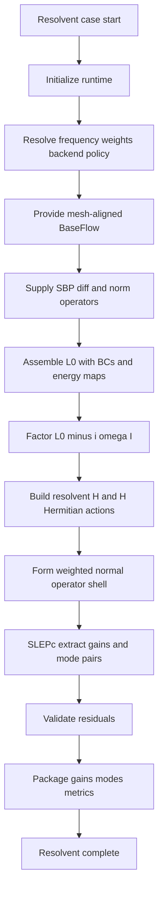

#### Key nodes

| Step | Detail | Code |
|---|---|---|
| Policy | ω, weights, backend, NCV-related sizing | `config/typed.py`, resolvent sections |
| L0 + energy | Same assembly spine; `compute_chu_norm` for compressible energy inner product | `operators/assembly.py`, `energy_norm.py` |
| Factor (L0 − iωI) | Reused across many H applies | `linalg/factorize.py` |
| H / Hᴴ | Input map B, output map C; PETSc-aware vectors | `resolvent/operator.py` |
| Weighted normal | `invW * Hᴴ * W * H(v)` MatShell | `resolvent/gain.py` |
| Analysis driver | Optimal pairs, gains, residual norms; MATLAB-aligned path | `resolvent/analysis.py` |

**I/O:** Inputs extend temporal prep with frequency list/weights and forcing/response maps; outputs are gains, forcing/[response mode](core-concepts.md) shapes, residual certificates, solver metrics.

---

### 2.4 Beta–frequency resolvent gain map (cost-critical campaign)

**Why it matters:** Production-scale parametric studies of leading resolvent gain over spanwise [wavenumber](https://grokipedia.com/page/Wavenumber) β and frequency ω, with **cost-aware** factorization reuse.

**Entry:** `src/linstabpy/solvers/router/resolvent_map.py` (public `resolvent_map`).

#### Campaign flow

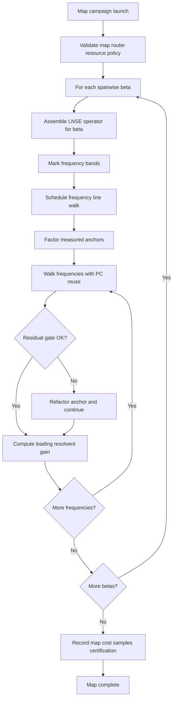

#### Routing mechanics (implementation-aligned)

1. **Per-β operator assembly**, one BC-enforced LNSE operator per spanwise wavenumber (β enters the linearized physics).
2. **Band marking**, labels such as NEAR_POLE, SMOOTH, STABLE (`band_marking.py`) guide walk strategy.
3. **Line walk (`map_walk.LineWalker`)**  
   - First frequencies on a line pay a **real factor** and measure cost.  
   - Later points apply \(K(\omega)^{-1}\) using that factor as a **right [preconditioner](https://grokipedia.com/page/Preconditioner)**.  
   - **Residual gate** forces a new factor when accuracy degrades; walks may abort or defer (`WalkDeferred`).
4. **Stable-regime sweeps (`stable_sweep.py`)**, anchor-preconditioned sweeps across nearby frequencies; records factor time, memory, compression for routing feedback.
5. **Backend policy**, `linalg/backends.py` normalizes/probes MUMPS/LU/cuDSS; RAM autoselect and break-even logic influence choices.
6. **Leading gain**, still from SLEPc/resolvent analysis at each scheduled point.
7. **Recording**, map arrays, cost keys (wall assemble/factor/solve, peak RSS/GPU, ranks, git SHA, etc.), certification metadata; atomic save patterns in `map_record`.

#### Dissipation coordination (map-specific operational rule)

Whether SBP sawtooth dissipation is needed depends on the **mesh**:

- On **rectilinear** tensor meshes, metric cross-terms vanish; dissipation can be a costly no-op on gain accuracy.
- On **curvilinear-in-both-directions** meshes, undamped operators can show spurious near-singular resonances.
- Router expects **both**: `numerics.operator_dissipation.enabled` (build Q_diss on mesh) **and** top-level `dissipation_epsilon` (strength subtracted in `build_lnse_system`). Enabling only one is a **silent no-op**.

#### Sequence: orchestration vs router vs linear algebra

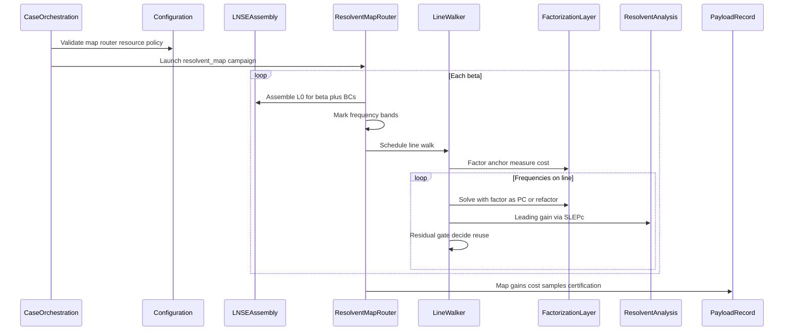

---

### 2.5 Spatial stability eigenproblem

**Why it matters:** Spatial growth/decay and streamwise wavenumber analysis via generalized eigenproblems.

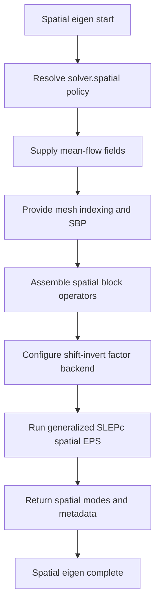

| Step | Behavior |
|---|---|
| Config | `solver.spatial` with **fallback to `solver.eigen`** when spatial YAML absent |
| Assembly | `operators/spatial.py` reuses temporal preparation/index helpers; SciPy and PETSc block-matrix paths |
| Solve | `solvers/spatial_eig.py`, generalized SLEPc EPS, direct shift-invert backend selection akin to temporal |
| Output | Spatial eigenvalues/modes and solver metadata |

---

### 2.6 Adjoint and structural sensitivity (supporting path)

Extends temporal eigenanalysis without a separate full case pipeline:

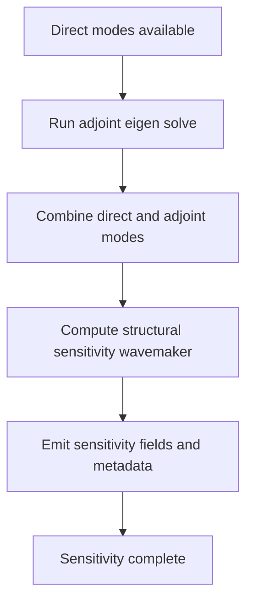

- Adjoint path: `adjoint_eigenvalues` (lazy export from `stability._eigenvalues`).
- [Structural sensitivity](core-concepts.md): `wavemaker` in `stability/sensitivity.py` combining direct/adjoint information for control and receptivity insight.
- Factorization supports transpose solves needed by adjoint-related linear actions.

---

### 2.7 Cross-workflow dependency summary

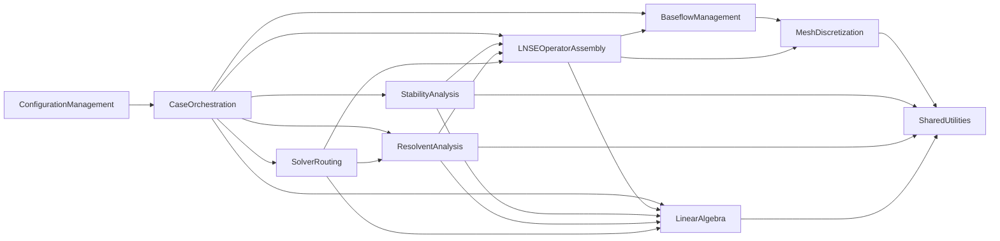

---

## 3. Flow coordination and control

### 3.1 Multi-module coordination mechanisms

| Mechanism | How it works |
|---|---|
| **Staged pipeline ownership** | Driver owns stage order, logging, heartbeats, and payload; domains expose pure-ish services |
| **Request/result objects** | Operator assembly uses structured requests (backend selection, sponge, finalization order) |
| **Typed config seam** | `config/typed.py` mirrors `utils._solver_cfg` so call sites migrate without behavior change |
| **Lazy public API** | Package `__init__` defers heavy imports; PETSc starts only on real solve paths (driver imports init early by design) |
| **BC recipe orchestration** | `BCRule` / `BCRecipe` sequence declarative rules and return combined index sets for free DOFs |
| **Router as campaign controller** | Map orchestration schedules β loops and frequency walks; LineWalker localizes reuse policy |
| **Backend registry** | Central probe/normalize of factor backends before factorization commits resources |

### 3.2 State management and synchronization

**Logical case state progression:**

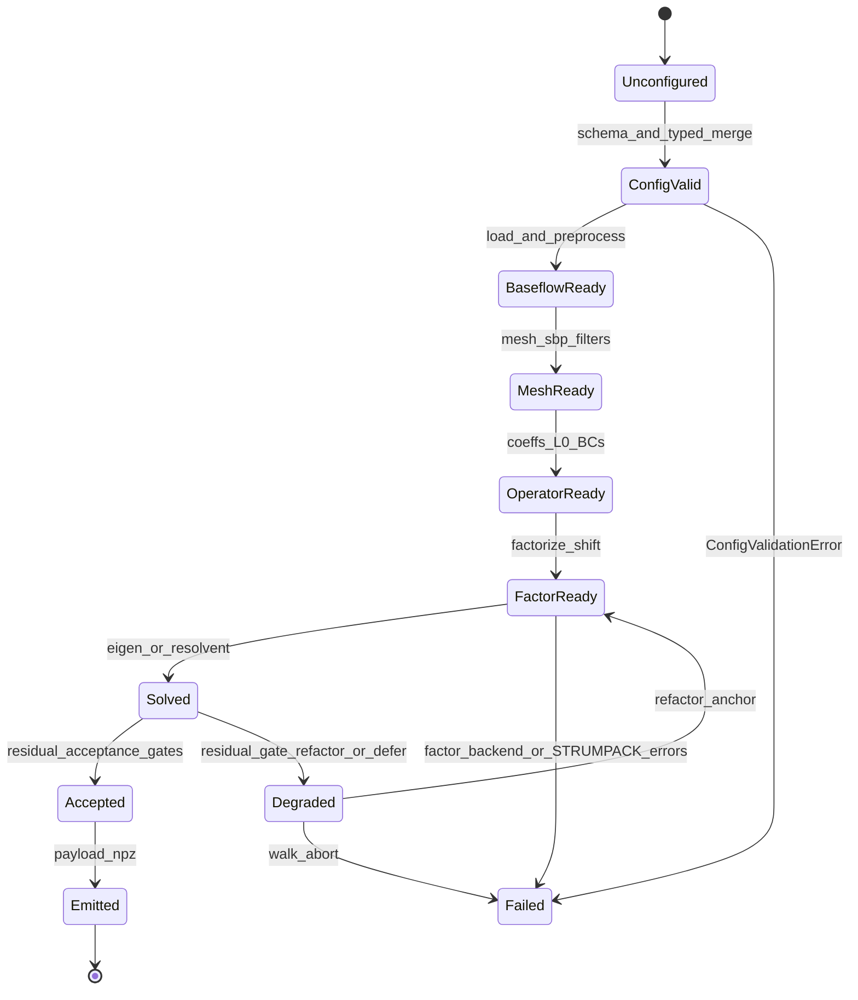

**MPI/runtime synchronization:**

- PETSc `COMM_WORLD` ranks share distributed matrices/vectors.
- Rank 0 performs prefixed progress logs; stage complete lines are machine-parseable (`stage=... elapsed=... rss_peak_delta_bytes=...`).
- Heartbeat thread/interval keeps long factors/EPS visible to operators without changing numerical state.
- Factor objects encapsulate lifecycle: create → solve* N → refactorize (same nonzero pattern) → destroy.

**Immutable/read-only defaults:** driver uses shared empty read-only NumPy arrays as hot-path defaults to avoid accidental mutation and allocation churn.

### 3.3 Data passing and sharing

| Data | Producer | Consumers | Form |
|---|---|---|---|
| Typed/merged config | config + yaml_io | all stages | dict / dataclasses |
| BaseFlow | grid_fields + preprocess | coefficients, assembly, energy norm | dataclass, (ny,nx) arrays |
| Mesh geometry/operators/runtime | mesh.py, sbp.py | assembly, BCs, filters | Mesh + view slices |
| L0 | assembly.py | eigen, resolvent, router | SciPy CSC or PETSc Mat |
| Free-DOF / BC index sets | BC recipe/dirichlet | reduced solves, validation | index arrays/masks |
| Factorization handle | factorize.py | EPS shift-invert, H applies, walks | Factorization object |
| Gains/modes/spectra | stability/resolvent | payload, map_record | NumPy + metadata dicts |
| Cost samples | cost_metrics, router | certification, ops tuning | structured cost keys |
| Provenance | provenance helpers | output naming, reproducibility | config MD5, git SHA, env |

**Bridge policy:** SciPy ↔ PETSc conversion lives in `utils/petsc_core.py` to avoid circular imports between mesh and solver layers; complex-mode and distribution policy are encoded there.

### 3.4 Execution control and scheduling

1. **Case-level scheduling**, driver selects eigen vs resolvent vs map stages from config; preflight advisories (config/baseflow/result) surface before/after heavy work.
2. **Eigen control**, shift-invert targets, backend from `solver.eigen` / env overrides; iterative eigen solver types listed explicitly in cfg helpers.
3. **Map scheduling**,  
   - Outer loop: β  
   - Inner: frequency line walk with anchor placement  
   - Residual gate: continue / refactor / defer / abort  
   - Optional stable sweep engine for smooth bands  
4. **Resource control**, RAM autoselect, MUMPS ordering/BLR/precision options, optional GPU cuDSS path; cost break-even influences when reuse beats refactor.
5. **Concurrency model**, MPI process parallelism for distributed linear algebra; per-line anchor walks stay **sequential** to preserve factor reuse. Parallelism across β lines is an optimization opportunity when memory allows.
6. **Output control**, env overrides for config path, output NPZ, log prefix; atomic map writes reduce partial-result corruption.

---

## 4. Exception handling and recovery

### 4.1 Error detection and handling

| Class | Detection | Typical response |
|---|---|---|
| **Config / schema** | Unknown keys, bad FD orders, invalid merged structure | Fail fast: `ConfigValidationError` before mesh/factor |
| **Baseflow I/O** | Missing/invalid field names, non-2D floats | Raise at load; preflight baseflow advisories |
| **BC recipe** | Invalid symbols, inconsistent borders/variables | Validation in recipe analyze/apply |
| **Backend availability** | Requested MUMPS/LU/cuDSS not present | Probe in `backends.py`; error before factor commit |
| **Factorization** | PETSc/MUMPS/STRUMPACK failures | Dedicated errors (e.g. STRUMPACK factorization failure path in eigen services); destroy partial state |
| **Refactorize contract** | Nonzero pattern change | `NotImplementedError`/PETSc error if CSR pattern cannot be verified |
| **Eigen/resolvent quality** | Residual norms, target distance, conjugate-pair gaps | Acceptance helpers; reorder/filter modes; advisories |
| **Map walk quality** | Residual gate fail | Refactor anchor; defer walk; mark reason codes (OK/PENDING/FAILED) |
| **Env parse** | Bad heartbeat seconds etc. | `ValueError` with clear message |

### 4.2 Exception recovery mechanisms

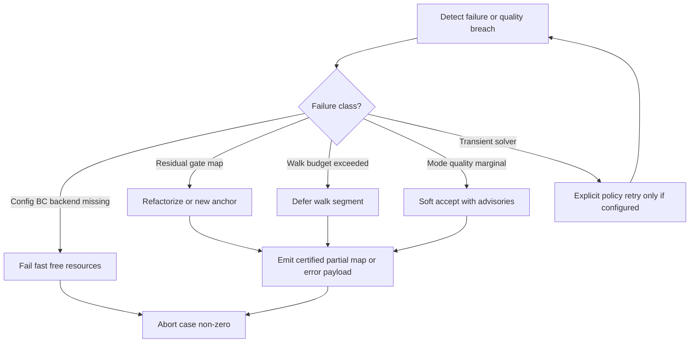

**Recovery principles:**

- **Prefer fail-fast on reproducibility gates** (config, missing backends) over running expensive wrong physics.
- **Prefer refactor over silent inaccurate gains** on map residual gates.
- **Iterative linear solvers are not an automatic downgrade** from direct factors; they require explicit solver policy (avoids hidden accuracy changes).
- **Adjoint self-test / heal paths** exist in the factorization layer for iterative [KSP](solver-glossary.md) edge cases (bounded iterations), keeping adjoint consistency checks local to the LA layer.
- **Resource cleanup:** factorization `destroy`, PETSc object lifecycle, and stage-scoped timing even on failure paths where implemented.

### 4.3 Fault tolerance strategy design

| Layer | Strategy |
|---|---|
| **Input** | Lenient-but-structured schema; preflight advisories without skipping hard validation |
| **Numeric** | SBP dissipation policy mesh-aware; free-DOF reduction; residual validation on modes/gains |
| **Linear algebra** | Direct default for reference accuracy; BLR/ordering knobs; optional GPU path; pattern-checked refactorize |
| **Campaign** | Per-frequency reason codes; atomic savez; cost samples for post-mortem; certification metadata |
| **Operations** | Heartbeats + stage RSS deltas for HPC job monitoring; rank-0 log prefix for aggregation |
| **Reproducibility** | Config hash in outputs; git SHA provenance; env-isolated output paths for concurrent timing runs |

### 4.4 Failure retry and degradation

- **Retry:** Not a generic infinite retry loop. Map walks **locally** recover via refactor when residual gates fail. Explicit iterative policies may allow bounded KSP iterations.
- **Degradation ladder (conceptual):**  
  1. Direct factor reuse (best cost/accuracy when residual OK)  
  2. Refactor at new anchor (restore accuracy, pay cost)  
  3. Stable-sweep / band-specific strategy  
  4. Backend change under RAM policy (e.g. memory-bound iterative, **opt-in**)  
  5. Defer/abort frequency or β line with recorded reason  
- **Partial success:** [Gain maps](core-concepts.md) can record completed (β, ω) cells with FAILED/PENDING markers rather than discarding the entire campaign when a single line breaks.
- **Operator guidance:** On [STRUMPACK](https://portal.nersc.gov/project/sparse/strumpack/)/MUMPS failure, verify backend build, matrix [conditioning](https://en.wikipedia.org/wiki/Condition_number)/BC setup, and memory; do not "retry harder" without config change.

---

## 5. Key process implementation

### 5.1 Core algorithm processes

#### 5.1.1 LNSE temporal operator assembly

**Intent:** Build large sparse \(L_0\) acting on \(q = [\rho, u, v, w, T]\) (size scale `5 * ngp`).

**Pipeline characteristics (from assembly service):**

1. Prepare coefficients from BaseFlow (Cartesian vs cylindrical; axis conventions vs MATLAB port).
2. Attach FD/SBP differentiation and metrics.
3. Apply sponge and optional operator dissipation (\(L_0 \leftarrow L_0 - \varepsilon Q_{\mathrm{diss}}\) when enabled).
4. Enforce BC recipes ([Dirichlet](https://grokipedia.com/page/Dirichlet_boundary_condition) zero rows/cols + pin; [Neumann](https://grokipedia.com/page/Neumann_boundary_condition) as applicable).
5. Finalize backend: SciPy CSC and/or PETSc Mat with **fixed transformation order**.

**Business rule:** Physics linearization is entirely driven by mesh-aligned mean flow; wrong preprocess (shock/sponge/viscosity) propagates directly into spectra and gains.

#### 5.1.2 Shift-invert eigenvalue process

**Intent:** Extract eigenvalues of LNSE near targets via SLEPc EPS.

**Technical spine:**

1. Form shifted operators as required by EPS SI strategy.
2. Factorize with selected backend (`resolve_factor_backend`, MUMPS options).
3. EPS iterations call repeated solves against the factor.
4. Post-process: residual norms, reordering, conjugate-pair checks, acceptance vs target.

**Performance:** Factorization dominates; subsequent matvecs/solves amortize cost, same pattern as resolvent.

#### 5.1.3 Resolvent gain process

**Intent:** Leading optimal gain and structures of \(H\).

1. Factor \((L_0 - i\omega I)\).
2. Matvecs of \(H\) and \(H^{H}\) via B, solves, C (`ResolventOperator`).
3. Build `WeightedNormalOperator` shell for \(W\)-inner-product gain problem.
4. SLEPc on shell; validate residuals; return forcing/response pairs.

**Coordination constraint:** SLEPc/MPI init ordering must be respected (shared with eigen path); package import stays light via type-only PETSc imports in places.

#### 5.1.4 Anchor-preconditioned frequency walk

**Intent:** Minimize factor count across dense ω grids.

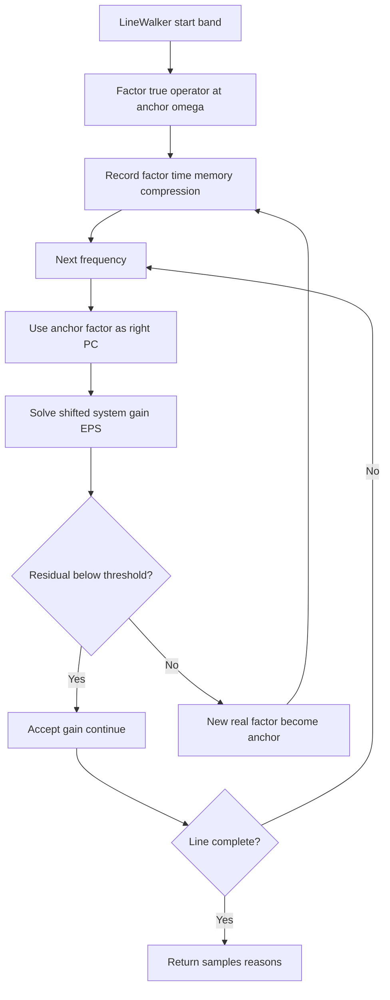

### 5.2 Data processing pipelines

#### Mean-flow to operator pipeline

```
CFD npy/npz
  → field validation (names, shapes)
  → BaseFlow dataclass
  → shock cleanup / sponge / Sutherland (or configured) viscosity
  → Mesh geometry (+ deformation, masking, poles)
  → SBP D, norms, filters, optional Q_diss
  → physical coefficient blocks
  → sparse assembly + sponge + dissipation
  → BC enforcement + free-DOF sets
  → SciPy and/or PETSc L0
```

#### Result and metrics pipeline

```
Solver raw outputs
  → residual/acceptance filters
  → payload builder / map_record
  → cost_metrics (wall stages, RSS, GPU mem, ranks)
  → provenance (config hash, git SHA, PETSc options tags)
  → NPZ / atomic savez emission
```

Driver stage logging provides an ops-facing timeline parallel to scientific outputs.

### 5.3 Business rule execution

| Rule | Enforcement point |
|---|---|
| Reproducible cases are YAML-driven | config merge + schema before heavy stages |
| State ordering is ρ,u,v,w,T | assembly and public API docs |
| Direct sparse solve is default accuracy path | factorize policy; tests/examples |
| Iterative LA only when explicitly chosen | solver-type allowlists |
| Map dissipation needs dual enable | router docs + assembly strength read from top-level `dissipation_epsilon` |
| Spatial config may inherit eigen policy | spatial_eig fallback |
| Library import must stay side-effect light | lazy `_LAZY_EXPORTS` in package `__init__` |
| Rank-0 logging only for human progress | `_log` guards |
| Gains/modes require residual accountability | analysis validation + acceptance modules |

### 5.4 Technical implementation details

#### Runtime driver (`driver/run.py`)

- Initializes PETSc from argv at import of the driver module (case path intentionally heavy).
- Resolves config/output paths via environment with documented fallbacks.
- Stages work with perf counters and peak RSS deltas for HPC observability.
- Wires: `load_case_fields`, `Mesh`, `build_lnse_system_result`, BC analysis, `temporal_eigenvalues` / `_solve_near_target`, `resolvent_analysis`, router helpers, `build_runtime_payload`.
- Stability acceptance and conjugate-pair checks gate scientific quality before trusting payloads.

#### Factorization layer (`linalg/factorize.py`)

- Factorize-once, solve-many for SI LNSE workflows.
- Default **KSPPREONLY + PCLU + MUMPS**.
- Supports solve, transpose solve, block solve, refactorize, destroy.
- Optional cuDSS factor path as PC shell.
- Lazy PETSc accessor pattern so non-driver imports need not initialize PETSc until use.

#### Router (`solvers/router`)

- `resolvent_map`: turnkey β/frequency orchestration; largest hub in package.
- `map_walk`: measured anchors + residual gate.
- `stable_sweep`: anchor-preconditioned stable-regime engine.
- Supporting: anchors, recycling, break_even, ram_autoselect, certification, band_marking, map_record.

#### Mesh/SBP (`mesh`)

- `Mesh` with geometry / operators / runtime-state views for explicit consumer contracts.
- `sbp.py`: Strand / Mattsson–Nordström style operators; pole matrices for axisymmetric grids.

#### External runtime contract

| External system | Role in workflows |
|---|---|
| PETSc | Distributed Mat/Vec, KSP/PC |
| SLEPc | EPS for eigen and gain problems |
| MUMPS | Default sparse direct factor |
| MPI | Process parallelism |
| cuDSS | Optional GPU direct factor |
| NumPy/SciPy | I/O, CSC/CSR assembly, local kernels |
| YAML + npy/npz | Sole primary I/O surface for cases and baseflow |

### 5.5 Performance optimization processes

| Strategy | Where applied | Effect |
|---|---|---|
| Factorize-once solve-many | Eigen SI, resolvent H, map PC reuse | Amortizes dominant cost |
| Anchor + residual gate | Frequency lines | Fewer full LU factors at controlled accuracy |
| Stable sweeps | Smooth/stable bands | Cheap ω coverage with preconditioners |
| Backend/RAM autoselect | Large cases | Avoids OOM; chooses MUMPS/BLR/cuDSS/iterative policy |
| SciPy assemble → PETSc solve | Operator path | Fast local build, scalable solve |
| Lazy imports | Library users | Fast startup; PETSc only when needed |
| Stage RSS/wall metrics | Driver + router | Data-driven anchor and backend tuning |
| Optional dissipation off on rectilinear meshes | Map prep | Avoids nnz/time penalty with negligible gain change |
| MPI distribution | Global Mat/Vec | Memory scale-out for large ngp |

**Optimization opportunities (architecture-aligned):**

1. Deeper reuse of one prepared L0 across mixed temporal + resolvent stages in a single case.  
2. Residual-gate thresholds tuned per backend accuracy profile (MUMPS BLR vs cuDSS).  
3. Parallel β lines when memory permits; keep per-line walks sequential for factor reuse.  
4. Richer structural-sensitivity packaging on the standard payload path.  
5. Feed multi-node cost samples more aggressively into anchor placement.

### 5.6 Operability guidance

**Development**

- Extend physics in coefficients/assembly; keep BC recipes declarative.  
- New analysis products should consume finalized L0 + factorization APIs rather than bypassing them.  
- Preserve lazy export surface in `__init__.py` for embedders.

**Operations / HPC**

- Monitor `[prefix] stage complete: ...` and heartbeats for stuck factors.  
- On map jobs, track `cost_wall_factor_s` vs `cost_wall_solve_s` and residual-driven refactor rate.  
- Set `LINSTABPY_CASE_CONFIG` and dedicated `LINSTABPY_CASE_OUTPUT_NPZ` per concurrent run.  
- Verify dissipation flags in pairs on curvilinear meshes; confirm undamped intent on rectilinear.

**Troubleshooting quick map**

| Symptom | Likely stage | First checks |
|---|---|---|
| Immediate abort | Config/schema | YAML keys, FD orders |
| Bad spectra/gains | Baseflow/BC/assembly | Field alignment, BC recipe, sponge |
| Factor crash / OOM | Linear algebra | Backend probe, ranks, BLR, iterative opt-in |
| Noisy map ridges | Router/mesh dissipation | metric cross-coupling, epsilon dual enable |
| Slow dense ω grid | Map walk | Anchor spacing, residual threshold, stable sweep |

---

## Document summary

LinStabPy core workflows form a **single staged LNSE pipeline** with multiple scientific products. **Baseflow ingest and operator prep** produce a BC-enforced \(L_0\); **temporal/spatial/adjoint eigenanalysis** and **resolvent analysis** share that operator and a **factorize-once** PETSc/MUMPS spine; **β–ω gain maps** add cost-aware routing with anchors, preconditioner reuse, and residual gates. Coordination is hub-and-spoke through the case driver and router, with configuration as the reproducibility gate and residual/acceptance checks as the scientific quality gate. Exception handling favors fail-fast validation, explicit accuracy policies, and campaign-local refactor/defer rather than silent degradation, supporting reliable MPI-scale stability and resolvent studies for research and aerospace engineering users.